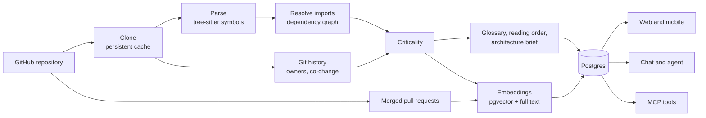

<div align="center">

# Illume

**Codebase onboarding from the code itself**

Illume reads a GitHub repository and turns it into an onboarding kit. You get an interactive 3D dependency graph, ownership and risk scores, a glossary, a reading order, an architecture brief, and a chat that answers questions from the code with citations. AI coding tools get the same abilities over MCP.

[](LICENSE)
[](https://www.python.org)
[](https://nextjs.org)
[](https://fastapi.tiangolo.com)
[](https://docs.celeryq.dev)

[](https://github.com/tejasnasa/illume/actions/workflows/ci.yml)
[](docs/testing/overview.md)
[](docs/testing/overview.md)

[Live site](https://illume.tejasnasa.me) · [Documentation](docs/README.md) · [Architecture](docs/architecture.md) · [Quick start](#quick-start) · [Evaluation results](docs/evals/results-full-v1.md)

</div>

---

## Why

A new engineer on an unfamiliar codebase has to work out which files matter, what depends on what, who knows each part, and where to start reading. Wikis go stale and senior engineers become the index. Illume treats the repository as the source of truth. It parses the code, mines the history and builds the answers from them. Every artefact names the commit it describes.

## What you get

| Feature                 | What it is                                                                                                                                                                                                      | Read more                                                                                                                        |
| ----------------------- | --------------------------------------------------------------------------------------------------------------------------------------------------------------------------------------------------------------- | -------------------------------------------------------------------------------------------------------------------------------- |
| **3D dependency graph** | every file (or every function and class) as a node, sized by lines of code, coloured by risk, with search and a guided reading-order tour                                                                       | [the dependency graph](docs/graph/dependency-graph.md), [rendering](docs/graph/rendering.md)                                     |
| **Reading order**       | files sorted so a file's dependencies come before it, in tiers, each with a note on why it is worth reading                                                                                                     | [generation](docs/pipeline/generation.md)                                                                                        |
| **Architecture brief**  | a short, model-written narrative of how the repository fits together, with its critical files                                                                                                                   | [generation](docs/pipeline/generation.md)                                                                                        |
| **Glossary**            | the project's own vocabulary: its most-used classes and functions, defined in plain words                                                                                                                       | [generation](docs/pipeline/generation.md)                                                                                        |
| **Ownership and risk**  | who wrote what, knowledge silos (files only one person has touched), files that change together, and a `critical` / `caution` / `safe` label per file                                                           | [git intelligence](docs/pipeline/git-intelligence.md)                                                                            |
| **Chat with citations** | questions answered from the code, every claim tied to a file, symbol, commit or pull request at the ingested commit                                                                                             | [chat](docs/retrieval/chat.md)                                                                                                   |
| **Retrieval presets**   | from one vector search (`classic`) to hybrid and structural search with rerankers, to a tool-using agent and a planner with parallel workers, plus `auto`, which picks one per question                         | [retrieval arms](docs/retrieval/retrieval-arms.md), [the agent](docs/retrieval/agent.md), [the router](docs/retrieval/router.md) |
| **MCP server**          | Claude Code, Cursor and other MCP clients can search, read and walk the graph of your repositories, or ask for a finished answer                                                                                | [the MCP server](docs/mcp/server.md)                                                                                             |
| **Auto-update**         | each repository can keep itself current in the background, rebuilding only what changed while the pages stay usable                                                                                             | [auto-update](docs/pipeline/sync.md)                                                                                             |
| **Bring your own key**  | add an OpenAI, Groq, OpenRouter or DeepSeek key for generation and chat; keys and GitHub tokens are encrypted at rest with AES-256-GCM. Without a key, a free tier gives three ingestions and ten chat messages | [BYOK and encryption](docs/security/byok-and-encryption.md)                                                                      |
| **`.illume` export**    | a compact plain-text summary of a repository, sized to paste into a model's context                                                                                                                             | [the export](docs/interfaces/illume-export.md)                                                                                   |
| **Mobile app**          | an Expo app for Android with its own on-device 3D graph renderer                                                                                                                                                | [the mobile app](docs/mobile/overview.md)                                                                                        |
| **Evaluation harness**  | an offline harness that measures the presets on questions mined from real pull requests, with pre-registered comparisons                                                                                        | [the harness](docs/evals/harness.md)                                                                                             |

Parsing uses tree-sitter for Python (including notebooks), JavaScript, JSX, TypeScript, TSX, Go, Rust, Java, C, C++, Ruby, C#, PHP, Swift and Kotlin (`EXTENSION_TO_LANGUAGE` in [`parser.py`](server/app/services/parser.py)).

## How it works



One Celery task runs the whole ingest. The deterministic half (parsing, the graph, history, scores) needs no model. The model-backed half runs on the repository owner's key, or on the free tier, and embeddings always use the operator's OpenAI key. Progress streams to the browser over a WebSocket. Some stages run on threads at the same time; each one receives only plain values and opens its own database session. [Architecture](docs/architecture.md) covers the whole system and the decisions behind it.

## Measured, not assumed

The first full evaluation ran ten answering configurations on 180 questions across three repositories: 105 "which files change for this pull request?" questions and 75 "how does this work?" questions. File recall is the share of the files a correct answer must name that the answer named.

| Configuration   | File recall | Correctness | Cost per answer | Seconds |
| --------------- | ----------- | ----------- | --------------- | ------- |
| `agent`         | **0.75**    | **0.62**    | $0.0114         | 49.8    |
| `hybrid_rerank` | 0.64        | 0.51        | $0.0035         | 13.6    |
| `auto`          | 0.60        | 0.47        | $0.0030         | 14.6    |
| `classic`       | 0.56        | 0.44        | $0.0015         | 10.9    |

A second judge from another model family re-graded a 30-answer sample and agreed strongly on correctness (kappa 0.87); faithfulness levels depend on the judge. The scope is three repositories and one generator model. [Results: full_v1](docs/evals/results-full-v1.md) has every configuration, the hypotheses, the statistics and the caveats.

## Tech stack

| Layer             | Technology                                                                                                                                                      |
| ----------------- | --------------------------------------------------------------------------------------------------------------------------------------------------------------- |
| Backend           | FastAPI and Celery on Python 3.14, managed with uv                                                                                                              |
| Data              | PostgreSQL with pgvector (HNSW), full-text search and `pg_trgm`; SQLAlchemy 2; Alembic                                                                          |
| Queue and streams | Redis: Celery broker, ingest progress pub/sub, agent run slots, rate limits                                                                                     |
| Parsing           | tree-sitter                                                                                                                                                     |
| Models            | OpenAI Responses API shape for generation (OpenAI, Groq, OpenRouter, DeepSeek); `text-embedding-3-small` for embeddings; OpenRouter for rerankers and decisions |
| Agent             | LangGraph                                                                                                                                                       |
| AI tool access    | Model Context Protocol, streamable HTTP, plus a stdio launcher in [`mcp-local/`](mcp-local/)                                                                    |
| Web client        | Next.js 16 App Router, React 19, Tailwind 4, `react-force-graph-3d`                                                                                             |
| Mobile            | Expo / React Native, three.js on `expo-gl`                                                                                                                      |
| Tests             | pytest against real Postgres and Redis, Vitest, Playwright, Jest                                                                                                |
| Deploy            | GitHub Actions to a DigitalOcean droplet: three containers from one image                                                                                       |

## Quick start

You need Python 3.14 with [uv](https://github.com/astral-sh/uv), Node.js and npm, Docker, git, GNU make with bash (Git Bash on Windows), and an OpenAI key.

```bash
make install       # uv sync + npm install
make dev-infra     # Postgres with pgvector on 5432, Redis on 6379
make env           # server/.env and client/.env from the examples; then fill them in
make migrate       # check SYNC_DATABASE_URL first: this migrates whatever it names
```

Then run each process in its own terminal:

```bash
make api           # FastAPI on :8000
make worker        # Celery worker (ingests and syncs)
make beat          # Celery beat (auto-update scheduler)
make web           # Next.js on :3000
```

Open `http://localhost:3000`, sign up from `/login`, and add a public GitHub repository. [Local setup](docs/getting-started/local-setup.md) lists every environment value and the common problems. [Your first ingest](docs/getting-started/first-ingest.md) explains what happens next. `make help` lists every command.

### Connect an AI tool

Create a token under Settings, then add the server to your MCP client:

```json
{
  "mcpServers": {
    "illume": {
      "type": "http",
      "url": "https://<api-host>/mcp",
      "headers": { "Authorization": "Bearer ilm_..." }
    }
  }
}
```

For a client that can only start a local command, use the stdio launcher in [`mcp-local/`](mcp-local/README.md).

## Tests

| Suite        | Where                                       | Runner     | Run with                |
| ------------ | ------------------------------------------- | ---------- | ----------------------- |
| Backend      | `server/tests/`                             | pytest     | `make test-be`          |
| Frontend     | `client/tests/`, `client/src/**/__tests__/` | Vitest     | `make test-fe`          |
| End-to-end   | `client/e2e/`                               | Playwright | `make test-e2e`         |
| Prod smoke   | `client/e2e-prod/`                          | Playwright | `make test-e2e-prod`    |
| Mobile       | `mobile/__tests__/`                         | Jest       | `npm test` in `mobile/` |
| Eval harness | `server/tests/evals/`                       | pytest     | `make eval-ci`          |

The backend and end-to-end suites need the test stack (`make test-infra`, Postgres on 5433 and Redis on 6380). The database is never mocked; only OpenAI and GitHub are faked. CI runs lint, the backend and frontend suites with coverage floors that only move up, and the eval harness tests on every push. Playwright runs nightly and on `main`, and a smoke suite checks the live site every night. [Testing overview](docs/testing/overview.md) covers the suites, the counts and how to write a test.

## Documentation

The [documentation](docs/README.md) is also published on the site at `/docs`. Good places to start:

- [Architecture](docs/architecture.md): the system on one page.
- [The ingestion pipeline](docs/pipeline/ingestion.md) and [concurrency and failure](docs/pipeline/concurrency-and-failure.md): the hardest part of the backend.
- [Retrieval arms](docs/retrieval/retrieval-arms.md) and [the agent](docs/retrieval/agent.md): how chat finds code.
- [API reference](docs/api.md): every route.
- [Guides](docs/README.md#guides): adding a stage, a channel, an endpoint, a tool or a migration.

## Known limitations

- **Imports only.** The dependency graph records imports, not calls, so "who calls this function?" is answered by search, not by the graph.
- **Snapshots lag.** Pages and answers describe the ingested commit until the next sync. Chat marks answers whose snapshot has moved.
- **One machine.** The API, worker and scheduler share one droplet, and the worker runs one ingest at a time.
- **Security gaps.** Public paths are matched by prefix, the ingest WebSocket accepts its token in a query string, and login and register have no rate limit. All three are listed in [authentication](docs/security/auth.md#known-security-issues).
- **Judge checked by a model, not a person.** Correctness agrees across two judge families; faithfulness is only comparable between arms.

## Security

If you discover a security vulnerability within Illume, please send an e-mail to tejasnasa1908@gmail.com. All security vulnerabilities will be promptly addressed.

## License

Distributed under the MIT License. See [`LICENSE`](LICENSE).

---

<div align="center">

**Built by [Tejas Nasa](https://github.com/tejasnasa)**

</div>
