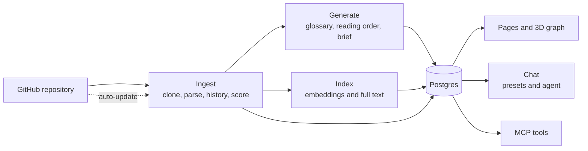

# Illume documentation

Illume is a codebase-onboarding tool. It clones a GitHub repository, parses it with tree-sitter, builds a file and symbol dependency graph, mines git history for ownership and risk, and uses language models to write a glossary, a reading order and an architecture brief. A chat answers questions from the code with citations, and an MCP server gives AI coding tools the same abilities. This is the documentation for everything in the repository: how each part works, why it is built that way, how to run and change it, and what it does not do.

## How to read these documents

The pages follow the [Diátaxis](https://diataxis.fr/) split: **tutorials** get you started, **how-to guides** walk through one change, **reference** pages list every route, table, variable and constant, and **explanation** pages say how a subsystem works and why. Every page opens with a short summary and a list of the terms it uses. Every page closes with its design trade-offs and limits, then links to related pages.

Pick a path by what you came for:

| You are                             | Read, in order                                                                                                                                                                                                                                                    |
| ----------------------------------- | ----------------------------------------------------------------------------------------------------------------------------------------------------------------------------------------------------------------------------------------------------------------- |
| new to the project                  | [Architecture](architecture.md), [repository layout](getting-started/repository-layout.md), [local setup](getting-started/local-setup.md), [your first ingest](getting-started/first-ingest.md)                                                                   |
| evaluating the engineering          | [Architecture](architecture.md), [ingestion](pipeline/ingestion.md), [concurrency and failure](pipeline/concurrency-and-failure.md), [retrieval arms](retrieval/retrieval-arms.md), [the agent](retrieval/agent.md), [results: full_v1](evals/results-full-v1.md) |
| changing the ingest                 | [Ingestion](pipeline/ingestion.md), [concurrency and failure](pipeline/concurrency-and-failure.md), [add a pipeline stage](guides/add-a-pipeline-stage.md), [auto-update](pipeline/sync.md)                                                                       |
| changing chat or retrieval          | [The index](retrieval/index-and-embeddings.md), [retrieval arms](retrieval/retrieval-arms.md), [chat](retrieval/chat.md), [add a retrieval channel or arm](guides/add-a-retrieval-arm.md), [the eval harness](evals/harness.md)                                   |
| connecting an AI tool               | [The MCP server](mcp/server.md), [authentication](security/auth.md#mcp-tokens)                                                                                                                                                                                    |
| working on the web or mobile client | [The web client](frontend/overview.md), [rendering the graph](graph/rendering.md), [the mobile app](mobile/overview.md)                                                                                                                                           |
| operating production                | [Deployment](operations/deployment.md), [CI and CD](operations/ci-cd.md), [runbook](operations/runbook.md), [environment variables](reference/environment.md)                                                                                                     |
| writing tests                       | [Testing overview](testing/overview.md), [backend tests](testing/backend.md), [frontend and end-to-end tests](testing/frontend-and-e2e.md)                                                                                                                        |

## The documents

### Start here

- [Architecture](architecture.md): the whole system on one page, and the decisions behind it.
- [Local setup](getting-started/local-setup.md): from a fresh clone to a running stack.
- [Your first ingest](getting-started/first-ingest.md): what happens when you add a repository, and what you get.
- [Repository layout](getting-started/repository-layout.md): where everything lives.

### The pipeline

- [The ingestion pipeline](pipeline/ingestion.md): every stage, the statuses, the orderings that matter.
- [Parsing and dependency resolution](pipeline/parsing-and-dependencies.md): tree-sitter, imports, barrels and fan-in.
- [Git intelligence and criticality](pipeline/git-intelligence.md): ownership, co-change, pull requests and risk scoring.
- [LLM generation](pipeline/generation.md): the glossary, the reading order and the architecture brief.
- [Ingestion concurrency and failure handling](pipeline/concurrency-and-failure.md): threads, sessions, the stage timer, and what happens on an exception.
- [The clone cache](pipeline/clone-cache.md): persistent clones, eviction and fallbacks.
- [Auto-update sync](pipeline/sync.md): sweeps, leases, watermarks and incremental rebuilds.

### Search and chat

- [The index and embeddings](retrieval/index-and-embeddings.md): what is indexed, as what text, and what is left out.
- [Retrieval arms](retrieval/retrieval-arms.md): query transforms, seven channels, fusion, rerankers, diversity and the presets.
- [Chat and citations](retrieval/chat.md): the two chat endpoints, citations, conversations, stale answers and the free tier.
- [The agent](retrieval/agent.md): the tool-using agent, its budgets, planner mode, events and persistence.
- [The auto router](retrieval/router.md): how `auto` picks a preset per question.

### The graph

- [The dependency graph](graph/dependency-graph.md): how edges are stored and how both graph payloads are built.
- [Rendering the graph](graph/rendering.md): the 3D graph page and the pixel-art graphs elsewhere.

### Interfaces

- [API reference](api.md): every HTTP route, the WebSocket and the MCP endpoint.
- [The ingest progress WebSocket](interfaces/websockets.md): every frame and the client's progress board.
- [The `.illume` export](interfaces/illume-export.md): the plain-text export, section by section.
- [The MCP server](mcp/server.md): transport, tokens, tools, resources, prompts and rate limits.

### Clients

- [The web client](frontend/overview.md): routes, authentication, data fetching and components.
- [The docs site](frontend/docs-site.md): how these files become `/docs`, and how to write a page.
- [The mobile app](mobile/overview.md): the Expo app, its session, networking and screens.
- [The mobile graph renderer](mobile/graph-renderer.md): three.js on `expo-gl`, layout and gestures.

### Security

- [Authentication and authorization](security/auth.md): JWTs, cookies, bearer tokens, OAuth, MCP tokens and the known issues.
- [Bring your own key, the free tier and encryption at rest](security/byok-and-encryption.md): who pays for each call and how keys are stored.

### Evaluation

- [The eval harness](evals/harness.md): the corpus, mined questions, gold sets, arms, budgets and manifests.
- [Judging and statistics](evals/judging-and-statistics.md): the judged metrics, the batch judge and the statistical methods.
- [Results: full_v1](evals/results-full-v1.md): what the first full run measured, with its caveats.

### Testing and operations

- [Testing overview](testing/overview.md): the suites, which one a change belongs in, and coverage.
- [Backend tests](testing/backend.md): fixtures, fakes, the security suite and migration tests.
- [Frontend and end-to-end tests](testing/frontend-and-e2e.md): Vitest, Playwright and the production smoke suite.
- [CI and CD](operations/ci-cd.md): the workflows, the coverage ratchet and the deploy.
- [Deployment](operations/deployment.md): the image, the three containers and the state that must survive.
- [Runbook](operations/runbook.md): symptoms, causes and fixes in production.

### Reference

- [Commands and scripts](reference/cli.md): every Makefile target, script and eval command.
- [Environment variables](reference/environment.md): every variable, where it is read and what happens when it is wrong.
- [Constants](reference/constants.md): every tunable number and its file.
- [Data model](reference/data-model.md): every table, relationship and migration.

### Guides

- [Add a pipeline stage](guides/add-a-pipeline-stage.md)
- [Add a retrieval channel or arm](guides/add-a-retrieval-arm.md)
- [Add an endpoint](guides/add-an-endpoint.md)
- [Add an agent or MCP tool](guides/add-an-mcp-tool.md)
- [Change the database schema](guides/change-the-schema.md)

## The system in one picture

## Glossary

Terms used across several pages. Each page also defines its own terms where they first appear.

| Term                     | Meaning                                                                                                                                                                 |
| ------------------------ | ----------------------------------------------------------------------------------------------------------------------------------------------------------------------- |
| **Agent**                | the `deep_agent` presets: a model that answers by calling tools in a loop instead of retrieving once. See [the agent](retrieval/agent.md)                               |
| **Arm**                  | one answering configuration measured by the eval harness. The product's presets are arms; ablations change one thing. See [the eval harness](evals/harness.md)          |
| **Artefact**             | anything the pipeline writes for a repository: files, symbols, edges, scores, glossary, reading order, brief, embeddings                                                |
| **Barrel**               | a file that only re-exports other files, such as `index.ts` or `__init__.py`. Detected by structure, not by name. See [the dependency graph](graph/dependency-graph.md) |
| **Base commit (B)**      | in the eval harness, the commit a repository is frozen at; nothing newer is visible to retrieval                                                                        |
| **Beat**                 | Celery's scheduler process, which queues the auto-update sweep and the nightly prune                                                                                    |
| **Brief**                | the architecture brief: a model-written narrative of how the repository fits together, plus its critical files                                                          |
| **Bus factor**           | the number of people who have committed to a file in the analysed history. A bus factor of one makes the file a knowledge silo                                          |
| **BYOK**                 | bring your own key: a user's own model-provider key, encrypted at rest, which pays for that user's generation and chat                                                  |
| **Channel**              | one independent way of finding candidates for a question, such as `dense`, `lexical`, `symbol`, `grep`, `history`, `graph` or `cochange`                                |
| **Chunk**                | one labelled piece of text in the search index, built from a symbol, file, commit, pull request or README section                                                       |
| **Citation key**         | the stable identifier of a chunk, which the model writes in its answer and the client turns into a citation card                                                        |
| **Clone cache**          | the persistent per-repository clones that let a sync fetch only what changed                                                                                            |
| **Co-change**            | two files that tend to change in the same commits                                                                                                                       |
| **Criticality**          | a file's risk label, `critical`, `caution` or `safe`, from fan-in, core-infrastructure path patterns, staleness and test coverage, with reasons                         |
| **Decision model (Jev)** | a model reached through OpenRouter that answers narrow choice, score and probability questions in batches: routing, the Jev reranker and some agent decisions           |
| **Embedding**            | a 1536-number vector from `text-embedding-3-small` that places a chunk so similar text lands close together                                                             |
| **Fan-in, fan-out**      | how many files import a file, and how many files it imports                                                                                                             |
| **Frame**                | one JSON progress message an ingest publishes, with `event`, `message`, `stage` and `phase`                                                                             |
| **Free tier**            | three ingestions and ten chat messages per user on the operator's key, for users with no key of their own                                                               |
| **Fusion (RRF)**         | merging several ranked lists by rank, not by score, with reciprocal rank fusion                                                                                         |
| **Gold item**            | an eval question with a known answer: the files a correct answer names and a reference answer                                                                           |
| **Ingest**               | the one background task that clones and analyses a repository and writes every artefact                                                                                 |
| **Judge**                | the model that scores eval answers for correctness, faithfulness and relevancy. Not yet validated against hand labels                                                   |
| **Knowledge silo**       | a file with a bus factor of one                                                                                                                                         |
| **Lease**                | the expiry time a sync writes before it starts, so a killed sync cannot hold a repository forever                                                                       |
| **`LLMConfig`**          | the frozen value that says which provider, key and model pay for a call; passed explicitly to every service and thread                                                  |
| **MCP**                  | the Model Context Protocol. Illume's server at `/mcp` lets AI coding tools search and read a user's repositories                                                        |
| **Overlapped stage**     | an ingest stage that runs on a thread at the same time as another, receiving only scalars and opening its own session                                                   |
| **Phase**                | where a stage is: `started`, `progress`, `done` or `failed`                                                                                                             |
| **Preset**               | a named retrieval configuration chat can run: `classic`, `hybrid`, `hybrid_rerank`, `structural`, `deep_agent`, `deep_agent_workers`, or `auto`                         |
| **Reading order**        | the files of a repository sorted so a file's dependencies come before it, in tiers, each with a short note on why to read it                                            |
| **Re-ingest**            | deleting a repository's row and everything under it, recreating it with the same id and number, and ingesting again                                                     |
| **Reranker**             | a model that reorders the fused candidates by reading each against the question: Cohere, Jev or the user's own model                                                    |
| **`repo_number`**        | the small integer in web URLs such as `/repo/3`; the API mostly uses the UUID `id`                                                                                      |
| **Run slot**             | a per-user allowance in Redis that bounds how many agent runs a user has at once                                                                                        |
| **Snapshot**             | the branch and commit an ingest or sync analysed. Every page and answer describes the snapshot                                                                          |
| **Stage**                | one named unit of ingest work, such as `parse` or `criticality`, and the name its timer and frames use                                                                  |
| **Stale answer**         | a chat answer written against an older snapshot than the repository now has                                                                                             |
| **Sweep**                | the beat-scheduled task that finds repositories due for an update and queues a sync for each                                                                            |
| **Symbol**               | a function, class, method or import that the parser extracted from a file                                                                                               |
| **Sync**                 | the background task that brings an ingested repository up to its remote head, rebuilding only what changed                                                              |
| **Watermark**            | a commit SHA recording what some data reflects: `ingested_commit_sha` for the deterministic data and `analysis_commit_sha` for the model output                         |

## Conventions in these documents

- Code links are relative paths to files in this repository, with symbol names in backticks. On the site they open on GitHub.
- Numbers come with the file that defines them. If a number here and a number in the code disagree, the code is right; please fix the page.
- Diagrams are Mermaid and render on GitHub and on the site. [The docs site](frontend/docs-site.md) explains how to write a page and the checks every page must pass.
- Limits are stated plainly. If something is not done or not verified, the page says so.

## Design trade-offs and limits

- **Docs live beside the code.** The files are read at build time, so a documentation change needs a rebuild of the web client to appear on the site, and pushing to `main` also redeploys the backend.
- **Checked links, unchecked facts.** A test fails on a broken link or anchor, but nothing checks that a sentence still matches the code. The numbers carry their source files so that drift can be found.
- **One snapshot of the eval results.** The results page describes one run; a new run needs a new page.

## Related documentation

- [Architecture](architecture.md): start here.
- [The docs site](frontend/docs-site.md): how these pages are published.
- [The project README](../README.md): the front page, with a feature tour and quick start.
