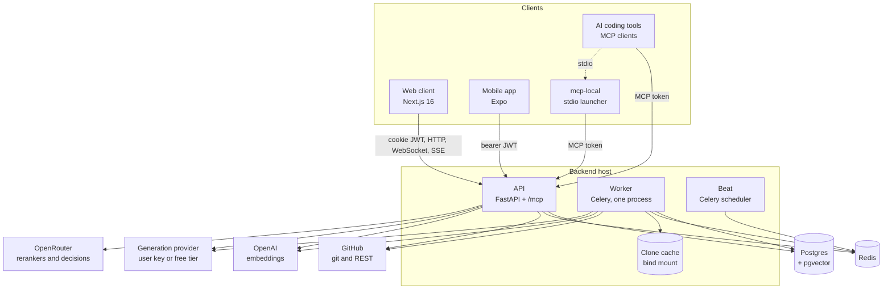
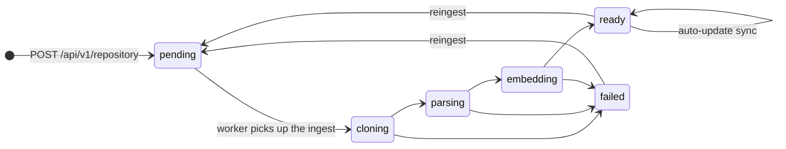
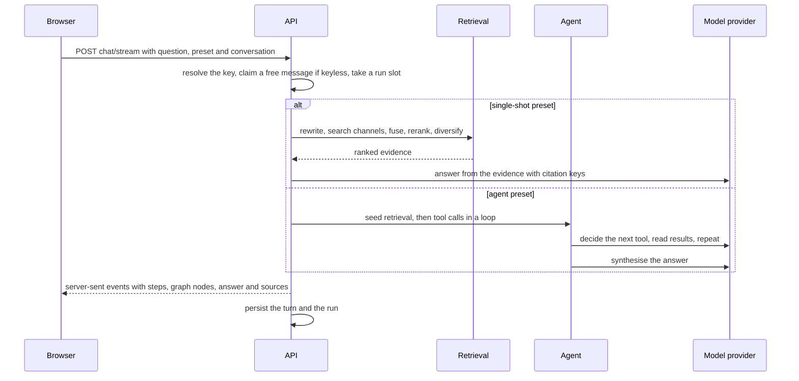

# Architecture

Illume turns a GitHub repository into an onboarding kit: a dependency graph, ownership and risk scores, a glossary, a reading order, an architecture brief, and a chat that answers questions from the code with citations. This page describes the whole system on one page: the processes, how a repository moves through them, the main request paths, where state lives, who pays for each model call, and the design decisions that shape everything else. Each section links to the page that covers its subject in depth.

## Terms used on this page

- **Ingest**: the background task that clones a repository, analyses it and writes every artefact. It runs once when a repository is added and again on a re-ingest.
- **Sync**: the background task that brings an ingested repository up to its remote head, rebuilding only what changed.
- **Snapshot**: the branch and commit an ingest or sync analysed. Everything Illume shows describes the snapshot, not the live repository.
- **Artefact**: anything the pipeline writes for a repository: files, symbols, edges, scores, glossary, reading order, brief, embeddings.
- **Preset**: a named retrieval configuration that chat runs, from `classic` (one vector search) to `deep_agent_workers` (a planner fanning out to tool-using workers).
- **BYOK**: bring your own key. A user's own model-provider key, stored encrypted, which pays for that user's generation and chat.
- **MCP**: the Model Context Protocol, which lets AI coding tools call Illume's tools from outside the web app.

## The system at a glance

| Part         | What it is                                                                                                              | Code                                                                   | In depth                                  |
| ------------ | ----------------------------------------------------------------------------------------------------------------------- | ---------------------------------------------------------------------- | ----------------------------------------- |
| API          | FastAPI app: 16 routers, the ingest WebSocket, the chat event stream, and the MCP server at `/mcp`                      | [`server/app/main.py`](../server/app/main.py)                          | [API reference](api.md)                   |
| Worker       | one Celery process consuming the `celery` queue (ingests) and the `sync` queue (updates)                                | [`server/app/tasks/`](../server/app/tasks/)                            | [ingestion](pipeline/ingestion.md)        |
| Beat         | Celery's scheduler: the auto-update sweep every 10 minutes and a nightly prune of agent steps                           | [`app/tasks/autoupdate.py`](../server/app/tasks/autoupdate.py)         | [auto-update](pipeline/sync.md)           |
| Postgres     | every artefact, every account, chat history and agent runs; pgvector for embeddings, `pg_trgm` and full-text for search | [`server/app/models/`](../server/app/models/)                          | [data model](reference/data-model.md)     |
| Redis        | Celery broker and results, the ingest progress channel, agent run slots and rate limits                                 | [`app/core/redis.py`](../server/app/core/redis.py)                     | [WebSockets](interfaces/websockets.md)    |
| Web client   | server components for reads, client components for live views, the 3D graph, chat                                       | [`client/`](../client/)                                                | [frontend overview](frontend/overview.md) |
| Mobile app   | a separate React Native app with its own API client and a three.js graph                                                | [`mobile/`](../mobile/)                                                | [mobile app](mobile/overview.md)          |
| MCP          | tools, resources and prompts for AI coding tools, plus a local stdio launcher                                           | [`server/app/mcp/`](../server/app/mcp/), [`mcp-local/`](../mcp-local/) | [MCP server](mcp/server.md)               |
| Eval harness | an offline harness that measures the presets on mined questions                                                         | [`server/evals/`](../server/evals/)                                    | [eval harness](evals/harness.md)          |

## The life of a repository

1. **Add.** The API validates the GitHub URL, charges a free ingestion if the user has no key, inserts the row as `pending`, and queues `ingest_repository`.
2. **Ingest.** The worker runs [`run_full_analysis`](../server/app/services/pipeline.py) after the clone. The stages are deterministic first (parse, resolve imports, fan-in and fan-out, stack, git history, co-change, criticality) and model-backed second (glossary and reading order together, then embeddings and the brief together). Each stage publishes progress frames that the browser receives over a WebSocket. See [ingestion](pipeline/ingestion.md).
3. **Use.** At `ready`, the pages, the graph, chat and MCP all read the stored artefacts. Nothing at request time touches the repository itself, except the agent's `read_file` tool, which fetches a file from GitHub at the ingested commit.
4. **Keep current.** With auto-update on, the beat process sweeps for due repositories and the worker syncs each one. A sync keeps `status = 'ready'` and swaps the graph in one transaction, so readers see the old version or the new one and never a mix of both. See [auto-update](pipeline/sync.md).
5. **Re-ingest.** This deletes the row and every child row, then recreates it with the same id and number and runs the full ingest again.

## Request paths

### A page load

Server components fetch from the API on the Next.js server, forwarding the browser's cookie. Client components fetch directly from the browser with `credentials: "include"`. Nothing is cached: every fetch is `cache: "no-store"`. See [frontend overview](frontend/overview.md#data-fetching).

### A chat question

The `auto` choice first asks a decision model what kind of question it is and then runs the matching preset. See [chat](retrieval/chat.md), [retrieval arms](retrieval/retrieval-arms.md), [the chat agent](retrieval/agent.md) and [the router](retrieval/router.md).

### An MCP call

An AI tool sends a JSON-RPC request to `/mcp` with a personal token. The MCP layer authenticates the token, applies per-user rate limits, resolves the `repo` argument to one of the token owner's repositories, and calls the same tool registry the chat agent uses. `ask_illume` runs a whole chat answer. See [the MCP server](mcp/server.md).

## Where state lives

| State                              | Where                                                                         | Lifetime                                                   |
| ---------------------------------- | ----------------------------------------------------------------------------- | ---------------------------------------------------------- |
| accounts, keys (encrypted), tokens | Postgres `users`, `mcp_tokens`, `push_tokens`                                 | until the account is deleted                               |
| repository artefacts               | Postgres, every child table keyed by `repository_id` with `ON DELETE CASCADE` | until re-ingest or delete                                  |
| chat history and agent runs        | Postgres `conversations`, `chat_messages`, `agent_runs`, `agent_steps`        | agent steps are pruned nightly                             |
| progress frames                    | Redis pub/sub channel `task:{repo_id}:logs`                                   | not stored: a subscriber that is not listening misses them |
| task queue                         | Redis                                                                         | until the worker acknowledges a task                       |
| clones                             | the clone cache on a host bind mount, or a temporary directory                | the cache is evicted least-recently-used                   |
| the beat schedule                  | a file on a host bind mount                                                   | across deploys                                             |
| the web session                    | an httponly `access_token` cookie                                             | `ACCESS_TOKEN_EXPIRE_MINUTES`                              |

## Async and sync, split by caller

The most important code convention: **FastAPI routes use the async engine (`asyncpg`), and Celery tasks and Alembic use the sync engine (`psycopg2`).** Both engines are in [`app/core/database.py`](../server/app/core/database.py). A service takes the flavour of its caller, so a few exist twice. `file_graph.py`, for example, exports both `query_file_edges` and `query_file_edges_async`.

| Async (routes, MCP, chat)                                                          | Sync (worker, Alembic)                                                                                                                                                                    |
| ---------------------------------------------------------------------------------- | ----------------------------------------------------------------------------------------------------------------------------------------------------------------------------------------- |
| `graph_builder`, `rag`, `illume_exporter`, `retrieval/`, `agent/`, `conversations` | `scanner`, `dependency_resolver`, `embedder`, `glossary_builder`, `onboarding`, `architecture_brief`, `git_analyzer`, `pr_fetcher`, `cloner`, `criticality`, `cochange`, `stack_detector` |

The reason is the callers. The API serves many requests on one event loop and must not block. The worker runs one long task at a time and gains nothing from an event loop, but it does run some stages on threads, which the sync engine handles simply. Settings are always imported as `from app.core.config import settings`, never constructed.

## Concurrency

- **The worker runs one task at a time** (`--concurrency=1`). An ingest peaks at several hundred megabytes, and a second concurrent ingest would multiply that on a small machine. Syncs and ingests share that one process, so they serialise.
- **Inside an ingest, some stages overlap on threads**: pull-request fetching overlaps the parse and git analysis, the glossary overlaps the reading order, and embeddings overlap the brief. Every overlapped stage receives only scalars (`repo_id`, `github_url`, an `LLMConfig`) and opens its own database session. No session or ORM object crosses a thread. See [concurrency and failure](pipeline/concurrency-and-failure.md).
- **The API is async**, and an agent run is bounded by per-user run slots in Redis and by budgets on turns, tool calls, tokens and time. Its parallel tool calls each get their own session.

## Who pays for each model call

| Call                                      | Credential                                            | Why                                                                                       |
| ----------------------------------------- | ----------------------------------------------------- | ----------------------------------------------------------------------------------------- |
| embeddings (ingest, sync, every question) | the operator's `OPENAI_API_KEY`, always               | the vector dimension (1536) is part of the schema, so every repository must use one model |
| glossary, reading order, brief            | the owner's key, or the operator's free-tier key      | the cost scales with the user's repositories                                              |
| chat answers and agent turns              | the asking user's key, or the free tier (10 messages) | the same                                                                                  |
| rerankers, decisions, the auto router     | the operator's `OPENROUTER_API_KEY`                   | small, fixed-size calls; when the key is missing, each falls back                         |

The choice is made once per request or task and carried as a frozen `LLMConfig` through every service and thread. It is never stored in a context variable, because threads do not inherit those. See [BYOK and encryption](security/byok-and-encryption.md).

## Security boundaries

- **Authentication** is a JWT in an httponly cookie for the web, the same JWT as a bearer header for mobile, and separate revocable tokens for MCP. `AuthMiddleware` decodes it once per request. See [authentication](security/auth.md).
- **Ownership** is a `user_id` filter in every query, and another user's repository returns 404, never 403. A test derives every repository-scoped route from the app and proves each one rejects other users.
- **Stored credentials** (AI keys and GitHub tokens) are encrypted with AES-256-GCM under `CREDENTIAL_ENCRYPTION_KEY`.
- **Untrusted repositories**: git runs with prompts disabled and the global and system configuration ignored. Repository text reaches models only inside fenced `<source>` blocks.
- **Known issues** are listed in [authentication](security/auth.md#known-security-issues): prefix-matched public paths, the WebSocket token in a query parameter, and no rate limiting on login or register.

## Design decisions

| Decision                                                           | Why                                                                                                             | Cost                                                              |
| ------------------------------------------------------------------ | --------------------------------------------------------------------------------------------------------------- | ----------------------------------------------------------------- |
| one ingest task with overlapped stages, not a Celery chain         | one place owns status, retries and cleanup, and overlapped stages buy wall-clock time without a second process  | a failure anywhere retries everything                             |
| the deterministic half needs no model                              | the graph, scores and ownership work even when every provider is down                                           | the model-backed artefacts can be missing while the graph is fine |
| store the snapshot, answer from it                                 | answers, citations and the graph agree with each other and are reproducible                                     | answers lag the live repository until the next sync               |
| syncs keep `status = 'ready'` and swap the graph transactionally   | the product stays usable during an update                                                                       | a sync shows no live progress                                     |
| a configurable retrieval pipeline instead of one method            | presets can be compared on the same questions, and the eval harness measures them                               | more code paths to test; channels run one after another           |
| one tool registry for the agent and MCP                            | a tool written once works in chat and in outside tools                                                          | one description has to suit both audiences                        |
| BYOK with a small free tier                                        | users try it without a key, and heavy use is paid by the user                                                   | the operator pays for embeddings for everyone                     |
| real Postgres and Redis in tests, fakes only for OpenAI and GitHub | the defects this project has hit were query, constraint and schema defects that a mocked database cannot report | tests need Docker                                                 |
| one droplet, three containers                                      | simple and cheap                                                                                                | no redundancy; a deploy interrupts running tasks                  |

## Design trade-offs and limits

- **Single machine.** The API, worker and beat share one host. A large ingest competes with request handling for memory, and a host outage is a full outage.
- **No call graph.** The dependency resolver writes only `imports` edges, so "who calls this function" is answered by search, not by a graph.
- **Snapshots lag.** An answer can describe code that has since changed; chat marks such answers as stale when the snapshot moves.
- **Lost frames.** Progress is pub/sub without storage, so a browser that connects late sees only later frames, and reconstructs earlier ones from the row's status.
- **Killed ingests need a hand.** Syncs have a lease that expires; ingests do not, so a worker killed mid-ingest leaves a row that needs a manual fix ([runbook](operations/runbook.md#a-repository-shows-progress-forever)).
- **The judge is checked by a second model, not by hand.** On a 30-answer sample, a judge from another model family agreed strongly on correctness but not on faithfulness, so faithfulness levels are judge-dependent ([judging](evals/judging-and-statistics.md#validating-the-judge)).

## Related documentation

- [Documentation index](README.md): every page and the glossary.
- [Repository layout](getting-started/repository-layout.md): where each part lives.
- [Ingestion](pipeline/ingestion.md): the pipeline in depth.
- [Chat](retrieval/chat.md): how questions are answered.
- [API reference](api.md): every route.
- [Deployment](operations/deployment.md): the containers in production.
