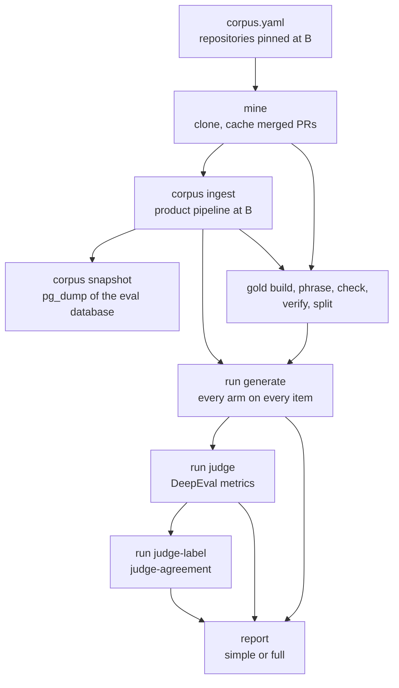

# The eval harness

`server/evals/` is a command-line harness that measures how well each way of answering a question in Illume finds the right files and answers correctly, and what each costs. It pins real open-source repositories at a base commit, mines questions whose answers are known from pull requests merged after that commit, runs every retrieval configuration ("arm") on every question with the product's own code, meters every model call, and has a separate model judge the answers. This page covers the pipeline end to end, the isolation that keeps it off the product's databases, the corpus, the gold set, the arms, generation and metering, budgets and the reports; [judging and statistics](judging-and-statistics.md) covers how answers are graded and compared, and [the full_v1 results](results-full-v1.md) what the first full run found.

## Terms used on this page

- **Arm**: one complete answering configuration, a `PipelineConfig` plus its execution mode. The product's presets are arms, and so are variants that change exactly one thing.
- **Base commit (B)**: the commit a repository is frozen at. Nothing newer is ever visible to retrieval.
- **Gold item**: a question with a known answer: the files a correct answer names, a reference answer, and metadata.
- **Change question**: a gold item mined from a pull request merged after B: "given this description, which files change?". The gold files are the files that PR changed.
- **Explain question**: a gold item asking how existing code works, written by a model from the repository at B and checked by another model.
- **Cluster**: the variants built from one pull request, kept together when sampling and splitting.
- **Generation**: one arm's answer to one question, with its retrieval trace, steps, usage and cost.
- **Pre-registration**: a design file committed before a run; the commit is its timestamp, and the harness refuses to generate on a slice until its file is committed and unmodified.

## The pipeline



| Step                | Command                                                 | Costs money                         | Writes                                    |
| ------------------- | ------------------------------------------------------- | ----------------------------------- | ----------------------------------------- |
| Migrate the eval DB | `python -m evals db migrate`                            | no                                  | schema in the eval database               |
| Mine                | `python -m evals mine --repo NAME`                      | no (GitHub token)                   | `out/clones/`, `out/github/` cache        |
| Ingest              | `python -m evals corpus ingest --repo NAME`             | yes (embeddings, generation stages) | rows in the eval database                 |
| Snapshot            | `python -m evals corpus snapshot --name N`              | no                                  | a `pg_dump` under `out/snapshots/`        |
| Build gold          | `python -m evals gold build --repo NAME`                | no                                  | gold JSONL and a build log                |
| Phrase              | `python -m evals gold phrase`                           | yes (phraser model)                 | phrased questions, cached                 |
| Check               | `python -m evals gold check`                            | yes (checker model)                 | supported / partly / unsupported verdicts |
| Verify              | `python -m evals gold verify`                           | no (a person)                       | `labels.jsonl`, an error report           |
| Split               | `python -m evals gold split`                            | no                                  | `split.lock.json`                         |
| Generate            | `python -m evals run generate --run NAME`               | yes                                 | `out/runs/NAME/generations.jsonl`         |
| Judge               | `python -m evals run judge --run NAME`                  | yes                                 | a judgments JSONL per judge identity      |
| Report              | `python -m evals report --run NAME --mode simple\|full` | no                                  | `report.json`, `report.md`, figures       |

Every flag is in [the command reference](../reference/cli.md#the-eval-cli). All commands run from `server/` as `uv run python -m evals …`.

## Isolation from the product

The harness imports the product's code (`app.services.retrieval`, `app.services.agent`, the ingestion stages), and `app.core.config` builds `Settings` from the environment on import. So [`evals/settings.py`](../../server/evals/settings.py) is imported **first** by the entry point and rewrites `os.environ` so that every `Settings` field is set explicitly to the eval stack, leaving nothing to fall through to `server/.env`, which points at production. It refuses to run if `app.core.config` was already imported.

| Resource | Eval value                                                          | Defined in                                      |
| -------- | ------------------------------------------------------------------- | ----------------------------------------------- |
| Postgres | `localhost:5434/illume_eval`                                        | [`envcheck.py`](../../server/evals/envcheck.py) |
| Redis    | `localhost:6381/0`                                                  | `envcheck.py`                                   |
| Keys     | `server/evals/.env.eval` (gitignored; shape in `.env.eval.example`) | `settings.py`                                   |

`assert_eval_url` refuses any database URL that is not on a local host and the eval port, and `mask_url` hides passwords in output. The stack comes from [`docker-compose.eval.yml`](../../docker-compose.eval.yml), with **named volumes** (unlike the throwaway test stack), because ingested corpora with their embeddings and briefs cost money to rebuild:

```bash
make eval-infra          # Postgres 5434 and Redis 6381, persistent
make eval-migrate        # python -m evals db migrate
make eval-selftest       # pure metric self-tests, no database
make eval-infra-down     # stop, keeping the data
```

`.env.eval` holds `OPENAI_API_KEY` (embeddings and the phraser), `AI_API_KEY` and `AI_BASE_URL` (the generator), `OPENROUTER_API_KEY` (the decider, the rerankers and the judge), `GITHUB_TOKEN` (mining), and optional `JUDGE_*` overrides. See [the environment reference](../reference/environment.md#evals).

## The corpus

[`evals/corpus/corpus.yaml`](../../server/evals/corpus/corpus.yaml) pins each repository: `name`, `url`, `language`, `licence` (MIT, Apache-2.0 or BSD only), a 40-character `base_commit`, `era`, and its question mix. The selection rules written in the file: a permissive licence, 200 to 3,000 source files at B, at least 300 merged pull requests with real descriptions and at least 150 merged after B, and not Illume itself.

| Name       | Repository           | Language   | Era       | Base date  | Mix                   |
| ---------- | -------------------- | ---------- | --------- | ---------- | --------------------- |
| `pvlib`    | `pvlib/pvlib-python` | Python     | before AI | 2026-04-29 | 35 change, 25 explain |
| `langroid` | `langroid/langroid`  | Python     | early AI  | 2026-05-28 | 35 change, 25 explain |
| `rakazo`   | `elie222/rakazo`     | TypeScript | latest AI | 2026-09-30 | 35 change, 25 explain |

The "era" is a label for the period most of the code was written in, so that the report can show how results move across codebases written before and with AI help. [`corpus/style.py`](../../server/evals/corpus/style.py) measures each repository at B (comment density, function and file length, identifier length, commit and PR description length, and commits with visible AI involvement, counted only from `Co-Authored-By` trailers or AI bot authors, so a lower bound). The report shows these as observations, never as causes.

`pvlib` has 187 code files at B, under the 200-file guide; it was kept, and the design records why: its files are large (about 400k tokens of non-test code, more than the agent's 300k input cap), so every arm still has to search.

### Mining

`mine` makes a `--no-checkout` full clone per repository under `out/clones/` and builds an on-disk GitHub cache, one JSON file per merged pull request at `<cache>/<owner>__<repo>/prs/<number>.json` with stable key order, so a refetch of unchanged data rewrites identical bytes. The cache holds up to `history_prs` (default 200) PRs merged before B, as text only, and every PR merged after B that the default branch contains, with its changed files. After the first build the cache is the source of truth and a repeat run makes no request. The harness's own HTTP client ([`mining/github_fetch.py`](../../server/evals/mining/github_fetch.py)) sends the token only in the `Authorization` header and backs off on rate limits.

### Ingestion at the base commit

[`corpus/ingest.py`](../../server/evals/corpus/ingest.py) composes the product's pipeline stages directly instead of running the Celery task, because the task fetches the most recently updated PRs from GitHub, which in an active repository are almost all newer than B. The order:

1. Create the eval user and a fresh `Repository` row.
2. Clone and check out B.
3. Insert the most recent cached PRs whose merge commit is an ancestor of B, before analysis, so the embedder indexes them with everything else.
4. Run the analysis stages (parse, git history, scoring, glossary, reading order, embeddings, brief).
5. Mark the repository ready at B.
6. **Verify that nothing after B leaked in**, on both rows and embeddings.

Commits and co-change pairs are safe by construction (the clone is detached at B and `git log` walks ancestors only); PRs are the only leak path, which is why the guard exists. `corpus snapshot` and `corpus restore` save and reload the eval database with `pg_dump` and `pg_restore`, so a paid ingestion is reused; the password reaches the child processes only through `PGPASSWORD`.

## The gold set

[`evals/gold/`](../../server/evals/gold/) builds items in families:

| Family       | Question                                                  | Gold                                                                                      | Role                                           |
| ------------ | --------------------------------------------------------- | ----------------------------------------------------------------------------------------- | ---------------------------------------------- |
| `changeset`  | a merged PR's description, asked as "which files change?" | the PR's changed files that existed at B, minus changelogs, lockfiles and generated files | the headline                                   |
| `hand`       | how existing code works (explain, architecture, flow)     | the files a correct answer relies on, and a reference answer                              | the explain questions                          |
| `rationale`  | "Why does this file contain this line?"                   | sentences from the PR that introduced the line                                            | optional; circular with the history channel    |
| `structural` | importers of a file, or the import chain from A to B      | files from the eval database's import graph                                               | optional sanity class; circular with the graph |

`full_v1` used the first two only: 105 change questions and 75 explain questions.

### Change questions

[`gold/changeset.py`](../../server/evals/gold/changeset.py) keeps a PR when it changed between `MIN_GOLD_FILES` (2) and `MAX_GOLD_FILES` (15) files that existed at B and has at least `MIN_BODY_WORDS` (20) words of description. The question seed is the title and body **with everything that gives the answer away removed**: gold paths, gold basenames, and identifiers that occur only in gold files, as well as HTML comments, checklists, images and links into the repository. An optional "anchor" variant adds "Start from `<path>`." naming a non-gold file; `full_v1` used the blind variant only.

[`gold/phrase.py`](../../server/evals/gold/phrase.py) has a model other than the generator rewrite each seed into a natural developer question, then **re-checks the phrasing for leaks**, retries once with a stricter prompt, and drops the item if it still leaks. Accepted phrasings are cached by item, model and prompt version.

### Explain questions

Hand items live in `gold/hand/<repo>.yaml` (format and writing rules in `gold/hand/GUIDE.md`); the `full_v1` ones were written by a coding agent from each repository at B. [`gold/check.py`](../../server/evals/gold/check.py) has a different model read each question, its reference answer and the text of the files it names at B, and return `supported`, `partly_supported` or `unsupported` with the claim at fault. Unsupported items are dropped; partly supported ones are kept and listed. For `full_v1`: 84 checked, 49 supported, 35 partly supported, 0 unsupported.

### Ids, verification and the split

- **Ids are content hashes** of the defining fields ([`gold/schema.py`](../../server/evals/gold/schema.py)), and the JSONL is canonical (sorted, compact, no timestamps), so two builds from the same inputs are byte-identical.
- **Choosing the mix** ([`gold/mix.py`](../../server/evals/gold/mix.py)) orders clusters by a hash of the seed and the cluster, so selection does not depend on input order.
- **Human verification** ([`gold/verify.py`](../../server/evals/gold/verify.py)) shows a person a stratified sample (15%, at least 50 per family) with GitHub links at B, records correct, wrong or ambiguous, and drops a family or template whose Wilson upper bound on its error rate is above 20%. Two annotators give Cohen's kappa.
- **The split** ([`gold/split.py`](../../server/evals/gold/split.py)) is either one `pilot` slice (what `full_v1` used) or a tuning/test split by seeded hash, stratified by repository and family with clusters kept whole, 20% tuning by default. `split.lock.json` records each slice's ids and a SHA-256 of the test file, so any later edit to a test item is detected.
- **The pre-registration guard**: generation on a slice refuses to start unless its design file (`prereg/pilot.md` for the pilot, `prereg/v1.md` for the test split) is tracked by git and identical to `HEAD`.

## The arms

[`evals/arms.py`](../../server/evals/arms.py) builds each arm as an explicit `PipelineConfig` from the product's channel and config classes, rather than reading the product's `PRESETS`. The presets change several things at once (Structural carries a reranker Hybrid does not), so "structural versus hybrid" read off the presets would be two changes. Each arm names the arm it is compared with and the fields it changes, and **`assert_arm_diffs` fails if the two configurations differ anywhere else**.

| Arm                                                   | Built from      | Changes                            | What it is                                                                                             |
| ----------------------------------------------------- | --------------- | ---------------------------------- | ------------------------------------------------------------------------------------------------------ |
| `classic`                                             | none            |                                    | dense search only, `k` 50, distance cut 0.7, no fusion, no reranker, 10 results; the product's Classic |
| `hybrid`                                              | `classic`       | channels, fusion, query, diversify | dense, lexical and symbol channels, reciprocal rank fusion, 20 results                                 |
| `hybrid_rerank`                                       | `hybrid`        | rerank                             | with the Cohere reranker                                                                               |
| `hybrid_jev`                                          | `hybrid_rerank` | rerank                             | the Jev reranker instead (defined, not in the starter run)                                             |
| `hybrid_multiquery`                                   | `hybrid`        | query                              | the question rewritten into several variants                                                           |
| `hybrid_hyde`                                         | `hybrid`        | query                              | dense search also runs a hypothetical code snippet                                                     |
| `structural`                                          | `hybrid`        | channels                           | adds grep (weight 0.7), graph, co-change and history; no reranker                                      |
| `structural_-graph`, `-cochange`, `-history`, `-grep` | `structural`    | channels                           | Structural with one channel removed                                                                    |
| `structural_rerank`                                   | `structural`    | rerank                             | with Cohere; the product's Structural                                                                  |
| `agent`                                               | none            |                                    | the product's deep agent over the structural channels with Cohere, input cap 300,000 tokens            |
| `agent_text_tools`                                    | `agent`         | agent, channels                    | only `search_code`, `grep_code` and `read_file`, hybrid channels (defined, not run)                    |
| `agent_workers`                                       | `agent`         | execution, planner                 | a planner fanning out to parallel workers (defined, not run)                                           |
| `auto`                                                | composed        |                                    | one routing decision per question, then the generation of the arm the product would have run           |

The **starter** set (`--arms starter`, the default) is the ten arms `full_v1` ran: `classic`, `hybrid`, `hybrid_rerank`, `hybrid_hyde`, `hybrid_multiquery`, `structural`, `structural_-cochange`, `structural_rerank`, `agent` and `auto`. The channels and presets themselves are described in [retrieval arms](../retrieval/retrieval-arms.md); the agent in [the chat agent](../retrieval/agent.md); the router in [the router](../retrieval/router.md).

Every arm is asked the question with one eval-only instruction appended: end the answer with a list headed `Files:` naming every file that must change, or, for a question about existing behaviour, the files that implement it. That list is what file recall is scored on.

`auto` is never generated directly. [`run/adapters.py`](../../server/evals/run/adapters.py) asks the product's decider (`jev`) for a route per question and copies the generation of the arm that route resolves to (`classic`, `hybrid_rerank`, `structural_rerank` or `agent`), generating that arm first if it has no record yet. Its cost is the target's cost plus the decision's.

## Generation

[`run/generate.py`](../../server/evals/run/generate.py) runs every item on every arm and appends one JSONL line per finished pair to `out/runs/<run>/generations.jsonl`, never rewriting a line:

- **Resumable by key.** A record is keyed by a hash of everything that affects the answer (item, arm configuration, prompt version, model, instruction). A restart skips pairs that finished `ok`, regenerates any whose key changed, and retries errors. The last line for a key wins.
- **Errors are records, never zeros.** A pair is tried up to `MAX_ATTEMPTS` (3); the last failure is written with `status="error"`. A run whose reranker silently degraded (`reranker_degraded`) is also an error, because an arm that lost its reranker would otherwise be scored as if it had one.
- **Budgeted between pairs.** The spend limit is checked before each pair starts, never inside one, so a stop leaves no half-finished pair.
- **Off-peak aware.** Calls are spaced per provider, and `--off-peak-only` makes each pair wait for DeepSeek's cheaper window.

Single-shot arms run the product's `app.services.retrieval.single_shot.answer`; agent arms run `app.services.agent.runner.run_agent` with an in-memory step log. The one tool swapped out is `read_file` ([`run/clone_tools.py`](../../server/evals/run/clone_tools.py)): the product's reads from the GitHub API with the owner's token, which without a token is 60 requests an hour and would quietly degrade the agent; the harness reads the same text from the clone at B, with no network.

### Metering

The product's own counters cannot give costs: a single-shot answer carries no usage, and an agent run's counter leaves out rewrites, HyDE, embeddings and rerankers called inside tools. [`run/metering.py`](../../server/evals/run/metering.py) meters every call itself:

1. a client factory whose `responses.create` and `embeddings.create` record usage, handed to the product wherever it accepts a `client_factory`;
2. a temporary patch of `AsyncOpenAI` in the modules that build their own client (query rewriting, the query embedder, the LLM decider and reranker), attributing each call to the right generation through a context variable so concurrent generations never share usage;
3. wrappers on the Cohere and Jev rerankers, which report their own cost per call.

[`run/pricing.py`](../../server/evals/run/pricing.py) prices tokens from [`run/prices.yaml`](../../server/evals/run/prices.yaml), a dated, versioned table read from the providers' pricing pages. A paid run refuses to start while any rate it needs is missing or `verified` is false. DeepSeek has separate peak and off-peak rates (peak 01:00 to 04:00 and 06:00 to 10:00 UTC, Monday to Friday), so a call's cost depends on when it ran. The table's version goes into every manifest.

### Budgets

[`run/budget.py`](../../server/evals/run/budget.py) tracks spend from each record's `cost_usd`, rebuilding it from disk when a run resumes. `--budget` is the hard cap and `--stop` the spend at which the run stops cleanly; both default to the starter run's $10.00 and $9.50 (`STARTER_BUDGET_USD`, `STARTER_STOP_USD`). `python -m evals budget --project --items N --arms …` projects a planned run's cost from the per-arm cost measured so far.

## Manifests

[`evals/manifest.py`](../../server/evals/manifest.py) writes `manifest.json` beside every output: the git revision and whether the tree was dirty (recorded, never refused), the dependency lock hash, every arm's configuration, prompt and model versions, the judge identity and DeepEval version, the price table version, the corpus pins and the split. The judge and phraser model ids are pinned from the provider's reported `response.model`, so a silent provider-side change shows up as a manifest difference.

## Reports

`python -m evals report --run NAME --mode …` builds `report.json` (the source of truth), `report.md` rendered from it, SVG figures and `questions.csv` / `questions.jsonl` with one row per question and arm. [`report/build.py`](../../server/evals/report/build.py) refuses to build while any metric self-test fails, leaves out sections whose arms or data are missing, and checks its own prose against [the wording rules](judging-and-statistics.md#wording-rules) before writing anything.

| Mode     | For                              | Contents                                                                                                                                                                                          |
| -------- | -------------------------------- | ------------------------------------------------------------------------------------------------------------------------------------------------------------------------------------------------- |
| `simple` | the design in `prereg/pilot.md`  | arm tables overall and per repository, the fixed head-to-head comparisons on recall, correctness and cost, change against explain, codebase style, cost against quality, judge check, limitations |
| `full`   | the hypotheses in `prereg/v1.md` | hypothesis table with Holm, main results, retrieval@k, channel ablation, rerankers, agent trajectories, cost, Pareto frontier, routing, drift, memorisation, judged results, exclusions           |
| `pilot`  | the older pilot report           | kept for earlier runs                                                                                                                                                                             |

`--judge-slug` selects which judge's judgments to read; outputs land in `server/evals/out/`, which is gitignored.

## Metrics computed without a judge

All in [`evals/metrics/`](../../server/evals/metrics/), pure functions with no database or network:

| Module          | Measures                                                                                                                                                               |
| --------------- | ---------------------------------------------------------------------------------------------------------------------------------------------------------------------- |
| `files_list.py` | parses the **last** `Files:` heading; forgiving about bullets, backticks, links, line ranges and Windows separators; no heading is a format failure, not an empty list |
| `answer.py`     | **file recall** (share of gold files in the list) and **file precision**                                                                                               |
| `retrieval.py`  | recall@5/10/20, MRR and nDCG over files, from the fused or reranked pool for single-shot arms and first-touch order for agents                                         |
| `citations.py`  | cited keys that match nothing the run saw, and cited files that do not exist at B                                                                                      |
| `cost.py`       | dollars per question and per correct answer, tokens, latency percentiles                                                                                               |
| `trajectory.py` | the agent's tool use, steps to the first gold file (censored when never reached), wasted reads, duplicated work                                                        |
| `routing.py`    | what `auto` chose, how often it fell back, and whether it picked the best arm for the item                                                                             |

`metrics/selftest.py` registers hand-computed cases for every metric; `python -m evals selftest` and the report run them. Since the expected values are worked out by hand, a failure means the arithmetic changed, not that two copies of the code agree.

## Code map

Every module in [`server/evals/`](../../server/evals/), by folder.

| Folder or module | Modules and what they hold                                                                                                                                                                                                                                                                                                                |
| ---------------- | ----------------------------------------------------------------------------------------------------------------------------------------------------------------------------------------------------------------------------------------------------------------------------------------------------------------------------------------- |
| entry point      | `__main__.py`: the `python -m evals` argument parser; `settings.py`: the isolated environment, imported first; `envcheck.py`: guards that refuse a non-eval database URL; `models.py`: pinned model ids; `manifest.py`: the run manifest; `stats.py`: intervals and agreement                                                             |
| self-tests       | `selftest_registry.py`: the registry `selftest` runs; `stats_selftest.py`: hand-computed checks of the paired statistics; `metrics/selftest.py`: hand-computed checks of every metric                                                                                                                                                     |
| `cli/`           | `corpus_commands.py` (`corpus ingest`, `snapshot`, `restore`, `report`), `mine_commands.py` (`mine`), `gold_commands.py` (`gold build`, `phrase`, `check`, `verify`, `split`), `run_commands.py` (`run generate`, `budget`), `judge_commands.py` (`run judge`, `judge-label`, `judge-agreement`)                                          |
| `corpus/`        | `corpus.py` loads `corpus.yaml`; `ingest.py` ingests a pinned repository at its base commit; `snapshot.py` dumps and restores the database; `report.py` counts rows; `style.py` measures how the codebases differ                                                                                                                         |
| `mining/`        | `clones.py`: harness-owned clones and read-only git queries; `github_fetch.py` and `github_cache.py`: the on-disk cache of merged pull requests; `blame.py`: a line back to the commit and pull request that wrote it; `paths.py`: path normalisation and present-at-B checks                                                             |
| `gold/`          | `schema.py`, `build.py`, `mix.py`, `changeset.py`, `rationale.py`, `structural.py`, `hand.py` (and `hand/<repo>.yaml`), `phrase.py`, `check.py`, `verify.py`, `split.py` (the frozen split and the pre-registration guard)                                                                                                                |
| `arms.py`        | every arm and `assert_arm_diffs`                                                                                                                                                                                                                                                                                                          |
| `run/`           | `generate.py` (the runner), `adapters.py`, `clone_tools.py` (a `read_file` that reads the harness clone), `evidence.py`, `records.py`, `metering.py`, `pricing.py` and `prices.yaml`, `budget.py`; the judge: `judge.py`, `judge_batch.py`, `judge_metrics.py`, `judge_model.py`, `judge_validation.py`, `endpoint.py`, `deepeval_env.py` |
| `metrics/`       | `answer.py`, `files_list.py`, `retrieval.py`, `citations.py`, `cost.py`, `routing.py`, `trajectory.py`                                                                                                                                                                                                                                    |
| `report/`        | `build.py`, `load.py`, `capture.py`, `compute.py`, `scores.py`, `comparisons.py`, `ratio.py`, `simple.py`, `summary.py`, `limitations.py`, `wording.py`, `fmt.py`, `render.py`, `render_simple.py`, `figures.py`, `svg.py`                                                                                                                |
| `prereg/`        | the design files: `pilot.md` and `v1.md`                                                                                                                                                                                                                                                                                                  |

## Tests

`server/tests/evals/` (about 830 tests) covers every module with fixtures and fakes and no key; CI runs it in the `evals` job after `ruff` over `evals/`, migrations and `selftest`. [`test_eval_ci_end_to_end.py`](../../server/tests/evals/test_eval_ci_end_to_end.py) is the harness's smoke test: two arms on three items through the real adapters and the runner, with a scripted model and the fake embedder over the backend suite's retrieval fixture. `test_settings_isolation.py` pins the environment rewrite. `make eval-ci` runs the same tests locally against the test stack.

## Design trade-offs and limits

- **Three repositories, one generator.** Every result is about these repositories at these commits with `deepseek-flash`; nothing generalises.
- **Change-question gold is what one PR changed**, which is a valid answer but not the only one; an answer naming other reasonable files loses recall.
- **One model phrases change questions and judges answers**, so its wording habits may favour answers that resemble it.
- **Explain questions are model-written**, checked by a second model, not by a person.
- **The product's code is reused, not reimplemented,** so results describe what ships, but a product change silently changes what a rerun measures; the manifest's git state is the record.
- **The PR fetcher's changed-file count is 0** for every PR (GitHub's list endpoint does not return `changed_files`), so the report's "median files changed per PR" column is meaningless.

## Related documentation

- [Judging and statistics](judging-and-statistics.md): DeepEval, the batch judge, validation, intervals and tests.
- [full_v1 results](results-full-v1.md): what the first full run found.
- [Retrieval arms](../retrieval/retrieval-arms.md): the channels and presets the arms are built from.
- [Commands](../reference/cli.md#the-eval-cli): every eval command and flag.
- [Backend tests](../testing/backend.md): the eval tests' place among the suites.
