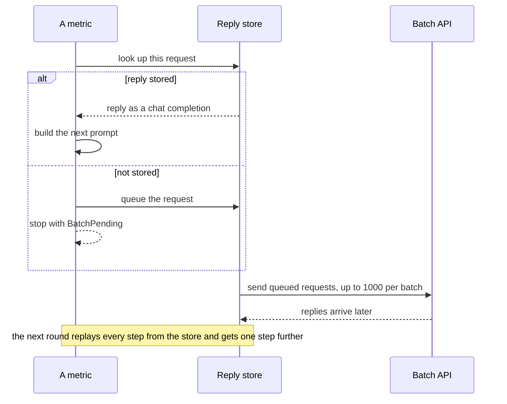

# Judging and statistics

File recall and cost are counted directly, but whether an answer is correct, faithful to its evidence and on topic needs a judge. The eval harness grades every answer with three DeepEval metrics run by a model from a different family than the generator, through OpenRouter's batch API at half price. It then compares arms with paired, cluster-level statistics: bootstrap intervals, permutation tests, a Holm correction and fixed wording rules. This page explains each metric and what the judge is shown, how the batch judge works, how the judge itself is validated, every statistical method in the reports, and the rules that keep the prose honest.

## Terms used on this page

- **DeepEval**: an open-source library of LLM-graded metrics. The harness uses version 4.3.2 for `full_v1`.
- **G-Eval**: a DeepEval metric where a judge model grades an answer against fixed evaluation steps and a rubric.
- **Bootstrap interval**: an interval built by resampling the data many times and taking percentiles of the recomputed statistic.
- **Permutation test**: a test that randomly flips the sign of each paired difference to see how often a result at least as extreme arises by chance.
- **Holm correction**: a step-down method that adjusts p-values when several hypotheses are tested together.
- **TOST (two one-sided tests)**: an equivalence test; both one-sided tests must reject before two arms are called equivalent.
- **Kappa**: an agreement statistic corrected for chance; weighted kappa gives partial credit for near misses on an ordered scale.
- **Wilson interval**: a confidence interval for a proportion that behaves well near 0 and 1.

## The three judged metrics

Defined in [`run/judge_metrics.py`](../../server/evals/run/judge_metrics.py). None of them is ever shown the arm, its configuration or the generator model.

| Metric             | DeepEval metric     | Shown                                                                                                                      | Scale                             |
| ------------------ | ------------------- | -------------------------------------------------------------------------------------------------------------------------- | --------------------------------- |
| `correctness`      | G-Eval, fixed steps | the question, the answer, a reference answer built from the repository's history plus the files a correct answer relies on | 0 to 3 rubric, stored as 0 to 1   |
| `faithfulness`     | Faithfulness        | the answer and the **text of the evidence it cited**, verbatim                                                             | share of claims supported, 0 to 1 |
| `answer_relevancy` | Answer Relevancy    | the question and the answer                                                                                                | 0 to 1                            |

### Correctness

The steps are fixed in code (`CORRECTNESS_STEPS`), so there is no step-generation call and every answer is graded by the same procedure: list the reference's main points, check each against the answer (paraphrase counts, vague wording does not), check for contradictions and that required files are named, and do not reward length, confidence or unsupported detail. The rubric (`CORRECTNESS_RUBRIC`):

| Score | Meaning                                                                      |
| ----- | ---------------------------------------------------------------------------- |
| 0     | wrong, off topic, empty, or contradicted by the reference                    |
| 1     | partly correct: some of the main point, a key part missing, vague or wrong   |
| 2     | mostly correct: the main point right, a secondary point missing or imprecise |
| 3     | fully correct                                                                |

DeepEval stores the score divided by 3, so the simple report's correctness of 0.62 means a mean rubric score of about 1.9; the full report shows the raw 0 to 3 values.

### Faithfulness

Faithfulness asks whether each claim in the answer is backed by the evidence. Three faults were found on the pilot and fixed before any full-run answer was judged, and the fixes are recorded as a dated amendment in [`prereg/pilot.md`](../../server/evals/prereg/pilot.md):

1. **Verbatim evidence.** DeepEval's stock metric restates the retrieval context before checking claims, and on code the restatement dropped the code, so true claims were marked unsupported. The harness passes the evidence text itself.
2. **A shared budget.** Evidence is capped at `EVIDENCE_CHAR_BUDGET` (24,000 characters) shared fairly, so a short piece gives its unused share to the others instead of a long piece crowding out the rest. The answer is capped at `ANSWER_CHAR_BUDGET` (8,000).
3. **Answers that cite nothing.** An arm that never cites (`classic`) is held to the context it was shown, its final candidates in rank order, so it is not scored 0 by construction.

| Pilot, 30 answers | Original     | Budget fix only | Verbatim evidence (used) |
| ----------------- | ------------ | --------------- | ------------------------ |
| Faithfulness mean | 0.31         | 0.42            | 0.79                     |
| Range             | 0.00 to 0.89 | 0.00 to 0.90    | 0.42 to 0.95             |

`penalize_ambiguous_claims` is on: a claim the evidence neither supports nor contradicts counts as unfaithful. Evidence text is looked up again at judge time by [`run/evidence.py`](../../server/evals/run/evidence.py), since generations store only citation keys: code from the clone at B, commits from the clone, PRs from the cache. A key with no text is shown as "(evidence text unavailable)".

Two consequences when reading faithfulness: `classic` is held to a different standard (everything it saw rather than what it cites), and on change questions an answer that proposes **new** code cannot be backed by existing evidence, so every arm's faithfulness is lower there.

### Empty answers

An empty answer has no claims, and DeepEval would score it 1.0 on faithfulness and relevancy. Those two metrics are therefore marked not applicable when the answer is empty (`NOT_APPLICABLE_WHEN_EMPTY`), and correctness counts it as 0.

## Running the judge

[`run/judge.py`](../../server/evals/run/judge.py) grades the selected generations, one record per generation and metric, appended to `judgments.<judge>.jsonl`. A record's key is the generation, the metric, a hash of that metric's settings, the DeepEval release, the judge model and the judge host. Changing any one of those re-grades that metric only and leaves the rest, and `generations.jsonl`, untouched. A metric that raises, times out (`METRIC_TIMEOUT_SECONDS`, 900) or returns unusable output is an error record, retried on the next run, never a score.

Every call goes through [`MeteredJudgeModel`](../../server/evals/run/judge_model.py), which answers DeepEval's calls from the harness's own endpoint (Responses API with a strict JSON schema, or chat completions asked for a JSON object) and meters each, so judging counts against the budget. It is async only, and has no raw-response method, so G-Eval takes its structured-output path rather than asking for log-probabilities.

The judge is swappable ([`run/endpoint.py`](../../server/evals/run/endpoint.py)): `--judge-model`, `--judge-base-url` and `--judge-api-style` point it at any OpenAI-compatible endpoint. A judge key is only ever sent to its own host; for any host other than OpenRouter or OpenAI, `JUDGE_API_KEY` is required so neither of those keys leaks elsewhere. Judgments from different judges or DeepEval versions are kept in separate files and never mixed.

### The batch judge

A model id ending in `:batch` selects [`run/judge_batch.py`](../../server/evals/run/judge_batch.py). OpenRouter's batch API answers within 24 hours at half the price, but a DeepEval metric is a chain of calls where each prompt is built from the previous reply (claims, then verdicts, then a reason). So the batch judge runs in **rounds**:

Requests are keyed by a hash of their body, so the store also deduplicates: two generations with the same answer to the same question share replies. `--wait` keeps polling and running rounds until every metric completes. A stored reply the judge cannot parse is asked again rather than replayed, which cut `full_v1`'s unusable gradings from 33 to 4.

On the 30 pilot answers, the batch and live endpoints of the same model agreed closely on the means: correctness 0.644 against 0.622, faithfulness 0.786 against 0.795, relevancy 0.885 against 0.876.

## Validating the judge

A judge's grades mean something only if they agree with a person. [`run/judge_validation.py`](../../server/evals/run/judge_validation.py):

1. `run judge --sample-only` draws `LABEL_SAMPLE_SIZE` (30) judged answers **without looking at the scores**, spread across arms and question kinds, and writes `judge_sample.jsonl` with the question, reference notes, gold files, answer and cited evidence, but no scores and no arm.
2. `run judge-label` is an interactive session where a person labels each answer `correct`, `partly` or `wrong`, and whether it made something up. Labels append to `judge_labels.jsonl`, so a session resumes.
3. `run judge-agreement` bins the judge's scores (rubric 0 is wrong, 1 partly, 2 and 3 correct; faithfulness below `UNFAITHFUL_BELOW`, 0.8, is made up) and reports quadratically weighted kappa with a bootstrap interval and raw agreement, per family. With `--compare-judge-model` it compares two judges instead.

A family whose correctness kappa is below `EXPLORATORY_BELOW` (0.6) has its judged numbers reported as exploratory.

**Status for `full_v1`: not done.** The 30-answer sample has been drawn, but no answer has been labelled, so the correctness, faithfulness and relevancy columns are **unvalidated**. A second-judge pass from another model family over the sample was configured (its batch rate is in `prices.yaml`) but has produced no judgments the reports use. File recall, precision, cost and speed do not depend on the judge.

## Statistics

Implemented in [`evals/stats.py`](../../server/evals/stats.py) and applied by [`report/comparisons.py`](../../server/evals/report/comparisons.py) and [`report/simple.py`](../../server/evals/report/simple.py).

### Pairing and clusters

Every arm answers every question, so every comparison is **paired**: the statistic is the mean of per-question differences, A minus B. Questions built from the same pull request form a cluster, and repositories are **fixed strata**: resampling draws clusters with replacement within each repository and never resamples the repositories themselves. Claims are therefore about these repositories, not repositories in general.

### Methods

| Method                        | Used for                                 | Settings                                                                                                                            |
| ----------------------------- | ---------------------------------------- | ----------------------------------------------------------------------------------------------------------------------------------- |
| Percentile cluster bootstrap  | every interval on a mean or a difference | 10,000 resamples for comparisons, 2,000 for descriptive means, seeded                                                               |
| Paired sign-flip permutation  | p-values on the full report's hypotheses | 10,000 patterns, or every pattern when there are at most 10,000; add-one smoothing when sampled                                     |
| Holm step-down                | the main family of hypotheses            | family-wise alpha 0.05                                                                                                              |
| TOST                          | the equivalence hypothesis               | margin plus or minus 0.03 on answer recall (`TOST_MARGIN`)                                                                          |
| Ratio intervals               | cost ratios and recall ratios            | cluster bootstrap of the ratio of means ([`report/ratio.py`](../../server/evals/report/ratio.py))                                   |
| Wilson interval               | every rate                               | errors, format failures, routes, fallbacks                                                                                          |
| Minimum detectable difference | every unresolved comparison              | `(z_0.975 + z_0.8) × SE`, with SE the standard deviation of cluster-mean differences over the square root of the number of clusters |
| Weighted kappa                | judge agreement                          | quadratic weights, bootstrap interval of 2,000                                                                                      |
| Direction counts              | per-repository leaders                   | descriptive only                                                                                                                    |
| Pareto frontier               | cost against quality                     | an arm is on it when no other arm is both cheaper and better; descriptive                                                           |

The minimum detectable difference is what keeps "not resolved" honest: H3's change in top-10 recall was −0.3 points with a detectable difference of about 3.3 points, so the run could have seen a 3-point effect and did not.

### The two analyses

- **The simple report** follows the design in `prereg/pilot.md`: means with intervals for every arm and metric, and a fixed list of head-to-head comparisons (each arm against the arm it builds on, `structural` against `structural_-cochange`, `agent` against `structural_rerank`, `auto` against `agent`) on file recall, correctness and cost. It runs no significance test.
- **The full report** follows the hypotheses in `prereg/v1.md`, which were written for a tuning/test split. `full_v1` ran on the pilot slice and the full report was built from it, so its hypothesis tests describe the pilot slice. A test confirms the comparison lists in code match both design files.

The hypotheses, each with one metric, one pair of arms and one direction:

| Id  | Claim                                                               | Metric                   | Test                              |
| --- | ------------------------------------------------------------------- | ------------------------ | --------------------------------- |
| H1a | `agent` beats `structural_rerank`                                   | answer file recall       | permutation, one-sided            |
| H1b | `agent` costs more than 5 times `structural_rerank`                 | dollars per question     | one-sided ratio test              |
| H2  | `structural` beats `hybrid` (no rerankers, so only channels differ) | file recall@10           | permutation                       |
| H3  | removing co-change lowers recall (the headline)                     | file recall@10           | permutation                       |
| H4  | `agent` reaches a gold file in fewer steps than `agent_text_tools`  | steps to first gold file | permutation                       |
| H5  | `agent_workers` is equivalent to `agent`                            | answer file recall       | TOST, its own alpha               |
| H6  | multi-query or HyDE beats `hybrid` at under 25% of `agent`'s cost   | recall, cost             | permutation each, plus gap closed |
| H7  | `auto` keeps 90% of `agent`'s recall at under half its cost         | recall ratio, cost ratio | both interval criteria must hold  |

Holm covers H1a, H1b, H2, H3, H4, both H6 tests and both H7 tests. H5 stands alone, and anything else in a report is labelled exploratory. Tests whose arms were not run are left out of the family, which for `full_v1` were H4 and H5.

### Exclusions

Fixed in the design files before any result: an error record is excluded from comparisons involving its arm and listed; an answer with no `Files:` list scores 0 recall and is counted, not excluded; an item an arm did not reach before a budget stop is listed and nothing is imputed; and no item is removed after results are seen.

## Wording rules

[`report/wording.py`](../../server/evals/report/wording.py) encodes how results may be stated, and the report builder refuses to write prose that breaks them:

- A comparison whose interval excludes zero is stated as "On these three repositories, A scored higher than B", with the estimate, interval and n.
- Any other comparison is "Not resolved at this sample size", with the minimum detectable difference.
- No sentence claims a result for repositories in general.
- "Significant" never appears without the test and the sample size beside it.
- Differences between repositories, including the codebase-style measurements, are observations, not causes.

## Design trade-offs and limits

- **An unvalidated judge.** Until the hand labels exist, every judged number is provisional; the judge-free metrics are the reliable ones.
- **One judge family phrases and grades change questions.** Wording affinity could favour some answers.
- **Faithfulness punishes proposals.** For change questions, a correct plan for new code scores as unfaithful.
- **Answer relevancy does not discriminate**: every arm in `full_v1` scored 0.87 to 0.94.
- **Fixed strata limit the claims** to the repositories in the run, by construction.
- **The full analysis ran on the pilot slice.** The tuning/test separation the hypotheses were designed for has not been used yet.

## Related documentation

- [The eval harness](harness.md): how the answers being judged are produced.
- [full_v1 results](results-full-v1.md): the numbers these methods produced.
- [The chat agent](../retrieval/agent.md#evidence-and-citations): how answers cite evidence.
