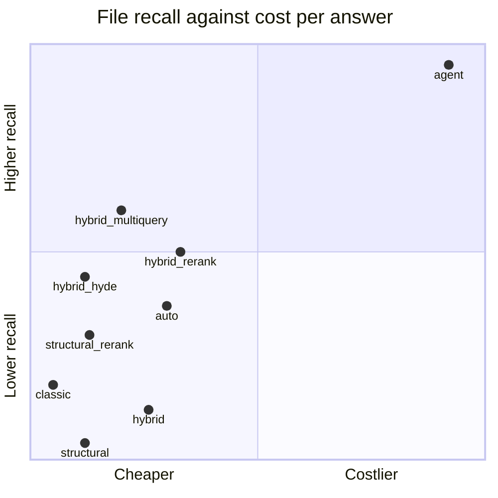

# Results: full_v1

`full_v1` is the first full run of the eval harness: ten arms answered 180 questions over three pinned repositories, 1,800 answers in all with no generation errors, for about $10.86. The deep agent found the most of the right files and gave the most correct answers, at roughly four times the cost of the best single-shot arm; the structural channels and co-change did not measurably beat plain hybrid retrieval; and the router saved money but lost too much recall. A second judge from another model family re-graded a sample of 30 answers: it agreed strongly with the main judge on correctness (weighted kappa 0.87) but not on faithfulness, so read the faithfulness column as a comparison between arms rather than an absolute level. File recall, precision, cost and speed do not depend on the judge.

## Terms used on this page

- **File recall**: the share of the required files an answer names in its closing `Files:` list, from 0 to 1. The primary metric.
- **Recall@10**: the share of required files among the first ten distinct files of an arm's retrieval ranking, before the answer is written.
- **Change question / explain question**: "which files does this pull request's change touch?" versus "how does this existing code work?". See [the gold set](harness.md#the-gold-set).
- **Resolved**: a paired difference whose 95% interval excludes zero. Anything else is "not resolved at this sample size".

Every number on this page comes from two generated reports in `server/evals/out/` (gitignored): the simple report over all 180 questions, and the full report over the 105 change questions. To rebuild them:

```bash
cd server
uv run python -m evals report --run full_v1 --mode simple --judge-slug anthropic-claude-haiku-5.5-batch--openrouter.ai--73b2ec
uv run python -m evals report --run full_v1 --mode full   --judge-slug anthropic-claude-haiku-5.5-batch--openrouter.ai--73b2ec
```

## Setup

| Item         | Value                                                                                                                                                                                 |
| ------------ | ------------------------------------------------------------------------------------------------------------------------------------------------------------------------------------- |
| Repositories | `langroid` (early AI, Python), `pvlib` (before AI, Python), `rakazo` (latest AI, TypeScript), each at its base commit                                                                 |
| Questions    | 180: 105 change questions mined from merged PRs (35 per repository), 75 explain questions (25 per repository)                                                                         |
| Arms         | 10, every arm on every question: `classic`, `hybrid`, `hybrid_rerank`, `hybrid_multiquery`, `hybrid_hyde`, `structural`, `structural_-cochange`, `structural_rerank`, `agent`, `auto` |
| Answers      | 1,800, 0 generation errors (1,620 generated, 180 composed for `auto`)                                                                                                                 |
| Generator    | `deepseek-flash`                                                                                                                                                                      |
| Judge        | `anthropic/claude-haiku-5.5:batch` through OpenRouter, DeepEval 4.3.2, JSON-schema output                                                                                             |
| Spend        | $6.25 generation and routing, $4.49 judging (25.1M input and 12.9M output tokens), $0.29 for the second judge, about $11.15                                                           |
| Slice        | `pilot` (no tuning/test split)                                                                                                                                                        |

| Repository | Files | Symbols | Edges | Commits | PRs as history | Co-change pairs |
| ---------- | ----- | ------- | ----- | ------- | -------------- | --------------- |
| `langroid` | 432   | 6,580   | 1,870 | 500     | 200            | 121             |
| `pvlib`    | 195   | 2,874   | 293   | 500     | 200            | 117             |
| `rakazo`   | 1,231 | 11,655  | 3,050 | 500     | 200            | 1,552           |

## Headline results

All 180 questions, means. Correctness and faithfulness run from 0 to 1 (see [the rubric](judging-and-statistics.md#correctness)); intervals are in the report.

| Arm                    | File recall | Correctness | Faithfulness | $ per answer | Seconds |
| ---------------------- | ----------- | ----------- | ------------ | ------------ | ------- |
| `agent`                | **0.75**    | **0.62**    | 0.72         | $0.0114      | 49.8    |
| `hybrid_rerank`        | 0.64        | 0.51        | 0.71         | $0.0035      | 13.6    |
| `hybrid_multiquery`    | 0.64        | 0.55        | 0.72         | $0.0036      | 16.8    |
| `hybrid_hyde`          | 0.63        | 0.52        | 0.71         | $0.0035      | 18.3    |
| `structural_rerank`    | 0.60        | 0.46        | 0.69         | $0.0030      | 12.7    |
| `auto`                 | 0.60        | 0.47        | 0.70         | $0.0030      | 14.6    |
| `structural_-cochange` | 0.58        | 0.41        | 0.71         | $0.0023      | 11.0    |
| `classic`              | 0.56        | 0.44        | 0.60         | $0.0015      | 10.9    |
| `hybrid`               | 0.55        | 0.44        | 0.70         | $0.0033      | 11.2    |
| `structural`           | 0.53        | 0.40        | 0.70         | $0.0027      | 10.9    |

Answer relevancy was between 0.87 and 0.94 for every arm and separates nothing. `agent` had the highest file recall on each of the three repositories.



The chart places each arm by its overall cost (x, $0.0015 to $0.0114) and file recall (y, 0.53 to 0.75), each rescaled to fit the square. Every arm except `classic` and `agent` costs between $0.0027 and $0.0036, so those points are spread apart horizontally to keep their labels readable: read their order on recall from the chart and their cost from the table. It shows positions, not intervals, and leaves out `structural_-cochange` for legibility.

## The hypotheses

Change questions only (n = 105, 105 clusters), Holm-corrected within the main family, which covered 8 of 9 planned tests: H4 needs the `agent_text_tools` arm and H5 the `agent_workers` arm, and neither was run.

| Id                | Claim                                                                | Estimate (95% CI)                                                | Result                                     |
| ----------------- | -------------------------------------------------------------------- | ---------------------------------------------------------------- | ------------------------------------------ |
| H1a               | `agent` beats `structural_rerank` on answer file recall              | +16.9 points (10.7 to 23.6), Holm p = 0.0008                     | **supported**                              |
| H1b               | `agent` costs more than 5 times `structural_rerank`                  | ratio 4.29 (4.02 to 4.59)                                        | not supported: it costs less than 5 times  |
| H2                | `structural` beats `hybrid` on recall@10                             | −0.9 points (−4.2 to 2.3)                                        | not supported; detectable about 4.7 points |
| **H3** (headline) | removing co-change lowers recall@10                                  | −0.3 points (−2.6 to 2.0)                                        | not supported; detectable about 3.3 points |
| H6, multi-query   | beats `hybrid` on answer recall at under 25% of `agent`'s cost       | +1.3 points (−4.0 to 6.5); costs 29.3% of `agent`                | not supported on either count              |
| H6, HyDE          | the same for HyDE                                                    | +2.8 points (−1.8 to 7.4); costs 29.4% of `agent`                | not supported on either count              |
| H7                | `auto` keeps at least 90% of `agent`'s recall at under half its cost | recall ratio 0.79 (0.69 to 0.88); cost ratio 0.27 (0.24 to 0.31) | not supported: cost holds, recall fails    |

H7 is one joint hypothesis, so both of its rows carry the joint verdict; that is why the cost row reads "not supported" though its own criterion is met. HyDE and multi-query close 17.4% and 8.1% of the gap from `hybrid` to `agent`, with intervals spanning zero.

In words:

- **The agent is worth its cost on recall.** It found 16.9 more points of the changed files than reranked structural retrieval, at about 4.3 times the cost, not the 5 times or more expected.
- **The structural graph does not beat plain hybrid retrieval, and co-change adds nothing measurable** at this sample size. Exploratory: on answer recall, `structural` without co-change scored higher than with it (+4.4 points, −0.1 to 9.2 on change questions; +4.2 points, 0.4 to 8.3 over all 180 in the simple report's fixed pair).
- **Query rewriting does not resolve on change-question recall**, and costs just over the 25% allowed.
- **The router saves money but loses too much recall**: 27% of the agent's cost, 79% of its recall.

## Change questions against explain questions

| Arm                    | Change recall | Explain recall | Change correctness | Explain correctness |
| ---------------------- | ------------- | -------------- | ------------------ | ------------------- |
| `classic`              | 0.44          | 0.73           | 0.41               | 0.48                |
| `hybrid`               | 0.42          | 0.73           | 0.39               | 0.51                |
| `hybrid_rerank`        | 0.48          | 0.87           | 0.43               | 0.63                |
| `hybrid_multiquery`    | 0.43          | 0.94           | 0.43               | 0.72                |
| `hybrid_hyde`          | 0.45          | 0.88           | 0.42               | 0.65                |
| `structural`           | 0.40          | 0.73           | 0.37               | 0.44                |
| `structural_-cochange` | 0.44          | 0.77           | 0.38               | 0.46                |
| `structural_rerank`    | 0.41          | 0.87           | 0.40               | 0.55                |
| `agent`                | 0.58          | 0.99           | 0.47               | 0.83                |
| `auto`                 | 0.46          | 0.80           | 0.42               | 0.55                |

- **Change questions are harder for everyone**: file recall 0.40 to 0.58, against 0.73 to 0.99 for explain questions.
- **Explain questions are where the cheap arms catch up.** `hybrid_multiquery` reached 0.94 recall and 0.72 correctness there. Over all 180 questions, multi-query, HyDE and the reranker each beat `hybrid` on recall and correctness; on change questions alone those recall gains do not resolve.

## Retrieval, rerankers and channels

Recall@10 on change questions, from each single-shot arm's ranked pool:

| Arm                    | Recall@5  | Recall@10 | Recall@20 | MRR       |
| ---------------------- | --------- | --------- | --------- | --------- |
| `classic`              | 32.1%     | 37.1%     | 39.6%     | 0.533     |
| `hybrid`               | 33.0%     | 38.4%     | 45.7%     | 0.538     |
| `hybrid_rerank`        | 33.0%     | 38.4%     | 45.7%     | 0.538     |
| `hybrid_multiquery`    | 38.2%     | 43.7%     | 48.3%     | 0.597     |
| `hybrid_hyde`          | **39.6%** | **47.1%** | **50.9%** | **0.622** |
| `structural`           | 29.0%     | 37.5%     | 44.9%     | 0.498     |
| `structural_-cochange` | 33.7%     | 37.7%     | 43.8%     | 0.562     |
| `structural_rerank`    | 29.5%     | 37.5%     | 44.9%     | 0.498     |

- **HyDE ranks best** on retrieval itself.
- The reranked arms' retrieval figures match their base arms', so in this table the reranker's effect does not show; it shows in the answers.
- **The reranker helps hybrid answers**: `hybrid_rerank` over `hybrid` is +6.0 points of change-question answer recall (0.5 to 11.2, unadjusted), and +0.096 recall and +0.071 correctness over all 180. On structural it does not resolve on change questions (+1.6 points, −3.8 to 6.8).

## The agent

| Measure on change questions         | Value                                                                                          |
| ----------------------------------- | ---------------------------------------------------------------------------------------------- |
| Runs                                | 105                                                                                            |
| How runs ended                      | 47 at the input token cap, 43 with a text reply, 14 by calling `finish`, 1 at the hard timeout |
| Never reached a changed file        | 4.8% (2.1 to 10.7)                                                                             |
| Steps to the first changed file     | 2.4 on average (censored), median 0 when reached                                               |
| Wasted reads                        | 40.2% (35.0 to 45.5)                                                                           |
| Input tokens per question           | about 256,000                                                                                  |
| Cost per question                   | $0.0127                                                                                        |
| Latency, median and 95th percentile | 57.7 s and 86.6 s                                                                              |

Tool calls across the 105 runs: `read_file` 828, `grep_code` 465, `list_files` 294, `search_history` 277, `search_code` 175, `search_symbols` 76, `read_symbol` 71, `list_symbols` 42, `get_importers` 20, `get_file_info` 18, `finish` 14, `get_overview` 14, `get_glossary` 5, `get_cochanged` 4, `get_importees` 2. The agent leans on reading and grepping; the graph tools are barely used.

Nearly half the runs stopped at the 300,000-token input cap, which suggests the agent often runs out of room rather than out of ideas. See [token budgets](../retrieval/agent.md#token-budgets).

## The router

`auto` made 105 routing decisions on change questions; 56 (53.3%) fell back on low confidence. Decisions cost $0.00444 in total.

| Route          | Share | Arm actually run    | Share |
| -------------- | ----- | ------------------- | ----- |
| `local`        | 45.7% | `structural_rerank` | 59.0% |
| `relational`   | 20.0% | `hybrid_rerank`     | 29.5% |
| `out_of_scope` | 19.0% | `classic`           | 7.6%  |
| `global`       | 13.3% | `agent`             | 3.8%  |
| `history`      | 1.9%  |                     |       |

The picked arm was the best one for the question 15.2% of the time (9.6 to 23.3). It ran the agent for only 4 questions, while the agent was the best arm for 30. See [the router](../retrieval/router.md).

## By repository

| Arm                 | `langroid` recall | `pvlib` recall | `rakazo` recall |
| ------------------- | ----------------- | -------------- | --------------- |
| `classic`           | 0.50              | 0.65           | 0.53            |
| `hybrid`            | 0.48              | 0.66           | 0.50            |
| `hybrid_rerank`     | 0.61              | 0.74           | 0.58            |
| `hybrid_multiquery` | 0.68              | 0.68           | 0.57            |
| `hybrid_hyde`       | 0.56              | 0.76           | 0.57            |
| `structural`        | 0.54              | 0.67           | 0.39            |
| `structural_rerank` | 0.61              | 0.69           | 0.51            |
| `agent`             | 0.72              | 0.79           | 0.75            |
| `auto`              | 0.52              | 0.74           | 0.54            |

Every arm scored its highest correctness on `pvlib`. Structural arms did worst on `rakazo`, where `structural` reached 0.39 recall against 0.67 on `pvlib`. `rakazo` is also the largest repository, the only TypeScript one, and the one with by far the most co-change pairs (1,552). These are observations on three repositories, not effects of era or language.

| Repository | Comments per function | Median commit message | Median PR description | Commits with visible AI involvement |
| ---------- | --------------------- | --------------------- | --------------------- | ----------------------------------- |
| `langroid` | 3.82                  | 30 characters         | 139 characters        | 32 of 2,418 (1.3%)                  |
| `pvlib`    | 9.44                  | 91 characters         | 1,271 characters      | 2 of 1,797 (0.1%)                   |
| `rakazo`   | 0.87                  | 295 characters        | 2,793 characters      | 439 of 961 (45.7%)                  |

## Drift and memorisation

Answer recall did not fall steadily with how far after the base commit a PR landed: for most arms it rose from the first bucket (0 to 24 merges after B) to the middle ones and dropped again in the last (75 to 99). Only 4 change questions come from PRs merged after the generator's training cutoff, so the memorisation check is uninformative here.

## Checking the judge

The design called for 30 hand-labelled answers to check the judge. Instead, the same 30 answers (drawn blind: 16 change and 14 explain questions) were re-graded by a second judge from a different model family, `openai/gpt-6.1-terra` through OpenRouter's batch API, for $0.29 with no errors. `run judge-agreement` bins both judges' scores and compares them:

| Questions | Scale             | n   | Exact agreement | Weighted kappa (95% interval) |
| --------- | ----------------- | --- | --------------- | ----------------------------- |
| Change    | Correctness       | 16  | 69%             | 0.74 (0.44 to 0.92)           |
| Explain   | Correctness       | 14  | 100%            | 1.00                          |
| **All**   | **Correctness**   | 30  | 83%             | **0.87 (0.72 to 0.97)**       |
| Change    | Made something up | 16  | 100%            | 1.00                          |
| Explain   | Made something up | 14  | 21%             | 0.00                          |
| All       | Made something up | 30  | 63%             | 0.10 (0.00 to 0.33)           |

**Correctness holds up.** Kappa 0.87 is well above the 0.6 bar the design set, and the two judges' mean correctness is close: 0.57 against 0.55 on explain questions, 0.40 against 0.29 on change questions, where the second judge is a little harsher.

**Faithfulness does not, for a specific reason.** Faithfulness asks a judge for a verdict on every claim in an answer: `yes` (the evidence supports it), `no` (the evidence contradicts it) or `borderline` (the evidence neither shows nor contradicts it, for example a line number or a full signature that is not in the excerpt). The harness runs DeepEval with `penalize_ambiguous_claims=True`, so a borderline claim counts as unsupported. Neither judge calls many claims contradicted (the second judge 2% of its verdicts, the main judge 7%), so neither sees much invention. They differ on borderline: the second judge used it for 50% of its verdicts, the main judge for 31%. That alone pulls the second judge's faithfulness means down to about 0.2, against the main judge's 0.6 to 0.85, and makes the binned "made something up" comparison disagree on explain questions. Faithfulness therefore measures how much of an answer is visibly backed by its cited excerpts, at a level that depends on the judge: compare arms with each other, not with a fixed threshold.

Answer relevancy is not part of the comparison, and it does not separate the arms anyway (0.87 to 0.94). No answer was hand-labelled, so none of the judged columns has been checked against a person.

## Caveats

- **The judge was checked by a second judge, not by hand.** Correctness agreement is strong (kappa 0.87); faithfulness levels depend on the judge. See [checking the judge](#checking-the-judge).
- **The same model phrased the change questions and judged the answers**, so its wording habits may favour answers that resemble it.
- **Faithfulness method.** Claims are checked against the cited evidence passed verbatim; an answer that cites nothing is held to everything it was shown. `classic` therefore scores lowest (0.60 against about 0.70) under a different standard, not because it invents more.
- **Faithfulness penalises proposed new code.** Every arm's faithfulness is lower on change questions (0.61 to 0.65, `classic` 0.46) than explain questions (0.78 to 0.88).
- **Empty answers.** 11 came back empty (the generator spent its whole output limit reasoning) and were retried once with unchanged settings; 10 recovered. The remaining one (`hybrid_rerank` on item `105aac7e24662e09`) scores 0 correctness and 0 recall, and is left out of faithfulness and relevancy.
- **Judge errors.** 4 of 5,400 gradings had no usable grade after two tries and are excluded from their cells (three correctness, one relevancy).
- **Format failures.** 28 of 1,800 answers (1.6%) had no `Files:` list and score 0 recall.
- **`Files:` parser change**, made after generation and before judging, and recorded in the design file's amendment: words with no directory separator and no extension are no longer read as paths. It removed 1,551 stray entries from 591 answers and no real file, so recall is unchanged and precision is fairer.
- **Explain answer keys are model-written**: of 84 checked by a second model, 49 were supported, 35 partly supported, 0 unsupported.
- **Known report defect.** "Median files changed per PR" reads 0 for every repository, because the product's PR fetcher reads `changed_files` from GitHub's list endpoint, which does not return it. Ignore that column.
- **Scope.** Three repositories and one generator; nothing here generalises beyond them.

## What the results suggest for the product

These are readings of the numbers above, not tested claims:

- The **Deep agent** is the most accurate mode by a clear margin on these repositories, and its biggest limit is the input-token cap.
- The **reranker** is a cheap, reliable gain for hybrid retrieval.
- **Co-change and the graph channel** do not earn their place in single-shot retrieval here; their value, if any, is not visible at this sample size.
- **Auto routing** needs a better decider before it can stand in for the agent: it falls back half the time and rarely picks the agent when the agent would win.

## Design trade-offs and limits

- **The pilot slice only.** The hypotheses were written for a held-out test split, which has not been run; these numbers come from a slice the design could have been tuned on.
- **H4 and H5 were not run**, so the text-tools and planner-workers questions are open.
- **One run, no repeats.** Run-to-run variance of the agent is not measured.
- **Judged columns checked by a second model, not by people.** Correctness is consistent across two judge families; faithfulness is only comparable between arms.

## Related documentation

- [The eval harness](harness.md): how this run was produced.
- [Judging and statistics](judging-and-statistics.md): how the numbers were computed and how to read them.
- [Retrieval arms](../retrieval/retrieval-arms.md): what each arm does in the product.
- [The chat agent](../retrieval/agent.md): the `agent` arm.
- [The router](../retrieval/router.md): the `auto` arm.
