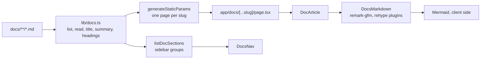

# The docs site

These documents are plain Markdown files in [`docs/`](../) at the repository root, and the web client publishes them at `/docs`. The same files render on GitHub unchanged: the site asks them for no special syntax, and maps GitHub-style relative links to site URLs when it renders them. This page explains how the files become pages, how links and diagrams are handled, how the sidebar is ordered, the checks that keep the docs consistent, and how to write a new page.

## Terms used on this page

- **Slug**: a doc's path under `docs/` without `.md`. `docs/pipeline/sync.md` has the slug `pipeline/sync` and is served at `/docs/pipeline/sync`.
- **Overview**: `docs/README.md`, which GitHub shows when the folder is opened; the site serves it at `/docs`.
- **Static generation**: rendering every page at build time, so a docs page is a pre-built HTML file.

## From file to page



| File                                                                                    | Role                                                                                                                                                                 |
| --------------------------------------------------------------------------------------- | -------------------------------------------------------------------------------------------------------------------------------------------------------------------- |
| [`lib/docs.ts`](../../client/src/lib/docs.ts)                                           | finds the folder, lists and reads docs, extracts title, summary and headings, groups the sidebar, rewrites links, estimates reading time, places a doc for its pager |
| [`app/docs/layout.tsx`](../../client/src/app/docs/layout.tsx)                           | the shell: site navbar, sidebar (a dropdown on phones), content column                                                                                               |
| [`app/docs/page.tsx`](../../client/src/app/docs/page.tsx)                               | `/docs`, rendered from `README.md`                                                                                                                                   |
| [`app/docs/[...slug]/page.tsx`](../../client/src/app/docs/%5B...slug%5D/page.tsx)       | every other doc; `dynamicParams = false`, so an unknown slug is a 404                                                                                                |
| [`components/docs/DocArticle.tsx`](../../client/src/components/docs/DocArticle.tsx)     | breadcrumb, reading time, body, previous and next links, the outline                                                                                                 |
| [`components/docs/DocsMarkdown.tsx`](../../client/src/components/docs/DocsMarkdown.tsx) | the Markdown pipeline and element overrides                                                                                                                          |
| [`components/docs/rehypeMermaid.ts`](../../client/src/components/docs/rehypeMermaid.ts) | lifts `mermaid` fences out before syntax highlighting                                                                                                                |
| [`components/docs/Mermaid.tsx`](../../client/src/components/docs/Mermaid.tsx)           | renders diagrams in the browser, with an expanded zoom-and-pan view                                                                                                  |
| [`components/docs/DocsNav.tsx`](../../client/src/components/docs/DocsNav.tsx)           | the sidebar with a title filter                                                                                                                                      |
| [`components/docs/DocsOutline.tsx`](../../client/src/components/docs/DocsOutline.tsx)   | "On this page", highlighting the section being read                                                                                                                  |

The docs folder is found by `resolveDocsDir`, which tries `../docs` and then `docs` relative to the working directory (`client/` under `next dev`, `next build` and Vitest), and requires a `README.md` inside. Files are read at build time, so **a doc edit needs a rebuild** to appear on the deployed site; `next dev` picks edits up on reload.

`/docs` is public. The auth proxy neither guards it nor redirects a signed-in visitor away.

## Metadata from the file

| Field        | Rule                                                                                                                                                         |
| ------------ | ------------------------------------------------------------------------------------------------------------------------------------------------------------ |
| title        | the first `# Heading` outside a code fence, as plain text; the page's `<title>` is "{title} - Illume Docs"                                                   |
| summary      | the first paragraph after the title, as plain text; the page's meta description. A doc that opens with a heading, list, table, quote, fence or HTML has none |
| headings     | every `##` heading, with the id `github-slugger` gives it, for the outline                                                                                   |
| reading time | words outside code blocks ÷ 200, at least one minute                                                                                                         |

Heading ids are computed with `github-slugger` over **every** heading in document order, as `rehype-slug` does when rendering, so duplicate headings get the same `-1`, `-2` suffixes in both places and in GitHub's own anchors.

## The Markdown pipeline

`DocsMarkdown` is a server component using `MarkdownAsync` from `react-markdown`:

1. `remark-gfm`: tables, task lists, strikethrough and autolinks.
2. `rehypeMermaid`: replaces each `<pre><code class="language-mermaid">` with a `<mermaid-diagram>` element holding the source. It must run before the highlighter, which would otherwise split the source into coloured spans.
3. `rehype-slug`: heading ids.
4. `rehype-autolink-headings`: appends a `#` link to each heading.
5. `rehype-pretty-code` with the `github-dark-default` theme: syntax highlighting at build time.

Element overrides:

- **Links** go through `resolveDocTarget` (below). Internal doc links become Next.js `Link`s; external ones open in a new tab with `rel="noopener noreferrer"`.
- **Images** resolve to the raw file on GitHub and load lazily.
- **Tables** are wrapped in a horizontally scrolling container.
- **`mermaid-diagram`** becomes the client-side `Mermaid` component.

### Link rewriting

`resolveDocTarget(target, fromSlug, kind)` resolves a relative target from the doc's own folder, exactly as GitHub does:

| Target                                    | Becomes                                                                             |
| ----------------------------------------- | ----------------------------------------------------------------------------------- |
| `#section`, `/path`                       | unchanged                                                                           |
| `https://…`, `mailto:…`, `//…`            | unchanged, opened in a new tab                                                      |
| another doc, `../pipeline/sync.md#leases` | `/docs/pipeline/sync#leases`                                                        |
| `README.md` (the overview)                | `/docs`                                                                             |
| any other repository file                 | `https://github.com/tejasnasa/illume/blob/main/<path>`, or `raw/main/` for an image |
| a path that climbs above the repository   | unchanged                                                                           |

So **code links in the docs always point at `main` on GitHub**. A link to a file that exists only in an uncommitted working tree resolves to a 404 until that file reaches `main`.

### Diagrams

Mermaid is imported dynamically after the component mounts, so it is never in the initial bundle and never runs on the server. Until it loads, or if a diagram fails to parse, the source stays visible as a `<pre>`. Diagrams use Mermaid's dark theme with `securityLevel: "strict"` and `startOnLoad: false`. A diagram is fitted to the column (never enlarged beyond its natural width) and opens full-screen at natural size from its Expand label or a click, with zoom from 0.25× to 4× in 1.25× steps and drag to pan.

The site uses Mermaid 12. Labels containing `( ) [ ] { } : ; , / # < > " @ |` must be quoted, `end` and `graph` are not valid node ids, line breaks are `<br/>`, sequence messages cannot contain `;` or `#`, `erDiagram` attribute types are single words, and `stateDiagram-v2` state names cannot contain colons. A diagram that breaks these rules renders as its source text.

## The sidebar

`DOC_SECTIONS` in `lib/docs.ts` lists the groups in order, each with its slugs in order. `groupSlugs` keeps only slugs that exist, then appends any doc no group names under "More", alphabetically, so a new doc never disappears. `placeDoc` flattens the sidebar, with the overview first, to give each page its group (the breadcrumb) and its previous and next pages.

| Group                  | What it holds                                                      |
| ---------------------- | ------------------------------------------------------------------ |
| Getting started        | local setup, a first ingest, the repository layout                 |
| Foundations            | architecture, authentication, BYOK and encryption                  |
| The pipeline           | ingestion and every stage page                                     |
| Retrieval and chat     | the index, chat, retrieval arms, the agent, the router, MCP        |
| The graph              | the dependency graph and its rendering                             |
| Interfaces             | the API, WebSockets, the export, the web client, this site, mobile |
| Evaluation             | the harness, judging and statistics, results                       |
| Reference              | data model, environment, constants, commands                       |
| Operations and testing | CI/CD, deployment, the runbook, the three test suites              |
| How-to guides          | step-by-step changes                                               |

The "Interfaces" title is referenced by name in a unit test.

## Checks

[`client/tests/unit/lib/docs.test.ts`](../../client/tests/unit/lib/docs.test.ts) runs over the real `docs/` folder:

- every doc has a title of its own (not empty, not equal to its slug);
- **every doc is named by a sidebar group**; the failure lists what to add to `DOC_SECTIONS`;
- **every link to a doc resolves to a doc that exists, and every `#anchor` to a heading that exists in it**, computed with the same slugger. Links inside code fences are ignored;
- the sidebar lists every doc exactly once, and its group titles equal `DOC_SECTIONS`' titles in order, so a group whose docs are all missing fails the test;
- `readDoc` rejects slugs with `..`, absolute paths and unknown names, and the link rewriter handles every case in the table above.

Links to repository files are not checked; a renamed source file leaves a dead GitHub link.

```bash
cd client
npx vitest run tests/unit/lib/docs.test.ts
```

## Writing a page

1. Create `docs/<area>/<name>.md`. Use lower-case, hyphenated names.
2. Line 1 is `# Title`. Then a blank line and a plain two-to-four-sentence summary paragraph: it becomes the meta description and the sidebar's preview, so do not start with a list or a heading.
3. Use `##` for sections and `###` below them. End with `## Design trade-offs and limits` and `## Related documentation`, as the other pages do.
4. Link with relative paths: `../pipeline/sync.md#leases` to a doc, `../../server/app/tasks/sync.py` to code, with symbol names in backticks. Anchors are github-slugger slugs of the heading text.
5. Put the slug in `DOC_SECTIONS` in the right group and position.
6. Run the docs test, then Prettier: `npx prettier --write ../docs/<area>/<name>.md`.
7. Check the page and its diagrams render: `npm run dev` and open `/docs/<area>/<name>`.

## Design trade-offs and limits

- **GitHub-native Markdown.** The same file works in two places, at the cost of no custom components: no tabs, callouts or embedded demos.
- **Build-time reads.** Fast static pages, but the deployed site lags the files until the client is rebuilt.
- **Links point at `main`.** Code links cannot follow a branch.
- **Client-rendered diagrams.** Mermaid runs in the browser, so diagrams appear a moment after the text and are not in the static HTML.
- **No search beyond titles.** The sidebar filter matches titles only.

## Related documentation

- [The documentation index](../README.md): the reading guide and glossary.
- [The web client](overview.md): routing and conventions around the docs routes.
- [Frontend and end-to-end tests](../testing/frontend-and-e2e.md): where the docs test runs in CI.
