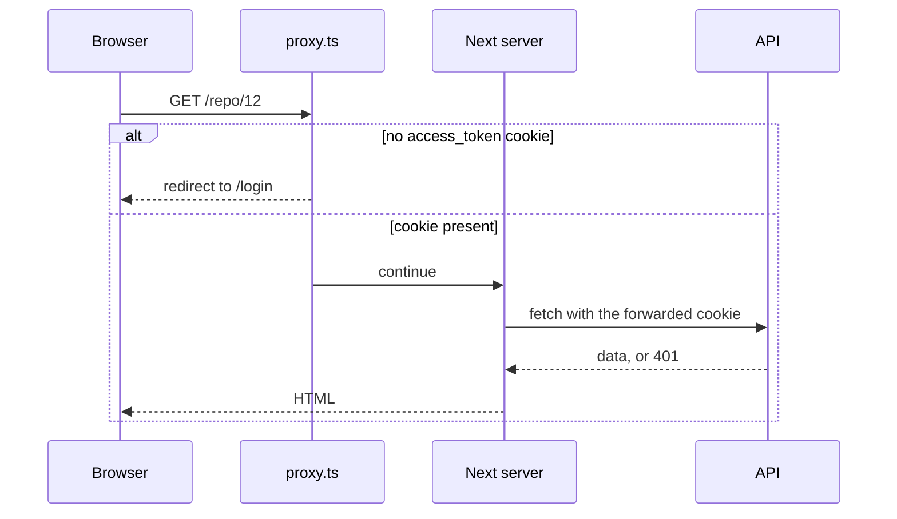

# The web client

The web client in [`client/`](../../client/) is a Next.js 16 App Router application on React 19 and Tailwind 4. It renders the landing page and the public docs, the dashboard of a user's repositories, five views of each repository (overview, explorer, glossary, graph and chat, plus settings), and the account settings. This page explains its routes, how it fetches data, how authentication gates pages, its component layout, and the conventions that matter when changing it.

> **Working-tree state.** The client is mid-redesign on the `ui-redesign` branch, with the work uncommitted. This page describes the working tree: several files it names (for example `PixelGraph.tsx`, `RepoCollection.tsx`, the `repo/[id]/settings` route and `app/mobile`) exist only there, so their GitHub links resolve only once that work is committed. `main` still has the earlier interface.

## Terms used on this page

- **Server component**: a React component rendered on the Next.js server. It can read cookies and call the backend before any HTML is sent.
- **Client component**: a file marked `"use client"`, rendered in the browser too, which can hold state and handle events.
- **Server action**: a function in a `"use server"` file that a component calls like a local function; Next.js runs it on the server.
- **Proxy**: Next.js 16's name for what earlier versions called middleware: code that runs before a route renders. Illume's is [`src/proxy.ts`](../../client/src/proxy.ts).

Next.js 16 changed APIs and file conventions. [`client/AGENTS.md`](../../client/AGENTS.md) tells contributors to read the bundled guides in `node_modules/next/dist/docs/` before writing client code, rather than relying on remembered Next.js behaviour.

## Stack

| Package                                    | Version     | Used for                                           |
| ------------------------------------------ | ----------- | -------------------------------------------------- |
| `next`                                     | 16.2        | routing, server components, server actions         |
| `react`                                    | 19.2        |                                                    |
| `tailwindcss`                              | 4           | styling, configured in `app/globals.css`           |
| `react-force-graph-3d`, `three`            | 1.29, 0.183 | the 3D graph page                                  |
| `react-markdown`, `remark-gfm`, `rehype-*` |             | the docs site and chat answers                     |
| `mermaid`                                  | 12.3        | diagrams in the docs                               |
| `geist`                                    |             | Geist Sans for text, Geist Pixel Square for labels |
| `vitest`, `@playwright/test`               | 5, 1.63     | unit and end-to-end tests                          |

Path alias `@/*` maps to `src/*`. The only environment variable is `NEXT_PUBLIC_BACKEND_URL`; see [environment variables](../reference/environment.md#clients).

## Routes

| Route                 | File                              | Access    | What it shows                                                                                                         |
| --------------------- | --------------------------------- | --------- | --------------------------------------------------------------------------------------------------------------------- |
| `/`                   | `app/page.tsx`                    | public    | the landing page: hero constellation, features, walkthrough, FAQ                                                      |
| `/login`              | `app/login/page.tsx`              | public    | GitHub sign-in beside a live graph                                                                                    |
| `/contact`            | `app/contact/page.tsx`            | public    | the contact form                                                                                                      |
| `/mobile`             | `app/mobile/page.tsx`             | public    | download page for the Android app                                                                                     |
| `/docs`, `/docs/...`  | `app/docs/`                       | public    | these documents; see [the docs site](docs-site.md)                                                                    |
| `/dashboard`          | `app/dashboard/page.tsx`          | signed in | the repository collection, the free-tier banner, adding a repository                                                  |
| `/settings`           | `app/settings/page.tsx`           | signed in | account, AI credentials, free-tier allowance, agent settings, MCP tokens, account deletion                            |
| `/repo/[id]`          | `app/repo/[id]/page.tsx`          | signed in | while ingesting, the live pipeline board; when ready, the overview: brief, stats, where to start, risky files, owners |
| `/repo/[id]/explorer` | `app/repo/[id]/explorer/page.tsx` | signed in | the file tree with reading order, and a selected file's risk, owners, symbols, history and neighbourhood              |
| `/repo/[id]/glossary` | `app/repo/[id]/glossary/page.tsx` | signed in | the glossary, paginated, with an A to Z rail and search                                                               |
| `/repo/[id]/graph`    | `app/repo/[id]/graph/page.tsx`    | signed in | the 3D dependency graph; see [rendering](../graph/rendering.md)                                                       |
| `/repo/[id]/chat`     | `app/repo/[id]/chat/page.tsx`     | signed in | conversations, presets, streamed agent answers, the live graph                                                        |
| `/repo/[id]/settings` | `app/repo/[id]/settings/page.tsx` | signed in | auto-update, the analysed version, export, re-ingest and delete                                                       |
| `/dev/pipeline`       | `app/dev/pipeline/page.tsx`       | public    | a harness that replays recorded ingest frames through the real pipeline board                                         |

`[id]` is the repository's `repo_number`, not its UUID. Pages that call UUID-keyed endpoints first load the repository to get its `id`.

Every route has a `loading.tsx` skeleton, so navigation streams immediately. `app/error.tsx` and `app/repo/[id]/error.tsx` are error boundaries, and `app/not-found.tsx` is the 404 page; the last two use `StatusScreen`. There is no `/signup` route: sign-in is through GitHub OAuth, and `SignupForm.tsx` is no longer rendered anywhere.

### The repository layout

[`app/repo/[id]/layout.tsx`](../../client/src/app/repo/%5Bid%5D/layout.tsx) is a server component shared by every repository route. It loads the repository and its file-level graph once, wraps the children in `RepoGraphProvider` ([`RepoGraphContext.tsx`](../../client/src/components/RepoGraphContext.tsx)) so client pages can read the graph without fetching it again, and renders `RepoNavbar` and `BackgroundGraph`. On the graph and settings routes the background is veiled; on the chat route it gives way to the chat's own live graph.

## Authentication



- The session is the backend's httponly `access_token` cookie. The client never stores a token in `localStorage`.
- [`proxy.ts`](../../client/src/proxy.ts) redirects a request without the cookie away from any path starting with `/dashboard`, `/repo` or `/settings`, and a request with the cookie away from exactly `/` or `/login` to the dashboard. It only checks that the cookie **exists**; the backend validates it. Its matcher skips `api`, `_next/static`, `_next/image` and `.png` paths.
- Because `/` redirects a signed-in user, the landing page is visible only when signed out.
- Signing in sends the browser to `${NEXT_PUBLIC_BACKEND_URL}/api/v1/auth/github`; the backend sets the cookie on its callback. See [authentication](../security/auth.md).

## Data fetching

Fetching is hybrid, deliberately:

| Where                                                          | How                                                                     | Cache      |
| -------------------------------------------------------------- | ----------------------------------------------------------------------- | ---------- |
| server components, via [`src/api/*`](../../client/src/api/)    | `fetch` with `cookie: (await headers()).get("cookie")` forwarded        | `no-store` |
| server actions in [`src/actions/*`](../../client/src/actions/) | `fetch` with `Cookie: cookieStore.toString()`                           | `no-store` |
| client components and hooks                                    | `fetch(..., { credentials: "include" })` straight to the backend origin | browser    |

Every file under `src/api/` and `src/actions/` is `"use server"`. The browser reaches the backend at the absolute `NEXT_PUBLIC_BACKEND_URL`; there are no `rewrites`, so the backend's CORS configuration must allow the frontend origin with credentials.

| Module              | Fetches                                                 |
| ------------------- | ------------------------------------------------------- |
| `api/auth.ts`       | the current user                                        |
| `api/repository.ts` | the repository list and one repository                  |
| `api/graph.ts`      | `GET /graph?level=`                                     |
| `api/guide.ts`      | the onboarding guide and stats                          |
| `api/glossary.ts`   | glossary pages and search                               |
| `api/ownership.ts`  | ownership and knowledge silos                           |
| `api/fileDetail.ts` | one file's symbols and history                          |
| `api/chat.ts`       | chat history                                            |
| `api/github.ts`     | the GitHub proxy (branches, commits, repository search) |

Server actions cover writes: deleting, re-ingesting and syncing a repository, auto-update settings, AI credentials and agent settings, MCP tokens, and the `.illume` export. Actions that end in `redirect()` are called through `utils/redirectingAction.ts`, which tells a real redirect apart from a failure.

Client components that talk to the backend directly: the chat (`useAgentStream`, `useConversation`, `useConversationList`), the ingest WebSocket (`useIngestStream`), the repository picker and timeline (`RepoPickerModal`, `useGitGraph`), repository settings, repository thumbnails, the GitHub star count and the status line (`SystemStatus`, which reads the backend health probe).

### Polling

- `DashboardRefresh` calls `router.refresh()` periodically while any repository on the dashboard is ingesting.
- `RepoStatusPoller` does the same on a repository page while a background sync is running or the ingest has not finished.
- `IngestFlow` refreshes once when an ingest completes or fails; see [the WebSocket page](../interfaces/websockets.md#retries-stalls-and-the-end-of-a-run).

## The chat client

The chat is the most involved part of the client and is documented with the backend it talks to:

- [`hooks/useAgentStream.ts`](../../client/src/hooks/useAgentStream.ts) posts to the streaming endpoint and parses the response body with the small SSE parser in [`lib/agent/sse.ts`](../../client/src/lib/agent/sse.ts).
- [`lib/agent/reducer.ts`](../../client/src/lib/agent/reducer.ts) is a pure state machine that folds events into a turn: steps, lanes, highlights for the live graph, the answer text and its citations.
- [`lib/agent/presets.ts`](../../client/src/lib/agent/presets.ts) lists the presets, which are disabled for the user's tier and model, the advanced overrides, and what is remembered between visits.
- `ChatPage`, `TurnView`, `ActivityBlock`, `AnswerView`, `CitationCard`, `PresetPicker`, `AdvancedDrawer`, `ConversationSidebar` and `StaleNotice` render it.

See [chat and citations](../retrieval/chat.md) and [the agent](../retrieval/agent.md#events).

## Component layout

```text
client/src/
  app/            routes, layouts, loading and error files, globals.css
  api/            "use server" reads for server components
  actions/        "use server" writes
  components/     page-level components
    chat/         the chat page and its parts
    docs/         the docs site renderer
    ingest/       the pipeline board and raw log
    landing/      landing page sections and demos
    ui/           shared building blocks: Button, Modal, Select, Switch, cards
  hooks/          client state and fetching
  lib/            pure logic: agent state, pixel graph scenes, docs loading, GitHub helpers
  utils/          small pure helpers
  types/          shared TypeScript types for API payloads
  proxy.ts        the auth gate
```

Pure logic lives in `lib/` and `utils/` with no React imports, so it can be unit-tested in Vitest's Node environment. `utils/ingestFlow.ts` and `lib/agent/reducer.ts` are the two examples that matter most.

## Conventions

- **WebGL only in the browser.** Any component that uses Three.js is imported with `next/dynamic` and `{ ssr: false }`, as `GraphClient` does.
- **Dynamic imports for heavy client-only code.** The chat's `LiveGraph` is loaded only on wide screens; Mermaid is imported after mount.
- **Prettier formatting**, two-space indent, format on save (configured in `.zed/settings.json`).
- **ESLint over `src/` is report-only in CI.** `npm run lint` currently reports about 50 problems, 30 of them `no-explicit-any`. Lint over `tests/`, `e2e/`, `e2e-prod/` and `vitest.config.ts` blocks.
- **Type-check with typegen first**: `npx next typegen` then `npx tsc --noEmit` (also `npm run typecheck`), because `next-env.d.ts` is gitignored.
- **One dark theme.** The interface ships one palette; colours are CSS variables in `globals.css`.
- **The `Graph` type is loose.** `types/graph.ts` declares `language`, `fan_in` and `fan_out` on every node, but symbol-level nodes from the API do not carry them.

## Design trade-offs and limits

- **Hybrid fetching.** Server components give fast first paint with the session cookie; client fetches keep interactive pages live. The price is two ways of calling the same backend, and CORS configuration that must be right.
- **Existence-only gating.** The proxy cannot tell an expired cookie from a valid one, so an expired session reaches a page and fails there with a 401 from the backend.
- **No client cache.** Everything is `no-store`, so every navigation refetches.
- **Uncommitted redesign.** Documentation and `main` disagree until the redesign is committed.

## Related documentation

- [The docs site](docs-site.md): how these pages are served.
- [Rendering the graph](../graph/rendering.md): the graph components.
- [Frontend and end-to-end tests](../testing/frontend-and-e2e.md): how the client is tested.
- [The mobile app](../mobile/overview.md): the native client.
- [API reference](../api.md): every endpoint the client calls.
