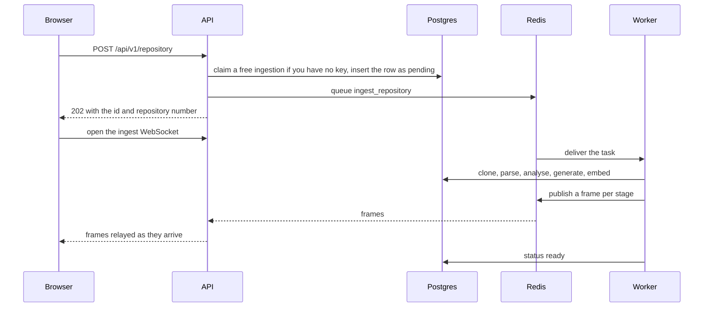

# Your first ingest

This page follows one repository from the moment you add it to the moment every page works. It shows what you see in the browser, what the backend does at each point, and where to look when something stalls. It assumes the stack from [local setup](local-setup.md) is running.

## Terms used on this page

- **Ingest**: the one background task that clones a repository, analyses it and writes everything the pages show. Its code starts at `ingest_repository` in [`server/app/tasks/ingest.py`](../../server/app/tasks/ingest.py).
- **Snapshot**: the branch and commit an ingest analysed, stored as `ingested_branch` and `ingested_commit_sha`. Every page and every citation describes that commit, not the live repository.
- **Repository number**: a small integer (`repo_number`) the web routes use, as in `/repo/3`. The API also uses a UUID `id`.
- **Frame**: one progress message the worker publishes and the browser receives over a WebSocket.

## 1. Add a repository

Sign in and open the dashboard. **Add repository** opens a dialog with two ways in:

- **Search your GitHub repositories**, which needs a linked GitHub account and lists public and private repositories the token can see.
- **Paste a URL** of the form `https://github.com/owner/repository`. Any other host is refused, because the clone step puts the user's GitHub token in the clone URL. Public repositories need no token.

You can pick a branch and a commit on a small branch timeline before you confirm. The default is the head of the default branch.

## 2. What the backend does

If you have no AI key of your own, the ingest spends one of your three free ingestions (`FREE_INGESTIONS = 3` in [`app/services/entitlements.py`](../../server/app/services/entitlements.py)), and its model calls use the operator's free-tier key. With no free ingestions left and no key, the API answers 402.

## 3. Watch the progress board

The repository page shows a live board of every stage while the status is not `ready`. Each node starts _pending_, becomes _active_ when its `started` frame arrives and _done_ when its `done` frame arrives. The board's seven columns are `PIPELINE_COLUMNS` in [`client/src/utils/ingestFlow.ts`](../../client/src/utils/ingestFlow.ts):

| Column  | Nodes on the board                           | Stage ids                                                     | Needs a model             |
| ------- | -------------------------------------------- | ------------------------------------------------------------- | ------------------------- |
| Fetch   | Fetch Repo                                   | `clone`                                                       | no                        |
| Read    | Parse files, Mine Git History, Gather PRs    | `parse`, `git_history`, `pr_fetch`                            | no                        |
| Connect | Map Connections, Rank Impact, Identify Stack | `resolve_dependencies`, `compute_fan_metrics`, `detect_stack` | no                        |
| Score   | Score Risk                                   | `criticality`                                                 | no                        |
| Write   | Create Glossary, Create Reading Order        | `glossary`, `reading_order`                                   | yes, generation           |
| Index   | Generate Embeddings, Analyze Architecture    | `generate_embeddings`, `brief`                                | embeddings and generation |
| Done    | Ready                                        | `ready`                                                       | no                        |

The `cochange` stage also publishes frames, but the board has no node for it.

[The pipeline stages](../pipeline/ingestion.md#the-stages) describe each one, and [every frame, in order](../interfaces/websockets.md#every-frame-in-order) lists what the board receives. If you reload mid-ingest, the board rebuilds what it can from the row's `status` and then follows the live frames.

How long it takes depends on the repository. Cloning and parsing are quick for small repositories. Generation and embeddings are usually the longest part, because they wait on model providers. A large repository can take many minutes.

## 4. Explore the result

When the status reaches `ready`, every tab works:

| Page     | Route                | What it shows                                                                                          | Built from                                   |
| -------- | -------------------- | ------------------------------------------------------------------------------------------------------ | -------------------------------------------- |
| Overview | `/repo/<n>`          | the architecture brief, languages, where to start reading, risky files, recent activity and who to ask | brief, reading order, criticality, ownership |
| Explorer | `/repo/<n>/explorer` | the file tree with reading-order notes and risk markers                                                | file graph and guide                         |
| Glossary | `/repo/<n>/glossary` | the project's own terms, searchable                                                                    | glossary                                     |
| Graph    | `/repo/<n>/graph`    | the interactive 3D dependency graph, at file or symbol level, with a reading-order tour                | dependency edges, criticality                |
| Chat     | `/repo/<n>/chat`     | questions answered from the code, with citations to the ingested commit                                | the vector index and the retrieval presets   |
| Settings | `/repo/<n>/settings` | auto-update, a manual sync, regenerate, the `.illume` export and delete                                | the repository row                           |

Good first questions for chat: "where does a request get authenticated?", "what would I change to add a new X?", and "who knows the most about Y?". Try the **Classic**, **Hybrid** and **Structural** presets on the same question to see how retrieval changes the answer. [Chat](../retrieval/chat.md) explains the presets.

## 5. Keep it current

Turn on **Auto-update** in the repository's settings. Every interval (6 hours by default; 1, 3, 6, 12 or 24 hours), the beat process queues a check. The worker compares the remote head with the snapshot and, if it moved, rebuilds only what changed. The repository stays `ready` throughout, so the pages keep working during an update. [Auto-update](../pipeline/sync.md) explains how.

## When something goes wrong

| What you see                           | Look at                                                                                                                                       |
| -------------------------------------- | --------------------------------------------------------------------------------------------------------------------------------------------- |
| the board never leaves its first stage | the worker terminal; the worker may not be running                                                                                            |
| the board stops on one stage           | the worker log for an exception, then `grep stage_timer` for the last stage that finished                                                     |
| the page shows _failed_                | the worker log. The task retries three times, 10 seconds apart, before it stays failed. Re-ingest from the page once you have fixed the cause |
| the guides say generation failed       | the generation key; the brief falls back to a placeholder instead of failing the ingest                                                       |
| chat says no relevant code was found   | the embeddings stage; check `OPENAI_API_KEY`                                                                                                  |

The [runbook](../operations/runbook.md) covers the same symptoms for production.

## Design trade-offs and limits

- **One task, all or nothing.** A failure at any stage fails the whole ingest, and the retry starts again from the clone.
- **Snapshots, not live code.** Pages, chat and citations describe the ingested commit until the next sync or re-ingest.
- **Re-ingest deletes first.** Re-ingesting deletes the row and every child row, then recreates it with the same id and number, so the pages are empty until the new ingest finishes. A sync, by contrast, keeps the old data visible.
- **No progress for syncs.** A background update publishes no frames, so the board appears only for the first ingest and for a re-ingest.

## Related documentation

- [Ingestion](../pipeline/ingestion.md): every stage in depth.
- [WebSockets](../interfaces/websockets.md): the progress frames and the board.
- [Chat](../retrieval/chat.md): how questions are answered.
- [Auto-update](../pipeline/sync.md): background syncs.
- [Architecture](../architecture.md): the whole system on one page.
