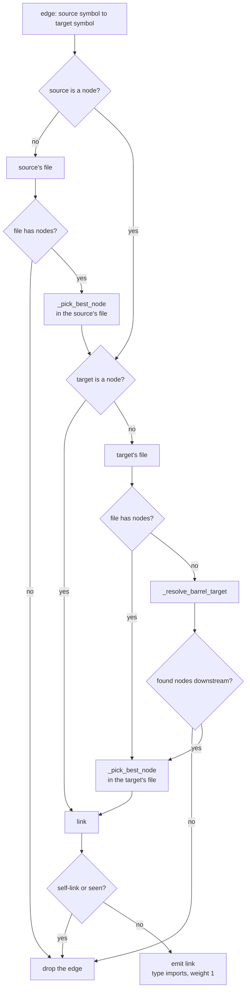

# The dependency graph

The dependency graph records which files import which. The ingest stores it as symbol-to-symbol `Dependency` edges, and two services read it back: [`graph_builder.py`](../../server/app/services/graph_builder.py) builds the file-level and symbol-level payloads the graph page draws, and [`file_graph.py`](../../server/app/services/file_graph.py) gives every other consumer (the reading order, the export, the architecture brief, retrieval's graph expansion and the agent's graph tools) a shared file-level view. This page explains how edges are stored, how both payloads are built, barrel resolution, the shared helpers, and the endpoints.

## Terms used on this page

- **Edge**: one `Dependency` row, from a source symbol to a target symbol, with a `dep_type`.
- **Node**: something the graph page draws. At file level a node is a file; at symbol level it is a function or class.
- **Fan-in, fan-out**: how many distinct files import a file, and how many it imports. Stored on `files` at ingest.
- **Barrel**: a file with no function or class symbols, usually an `index.ts` or `__init__.py` that only re-exports others. Detected by structure, not by name.
- **Collapse**: merging many symbol-level edges between the same two files into one file-level link.

## How edges are stored

The [dependency resolver](../pipeline/parsing-and-dependencies.md#resolving-imports-to-files) turns each import statement into an edge:

- the **source** is the import symbol itself (a row of kind `import` in `ast_symbols`), so the edge sits in the importing file;
- the **target** is a definition in the imported file chosen by name (the imported name, or the file's first definition), or, when the imported file has no definitions but has imports, that barrel's first import symbol, so the chain can be followed later;
- `dep_type` is always `imports`. The column's enum also allows `calls`, `inherits` and `instantiates`, but nothing writes them, so there is **no call graph**;
- each pair of files gets **at most one** edge, however many import statements link them, and self-imports are dropped.

The table has `uq_dependency_edge (source_symbol_id, target_symbol_id)`, and both foreign keys cascade, so deleting a file removes every edge touching its symbols. See [the data model](../reference/data-model.md).

Import edges are only produced for Python and the JavaScript family (JS, JSX, TS, TSX). Other parsed languages contribute nodes but no edges.

## The graph endpoint

`GET /api/v1/repository/{repo_id}/graph?level=file|symbol` in [`api/v1/graph.py`](../../server/app/api/v1/graph.py). The router prefix is `/api/v1/repository`, so the path is under the repository, not under `/graph`.

| Status | When                                                 |
| ------ | ---------------------------------------------------- |
| 200    | the graph payload                                    |
| 404    | the repository does not exist or is not the caller's |
| 409    | `status != "ready"`                                  |
| 422    | `level` is not `file` or `symbol`                    |
| 500    | the build raised (the exception is logged)           |

Nothing is cached server-side, the client fetches with `cache: "no-store"`, and **there is no node cap**: every file, or every function and class, is returned. A large repository produces a large payload; the client's pixel renderer caps what it draws (see [rendering](rendering.md)), but the 3D graph page draws everything.

The payload has the same shape at both levels:

```json
{
  "nodes": [
    {
      "id": "...",
      "label": "repo_cache.py",
      "path": "server/app/services/repo_cache.py",
      "group": "server/app/services",
      "kind": "file",
      "loc": 412,
      "criticality": "caution",
      "criticality_score": 75.0,
      "language": "python",
      "fan_in": 3,
      "fan_out": 5
    }
  ],
  "links": [
    { "source": "...", "target": "...", "type": "imports", "weight": 1 }
  ],
  "metadata": { "total_nodes": 1, "total_edges": 1, "clusters": 1 }
}
```

`metadata.clusters` is the number of distinct top-level directories (`_top_dir`; a file at the root counts as `root`).

### `GET /graph/thumbnail`

`GET /api/v1/repository/{repo_id}/graph/thumbnail` returns a condensed file graph for the picture on a repository card: the `THUMBNAIL_MAX_FILES = 120` files with the highest `fan_in + fan_out` (ties by path), each with id, path, LOC, criticality and fan-in, and the links among only those files, de-duplicated and self-links removed. A repository that is not ready returns an empty graph rather than 409, so a card for a repository still ingesting renders without an error.

## File level

`_build_file_graph` loads every file of the repository and builds one node per file:

| Field               | From                                                                                |
| ------------------- | ----------------------------------------------------------------------------------- |
| `id`                | the file's UUID                                                                     |
| `label`             | the basename                                                                        |
| `path`              | the repository-relative path                                                        |
| `group`             | the parent directory (`_parent_dir`), or `root`                                     |
| `kind`              | always `file`                                                                       |
| `loc`               | `files.loc`, or 0                                                                   |
| `criticality`       | `files.criticality`, or `medium` when unset                                         |
| `criticality_score` | `critical` 100, `caution` 75, `safe` 25, anything else 50, after `.lower().strip()` |
| `language`          | `files.language`, or `unknown`                                                      |
| `fan_in`, `fan_out` | the stored columns, or 0                                                            |

Criticality labels are `critical`, `caution` and `safe`, written by [criticality scoring](../pipeline/git-intelligence.md#criticality). `medium` is only the builder's placeholder for a file that was never scored, and it scores 50.

Links come from `_file_edge_stmt`, which joins `dependencies` to `ast_symbols` twice (once for the source symbol, once for the target) and keeps edges whose source and target files both belong to the repository. Then:

1. Self-edges (source file equals target file) are dropped.
2. Edges are grouped by `(source_file, target_file)`, counting each `dep_type`.
3. Each group becomes one link: `type` is the most common `dep_type`, `weight` is the number of edges collapsed.

Because the resolver already writes one edge per file pair and only ever writes `imports`, in practice every file-level link has `type: "imports"` and `weight: 1`. The collapsing logic is there for the edge types the schema allows but nothing yet produces.

**Barrels appear as ordinary nodes at file level.** An importer of `components/index.ts` links to `index.ts`, and `index.ts` links onward to what it re-exports. Nothing is resolved through it; the file graph shows the files as they are.

## Symbol level

`_build_symbol_graph` draws functions and classes. Its nodes:

| Field               | From                                                             |
| ------------------- | ---------------------------------------------------------------- |
| `id`                | the symbol's UUID                                                |
| `label`             | the symbol's name                                                |
| `path`, `group`     | its file's path and parent directory, or `unknown`               |
| `kind`              | `function` or `class`                                            |
| `loc`               | `end_line - start_line + 1`, or 0 without line numbers           |
| `complexity`        | the stored cyclomatic complexity, or 0                           |
| `criticality`       | its **file's** criticality, or `medium`                          |
| `criticality_score` | from the file's criticality **without** lower-casing or trimming |

Symbol nodes have no `language`, `fan_in` or `fan_out`, even though the client's `Graph` type declares them on every node. And because the symbol level skips `.lower().strip()`, a mixed-case or padded criticality value scores 50 at symbol level and its proper score at file level. The scorer only writes lower-case labels, so this is latent.

Only kinds `function` and `class` are nodes. The parser stores Python methods as `function`, so they appear; JavaScript-family methods are stored as `method` and do not. Interfaces, type aliases, enums and variables are not nodes either.

### Edges between symbols

Every stored edge links an import symbol (not a node) to a target symbol (often a node, sometimes another import symbol). So almost every edge needs both ends lifted onto nodes:



- **Source side.** A non-node source is lifted to a node in its own file with `_pick_best_node`, passing the source symbol's name. For an import symbol that name rarely matches a definition, so this usually falls through to the file's first function. A source file with no nodes (a barrel or a file of constants) drops the edge; the barrel's onward edges are used for resolution instead.
- **Target side.** A non-node target is lifted to a node in its file, or, when the file has no nodes, resolved through barrels (below).
- Self-links and duplicate `(source, target)` pairs are dropped. Every link has `weight: 1`.

### `_pick_best_node`

Given candidate node ids in one file and a name, it returns, in order of preference:

1. a candidate whose name equals the name exactly;
2. one whose name matches case-insensitively;
3. the first `function` whose name is not `<anonymous>` or `Props`;
4. the first `class` with the same exclusions;
5. the first candidate.

`<anonymous>` is the parser's name for unnamed functions; `Props` is excluded because React components commonly declare a `Props` type or class next to the component, and an edge should land on the component.

### Barrel resolution

A barrel contains only re-export symbols, so at symbol level it contributes zero nodes and an edge into it would have nowhere to land. `_resolve_barrel_target(file_id)` follows it:

1. It first builds `barrel_file_targets`: for every edge whose source symbol is in a file with no nodes, the target symbol's file is added to that file's list. That is the barrel's own outgoing re-exports.
2. Resolving a file: if it has nodes, return them. Otherwise recurse into each file it re-exports from and concatenate what they return.
3. A `visited` set makes it cycle-safe: two barrels that re-export each other terminate.

The candidates it returns go to `_pick_best_node` with the **original** target symbol's name, so `import { Button } from "./components"` lands on `Button` in `components/Button.tsx` when the barrel re-exports it, rather than on whatever the first function is.

Barrels are detected **structurally**: any file without function or class nodes is a candidate, whatever its name. A Python `constants.py` with no functions is treated the same as an `index.ts`, which is the right outcome for drawing (it has nothing to draw), though such a file is not really re-exporting anything.

### Sibling links

After the import edges, every file with at least two nodes gets a chain of `sibling` links between its nodes in source order (by `start_line`): first to second, second to third, and so on. They are not dependencies; they exist so the force layout keeps a file's functions together. `sibling` is not a `dep_type` and appears only in this payload.

## The shared file-graph helpers

[`file_graph.py`](../../server/app/services/file_graph.py) was split out because several consumers had each re-implemented the symbol-to-file join with different de-duplication rules. `graph_builder` keeps its own private `_file_edge_stmt` for the visualisation, so **a change to edge derivation must be made in both**.

| Function                 | Flavour | Returns                                                                                  | Used by                                                                                      |
| ------------------------ | ------- | ---------------------------------------------------------------------------------------- | -------------------------------------------------------------------------------------------- |
| `query_file_edges`       | sync    | `(source_file_id, target_file_id)` pairs                                                 | tests and older callers                                                                      |
| `build_adjacency`        | sync    | forward and reverse adjacency sets from those pairs                                      |                                                                                              |
| `build_file_graph`       | sync    | `deps` and `rdeps` maps                                                                  |                                                                                              |
| `iter_file_edges`        | sync    | the same pairs, streamed in chunks of `_EDGE_STREAM_CHUNK = 1000`                        | [`onboarding.py`](../../server/app/services/onboarding.py)                                   |
| `build_int_adjacency`    | sync    | forward and reverse maps keyed by small integers instead of UUIDs, built from the stream | `onboarding.py`, for the reading order's topological sort                                    |
| `query_file_edges_async` | async   | `(dep_type, source_file, target_file)`, optionally with the target symbol's name         | the thumbnail endpoint, [`illume_exporter.py`](../../server/app/services/illume_exporter.py) |
| `query_neighbours_async` | async   | `(seed, neighbour, weight)` one import away, looking through barrels                     | retrieval's graph expansion, the agent's `get_importers`, `get_importees` and `find_path`    |
| `build_dep_path_map`     | pure    | each file id mapped to the de-duplicated paths it depends on                             | [`architecture_brief.py`](../../server/app/services/architecture_brief.py)                   |

The reading order streams edges into integer-keyed maps because, for a large repository, a dictionary of UUID sets for every file is a significant part of the stage's memory; see [LLM generation](../pipeline/generation.md).

### `query_neighbours_async`

`query_neighbours_async(db, repo_id, file_ids, *, through_barrels=True, direction="both")` answers "which files are one import away from these", which is what an agent or a retrieval expansion actually wants: the real module behind a barrel, not the barrel.

1. `_edge_counts_touching` collapses every edge with an endpoint in the seed files to `(source_file, target_file, count)`.
2. For each seed it records outward hops (files it imports) unless `direction="importers"`, and inward hops (files importing it) unless `direction="importees"`. Self-edges are ignored.
3. With `through_barrels=False` it returns those hops summed per neighbour.
4. Otherwise `_files_without_nodes` finds which neighbours are barrels (no function or class symbol). Non-barrel neighbours are final.
5. Barrel neighbours become a frontier. For up to `_MAX_BARREL_DEPTH = 5` rounds it loads their edges and keeps walking in the same direction: an outward walk follows what the barrel imports, an inward walk follows what imports the barrel. A barrel with no onward edge is kept as a neighbour itself, so it is not silently lost. Each walk keeps the weight of its first hop. Walks that return to the seed are dropped, and `visited` prevents cycles.
6. Results are merged, keeping the larger weight when a neighbour is reached both directly and through a barrel.

The depth limit bounds the cost on pathological re-export chains; real barrel chains are one or two levels deep.

## Where the graph ends up

| Consumer                         | Reads                                      | Page                                                                                   |
| -------------------------------- | ------------------------------------------ | -------------------------------------------------------------------------------------- |
| the graph page                   | `GET /graph` at both levels                | [rendering](rendering.md)                                                              |
| the repository layout background | `GET /graph?level=file`                    | [rendering](rendering.md)                                                              |
| repository cards                 | `GET /graph/thumbnail`                     | [rendering](rendering.md)                                                              |
| the reading order                | `iter_file_edges`, `build_int_adjacency`   | [LLM generation](../pipeline/generation.md)                                            |
| the architecture brief           | `build_dep_path_map`                       | [LLM generation](../pipeline/generation.md)                                            |
| the `.illume` export             | `query_file_edges_async` with target names | [the export](../interfaces/illume-export.md)                                           |
| graph expansion in retrieval     | `query_neighbours_async`                   | [retrieval arms](../retrieval/retrieval-arms.md#graph)                                 |
| agent and MCP graph tools        | `query_neighbours_async`                   | [the agent](../retrieval/agent.md#the-tools)                                           |
| fan-in and fan-out               | the resolver's own join at ingest          | [parsing and dependencies](../pipeline/parsing-and-dependencies.md#fan-in-and-fan-out) |

The reading-order tier never reaches the graph payload. The guide endpoint returns each entry's position, path, annotation and fan-in but not its tier, and the client joins the guide onto graph nodes by `path` when it draws the tour.

## Design trade-offs and limits

- **Imports only.** No call graph is captured anywhere, so neither level shows which function calls which. The symbol level's edges are import edges lifted onto functions by name.
- **Two languages.** Only Python and the JavaScript family produce edges.
- **One edge per file pair.** File-level weights are always 1, so the graph cannot show that one file uses another heavily.
- **Two implementations of one join.** Deliberate, to keep the visualisation's rules independent, but a change must be made twice.
- **No caching and no cap.** Every request rebuilds the graph from the database, and the payload grows with the repository.
- **Heuristic lifting.** Symbol-level links land on the best-named node or the first function, which is sometimes the wrong one.
- **Structural barrels.** Any file without functions or classes is looked through at symbol level and by the neighbour query, including files that are not really barrels.

## Related documentation

- [Parsing and dependencies](../pipeline/parsing-and-dependencies.md): how edges and fan metrics are produced.
- [Rendering the graph](rendering.md): how the client draws these payloads.
- [Retrieval arms](../retrieval/retrieval-arms.md#graph): graph expansion.
- [The mobile graph renderer](../mobile/graph-renderer.md): the same payload drawn on a phone.
- [Data model](../reference/data-model.md): the `dependencies`, `ast_symbols` and `files` tables.
