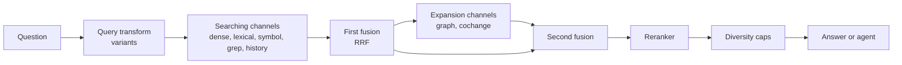

# Add a retrieval channel or arm

This guide covers the two ways to change how chat finds code. Adding a **channel** gives the retrieval pipeline a new way to search. Adding an **arm** gives the evaluation harness a new configuration to measure. The two usually come together: a new channel is not worth shipping until an arm shows it helps. Read [retrieval arms](../retrieval/retrieval-arms.md) and [the eval harness](../evals/harness.md) first.

## Terms used on this page

- **Channel**: one way of finding candidates, such as vector similarity (`dense`) or full-text search (`lexical`). The code is in [`app/services/retrieval/channels/`](../../server/app/services/retrieval/channels/).
- **Searching channel**: a channel that searches the question itself. It implements `Channel.search`.
- **Expansion channel**: a channel that takes the best files from a first fusion pass and returns files near them, such as `graph` and `cochange`. It implements `ExpansionChannel.expand`.
- **Spec**: the frozen Pydantic object that configures one channel, such as `DenseChannel(k=50, max_distance=0.7)`. Specs are in [`app/services/retrieval/config.py`](../../server/app/services/retrieval/config.py).
- **Preset**: a named `PipelineConfig` the product offers: `classic`, `hybrid`, `hybrid_rerank`, `structural`, `deep_agent` and `deep_agent_workers`.
- **Arm**: an `Arm` in [`evals/arms.py`](../../server/evals/arms.py). It pairs a `PipelineConfig` with the arm it is compared against and the fields it deliberately changes.

## Where a channel sits



`retrieve` in [`app/services/retrieval/pipeline.py`](../../server/app/services/retrieval/pipeline.py) looks each spec up by its `kind` with `get_channel` or `get_expansion_channel` and awaits the channels **one at a time**. They share the request's single `AsyncSession`, which two coroutines cannot use at once. The module docstring of [`channels/base.py`](../../server/app/services/retrieval/channels/base.py) explains why.

## Add a channel

### 1. Write the spec

Add a class to `config.py` that extends `_ChannelBase`. That base class supplies `weight` (0 to 10, default 1) and `k` (1 to 200, default 50). Give the class a `Literal` `kind` and bounded fields:

```python
class TestsChannel(_ChannelBase):
    """Test files that exercise the strongest files.

    Attributes:
        seeds: How many top files from the first fusion pass are expanded.
    """

    kind: Literal["tests"] = "tests"
    seeds: int = Field(default=5, ge=1, le=20)
```

Then update three things in the same file:

| What                 | Change                                                         |
| -------------------- | -------------------------------------------------------------- |
| `ChannelSpec`        | add the class to the discriminated union                       |
| `ChannelKind`        | add the literal                                                |
| `EXPANSION_CHANNELS` | add the kind if the channel expands seeds instead of searching |

Every field you add changes `PipelineConfig.config_hash`. That is intended: a run records the hash of the configuration that produced it, and the eval manifests compare hashes ([the configuration hash](../retrieval/retrieval-arms.md#the-configuration-hash)).

### 2. Write the channel

Create `channels/<kind>.py` with a class that has a `kind` attribute and the right method:

```python
class TestsExpansion:
    kind = "tests"

    async def expand(self, ctx, seeds, spec):
        ...
```

The contract in `base.py`:

- Return up to `spec.k` candidates, best first. Each candidate carries exactly one hit for this channel, with ranks starting at 1.
- **Return only rows of `ctx.repository_id`.** Join on `file_id` and `repository_id`, never on a path or a name. Two repositories can share every path and symbol name.
- An expansion channel never returns a seed file. It uses `variant=0`, and it skips seeds that have no `file_id`.
- Use `ctx.embedding(text)` for vectors. Do not call the embedding API yourself: tests inject a deterministic fake through `ctx.embed`.
- Use `ctx.emit` for a degradation event when the channel gives up on part of the work. Do not raise for a recoverable problem. The grep channel shows the pattern: it refuses an invalid regex or a statement timeout, and it does not fail the request.

The helpers in `channels/_common.py`, `_files.py` and `_symbols.py` already build file and symbol candidates. Reuse them.

### 3. Register it

Add an instance to `_CHANNELS` or to `_EXPANSIONS` in [`channels/__init__.py`](../../server/app/services/retrieval/channels/__init__.py).

### 4. Decide who can use it

A channel no preset uses is invisible to the product. [`app/services/agent/overrides.py`](../../server/app/services/agent/overrides.py) handles a user's per-request channel overrides:

- It builds `CHANNEL_CATALOGUE` from the channels the presets already run.
- It refuses to _add_ a channel on the free tier.
- It keeps **its own copy** of `ChannelKind`. Update that copy as well, or the override schema rejects the new kind.

To ship the channel, add it to a preset in `config.py`, usually `structural` and the two agent presets, which share `_STRUCTURAL_CHANNELS`. The web client lists channel ids in [`client/src/lib/agent/presets.ts`](../../client/src/lib/agent/presets.ts); add the id there so the preset picker can show it.

### 5. Test it

| Test                                                                                                                        | What to add                                                                          |
| --------------------------------------------------------------------------------------------------------------------------- | ------------------------------------------------------------------------------------ |
| `tests/integration/services/test_channel_<kind>.py`                                                                         | ranking, `k`, an empty repository, every degradation path                            |
| [`tests/integration/services/test_channel_isolation.py`](../../server/tests/integration/services/test_channel_isolation.py) | the new channel in its parametrisation, so a cross-repository leak fails             |
| [`tests/unit/services/test_channel_registry.py`](../../server/tests/unit/services/test_channel_registry.py)                 | the kind in the right registry, and absent from the other                            |
| [`tests/unit/services/test_retrieval_config.py`](../../server/tests/unit/services/test_retrieval_config.py)                 | the spec's bounds, and the hash changing when a field changes                        |
| [`tests/integration/services/test_retrieval_recall.py`](../../server/tests/integration/services/test_retrieval_recall.py)   | if the channel finds something the others cannot, a fixture question only it answers |

The recall check runs every preset over a small seeded repository. It asserts floors on recall at 10, the ordering classic < hybrid < structural, and that the questions only one channel can answer appear only when that channel is on. [Backend tests](../testing/backend.md) lists the floors.

## Add an arm

### 1. Define it

Add an `Arm` in `_build_arms` in [`evals/arms.py`](../../server/evals/arms.py):

```python
Arm(
    "structural_tests",
    _single_shot("structural_tests", (*_STRUCTURAL_CHANNELS, TestsChannel())),
    comparison="structural",
    changes=("channels",),
    description="Structural plus the test-file expansion.",
),
```

| Field        | Meaning                                                                          |
| ------------ | -------------------------------------------------------------------------------- |
| `config`     | the full `PipelineConfig`; `None` only for the composed `auto` arm               |
| `comparison` | the arm this one is measured against; `None` for a baseline                      |
| `changes`    | the top-level `PipelineConfig` fields that are meant to differ from `comparison` |
| `model`      | the generator model; defaults to the harness's fixed generator                   |

The helpers `_single_shot`, `_agent_config` and `_structural_without(kind)` build the usual shapes. Ablation arms are named `structural_-<kind>`.

### 2. Keep the diff honest

`assert_arm_diffs` runs when the module is imported. It fails if an arm differs from its comparison arm in any field it did not list in `changes`. For channel changes, `channel_changes` prints the kinds that were added and removed. This check is what lets a result say "adding X changed Y". Without it, an arm could quietly change the reranker as well.

[`tests/evals/test_arms.py`](../../server/tests/evals/test_arms.py) covers the arm table.

### 3. Write the comparison down before you run it

A comparison belongs in a design file under [`server/evals/prereg/`](../../server/evals/prereg/) before any answer is generated. Generation on a slice refuses to start unless that slice's design file is tracked by git and identical to `HEAD` ([the pre-registration guard](../evals/harness.md)), so the design is committed first and cannot change after results exist. The head-to-head lists in [`evals/report/comparisons.py`](../../server/evals/report/comparisons.py) must match the design files; a test checks that they do. Then add the arm to a run with the eval CLI ([the eval CLI](../reference/cli.md#the-eval-cli)), check the budget, and run it.

### 4. Report it with the wording rules

Report a difference as a finding only if it survives the corrections in [the statistics page](../evals/judging-and-statistics.md#wording-rules). Correctness is consistent across two judge families; treat faithfulness as a comparison between arms, not an absolute level.

## Checklist

- [ ] Spec in `config.py`, `ChannelSpec`, `ChannelKind`, `EXPANSION_CHANNELS` if relevant
- [ ] Channel class with `repository_id`-scoped queries and soft degradation
- [ ] Registered in `_CHANNELS` or `_EXPANSIONS`
- [ ] `ChannelKind` in `agent/overrides.py`, a preset, and `presets.ts`
- [ ] Channel, isolation, registry, config and recall tests
- [ ] An `Arm` with an honest `changes` tuple, and its comparison committed to a design file and `comparisons.py`

## Design trade-offs and limits

- **Sequential channels.** Each new channel adds its full latency to every request, because channels share one session and are awaited in turn.
- **Two copies of `ChannelKind`.** `config.py` and `agent/overrides.py` each declare the literal, and nothing checks that they agree.
- **Small recall fixture.** The recall check proves a channel can find what it is built to find on a toy repository. It says nothing about real repositories. Only the eval harness measures that, and only on its three-repository corpus.
- **Fusion weights are hand-set.** `weight` is a constant per spec. Nothing in the repository tunes it.

## Related documentation

- [Retrieval arms](../retrieval/retrieval-arms.md): every channel, fusion, rerankers and diversity.
- [The chat agent](../retrieval/agent.md): how the agent presets call retrieval as a tool.
- [Eval harness](../evals/harness.md): runs, budgets and manifests.
- [Results: full_v1](../evals/results-full-v1.md): what the existing arms measured.
