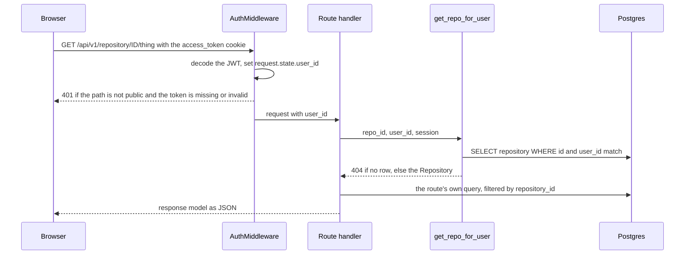

# Add an endpoint

This guide walks through adding an HTTP route to the FastAPI backend and calling it from the web client. It covers where the router goes, how authentication and repository ownership are enforced, input validation, the tests that will fail until the new route is covered, and the two ways the client fetches data. Read [authentication](../security/auth.md) and [the API reference](../api.md) first.

## Terms used on this page

- **Router**: a FastAPI `APIRouter`, one per module in [`server/app/api/v1/`](../../server/app/api/v1/), registered in [`app/main.py`](../../server/app/main.py).
- **Repository-scoped route**: a route whose path contains `{repo_id}` (the UUID) or `{repo_num}` (the integer `repo_number`).
- **IDOR**: insecure direct object reference, the bug where a user reaches another user's row by changing an id in the URL.
- **Server fetcher**: a `"use server"` function in `client/src/api/` or `client/src/actions/` that runs on the Next.js server and forwards the user's cookie.

## How a request reaches a handler



Ownership is enforced by the `user_id` filter in each query. There is no ORM-level scoping, so a route that forgets the filter leaks data; the IDOR tests below exist to catch that.

## Steps

### 1. Choose the router and the path

Add to an existing module in [`server/app/api/v1/`](../../server/app/api/v1/) when the route belongs to its subject. A new module needs a router and a line in `app/main.py`, where the sixteen existing routers are registered with `app.include_router` (lines 60 to 75).

Repository-scoped routes live under the prefix `/api/v1/repository` and key on `{repo_id}`, the UUID. One older route, `GET /api/v1/repository/{repo_num}`, keys on the integer; do not add more of those, because the IDOR matrix has to treat them separately.

### 2. Write the handler

The ownership router in [`app/api/v1/ownership.py`](../../server/app/api/v1/ownership.py) is a good template. The shape is:

```python
router = APIRouter(prefix="/api/v1/repository", tags=["thing"])


class ThingResponse(BaseModel):
    """One thing in a repository."""

    name: str
    count: int


@router.get("/{repo_id}/thing", response_model=list[ThingResponse])
async def list_things(
    request: Request,
    repo_id: uuid.UUID,
    page: PageNumber = 1,
    name: Annotated[str | None, Query(), NoControlCharacters] = None,
    db: AsyncSession = Depends(get_async_db),
) -> list[ThingResponse]:
    """List the things in a repository the caller owns."""
    user_id = getattr(request.state, "user_id", None)
    if not user_id:
        raise HTTPException(status_code=401, detail="Not authenticated")

    await get_repo_for_user(repo_id, user_id, db)
    ...
```

The rules:

| Rule                                                                                             | Why                                                                                                                                                                           |
| ------------------------------------------------------------------------------------------------ | ----------------------------------------------------------------------------------------------------------------------------------------------------------------------------- |
| async handler with `Depends(get_async_db)`                                                       | routes use the `asyncpg` engine; Celery tasks use the sync one                                                                                                                |
| call `get_repo_for_user` before touching child rows                                              | it returns 404, never 403, for another user's repository, so existence is not disclosed                                                                                       |
| filter every child query by `repository_id`                                                      | the ownership check proves the repository, not the rows                                                                                                                       |
| a Pydantic `response_model`                                                                      | the response shape is part of the contract the client and mobile read                                                                                                         |
| text inputs use the annotations in [`app/api/validation.py`](../../server/app/api/validation.py) | `NoControlCharacters`, `FreeText`, `MultiLineText`, `PageNumber`, `GitHubRepoUrl` and the length-capped `QuestionText` reject input the database or a prompt should never see |
| a docstring in the module's existing style                                                       | the codebase documents every route                                                                                                                                            |

If the route needs a model call, take the caller's `LLMConfig` the way the chat routes do, so a BYOK user's key is used; see [BYOK and encryption](../security/byok-and-encryption.md).

If the route must be reachable without a session, add it to `public_paths` in [`app/middleware/auth.py`](../../server/app/middleware/auth.py). That list is matched with `path.startswith`, so a short public prefix also exposes every path that begins with it; pick the most specific path you can. This is a [known issue](../security/auth.md#known-security-issues).

### 3. Add it to the IDOR matrix

[`tests/security/test_every_repo_route_is_covered.py`](../../server/tests/security/test_every_repo_route_is_covered.py) lists every repository-scoped route on the app and fails if one is missing from `REPO_ROUTES` in [`tests/security/test_idor.py`](../../server/tests/security/test_idor.py). Add an entry:

```python
RepoRoute("GET", "/api/v1/repository/{ref}/thing"),
```

`RepoRoute` takes `method`, `template`, `key` (`"id"` or `"number"`), `success` (the owner's status, 200 by default), `body`, `cross_user` (404) and `unknown` (404). Each entry is checked three ways: the owner succeeds, another user gets 404, and a caller with no session gets 401.

### 4. Write the integration test

Add a test to `tests/integration/api/` next to the existing `test_<router>_api.py` files. Use the factories in [`tests/factories.py`](../../server/tests/factories.py) and `authenticate` from [`tests/helpers.py`](../../server/tests/helpers.py); [the backend testing page](../testing/backend.md) describes them. Cover the happy path, pagination edges and each validation rule you added. The database is real; never mock it.

### 5. Call it from the web client

Pick the fetch style by the caller:

| Caller                    | Where                          | How                                                                                                                                                                                                                                                |
| ------------------------- | ------------------------------ | -------------------------------------------------------------------------------------------------------------------------------------------------------------------------------------------------------------------------------------------------- |
| a server component (read) | `client/src/api/<subject>.ts`  | `"use server"`, forward `cookie: (await headers()).get("cookie")`, `cache: "no-store"`                                                                                                                                                             |
| a form or button (write)  | `client/src/actions/<verb>.ts` | `"use server"`, forward `Cookie: (await cookies()).toString()`, and return failures as values instead of throwing, because Next.js hides a thrown message in production; [`triggerSync.ts`](../../client/src/actions/triggerSync.ts) explains this |
| a client component        | the component or a hook        | `fetch(url, { credentials: "include" })` straight to `NEXT_PUBLIC_BACKEND_URL`                                                                                                                                                                     |

[`client/src/api/ownership.ts`](../../client/src/api/ownership.ts) is the matching read for the ownership route. Add the response type to `client/src/types/`, and an MSW handler for the frontend tests ([frontend and end-to-end tests](../testing/frontend-and-e2e.md)).

### 6. Call it from mobile, if needed

The mobile app has its own typed client in `mobile/src/api/` and authenticates with an `Authorization: Bearer` header instead of the cookie. [`tests/security/test_bearer_header.py`](../../server/tests/security/test_bearer_header.py) covers that path in the middleware. See [the mobile app](../mobile/overview.md).

### 7. Document it

Add the route to [the API reference](../api.md). If it exposes a new table or column, update [the data model](../reference/data-model.md).

## Checklist

- [ ] Async handler, `get_repo_for_user`, `repository_id` filter on every child query
- [ ] Inputs typed with the validation annotations
- [ ] `REPO_ROUTES` entry; `test_every_repo_route_is_covered.py` passes
- [ ] Integration test in `tests/integration/api/`
- [ ] Client fetcher in the right place, a type and an MSW handler
- [ ] API reference updated

## Design trade-offs and limits

- **Ownership by convention.** Every query carries its own `user_id` or `repository_id` filter. The IDOR matrix proves each route rejects other users, but it cannot prove that every query inside a handler is filtered.
- **Prefix-matched public paths.** Adding a public path widens the surface for everything under it.
- **No rate limiting.** A new route is unthrottled unless it adds its own limit; only the MCP endpoint and the free-tier chat count requests.
- **No versioning beyond `/v1`.** A breaking change to a response shape breaks the web client, the mobile app and any MCP client at once.

## Related documentation

- [API reference](../api.md): every existing route.
- [Authentication](../security/auth.md): the middleware, cookies and bearer tokens.
- [Backend tests](../testing/backend.md): fixtures, factories and the security suite.
- [Frontend overview](../frontend/overview.md): server components and client fetches.
