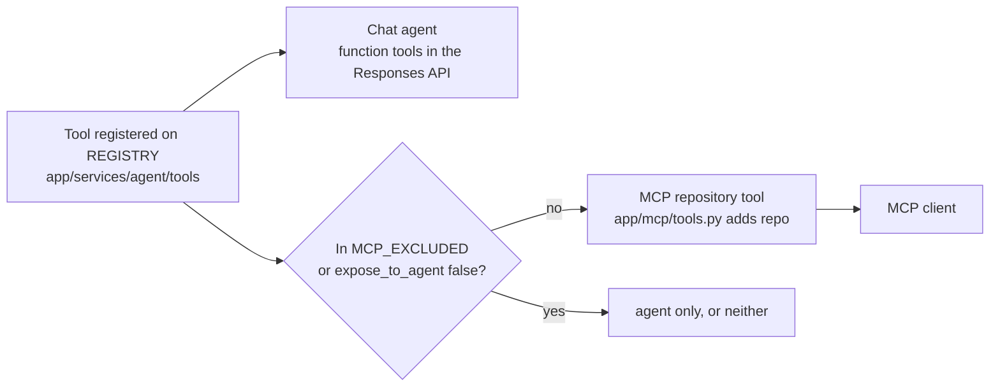

# Add an agent or MCP tool

This guide walks through adding a tool that both the chat agent and outside MCP clients can call. The two surfaces share one registry: a tool registered for the agent is exposed over MCP automatically, with a required `repo` argument added. The guide covers the tool's parts, the rules a handler must follow, how the MCP layer wraps it, and the tests and golden file that must change. Read [the chat agent](../retrieval/agent.md) and [the MCP server](../mcp/server.md) first.

## Terms used on this page

- **Registry**: `REGISTRY` in [`app/services/agent/tools/registry.py`](../../server/app/services/agent/tools/registry.py), the single list of tools.
- **Tool**: a frozen dataclass with a name, a description written for the model, a Pydantic input model, a Pydantic output model, a handler, a cost class and a timeout.
- **MCP**: the Model Context Protocol, the standard that lets clients such as Claude Code or Cursor call tools on a server. Illume's server is mounted at `/mcp`.
- **Cost class**: one of `none`, `free` (a database read), `cheap`, `network` (a GitHub request) or `model` (an embedding or generation call).
- **Fence**: the `<source key=… type=… provenance=…>` block that wraps repository text in a result, so text from the repository cannot pose as instructions.

## One tool, two surfaces



`exposed_tools()` in [`app/mcp/tools.py`](../../server/app/mcp/tools.py) returns every registry tool whose name is not in `MCP_EXCLUDED` (only `finish`) and whose `expose_to_agent` is true. So a new tool appears in both places unless you exclude it.

## Steps

### 1. Write the input and output models

Put the tool in the module under [`app/services/agent/tools/`](../../server/app/services/agent/tools/) that matches its subject: `search.py`, `navigate.py`, `graph.py`, `info.py` or `read_file.py`.

```python
class TestsForInput(ToolInput):
    path: str = Field(min_length=1, max_length=1024, description="The file's path.")


class TestsForOutput(ListOutput):
    items: list[str]

    def render(self) -> str:
        body = "\n".join(self.items) or "No test files import this file."
        return self.note_line() + fence("tool:tests_for", body, label="listing")
```

- Inputs extend `ToolInput`, which forbids unknown arguments and treats a `null` for a defaulted argument as omitted (strict schemas make the model send `null` for every optional argument it leaves out).
- Bound every field. The models are rendered as strict JSON schemas, and the field descriptions are what the model reads.
- Outputs extend `ToolOutput`, or `ListOutput` for lists. `ListOutput` always reports how many items exist beside how many it shows. `render()` returns the compact text the model sees.
- Wrap any repository text in `fence(...)` from [`output.py`](../../server/app/services/agent/tools/output.py). Use the item's citation key when the text can be cited, and `tool:<name>` for a listing. Results are capped by `cap_text`.
- Use `note` for a sentence the model needs, such as a path that does not exist. Do not raise for that.

### 2. Write the handler

```python
async def _tests_for(ctx: ToolContext, args: TestsForInput) -> TestsForOutput:
    async with ctx.session_factory() as db:
        ref = await find_file(db, ctx.repository.id, args.path)
        if ref is None:
            return TestsForOutput(total=0, items=[], note=no_such_file(args.path))
        ...
```

The rules:

| Rule                                                | Why                                                                                                                                                       |
| --------------------------------------------------- | --------------------------------------------------------------------------------------------------------------------------------------------------------- |
| open a session from `ctx.session_factory()`         | the agent runs tool calls concurrently, and a session cannot be shared between them                                                                       |
| filter every query by `ctx.repository.id`           | the context is the only proof of which repository the caller may read                                                                                     |
| read the ingested snapshot, not the live repository | answers must match the indexed commit; `read_file` is the one tool that calls GitHub, and it is pinned to the ingested commit                             |
| return a result for every expected failure          | the registry turns a bad argument, a timeout or a crash into a `ToolResult` the model can read; your handler should not depend on that for ordinary cases |

### 3. Register it

```python
REGISTRY.register(
    Tool(
        name="tests_for",
        description=(
            "The test files that import a file. Use it to find where a behaviour is "
            "tested before changing it."
        ),
        input_model=TestsForInput,
        output_model=TestsForOutput,
        handler=_tests_for,
        cost="free",
        timeout_s=10,
        emits_nodes=lambda out: touched(*out.items) if out.items else None,
    )
)
```

| Field             | Choose                                                                                                                                                |
| ----------------- | ----------------------------------------------------------------------------------------------------------------------------------------------------- |
| `description`     | what it does, when to use it, and what it cannot do; the model picks tools from this text alone                                                       |
| `cost`            | honestly: `model` and `network` count toward the MCP model-call limit (`MODEL_COST_CLASSES` in [`app/mcp/limits.py`](../../server/app/mcp/limits.py)) |
| `timeout_s`       | the wall-clock limit for the handler                                                                                                                  |
| `emits_nodes`     | the files to highlight on the chat graph, or leave it out                                                                                             |
| `expose_to_agent` | `False` keeps the tool out of the model's list, and so out of MCP                                                                                     |

The package [`__init__.py`](../../server/app/services/agent/tools/__init__.py) imports every tool module so registration happens on import. A tool in a new module needs a line there.

### 4. Tell the agent about it

The system prompt in [`app/services/agent/prompts.py`](../../server/app/services/agent/prompts.py) gives the agent its search strategy and names the main tools. Add the new tool where it changes that strategy. If the tool should be in the MCP search guidance as well, the prompts served to MCP clients are in [`app/mcp/prompts.py`](../../server/app/mcp/prompts.py).

### 5. Shape it for MCP

Nothing is required: the MCP layer adds `repo`, resolves it to one of the caller's repositories, applies the per-user and per-repository rate limits, and maps the `ToolResult` to an MCP result, with an error flag when the status is not `ok`. Optional polish in [`app/mcp/tools.py`](../../server/app/mcp/tools.py):

- `TITLES`: a human title. The default capitalises the name.
- `DESCRIPTION_OVERRIDES`: a description for MCP clients that differs from the agent's.
- `_OPEN_WORLD`: add the name if the tool reaches outside Illume's database. This sets the MCP `openWorldHint` annotation.

A tool that acts on the account rather than a repository does not belong in the registry. Put it in [`app/mcp/account_tools.py`](../../server/app/mcp/account_tools.py) and add its name to `NO_REPO_TOOLS` in the inventory test.

### 6. Test it and update the golden file

| Test                                                                                                                    | What fails until you act                                                                                                     |
| ----------------------------------------------------------------------------------------------------------------------- | ---------------------------------------------------------------------------------------------------------------------------- |
| [`tests/unit/services/test_tool_registry.py`](../../server/tests/unit/services/test_tool_registry.py)                   | `test_the_rendered_tool_schemas_match_the_snapshot`: the schemas differ from `tests/fixtures/golden/agent_tool_schemas.json` |
| [`tests/security/test_mcp_tool_inventory.py`](../../server/tests/security/test_mcp_tool_inventory.py)                   | every MCP tool with `repo` must refuse another user's repository and an unknown one                                          |
| [`tests/unit/mcp/test_repository_tool_definitions.py`](../../server/tests/unit/mcp/test_repository_tool_definitions.py) | the MCP definitions: titles, annotations, the `repo` argument                                                                |
| a handler test next to the existing agent tool tests                                                                    | the tool's own behaviour, including a missing path and another repository's rows                                             |
| [`tests/integration/mcp/test_repository_tools.py`](../../server/tests/integration/mcp/test_repository_tools.py)         | an end-to-end call through the mounted MCP app                                                                               |

Regenerate the golden file, then read the diff before committing it:

```bash
cd server
uv run pytest tests/unit/services/test_tool_registry.py --update-golden
git diff tests/fixtures/golden/agent_tool_schemas.json
```

The diff should show only the new tool. A change to any other tool's schema means you changed something shared.

### 7. Document it

Add the tool to [the agent's tool table](../retrieval/agent.md#the-tools) and to [the MCP repository tools](../mcp/server.md#repository-tools).

## Checklist

- [ ] Bounded input model, `render()` that fences repository text
- [ ] Handler opens its own session and filters by `ctx.repository.id`
- [ ] Registered with an honest `cost` and a timeout; module imported in `__init__.py`
- [ ] Prompt updated if the tool changes how the agent should search
- [ ] Optional MCP title, description override and open-world flag
- [ ] Golden file regenerated and its diff read; inventory and definition tests pass
- [ ] Agent and MCP docs updated

## Design trade-offs and limits

- **One registry for two audiences.** A description written for Illume's own agent is what MCP clients read too, unless it is overridden. A tool that suits one audience and confuses the other needs an override or an exclusion.
- **Every tool widens the model's choice.** More tools make tool selection harder for the agent. The eval harness can measure whether a new tool helps.
- **Cost classes are self-declared.** Nothing checks that a tool marked `free` makes no model call, and the MCP rate limits trust the label.
- **The prompt is hand-written.** Nothing keeps the system prompt's tool guidance in step with the registry.

## Related documentation

- [The chat agent](../retrieval/agent.md): the loop that calls these tools.
- [The MCP server](../mcp/server.md): transport, auth, rate limits and every tool.
- [Backend tests](../testing/backend.md#golden-files): golden files.
- [Retrieval arms](../retrieval/retrieval-arms.md): what `search_code` runs.
