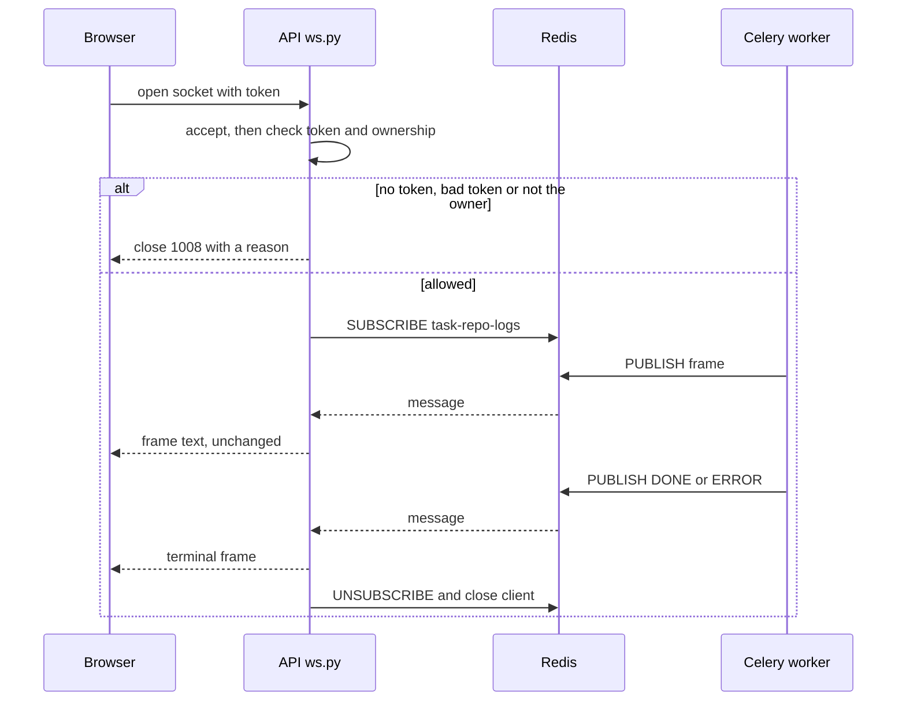
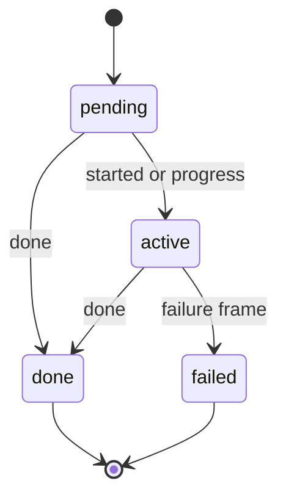

# The ingest progress WebSocket

While a repository is being ingested, the worker publishes a JSON frame to Redis at every stage boundary, and one WebSocket endpoint relays those frames to the browser unchanged. The client folds them into the pipeline board the repository page shows during an ingest. This page documents the endpoint, the channel, every frame the pipeline publishes, the `stage` and `phase` vocabulary, and how the client turns frames into node states, including reconnects and retries.

The agent's answer stream is a different transport (Server-Sent Events over `POST /agent/stream`) and is documented on [the agent page](../retrieval/agent.md#events).

## Terms used on this page

- **Frame**: one JSON object published to the channel and relayed as one WebSocket text message.
- **Channel**: the Redis pub/sub channel `task:{repo_id}:logs`. Pub/sub keeps no history: a subscriber only receives what is published after it subscribes.
- **Stage**: a named unit of pipeline work, a value of `Stage` in [`_stages.py`](../../server/app/services/_stages.py).
- **Phase**: where a stage is in its lifecycle: `started`, `progress`, `done` or `failed`, a value of `Phase`.
- **Terminal marker**: a frame whose `message` is `DONE` or `ERROR`; it ends the relay.

## The endpoint

`WS /api/v1/ws/ingest/{repo_id}` in [`api/v1/ws.py`](../../server/app/api/v1/ws.py). `repo_id` is the repository's UUID, not its `repo_number`.



1. The socket is **accepted first**, then authenticated. That lets the server close it with a policy-violation code and a readable reason instead of failing the handshake.
2. The token is read from the `access_token` cookie, or from the `?token=` query parameter when there is no cookie. The web client always uses the query parameter (the server component reads the cookie and passes its value down), which puts the JWT in proxy and access logs. This is a [known security issue](../security/auth.md#known-security-issues).
3. Failures close with code **1008** and one of three reasons: `Not authenticated` (no token), `Invalid token`, or `Repository not found or access denied`.
4. It subscribes to `task:{repo_id}:logs` on a fresh async Redis client and relays every `message` frame verbatim, skipping subscribe confirmations.
5. After relaying a frame, `_is_terminal` decodes it and stops when `message` is `DONE` or `ERROR`. A non-JSON frame equal to either marker is also accepted, so a publisher that skips the JSON wrapper cannot reintroduce an endless relay.
6. A client disconnect ends the loop. `asyncio.CancelledError` is re-raised, not swallowed, so a caller bounding the handler with `wait_for` can actually time it out. The `finally` unsubscribes and closes the Redis client.

The endpoint never reads repository status, never replays history and never sends a frame of its own. If the socket opens after the ingest finished, it waits until the client closes it.

## Frame shape

`publish_log` in [`_publish.py`](../../server/app/services/_publish.py) and the task's own `publish` closure in [`tasks/ingest.py`](../../server/app/tasks/ingest.py) build the same shape:

```json
{
  "event": "file_processed",
  "message": "1200/4800 files indexed",
  "timestamp": "2026-11-26T10:41:07.512903+00:00",
  "stage": "parse",
  "phase": "progress",
  "processed": 1200,
  "total": 4800
}
```

| Field                | Always | Meaning                                                                                 |
| -------------------- | ------ | --------------------------------------------------------------------------------------- |
| `event`              | yes    | a snake-case event name; informational, the client does not branch on it except `error` |
| `message`            | yes    | a human-readable line; `DONE` and `ERROR` are the terminal markers                      |
| `timestamp`          | yes    | ISO 8601 in UTC, set at publish time                                                    |
| `stage`              | almost | a `Stage` value; absent only on the two failure frames                                  |
| `phase`              | almost | a `Phase` value; absent only on the embedder's free-text lines (see below)              |
| `status`             | some   | the new `repositories.status`, on `status_update` frames                                |
| `processed`, `total` | parse  | file counter                                                                            |
| `count`              | some   | a stage's result total (dependencies, commits, files, PRs, vectors)                     |

Both enums are `StrEnum`, so they serialise as bare strings.

## Stages

| `Stage`                           | Value                             | Published   | Client node          |
| --------------------------------- | --------------------------------- | ----------- | -------------------- |
| `CLONE`                           | `clone`                           | yes         | Fetch Repo           |
| `PR_FETCH`                        | `pr_fetch`                        | yes         | Gather PRs           |
| `PARSE`                           | `parse`                           | yes         | Parse files          |
| `RESOLVE_DEPENDENCIES`            | `resolve_dependencies`            | yes         | Map Connections      |
| `COMPUTE_FAN_METRICS`             | `compute_fan_metrics`             | yes         | Rank Impact          |
| `DETECT_STACK`                    | `detect_stack`                    | `done` only | Identify Stack       |
| `GIT_HISTORY`                     | `git_history`                     | yes         | Mine Git History     |
| `COCHANGE`                        | `cochange`                        | yes         | none, ignored        |
| `CRITICALITY`                     | `criticality`                     | yes         | Score Risk           |
| `GLOSSARY`                        | `glossary`                        | yes         | Create Glossary      |
| `READING_ORDER`                   | `reading_order`                   | yes         | Create Reading Order |
| `GENERATE_EMBEDDINGS`             | `generate_embeddings`             | yes         | Generate Embeddings  |
| `BRIEF`                           | `brief`                           | yes         | Analyze Architecture |
| `READY`                           | `ready`                           | yes         | Ready                |
| `GLOSSARY_AND_READING_ORDER_JOIN` | `glossary_and_reading_order_join` | never       | none                 |
| `EMBED_AND_BRIEF_JOIN`            | `embed_and_brief_join`            | never       | none                 |

Every value except `ready` is also the name passed to the [stage timer](../pipeline/concurrency-and-failure.md#reading-the-stage-timer), so `grep stage_timer` in the worker log and `stage=` in a frame describe the same graph. A unit test parses every `stage(...)` call in `app/` and asserts the two sets stay equal. The two join stages are timed but never published, because they do no work of their own. `ready` is published but not timed.

`cochange` frames are published but the client's node list (`NODES` in [`utils/ingestFlow.ts`](../../client/src/utils/ingestFlow.ts)) has no entry for it, so they are ignored. The board shows no co-change step.

## Every frame, in order

The order below is a successful initial ingest. Indented rows are published from overlapped threads, so their position relative to the main sequence varies.

| #   | `event`                  | `stage`                | `phase`    | Extra fields           | Publisher                            |
| --- | ------------------------ | ---------------------- | ---------- | ---------------------- | ------------------------------------ |
| 1   | `status_update`          | `clone`                | (none)     | `status: cloning`      | `cloner._update_status`              |
| 2   | `clone_started`          | `clone`                | `started`  |                        | `cloner.clone_repository`            |
| 3   | `checkout_started`       | `clone`                | `progress` | only with a commit SHA | `cloner.clone_repository`            |
| 4   | `clone_complete`         | `clone`                | `done`     |                        | `cloner.clone_repository`            |
| ↳   | `prs_fetch_started`      | `pr_fetch`             | `started`  |                        | `pr_fetcher`, own thread             |
| ↳   | `prs_fetch_complete`     | `pr_fetch`             | `done`     | `count`                | `pr_fetcher`, own thread             |
| 5   | `status_update`          | `parse`                | `started`  | `status: parsing`      | `scanner._update_status`             |
| 6   | `parsing_started`        | `parse`                | `started`  |                        | `scanner`                            |
| 7   | `file_discovery`         | `parse`                | `progress` | `total`                | `scanner`                            |
| 8   | `file_processed`         | `parse`                | `progress` | `processed`, `total`   | `scanner`, repeated                  |
| 9   | `db_storage_complete`    | `parse`                | `done`     | `processed`, `total`   | `scanner`                            |
| 10  | `deps_resolved_started`  | `resolve_dependencies` | `started`  |                        | `scanner`                            |
| 11  | `deps_resolved`          | `resolve_dependencies` | `done`     | `count`                | `scanner`                            |
| 12  | `metrics_started`        | `compute_fan_metrics`  | `started`  |                        | `scanner`                            |
| 13  | `metrics_complete`       | `compute_fan_metrics`  | `done`     |                        | `scanner`                            |
| 14  | `stack_detected`         | `detect_stack`         | `done`     |                        | `scanner`                            |
| 15  | `git_analysis_started`   | `git_history`          | `started`  |                        | `git_analyzer`                       |
| 16  | `commits_parsed`         | `git_history`          | `progress` | `count`                | `git_analyzer`                       |
| 17  | `file_stats_aggregated`  | `git_history`          | `progress` | `count`                | `git_analyzer`                       |
| 18  | `ownership_written`      | `git_history`          | `done`     | `count`                | `git_analyzer`                       |
| 19  | `cochange_started`       | `cochange`             | `started`  |                        | `pipeline.run_full_analysis`         |
| 20  | `cochange_complete`      | `cochange`             | `done`     |                        | `pipeline.run_full_analysis`         |
| 21  | `criticality_started`    | `criticality`          | `started`  |                        | `pipeline.run_full_analysis`         |
| 22  | `criticality_complete`   | `criticality`          | `done`     |                        | `pipeline.run_full_analysis`         |
| 23  | `glossary_started`       | `glossary`             | `started`  |                        | `pipeline.run_full_analysis`         |
| 24  | `reading_order_started`  | `reading_order`        | `started`  |                        | `pipeline.run_full_analysis`         |
| 25  | `glossary_complete`      | `glossary`             | `done`     |                        | after the glossary thread joins      |
| 26  | `reading_order_complete` | `reading_order`        | `done`     |                        | after the reading-order thread joins |
| 27  | `embedding_started`      | `generate_embeddings`  | `started`  |                        | `pipeline.run_full_analysis`         |
| 28  | `brief_started`          | `brief`                | `started`  |                        | `pipeline.run_full_analysis`         |
| 29  | `status_update`          | `generate_embeddings`  | `started`  | `status: embedding`    | `scanner._update_status`             |
| 30  | `embedding_started`      | `generate_embeddings`  | `started`  |                        | `scanner.embed_repository_symbols`   |
| 31  | `embedding_progress`     | `generate_embeddings`  | `progress` | message only           | the embedder, repeated               |
| 32  | `embedding_complete`     | `generate_embeddings`  | `done`     | `count`                | `scanner.embed_repository_symbols`   |
| 33  | `brief_complete`         | `brief`                | `done`     |                        | after the brief thread joins         |
| 34  | `status_update`          | `ready`                | `done`     | `status: ready`        | `tasks/ingest.py`                    |
| 35  | `done`                   | `ready`                | `done`     | `message: DONE`        | `tasks/ingest.py`                    |

Notes on particular frames:

- **Status frames.** Every `status_update` that changes `repositories.status` carries the new value. The cloner's (row 1) carries a stage but no phase; the scanner's carry `phase: started`. Status changes only three times before `ready`: `cloning`, `parsing` (which stays set from parse through the reading order), and `embedding`.
- **No commits.** A repository with no history publishes `git_analysis_complete` ("No commits found; git analysis skipped") with `phase: done` instead of rows 16 to 18.
- **No PRs.** `prs_fetch_complete` carries `count: 0` and the message "No merged PRs found".
- **Parse progress.** `file_processed` is published every `max(50, total // 20)` files and once at the end, so a repository publishes at most about 20 counters however large it is. Publishing per file once made the client re-render an unbounded list for a 10,000-file repository.
- **Embedding lines.** The embedder receives a callback rather than a Redis client, so its messages ("Embedding 12 symbol chunks batches in parallel...", "Built 1840 symbol chunks (3 skipped, 0 up to date)", "README embedded (6 sections).", "Embedding complete — 2210 vectors stored.") arrive as `embedding_progress` frames with the stage and `phase: progress` added by the scanner's wrapper.
- **Duplicate starts.** `embedding_started` is published twice (rows 27 and 30), once by the pipeline before the embed-and-brief overlap begins and once by the scanner inside it. The client's reducer is monotonic, so the repeat is harmless.
- **Explicit completion.** Each of the four LLM stages publishes its own `*_complete` frame after its thread joins. The client never infers that a stage finished because a later one started.
- **PRs last.** The PR fetch future is joined only after `run_full_analysis` returns, so on a slow GitHub API `prs_fetch_complete` can arrive after `brief_complete`.

### The failure frames

When anything raises, the task's catch-all rolls back, sets `status = "failed"`, then publishes:

| `event`         | `message`                          | `stage` | `phase`  | Extra            |
| --------------- | ---------------------------------- | ------- | -------- | ---------------- |
| `status_update` | `Error: {redacted exception text}` | none    | `failed` | `status: failed` |
| `error`         | `ERROR`                            | none    | `failed` |                  |

There is **no `stage`** on either, because the catch-all runs outside `run_full_analysis` and cannot know which stage raised; naming the last stage that happened to publish would be a guess shown as fact. The exception text passes through `redact_credentials`, so a token embedded in a clone URL does not reach the browser. The task then retries after 10 seconds, up to 3 retries, and each retry republishes from row 1.

## Who publishes and what can fail

| Publisher                                    | Best effort | Used for                                               |
| -------------------------------------------- | ----------- | ------------------------------------------------------ |
| `publish_log` in `_publish.py`               | yes         | cloner, scanner, git analyzer, PR fetch                |
| the `publish` closure in `ingest_repository` | **no**      | the pipeline's own frames, `ready`, the failure frames |

`publish_log` catches every exception and logs a warning, so a Redis outage cannot fail an ingest through it. It also logs each frame as `[repo] event: message (stage=... phase=...)`, so the worker log lines up with what subscribers received. The task's closure calls `redis_client.publish` directly with no `try`: if Redis is down at a pipeline boundary, the publish raises and fails the ingest attempt.

## The sync path publishes nothing

`sync_repository` reuses `run_full_analysis` but passes `redis_client=None` and a `publish` stub that only logs. Every `publish_log` it reaches fails on `None.publish` and is swallowed. A background [sync](../pipeline/sync.md) therefore produces frames in the worker log and none on the channel, which is why an auto-update shows no live progress in the UI. Wiring the sync to the channel is the prerequisite for showing it.

## The client

[`hooks/useIngestStream.ts`](../../client/src/hooks/useIngestStream.ts) owns the socket and nothing else:

- builds the URL by swapping `http` for `ws` in `NEXT_PUBLIC_BACKEND_URL` and appending `?token=`;
- normalises each message into an `IngestFrame` (from [`types/ingest.ts`](../../client/src/types/ingest.ts)); a non-JSON message still appears, as itself;
- adds synthetic `system` frames for "Connected. Waiting for worker...", "Connection closed." and an `error` frame on socket errors;
- exposes `frames`, `connected`, `closed` and `reconnect()`, which opens a fresh socket while keeping the frames so far. A `cancelled` flag stops a superseded socket's `onclose` from marking the new one closed.

[`components/IngestFlow.tsx`](../../client/src/components/IngestFlow.tsx) decides what the frames mean, using the pure functions in [`utils/ingestFlow.ts`](../../client/src/utils/ingestFlow.ts).

### From frames to node states



`reduceFrame` applies three rules, in order:

1. A frame with `phase: failed` or `status: failed` marks **every active node** failed, since the failing stage is not named.
2. `stage: ready, phase: done` marks **every node** done. Reaching ready proves every stage succeeded, and it repairs a board that missed frames during a reconnect.
3. Otherwise the frame's stage, if the board knows it, moves up by rank (`pending` 0, `active` 1, `done` and `failed` 2) and never down. Unknown stages are ignored, so a newer worker cannot blank an older page. Only `parse` carries `processed` and `total` for the progress bar; a zero total is rejected.

### Seeding from status

Pub/sub keeps no history, so a page opened two minutes into an ingest would otherwise show every node pending. `seedFromStatus` seeds the board from the server-rendered status, pessimistically:

| Status      | Seeded done                 | Seeded active                                         |
| ----------- | --------------------------- | ----------------------------------------------------- |
| `pending`   | none                        | none; the header says "Queued — waiting for a worker" |
| `cloning`   | none                        | clone                                                 |
| `parsing`   | clone                       | parse, PR fetch                                       |
| `embedding` | clone through reading order | embeddings, brief, PR fetch                           |
| `ready`     | everything                  |                                                       |
| `failed`    | none                        | none                                                  |

`parsing` spans parse through the reading order, so it can only prove the clone finished. A stage that already completed may show as pending until a later frame arrives, which is the right direction to be wrong in. `pr_fetch` is never seeded done, because no status proves it.

### Retries, stalls and the end of a run

| Constant              | Value | Purpose                                                                               |
| --------------------- | ----- | ------------------------------------------------------------------------------------- |
| `COMPLETE_REFRESH_MS` | 3000  | after completion, `router.refresh()` re-renders the route into the overview           |
| `FAILURE_REFRESH_MS`  | 2500  | after a failure, the same refresh, after time to read the error                       |
| `IDLE_MS`             | 5 min | no frame for this long marks the run "stalled", sized against parse's sparse progress |
| `RETRY_GRACE_MS`      | 15 s  | after the socket closes on a failure, reconnect once to catch the retry               |
| `MAX_ATTEMPTS`        | 4     | the first run plus three retries, shown as "attempt n of 4"                           |

- A `clone` `started` frame after a failure is a **retry**: the board is rebuilt from that frame, because the monotonic reducer could never undo the failure otherwise.
- The server closes the relay on `ERROR`, so the retry publishes into a channel nobody is listening to. The grace timer reopens the socket after 15 seconds; if nothing arrives the failure is final. A page opened onto an already failed run waits the same grace.
- The error message shown is the last failure frame whose message starts with `Error:`, with the prefix removed.
- Each outcome refreshes the route at most once.

`app/dev/pipeline/page.tsx` drives `IngestFlow` with an injected stream from recorded frames, so the board can be developed without a worker; with an injected stream no socket opens and no refresh fires.

## Design trade-offs and limits

- **Relay, not replay.** Redis pub/sub is fire-and-forget. A client that connects late, or loses its connection, misses frames for good; status seeding and the `ready` rule paper over it.
- **Token in the URL.** The query-parameter token leaks into logs.
- **Not fully best-effort.** The pipeline's own frames can fail an ingest if Redis is down.
- **No sync progress.** Background updates publish nothing.
- **A frame the client ignores.** `cochange` has no node.
- **No server heartbeat.** A dead worker produces silence; the client's 5-minute stall timer is the only detector.

## Related documentation

- [The ingestion pipeline](../pipeline/ingestion.md): the stages these frames describe.
- [Concurrency and failure](../pipeline/concurrency-and-failure.md): retries, rollback and stage timing.
- [The agent](../retrieval/agent.md#events): the SSE stream for answers.
- [Authentication](../security/auth.md): the JWT and the query-parameter issue.
- [API reference](../api.md): every HTTP route.
