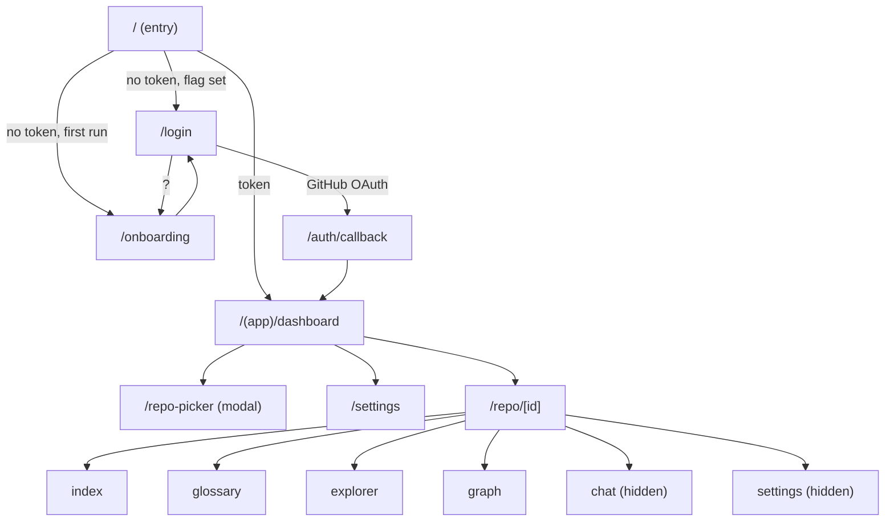
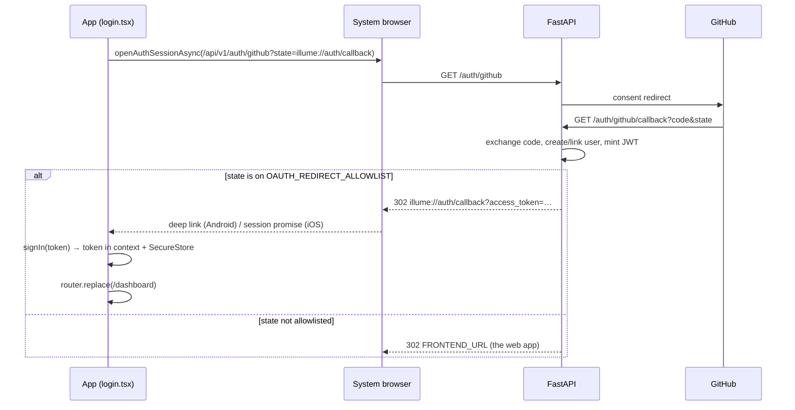
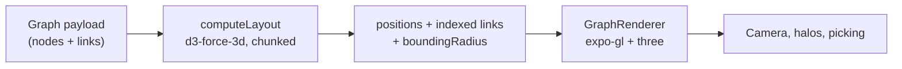

# The Mobile App

Illume ships two clients: a Next.js application in `client/`, and a React Native application in
`mobile/`. The web client is canonical — it is where features are designed, and the phone follows
it. The two share **no code**: no workspace, no package, not even a common types module. The design
tokens are copied by hand, and this document explains why that is a decision rather than an
oversight.

The mobile app is built with **Expo SDK 57**, **React Native 0.86**, **React 19**, and
**expo-router** for file-based navigation. It talks to the same FastAPI backend as the web client,
authenticated with a bearer token instead of a cookie.

This document is a tour of the app the way [frontend.md](frontend.md) is a tour of the web client:
first the shape, then each subsystem, then the failure modes. Native development has its own
vocabulary — Metro, native modules, dev clients, EAS — and each term is explained where it is first
used.

If you are reading for the first time, [Routing](#routing) and
[Authentication](#authentication-and-the-session) are the two sections that explain most of the
surprising behaviour. If you are about to change something visual, read
[The visual system](#the-visual-system) first.

## Contents

- [How this relates to the web client](#how-this-relates-to-the-web-client)
- [Project layout](#project-layout)
- [The toolchain](#the-toolchain)
- [Running the app](#running-the-app)
- [Routing](#routing)
- [Authentication and the session](#authentication-and-the-session)
- [Networking and server state](#networking-and-server-state)
- [Screens](#screens)
- [Features in depth](#features-in-depth)
  - [The live ingest stream](#the-live-ingest-stream)
  - [Chat](#chat)
  - [Glossary](#glossary)
  - [Explorer](#explorer)
  - [The 3D dependency graph](#the-3d-dependency-graph)
  - [Export](#export)
  - [Push notifications](#push-notifications)
- [The visual system](#the-visual-system)
- [Testing](#testing)
- [Building and releasing](#building-and-releasing)
- [Performance notes](#performance-notes)
- [Troubleshooting](#troubleshooting)
- [Design decisions and trade-offs](#design-decisions-and-trade-offs)
- [Known gaps](#known-gaps)
- [Related documentation](#related-documentation)

## How this relates to the web client

The phone is not a smaller website. Every screen is a React Native screen, written against the same
backend. What carries over is the product: the same repositories, the same analysis, the same
glossary, graph, and chat.

| Concern            | Web (`client/`)                             | Mobile (`mobile/`)                                        |
| ------------------ | ------------------------------------------- | --------------------------------------------------------- |
| Rendering          | React DOM + Tailwind 4                      | React Native + NativeWind 5 (`className` → native styles) |
| Routing            | Next.js App Router, server components       | expo-router, all client-side                              |
| Auth transport     | `httpOnly` cookie, forwarded by hand         | `Authorization: Bearer`, stored in `expo-secure-store`    |
| Session validation | Server-rendered redirects (`proxy.ts`)       | Context state + `<Redirect>` in a route group             |
| Data fetching      | Three strategies (server, actions, browser)  | One: TanStack Query over one `fetch` wrapper              |
| 3D graph           | `react-force-graph-3d` (WebGL 2)             | Raw `expo-gl` + imperative three.js (WebGL 1)             |
| Landing page       | Marketing page with a hero graph              | Three-screen onboarding carousel                          |
| Orientation        | Any viewport                                 | Portrait only                                             |
| Theme              | Light and dark                               | Dark only                                                 |

Two parity decisions shape everything else:

- **Android first.** The development machine runs Windows, so the Android emulator and a physical
  Android device are the test surfaces. iOS builds are produced by EAS in the cloud and are not
  exercised locally.
- **The app is a client, not an authority.** Where the phone and web disagree about behaviour, the
  web is treated as the specification.

## Project layout

```
mobile/
├── app.json                 Expo config: scheme, icons, plugins, Android/iOS ids
├── eas.json                 Build profiles (development / preview / production)
├── babel.config.js          babel-preset-expo only — NativeWind 5 needs no extra preset
├── metro.config.js          expo/metro-config wrapped by nativewind/metro
├── global.css               Tailwind layer imports + the @theme token block
├── postcss.config.mjs       Tailwind 4 PostCSS plugin
├── tsconfig.json            strict, "@/*" → src/*
├── jest.config.js           jest-expo preset + moduleNameMapper + transform allowances
├── jest.setup.js            Every native module mock (runs before the RN env exists)
├── jest.after-env.js        Testing-library timeouts (runs after it does)
├── __mocks__/               styleMock for the global.css import
├── __tests__/               Jest specs, flat
├── e2e/                     Maestro flows (need a device and a signed-in account)
├── scripts/                 check-native-linking.mjs, generate_assets.py
└── src/
    ├── app/                 expo-router routes — the file tree IS the route tree
    ├── components/          Feature components (graph renderer, ingest flow, pickers…)
    ├── ui/                  Small presentational pieces (RepoCard, badges, tab bar…)
    ├── hooks/               Data + state hooks (auth, chat, stream, forms)
    ├── lib/                 Framework-agnostic logic (tree building, layout maths, parsers)
    ├── api/                 One HTTP client plus one module per endpoint group
    ├── types/               Copied from client/src/types/ — they may drift
    └── theme/tokens.ts      The palette as plain strings, for places className cannot reach
```

Two rules of thumb for where code belongs:

- **`lib/` never imports React.** The layout maths, the markdown parser, the file-tree builder and
  the graph selection rules are pure functions, which is why they are the easiest things in the app
  to test.
- **`api/` never imports components.** Every network call goes through `api/client.ts`; nothing else
  calls `fetch` directly.

## The toolchain

### What each dependency is doing

| Package | Role |
| --- | --- |
| `expo` / `expo-router` | Build tooling, native module registry, file-based routing |
| `react-native` 0.86 | The runtime. New Architecture is on (`newArchEnabled: true`) |
| `nativewind` 5 (RC) + `react-native-css` | Compiles `className` to native styles from `global.css` |
| `expo-gl` | Provides a WebGL 1 context backed by `GLView` |
| `three` **0.162.0** | The scene graph for the 3D view. **Pinned — see below** |
| `d3-force-3d` | The force simulation that lays the graph out |
| `@tanstack/react-query` | Server state: caching, retries, invalidation, focus refetch |
| `expo-secure-store` | Encrypted storage for the bearer token |
| `@react-native-async-storage/async-storage` | The non-secret onboarding flag |
| `expo-web-browser` | The OAuth browser session |
| `expo-notifications` | Push registration, loaded lazily |
| `expo-file-system` + `expo-sharing` | Writing the `.illume` export and opening the share sheet |
| `react-native-svg` | The git timeline |
| `react-native-reanimated` | The ingest canvas, the log drawer, the skeleton shimmer |
| `zod` | Form validation, mirroring the web schemas |

### three.js is pinned to 0.162.0 and must stay there

`three` **removed WebGL 1 support in r163**. `expo-gl` provides a WebGL 1 context, so at r163 and
later `new THREE.WebGLRenderer()` throws `WebGL 1 is not supported since r163` before it draws
anything. The version is pinned exactly (`"three": "0.162.0"`, not `^`), and `@types/three` is
pinned to match.

Consequences worth knowing:

- A dependency that wants a newer three is a conflict, not an upgrade.
- r162 was released in early 2024 and receives no fixes.
- The only way off the pin is to move the renderer to a WebGL 2 context, which `expo-gl` does not
  currently offer.

`GraphRenderer.tsx` also hides `globalThis.WebGLRenderingContext` while it constructs the renderer.
At r162 that is defensive; it exists so that a future three bump without the pin fails in a place
that names the cause.

### NativeWind 5 and `global.css`

Styling is `className` strings on React Native components, compiled by `react-native-css` from the
CSS in `global.css`. The `@theme` block declares the palette as CSS custom properties, and
`nativewind/theme` teaches the runtime to read them.

Three constraints follow, and all three have caused bugs:

1. **`className` only reaches React Native's own components.** A third-party native view — notably
   `SafeAreaView` from `react-native-safe-area-context` — ignores it. `flex-1` on such a component
   is silently dropped, the container collapses to its content, and any `flex-1` child inside it
   collapses to zero height. Use a plain `View` with the style applied, or apply insets with
   `useSafeAreaInsets()`.
2. **No `oklch()`, no CSS variables in JS-only paths.** React Native's colour parser understands
   hex, `rgb()`, `hsl()` and named colours. Values that must be handed to a native API — an
   `ActivityIndicator` colour, a navigator `contentStyle`, a three.js material — come from
   `src/theme/tokens.ts` as strings.
3. **The palette exists twice.** `global.css` serves `className`; `tokens.ts` serves everything
   else. They are kept in step by `__tests__/themeSync.test.ts`, which parses `@theme` and fails on
   any value that differs from the TypeScript token of the same name.

### Configuration files

| File | What it controls |
| --- | --- |
| `app.json` | App name/slug, `scheme: "illume"`, iconography, splash, plugins, `newArchEnabled`, `typedRoutes`, `softwareKeyboardLayoutMode: "resize"` |
| `eas.json` | Build profiles and the `EXPO_PUBLIC_BACKEND_URL` each one bakes in |
| `babel.config.js` | `babel-preset-expo` only — NativeWind 5 has no separate preset |
| `metro.config.js` | `getDefaultConfig` wrapped in `withNativeWind` |
| `tsconfig.json` | `strict: true`, `jsx: "react-native"`, `@/*` → `./src/*` |
| `jest.config.js` | jest-expo preset, `@/` mapping, `d3-force-3d` transform allowance, `forceExit` |

### The `typescript` override in `package.json`

`@expo/require-utils` declares an optional peer on `typescript@^5 || ^6 || ^7`. Without a
constraint npm resolves that to TypeScript 7, which drags in one `@typescript/typescript-<platform>`
binary per OS/arch; `npm ci` on the EAS builder then dies with `EBADPLATFORM` on the first binary
that does not match Linux x64.

The `overrides` block pins `typescript` to `~5.4.0`. **Do not remove it.** After any dependency
change, `npm ci --dry-run` should exit cleanly with no `extraneous` entries in the lockfile.

## Running the app

```bash
cd mobile
npm install
npx expo run:android          # build + install a dev client on a connected device/emulator
npx expo start --dev-client   # Metro, afterwards
```

### Expo Go cannot run this app

Expo Go is the sandbox app that loads a JavaScript bundle from Metro without a rebuild. It is
unusable here for two reasons:

- **Remote push was removed from Expo Go in SDK 53**, and this app registers for push.
- **`expo-gl` needs a development build.** A module that is in `package.json` but not in the
  installed app crashes at runtime, not at build time — the symptom is a `ViewManager` error naming
  a missing component, and no amount of reloading adds native code that was never compiled in.

So the development loop is: build a dev client once, then reload JavaScript over Metro. Adding a new
native module means rebuilding the dev client.

### The backend URL

The app reads `EXPO_PUBLIC_BACKEND_URL` from the environment at bundle time. Expo statically inlines
variables with that prefix, so the value is baked into the bundle rather than read at runtime.

| Situation | Value |
| --- | --- |
| Local dev, physical device | Your machine's LAN address, in `mobile/.env` |
| Local dev, Android emulator | Falls back to `http://10.0.2.2:8000` (the emulator's host alias) |
| `preview` / `production` build | `https://illume-api.tejasnasa.me`, set in `eas.json` |

A **release** build with no value throws at startup with an actionable message rather than silently
trying to reach an emulator alias on a real phone. A development build keeps the `10.0.2.2`
fallback.

`api/ingest.ts` derives the WebSocket URL from the same base by swapping `http` for `ws` — so an
HTTPS backend automatically produces `wss://`.

### Scripts

```bash
npm test            # jest, via jest-expo
npm run typecheck   # tsc --noEmit
npx expo export --platform android --output-dir /tmp/bundle   # full bundle, catches resolution errors
```

There is no linter configured. The web client's ESLint config is Next-specific and does not apply.

## Routing

expo-router turns the file tree under `src/app/` into routes. There is no route table to maintain;
the tree is the table.

| Route | File | Renders |
| --- | --- | --- |
| `/` | `app/index.tsx` | The cold-start decision; a spinner, then a redirect |
| `/onboarding` | `app/onboarding.tsx` | The three-screen carousel |
| `/login` | `app/login.tsx` | The GitHub sign-in screen, with a "?" to reopen the carousel |
| `/auth/callback` | `app/auth/callback.tsx` | The OAuth deep-link target (Android) |
| `/dashboard` | `app/(app)/dashboard.tsx` | Repository list, free-tier banner, add button |
| `/repo-picker` | `app/(app)/repo-picker.tsx` | Modal route: pick a repository, then a version |
| `/settings` | `app/(app)/settings.tsx` | Account-level settings hub |
| `/settings/ai` | `app/(app)/settings/ai.tsx` | BYOK credentials editor |
| `/settings/contact` | `app/(app)/settings/contact.tsx` | Contact form |
| `/repo/[id]` | `app/(app)/repo/[id]/index.tsx` | Overview, or the live ingest view |
| `/repo/[id]/glossary` | `…/glossary.tsx` | Glossary browse + search |
| `/repo/[id]/explorer` | `…/explorer.tsx` | File tree with a file-details sheet |
| `/repo/[id]/graph` | `…/graph.tsx` | The 3D dependency graph |
| `/repo/[id]/chat` | `…/chat.tsx` | RAG chat (hidden tab) |
| `/repo/[id]/settings` | `…/settings.tsx` | Repository settings (hidden tab) |
| anything else | `app/+not-found.tsx` | "This screen does not exist" |



### The root layout

`src/app/_layout.tsx` is the only place providers are wired, in this order:

```
SafeAreaProvider
└── QueryClientProvider (one QueryClient, created at module scope)
    └── AuthProvider (token + profile)
        ├── PushRegistration (renders null; re-registers the device on every launch)
        ├── StatusBar
        └── Stack (headerless)
```

It also installs the AppState → React Query focus bridge, registers the query client in the
module-level registry the sign-out path uses, and exports the `ErrorBoundary` that replaces a
crashed screen with a message and a "Try again" button.

### The entry decision

`app/index.tsx` has no visual identity: it decides where a cold start lands and immediately
`replace`s itself.

- **Token present** → `/dashboard`. The onboarding flag is not read at all, so a returning signed-in
  reader is not delayed by a store round-trip.
- **No token, flag unset** → `/onboarding`. This is the first-run path; the flag lives in
  AsyncStorage, which is wiped on uninstall, so a reinstall shows the carousel again.
- **No token, flag set** → `/login`.

While the decision is pending it renders a spinner rather than `null`, because on some Android
builds the splash has already been dismissed by the time this screen mounts.

### The auth gate

`app/(app)/_layout.tsx` protects everything under the group:

- `loading` → a splash.
- No token → `<Redirect href="/login" />`.
- Otherwise → the `Stack`, including `repo-picker` as a modal presentation.

There is no per-route permission logic; ownership is enforced by the backend, which 404s a
repository that is not the caller's.

### The repository shell

`app/(app)/repo/[id]/_layout.tsx` is a `Tabs` navigator with a **custom top tab bar**. The built-in
bar is a bottom bar that wants an icon above every label; the web navbar is a row of text links, so
the mobile shell draws the same thing.

- **Visible tabs:** Home (`index`), Glossary, Explorer, Graph.
- **Hidden routes:** `chat` and `settings` are registered with `href: null` and filtered out of the
  custom bar by `withoutHiddenRoutes()`, while remaining navigable by URL.
- **Sections gate on readiness.** A repository that is not `ready` shows only the Home tab rather
  than three tabs whose data does not exist.
- **Deep-link guard.** Landing directly on `/repo/<n>/graph` for a repository that is not ready
  navigates back to the overview with `router.navigate`, not `replace` — replacing one tab with
  another leaves the navigator with two routes of the same name.
- **Header:** back arrow (`dismissTo("/dashboard")`, so a deep link still has a destination), the
  repository name, the status badge, and a gear that opens `/repo/<n>/settings`.

### Search params: local versus global

This is the single most expensive mistake made in this codebase, so it gets its own heading.

`useLocalSearchParams()` returns **only the current route's own params**. A screen that is a *child*
of a dynamic segment does not see that segment's params. The repo tab screens live inside
`repo/[id]/`, but they are not the `[id]` segment themselves — so `useLocalSearchParams()` returned
`undefined` for `id`, every query built on it stayed disabled, and the glossary, explorer and graph
tabs rendered as empty or "loading" forever.

`useGlobalSearchParams()` returns every param in the URL, parent segments included. All screens
under `repo/[id]/` use it, with a comment at each call site so it is not "simplified" back.

The general rule:

- The layout that *owns* a dynamic segment can use either.
- A screen nested under a dynamic segment must use the global hook.

### Modal route versus modal component

Two different things share the word "modal" here:

- **`/repo-picker` is a modal *route*** (`presentation: "modal"`). It has its own URL, the hardware
  back button dismisses it, and a successful creation `replace`s itself with the new repository's
  page so the back stack does not keep the picker underneath.
- **The file-details sheet in the explorer** is a modal *component* (`<Modal transparent>`), because
  it is a detail view of the current screen, not a destination.

### Unknown routes

`app/+not-found.tsx` handles every unmatched path: a stale notification deep link or a repository
that has been deleted. Without it, expo-router renders its developer-facing "Unmatched Route" panel
in release builds.

## Authentication and the session

The backend issues a JWT. The web client receives it as an `httpOnly` cookie; the phone stores it in
`expo-secure-store` and sends `Authorization: Bearer <token>`.

### The sign-in flow



**The redirect comes back two different ways.** On Android the OS delivers it as a `Linking` event,
which mounts `app/auth/callback.tsx`. On iOS the browser runs inside `ASWebAuthenticationSession`,
which hands the URL back to the `openAuthSessionAsync` promise and emits **no event at all**. Both
paths exist:

- `app/auth/callback.tsx` parses the deep link and calls `signIn`.
- `app/login.tsx` parses `result.url` from the promise and calls `signIn` itself.

Both succeed or fail through the same function, so there is no divergent behaviour to keep in step.

### `signIn` writes the store *and* the context

The route guard reads the auth **context**, not the secure store. An earlier version of the callback
screen wrote the token straight to SecureStore and navigated; the guard still saw `token: null` and
sent the reader back to `/login`. Sign-in only "worked" after a full restart.

`signIn(token)` therefore:

1. writes the token to SecureStore,
2. validates it against `GET /auth/me`,
3. sets `{ token, user }` in context,
4. returns `true` when accepted, `false` when the backend **rejects** it (401/403).

A network failure is not a rejection: the token is kept and the profile is retried, because a phone
losing connectivity must not sign the reader out.

### Cold start: rejected versus unreachable

`fetchMe` classifies the outcome into three states:

| Result | Meaning | What happens |
| --- | --- | --- |
| `ok` | 2xx with a profile | Token and user are adopted |
| `rejected` | 401/403 | Token is cleared; the guard sends the reader to `/login` |
| `unreachable` | 5xx, DNS, timeout, abort | **Token is kept**; the profile is retried |

The `unreachable` case is retried twice: once immediately (guarded by a `retriedFor` ref so it does
not loop) and again whenever the app returns to the foreground. Before the token is cleared on
`rejected`, the store is re-read: a deep-link callback can write a fresh token while a cold-start
validation is in flight, and deleting that token would break the very sign-in it was completing.

### Expiry: the 401 handler

Any `401` from `apiRequest` calls a handler registered by the auth provider, which signs out. The
handler is debounced for two seconds, because React Query retries a failed query once and one screen
can fire several queries at once. A `403` deliberately does **not** sign out — it is a permission
refusal, not an expired session.

Sign-out then:

1. deregisters the push token (failures swallowed),
2. clears SecureStore,
3. clears context state,
4. clears the whole React Query cache.

Step 4 matters: query keys carry no user id, so without it a second account signing in on the same
process could read the first account's repositories for the 30-second stale window.

### Token storage and the release guard

`lib/tokenStore.ts` wraps `expo-secure-store` under the single key `access_token`, with an injectable
implementation for tests. Reads that throw return `null`; writes are assumed atomic.

`api/client.ts` refuses to start a **release** build with no `EXPO_PUBLIC_BACKEND_URL`: the emulator
fallback resolves to nothing on a real phone, so the alternative is a app whose every request fails
with a generic network error.

## Networking and server state

### The client

Every request goes through `apiRequest` in `src/api/client.ts`:

```ts
apiRequest(path, { method?, body?, headers?, signal?, backendUrl?, getToken?, fetchImpl? })
```

- Resolves the base URL once per call (`resolveBackendUrl`), strips trailing slashes.
- Reads the bearer token from SecureStore on every request. The store is in-memory after the first
  hit, so the cost is negligible, and lazy reads mean query functions and one-off callers behave the
  same without a React context bridge.
- Sets `Accept: application/json`, a `Content-Type` only when there is a body, and `Authorization`
  only when a token exists.
- Returns `{ status, body }`; the `apiGet`/`apiPost`/`apiPut`/`apiPatch`/`apiDelete` shorthands
  return the body directly.
- `204` and empty bodies parse to `undefined`; non-JSON bodies are returned as text.
- Every non-2xx throws an `ApiError` carrying `kind`, `status`, `body`, `cause`, and a message taken
  from `detail` (string or stringified object), then `statusText`, then a default per kind.

The error kinds are `unauthorized`, `notFound`, `quota`, `clientError`, `server`, `network`,
`unknown`. `quota` is the one the UI treats specially: a `402` means the free allowance is spent and
the remedy is a personal API key, not a retry.

### Endpoints

| Module | Function | Route | Keyed by |
| --- | --- | --- | --- |
| `repository.ts` | `getRepositories` | `GET /api/v1/repository` | user |
| | `getRepository` | `GET /api/v1/repository/{repo_number}` | **number** |
| | `createRepository` | `POST /api/v1/repository` → 202 | — |
| `graph.ts` | `getGraph` | `GET /api/v1/repository/{id}/graph?level=` | **UUID** |
| `explorer.ts` | `getFileTree` | same graph route at `level=file`, keeps `nodes` | UUID |
| `guide.ts` | `getGuide` | `GET /api/v1/repository/{id}/guide` | UUID |
| `glossary.ts` | `getGlossary` | `GET …/glossary?page=&page_size=` | UUID |
| | `searchGlossary` | `GET …/glossary/search?q=&page=&page_size=` | UUID |
| `ownership.ts` | `getOwnership` | `GET …/ownership?…[&file_path=]` | UUID |
| | `getKnowledgeSilos` | `GET …/ownership/silos` | UUID |
| `chat.ts` | `postChatQuestion` | `POST …/chat` | UUID |
| | `getChatHistory` | `GET …/chat/history` | UUID |
| | `deleteChatMessage` | `DELETE …/chat/{message_id}` | UUID |
| | `clearChatHistory` | `DELETE …/chat` | UUID |
| `settings.ts` | AI credentials | `GET/PUT/DELETE /api/v1/auth/me/ai-credentials` | user |
| | auto-update | `PATCH …/auto-update` | UUID |
| | sync now | `POST …/sync` | UUID |
| | re-ingest | `PUT …/reingest` | UUID |
| | delete | `DELETE /api/v1/repository/{id}` | UUID |
| | export | `GET …/export/illume` (text) | UUID |
| | contact | `POST /api/v1/contact` | public |
| `push.ts` | register / deregister / status | `POST/DELETE/GET /api/v1/push/token` | user |
| `ingest.ts` | `ingestSocketUrl` | `ws(s)://…/api/v1/ws/ingest/{id}?token=` | UUID |

**The identifier split is the most common source of 404s.** List and detail routes use the
user-scoped `repo_number`; everything else uses the UUID. Mixing them produces a 404 that reads like
"no glossary yet" rather than "wrong id", so screens resolve the number to the record first and use
`repo.id` from there.

### The query client

`src/app/_layout.tsx` creates one `QueryClient` with:

- `retry: 1` — one retry covers a dropped connection without piling up on a hard 401.
- `staleTime: 30_000` — most repository data only changes on an ingest.
- `refetchOnWindowFocus` left at its default; the AppState bridge makes "focus" mean "app
  foreground" on mobile.

`src/api/queryKeys.ts` is the single key factory. Keys are `as const` arrays with a domain first
element, so `invalidateQueries({ queryKey: queryKeys.repositories.all })` flushes every
repository-scoped entry in one call:

```
["repositories", "list"]
["repositories", "detail", id]
["repositories", "graph", id, level]
["repositories", "guide", id]
["repositories", "explorer", id]
["repositories", "ownership", id]
["repositories", "glossary", id, page, query]
["repositories", "chat", id, "history"]
["github", "repos"]
["github", "branches", owner, repo]
["github", "multiBranchCommits", owner, repo]
```

### Invalidation rules

Every mutation has a rule, and getting one wrong shows up as stale UI rather than as an error:

| Mutation | Invalidated |
| --- | --- |
| Create repository | `repositories.list` |
| Chat send / delete / clear | `repositories.chatHistory(id)` |
| Auto-update change, sync queued | `repositories.list` + `repositories.detail(id)` |
| Re-ingest | **all** `repositories` keys (invalidated) |
| Delete repository | **all** `repositories` keys (removed) |
| Sign-out | the entire cache (`queryClient.clear()`) |
| Ingest progress / sync state | `repositories.detail(repoNumber)` on a timer |

The re-ingest and delete rules matter because the detail, guide, graph and glossary keys are
separate. Invalidating only the list after a re-ingest left a cached detail saying `ready`, which
sent the reader to the stale overview instead of the ingest view.

### Polling

Two pollers exist, both headless:

- **Dashboard** (`refetchInterval` on `useRepositories`) polls every 5 s only while at least one
  repository is neither ready nor failed.
- **`RepoStatusPoller`** (mounted by the repository shell) invalidates the detail query every 5 s
  while `shouldPoll(status, syncStatus)` holds, and gives up after 65 minutes — one hour past the
  worker's sync lease, because a sync killed rather than failed cannot clear its own status.

## Screens

The sections below describe each route as a state machine: what it renders while loading, when the
request fails, when there is nothing to show, and when it is ready.

### Dashboard (`/dashboard`)

- **Loading:** three `RepoCardSkeleton` placeholders, so the list has a stable height.
- **Error with no data:** "Couldn't load repositories", the error message, and a retry button.
- **Empty:** `DashboardEmptyState` — a dashed panel inviting the first repository.
- **Ready:** `RepoCard` rows, pull-to-refresh, a floating "add" button, and a header with Settings
  and Log out.

Settings lives in the header because the free-tier banner that used to link to it hides itself for
BYOK users and for anyone who has spent both allowances — exactly the readers most likely to need
it.

### Repository picker (`/repo-picker`, modal route)

Two steps. The first lists the caller's GitHub repositories (paged, 100 per page, filtered
client-side by name) on one tab, or accepts a pasted URL on the other. The second is `GitGraph`, a
2D commit timeline for choosing a branch or a specific commit.

- A modal route has no visible dismissal of its own on iOS, so the screen carries an explicit
  Cancel.
- `keyboardShouldPersistTaps="handled"` on the list: without it the first tap after typing a search
  only dismisses the keyboard.
- Creation is `POST /api/v1/repository` → 202. The free-tier counter changes, so the profile is
  refreshed before navigating, and the list is invalidated.

### Repository overview (`/repo/[id]`)

Branches on status:

- **Not ready:** `IngestFlow` (see [the live ingest stream](#the-live-ingest-stream)).
- **Ready:** `RepoDetail` — identity, status, architecture summary, the detected tech stack, and a
  button into chat.

The guide request is gated on readiness so a repository being indexed spends no request on an
endpoint that would 404.

### Glossary (`/repo/[id]/glossary`)

- **Loading:** a spinner in the list body.
- **Error:** a destructive banner plus "Try again".
- **Empty:** three different sentences — repository failed to load, no match for the query, or no
  glossary at all.
- **Ready:** cards with term, full definition, source link, and line number; paging appears only
  when there is more than one page.

Search is server-side and debounced by 400 ms. The definitions render in full; there is no fold.

### Explorer (`/repo/[id]/explorer`)

The file tree, built client-side from the file-level graph. Rows are separated by a hairline border;
directories carry a chevron, files show line count and criticality. Tapping a file opens a sheet over
the tree with its details and its ownership breakdown.

Ownership is fetched per file (`page=1&page_size=1&file_path=<exact>`), so the request is one row,
not the whole map.

### Graph (`/repo/[id]/graph`)

Two phases: fetch, then lay out. While either is running the screen shows a progress overlay with
the node count and a percentage. Once laid out, `GraphRenderer` draws it and the controls float
overhead: level switch, legend, reading-order tour, search, and an inspector sheet for the selected
node.

See [the 3D dependency graph](#the-3d-dependency-graph) for the internals.

### Chat (`/repo/[id]/chat`)

An empty state, a history spinner, or the conversation. The composer is disabled when the free
allowance is spent, and the counter is refreshed after every send.

The screen refuses to draw a composer before the repository record resolves: without that guard a
fast tap posts to `/api/v1/repository//chat`.

### Settings (`/settings`) and repository settings (`/repo/[id]/settings`)

The global hub holds only account-level things: AI credentials, Contact, About, Log out.

Everything repository-scoped lives behind the gear in the repository header: auto-update and sync,
the `.illume` export, and the danger zone (re-ingest, delete). A screen that has to ask "which
repository?" is a screen that can act on the wrong one, which is why these moved out of the global
hub.

### Onboarding, login, and the callback

- `/onboarding` shows the carousel and marks the flag on either exit. Opened from the login screen
  (`?`), it pops back; on a first run it replaces itself with the next destination.
- `/login` shows the welcome card, the GitHub button, and the "?" shortcut.
- `/auth/callback` shows a spinner while it parses and signs in.

## Features in depth

### The live ingest stream

`useIngestStream` is transport only: it owns the WebSocket, normalises frames, and reports
`{ frames, connected, closed, reconnect }`. Deciding what a frame *means* is `IngestFlow`'s job.

- The URL is `ws(s)://…/api/v1/ws/ingest/{repoId}?token=…`. The token is a query parameter because
  React Native has no cookie jar; that exposure is acknowledged in the module header.
- Every handler checks a `cancelled` flag, so a socket superseded by `reconnect()` cannot mark the
  new connection closed.
- Non-JSON messages are rendered verbatim rather than dropped.
- There is **no automatic reconnection**; `IngestFlow` reconnects once after a 15-second grace
  period if the socket closes before the run finishes.

`IngestFlow` folds frames into per-stage states and drives three things:

- **Headline:** queued → starting → the active stage → "Still working…" (no frame for five minutes)
  → ready or failed. A retry restarts the reduction from the clone stage, so stage states reset
  rather than accumulating.
- **Refetch policy:** on completion it invalidates the repository detail after 900 ms; on failure
  after 2500 ms. Each outcome refreshes at most once.
- **Push permission:** requested exactly once, after the first successful ingest. A cold prompt at
  launch gets denied because nothing has explained itself yet.

`IngestFlowCanvas` is purely presentational: it receives stage states and animates the pipeline
board (comets along newly lit edges, shockwaves on completion, a rewind on retry). With reduced
motion enabled the decorative layers are not rendered at all.

### Chat

`useChat` owns the conversation. Its shape:

- **Optimistic turns.** A question appears immediately with a client id (`pending-N`), and is
  replaced by the server's id when the answer lands.
- **History seeds once.** React Query holds the server history; the hook copies it into local state
  a single time. Later refetches are ignored so a response landing mid-conversation cannot reorder
  or drop the turns sent since the screen opened.
- **Quota is a distinct failure.** `402` renders the server's own message; every other failure
  renders the generic retry string. Failed turns stay on screen, are marked `error`, and are
  excluded from the history sent with the next question.
- **Deletes and clears are optimistic and are not rolled back.** A turn that was never persisted
  (pending or failed) is skipped on the server call entirely, because the delete route types its id
  as a UUID.

The server truncates history to the last five messages; the client sends everything and lets the
server decide.

### Glossary

Server-side search with a 400 ms debounce, a separate `/search` route, and `keepPreviousData` so
paging and typing do not blank the list. The page size is 20 for both browse and search. `isLoading`
is deliberately `isPending && isFetching`, because a placeholder keeps the status successful while
the next page is on its way.

### Explorer

`lib/fileTree.ts` does the work:

1. **Build** a nested tree from the flat node list. A path that is both a file and a directory
   prefix keeps the subtree and drops the file payload — otherwise one of the two entries would be
   visible but unselectable.
2. **Flatten** it against the expanded set, producing rows with a depth.
3. **Sort** directories before files, each by name.

Expansion is one `Set<string>` of directory paths owned by the screen; a row is expanded when its
path is in the set. Selecting a file also expands its ancestors.

`FileTreePanel` renders the rows with a `FlatList` (not a recursive component), which keeps
re-renders proportional to the visible rows rather than the tree.

### The 3D dependency graph

Three layers, in order:



**Layout** (`lib/graphLayout.ts`). The simulation is created stopped and ticked manually in chunks
of 10 ticks, yielding with `setTimeout(0)` between chunks so the progress bar can paint. Tick count
falls with graph size (300 up to 1,000 nodes, 200 to 5,000, 150 to 10,000, 100 above). The force
parameters are tuned for a phone: repulsion `-110`, link distance `45`, link strength `0.25`. At the
web defaults the graph collapses into a blob at this size.

Two details are load-bearing:

- The link force mutates link endpoints into node references, so it receives throwaway copies. The
  returned `links` keep numeric indices.
- The `id` accessor is left positional on purpose. Overriding it with the node's string id makes d3
  resolve numeric indices against that accessor and fail with `node not found`.

The layout takes an `AbortSignal` and checks it between chunks, so leaving the screen stops the
simulation instead of letting it run to completion in the background.

**Rendering** (`components/GraphRenderer.tsx`). There is no reconciler: the scene is built once
imperatively and a single `requestAnimationFrame` loop owns the camera, the halos, and the draw.

- A canvas shim supplies the handful of properties `WebGLRenderer` reads, because there is no
  `HTMLCanvasElement` here.
- `gl.endFrameEXP()` must be called after every render. Omitting it produces a permanently blank
  view with no error — the most common way this integration fails silently.
- Nodes are one `InstancedMesh` of spheres; links are one `LineSegments` of the whole edge set.
  Incident links are redrawn as thin cylinders because a WebGL line is one pixel wide whatever you
  request.
- Node radius is a fraction (1.1%) of the graph's own extent, scaled by `sqrt(loc)` and clamped to
  0.55×–2.2×. The per-node term has to be bounded: a single 2,000-line file with an unbounded
  radius swallows its neighbours and the graph reads as one mass.
- Sphere tessellation steps down with node count (12×8 below 2,000 nodes, 8×6 below 8,000, 6×4
  above) so a large graph does not spend its frame budget on triangles nobody can see.
- Search matches get pulsing halo rings — capped at 8 matches, 3 rings each, on a 1,500 ms cycle.
- Picking projects every node to screen space and accepts the nearest within 44 points; a release
  that moved more than 8 points total is a drag, not a tap.
- Two-finger spread zooms, clamped to `[0.15×, 12×]` of the bounding radius. One-finger drag orbits,
  using the **per-event delta** of the gesture — `gesture.dx` is the distance since the gesture
  began, and applying it per move event makes a short swipe spin the graph several turns.
- Unmount cancels the frame and disposes every geometry, material and the renderer. `LineSegments`
  has no `dispose()` of its own; its geometry and material do.
- The scene is built once. Later prop changes update colours and halos only — a new layout remounts
  the component, which is what the screen does by dropping `layout` to `null`.

**Controls** (`app/(app)/repo/[id]/graph.tsx`). The level switch and the legend sit at the top, the
legend on the right; the reading-order tour appears under the switch at file level; search is pinned
to the bottom. There is no safe-area padding on that overlay: the shell already applied the top
inset, and adding it again leaves a status-bar-sized gap.

### Export

`ExportIllumeButton` fetches the text bundle, writes it to `Paths.cache` as `<name>.illume`, and
opens the system share sheet. The file name comes from the bundle's `repo=` line, falls back to the
repository name, and is sanitised to `[a-zA-Z0-9._-]`. A platform without a share sheet gets "Sharing
is not available on this device." rather than a crash. The cache file is intentionally not deleted —
the share target may still be reading it.

### Push notifications

- **Permission is requested after the first successful ingest**, never at launch.
- **The token re-registers on every launch.** Expo rotates tokens, and a token the backend has never
  seen delivers nothing. This runs at the root layout, not on the ingest screen, so a rotation is
  picked up even when the reader never opens a repository.
- **Signing out deregisters the token** before the session is cleared.
- **The payload contract is the server's:** `event`, `repository_id`, `repository_number`,
  `repository_name`. `notificationPath` builds `/(app)/repo/{repository_number}` from it; a payload
  with a different key silently produces a notification that opens nothing.
- `expo-notifications` is `require`d lazily inside each function, so a build without push can still
  load the module.

## The visual system

### Tokens

The palette is defined twice — `global.css` `@theme` for `className`, `src/theme/tokens.ts` for
everything else — and a test keeps them equal. Values are sRGB hex or `rgba()`, because React
Native's colour parser does not understand `oklch` or relative colour syntax.

The card surface sits just above the background (`#0e0e10` against `#09090b`). On a desktop the
web value (`#18181b`) reads as a raised panel; on a phone the same value turns every card into a
separate pane, so the border carries the separation instead of the fill.

### Typography and layout

- No custom fonts are loaded. Sizes are explicit (`text-[13px]`, `text-[11px]`), and monospace is
  used for paths, hashes and code.
- Touch targets are at least 44 points, including icon buttons, via `min-h-[44px]` and `hitSlop`.
- Portrait only (`"orientation": "portrait"` in `app.json`).
- Dark only (`"userInterfaceStyle": "dark"`); there is no light palette to keep in step.

### Safe areas and the keyboard

- Screens that own their own chrome apply `paddingTop: insets.top` on a plain `View`. The
  `SafeAreaView` component from `react-native-safe-area-context` is a native view that `className`
  does not reach, so `flex-1` on it is dropped and its children collapse.
- The chat composer pads the whole screen by the keyboard height reported by `useKeyboardHeight`,
  **plus** the bottom inset. `KeyboardAvoidingView` does not account for the keyboard on Android
  once edge-to-edge is enabled, and the reported height stops at the gesture bar. Other form screens
  use `automaticallyAdjustKeyboardInsets` on their scroll views.

### Motion

- The skeleton shimmer is an infinite Reanimated loop, cancelled on unmount.
- The ingest canvas honours the OS reduce-motion setting by dropping decorative layers.
- The log drawer animates its translate with `withTiming` over 220 ms.

## Testing

```bash
npm test          # all Jest suites
npm run typecheck # tsc --noEmit
```

### What the suite covers

| Area | Examples |
| --- | --- |
| Pure logic | `graphLayout`, `graphSelection`, `fileTree`, `gitGraphLayout`, `markdownBlocks`, `glossarySearch` |
| Hooks | `useAuth`, `useChat`, `useIngestStream`, `useRepoForm`, `useRepositories`, `useAutoUpdate` |
| Screens | dashboard, chat, glossary, explorer, graph, repo shell, settings, onboarding |
| Contracts | `themeSync` (tokens vs CSS), `routes` (every route module loads), `pushNotifications` payload keys |

Jest runs with `jest-expo` in the React Native environment. Native modules are replaced in
`jest.setup.js`, which runs **before** that environment exists — so anything that needs
`react-native` (notably `@testing-library/react-native`) must be configured in `jest.after-env.js`
instead.

The default `waitFor` window is raised to 5 seconds there, because under a full parallel run the
heavier screens occasionally take longer than the one-second default.

### Conventions

- **Test behaviour through the public surface.** Screen tests render the screen, stub `fetch`, and
  assert on what a reader would see; they do not reach into hook internals.
- **Inject transport, never mock modules.** Every api function takes an options bag with
  `backendUrl` and `fetchImpl`.
- **Inject storage.** `__setTokenStoreImplementation` and `__setOnboardingFlagImplementation` exist
  for exactly this; they are test-only and never called from production code.
- **Do not test the GL path in Jest.** There is no GL context and no device; the renderer is
  verified on a phone. The layout maths it depends on are pure and are tested.

### End-to-end

`e2e/` holds Maestro flows for onboarding, the dashboard, the repository shell, and chat. They need
a real device, a reachable backend, and an account signed in by hand — Maestro cannot drive a GitHub
OAuth round trip. `onboarding.yaml` clears app state, so run it first and sign in again afterwards.

## Building and releasing

Three EAS profiles:

| Profile | Produces | Backend |
| --- | --- | --- |
| `development` | A dev client for `expo start --dev-client` | From the local `.env` via Metro |
| `preview` | An installable APK, internal distribution | `https://illume-api.tejasnasa.me` |
| `production` | A store build (AAB/IPA) | `https://illume-api.tejasnasa.me` |

```bash
npx eas login
npx eas build --profile preview --platform android
```

`eas-cli` is a devDependency, so `npx eas` resolves the real binary. Without it, an unrelated `eas`
package on npm is resolved instead and `npx` fails with "could not determine executable to run".

### What gets uploaded

EAS archives the **git repository root**, not `mobile/`, so `mobile/.easignore` is matched against
paths at any depth and `node_modules` anywhere in the tree is in scope. A rule that fails to match —
for example one whose line ends in a carriage return — silently ships the whole installed tree:
`mobile/node_modules` alone is around 700 MB, and the log's "Your project archive is 1.6 GB" line is
the symptom.

`.gitattributes` pins `mobile/.easignore` to LF so the checkout cannot reintroduce that. If uploads
are slow, read that line in the build log first.

### Prerequisites for a working build

1. **The backend's `OAUTH_REDIRECT_ALLOWLIST` must contain `illume://auth/callback` exactly.**
   Otherwise the callback redirects to the web app and the phone never receives a token.
2. **`EXPO_PUBLIC_BACKEND_URL` must be set for the profile.** `.env` is gitignored and not uploaded
   to EAS.
3. **Push needs a Firebase configuration in a release build:** `google-services.json` at the project
   root and `android.googleServicesFile` in `app.json`. Without it `getExpoPushTokenAsync` fails and
   the app simply never registers — everything else works.

### Native dependency changes require a rebuild

A module added to `package.json` is not in the already-installed APK. The symptom is a `ViewManager`
error naming the missing component at the moment the component first renders. `node scripts/check-native-linking.mjs`
compares the declared modules against the same resolution Gradle uses.

### Versioning

`eas.json` sets `appVersionSource: "remote"`, so EAS owns the Android `versionCode`; `app.json`'s
`version` is the human-facing string.

## Performance notes

- **Layout is the slow phase, and it is chunked and abortable.** A large repository spends its time
  in `computeLayout`, not in the renderer.
- **Draw calls are constant in node count:** one instanced mesh for nodes, one line-segments mesh
  for links, one instanced mesh for the few wide links.
- **Node colour changes do not rebuild the scene.** Only the instances whose colour changed are
  rewritten, and the link buffer is only rewritten when the selection changes.
- **Lists are `FlatList`s with stable keys**, and the tree is flattened so re-renders are
  proportional to visible rows.
- **The explorer downloads the file-level graph and discards its links**; that is accepted because
  the tree needs the node metadata and the endpoint has no node-only variant.
- **The chat list is not paginated.** History is whatever the server returns in one page.

## Troubleshooting

| Symptom | Cause | Fix |
| --- | --- | --- |
| Every request fails with a network error on a device | `EXPO_PUBLIC_BACKEND_URL` is missing or points at `localhost` | Set it to a host the phone can reach; release builds refuse to start without it |
| Sign-in completes in the browser but the app stays on login | The token was written to SecureStore without updating auth context, or the deep link is not allowlisted | Both paths call `signIn`; check `OAUTH_REDIRECT_ALLOWLIST` |
| Works on Android, sign-in never returns on iOS | The `openAuthSessionAsync` result was ignored | `login.tsx` handles the promise result; iOS emits no deep-link event |
| A screen renders nothing but its header | `useLocalSearchParams` was used under a dynamic segment | Use `useGlobalSearchParams` |
| `Can't find ViewManager 'RNSVGPath'…` | A native module is in `package.json` but not in the installed build | Rebuild the dev client |
| Blank graph, no error | `gl.endFrameEXP()` was not called after the render | Call it at the end of the frame |
| `WebGL 1 is not supported since r163` | `three` was upgraded past 0.162 | Restore the exact pin |
| Everything is underneath the keyboard | `KeyboardAvoidingView` under Android edge-to-edge | Pad by `useKeyboardHeight()` + bottom inset |
| The keyboard opens with a gap above it | The device window also resizes | Drop the added bottom inset |
| A card is a different shade from its neighbours | `global.css` and `tokens.ts` drifted | `npm test` — `themeSync` names the token |
| `npx eas …` says "could not determine executable to run" | Run outside `mobile/`, or `npm install` was skipped | `cd mobile && npm install` |
| The EAS upload is gigabytes and takes minutes | `.easignore` was saved with CRLF; a rule ending in a carriage return matches nothing, so `node_modules` is archived | Keep the file LF — `.gitattributes` pins it — and check the archive size printed at the start of the build |
| Tests time out only in a full run | Parallel CPU contention against `waitFor` | Already raised in `jest.after-env.js`; re-run before investigating |

## Design decisions and trade-offs

### Why no shared code with the web client?

Because sharing would have coupled the Vercel deployment of `client/` to a workspace resolution
that the phone needs. A `core/` package or a Turborepo would make every mobile change a potential
frontend deploy, and the two apps genuinely need different things from the shared layer: the web
renders server components, the phone cannot.

The cost is duplication, and the cost is real: the types in `mobile/src/types/` are copies and can
drift from the server models, and the palette is maintained twice. The mitigation is mechanical —
the theme sync test, and contracts checked against the server's Pydantic models when they change.

### Why raw `expo-gl` instead of a React 3D library?

`@react-three/fiber/native` v9 throws at module scope under this stack and does not evaluate at all;
its v10 successor says "DO NOT USE YET" in its own README and steers native toward WebGPU. The
renderer that works is imperative three over `expo-gl`.

The cost is the renderer: scene construction, colour updates, picking, disposal and the camera are
all hand-written, and every visual change is a code change rather than a JSX change. In exchange the
draw path has no reconciler in it, which is what makes a graph of this size viable.

### Why `three` at 0.162 when every other version is current?

Because `expo-gl` gives WebGL 1 and r163 removed it. The pin is a hard constraint, not a
preference: bumping it breaks the graph completely. The cost is no upstream fixes and a frozen
renderer until the context moves to WebGL 2.

### Why is sign-in a bearer token rather than a cookie?

React Native has no cookie jar. The backend accepts both: the web keeps its `httpOnly` cookie, and
the phone sends `Authorization: Bearer`. The cost is that the token is stored client-side and, for
the WebSocket, appears in a query string — both acknowledged, both accepted for this build.

### Why is the refresh token validated on foreground rather than on a timer?

A phone is asleep most of the time, and a timer that fires in the background is either unreliable or
a battery cost. Foregrounding is when the reader is actually looking, and it is when a stale session
becomes visible.

### Why do two pollers exist?

They answer different questions. The 5-second dashboard poll tracks *any* repository that is still
being analysed; `RepoStatusPoller` tracks *this* repository's `sync_status`, which is the only place
a background sync reports itself. Merging them would mean one of the two timelines is wrong.

### Why is the onboarding flag in AsyncStorage?

Because it must be wiped by an uninstall. A first-run flag in the secure store would survive a
reinstall, and someone who reinstalls to start clean would land on the login screen with no idea
what the app does.

### Why is the card surface nearly the same colour as the background?

Because a phone screen is small and the web's raised-card value makes every surface read as a
separate pane. The border does the separating. The cost is less visual hierarchy per card, which is
why the palette still distinguishes primary, destructive, and chart colours.

### Why does the repository shell hide tabs rather than disable them?

Because three permanently dead tabs crowd out the one that works on a phone. The web can afford to
show greyed-out links; a 360-point-wide bar cannot.

## Known gaps

1. **iOS is unverified locally.** The flow is implemented for both platforms, but no iOS device or
   simulator is part of the development loop.
2. **Push in release builds needs Firebase configuration** — `google-services.json` is not in the
   repository.
3. **The push endpoints must be deployed.** The server side of push lives in `server/app/api/v1/push.py`
   and is not in every deployed version.
4. **No pagination in chat history**, and no retry control for a failed turn beyond asking again.
5. **The explorer downloads the full file-level graph** (links included) to use only the nodes.
6. **`resolveBackendUrl` is baked at build time.** Changing the backend address is a new build, not
   a setting.
7. **No offline mode.** Every screen depends on the backend; the only offline tolerance is that a
   cold start keeps a session whose profile could not be read.

## Related documentation

- [frontend.md](frontend.md) — the web client this one follows.
- [api.md](api.md) — every endpoint the app calls, with its authentication and error semantics.
- [websockets.md](websockets.md) — the ingest frame contract `IngestFlow` renders.
- [auth.md](auth.md) — the JWT, the bearer branch, and the OAuth callback on the server.
- [pipeline/graph.md](pipeline/graph.md) — how the graph payload is derived upstream.
- [deployment.md](deployment.md) — the backend the `preview` profile points at.
