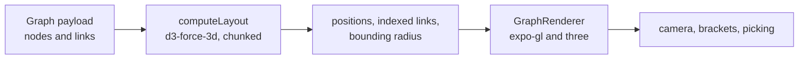

# The mobile graph renderer

The mobile app draws the dependency graph in 3D with three.js on a raw `expo-gl` context, with no React 3D library and no reconciler in the draw path. The layout is computed on the phone with `d3-force-3d`, in chunks the user can watch and abandon; the scene is built once imperatively and one animation loop owns the camera and the draw. This page explains the layout, the node cap, the renderer, picking and gestures, the controls, the safeguards that keep a bad graph from taking the app down, the constraints that pin the stack, and the failure modes that produce a blank screen without an error.

## Terms used on this page

- **`expo-gl`**: Expo's module that gives a React Native view (`GLView`) a WebGL 1 rendering context.
- **Instanced mesh**: one draw call that renders many copies of the same geometry with a per-copy transform and colour, used here for all nodes.
- **Force simulation**: the layout algorithm. Nodes repel, links pull, and repeated "ticks" move positions toward equilibrium.
- **Bounding radius**: the radius of the sphere enclosing the laid-out graph, which most sizes and distances are expressed as a fraction of.

## The three layers

| File                                                                                | Role                                                           |
| ----------------------------------------------------------------------------------- | -------------------------------------------------------------- |
| [`lib/graphLayout.ts`](../../mobile/src/lib/graphLayout.ts)                         | `computeLayout`, `defaultTicks`, `boundingRadius`, the node cap |
| [`components/GraphRenderer.tsx`](../../mobile/src/components/GraphRenderer.tsx)     | scene construction, the frame loop, gestures and picking       |
| [`lib/graphCamera.ts`](../../mobile/src/lib/graphCamera.ts)                         | pure orbit-camera maths: `orbitAt`, `clampPhi`, `projectPoint` |
| [`lib/graphSelection.ts`](../../mobile/src/lib/graphSelection.ts)                   | search matching, incident links, neighbours, the tour steps    |
| [`lib/graphBrackets.ts`](../../mobile/src/lib/graphBrackets.ts)                     | the on-screen size of the selection and search brackets        |
| [`lib/graphTour.ts`](../../mobile/src/lib/graphTour.ts)                             | the tour's step time and stepping                              |
| [`components/RenderBoundary.tsx`](../../mobile/src/components/RenderBoundary.tsx)   | an error boundary around the renderer                          |
| [`lib/graphTypes.ts`](../../mobile/src/lib/graphTypes.ts)                           | node colours and `criticalityColor`                            |
| [`app/(app)/repo/[id]/graph.tsx`](<../../mobile/src/app/(app)/repo/[id]/graph.tsx>) | the screen: fetch, layout, controls                            |
| [`components/GraphInspector.tsx`](../../mobile/src/components/GraphInspector.tsx)   | the sheet for the selected node                                |

The data is the same `GET /graph?level=file|symbol` payload the web uses; see [the dependency graph](../graph/dependency-graph.md).

## Layout

`computeLayout(graph, options)` runs the simulation on the JavaScript thread without blocking the screen:

1. An empty or malformed payload returns an empty layout straight away. Otherwise the nodes are cut to the cap (see below), and nodes and links are copied into simulation objects. The simulation is created **stopped** with three dimensions.
2. Forces, tuned for a phone screen: link distance 45 and strength 0.25, many-body charge −110 (`chargeStrength`), and a centring force. At the web's defaults the graph collapses into one blob at phone size.
3. It ticks manually in chunks, calling `onProgress(done, total)` and yielding with `setTimeout(0)` between chunks. A chunk is bounded by time as well as by tick count (`CHUNK_BUDGET_MS`, 24 ms), because one tick of a large graph can take longer than a frame. A macrotask, not a microtask: a microtask would drain before React could paint, and the progress bar would never move.
4. An `AbortSignal` is checked between chunks, so leaving the screen or switching level stops the work.
5. Every position is passed through a finite check before it is returned, so a simulation that produces `NaN` or an infinity gives zero rather than a corrupt buffer. It returns positions as a `Float32Array`, links as numeric index pairs, the bounding radius, the number of ticks run, the number of nodes laid out (`nodeCount`) and whether the cap cut the graph (`truncated`).

`defaultTicks` trades quality for time as graphs grow:

| Nodes        | Ticks |
| ------------ | ----- |
| up to 1,000  | 300   |
| up to 5,000  | 200   |
| up to 10,000 | 150   |
| more         | 100   |

### The node cap

`MAX_LAYOUT_NODES` is 30,000. A graph with more nodes is cut to the first 30,000, links that point outside them are dropped, and the screen says so: "Showing the first N of M nodes." (`graph-truncated`). The server has no cap, so this is the phone's own limit; the layout and the instance buffers for a larger graph were the likeliest way to run the app out of memory.

Two details are load-bearing:

- **The link force gets throwaway copies of the links.** d3 rewrites link endpoints into node object references; the returned links must keep numeric indices for the renderer.
- **The `id` accessor stays positional.** Setting it to the node's string id makes d3 resolve the numeric indices against that accessor and fail with `node not found`.

The screen shows a progress overlay with the node count and percentage while fetching and laying out. The payload and its layout are held together in one state value, so a level switch can never pair the new layout with the old node list, and the renderer is keyed on the level and node count so it remounts.

## The renderer

There is no reconciler. When the `GLView` context is created, the scene is built once:

- **Renderer.** three's `WebGLRenderer` expects an `HTMLCanvasElement`, which React Native does not have, so a small canvas shim supplies the properties three reads. While constructing it, the global `WebGLRenderingContext` is hidden, so a context `instanceof` check (added in three r163) fails with a message that names the cause instead of failing obscurely.
- **Camera.** A perspective camera with a 50° field of view and a far plane of 20 bounding radii (at least 100).
- **Nodes.** One `InstancedMesh` of unit spheres with `MeshBasicMaterial`. Tessellation drops with size: 12×8 segments up to 2,000 nodes, 8×6 up to 8,000, 6×4 above, so a large graph does not spend its frame on triangles nobody can see.
- **Node size.** A base radius of `NODE_SIZE_FRACTION` (1.1 %) of the bounding radius, scaled by `sqrt(max(loc, 10)) / 10` and clamped to 0.55×–2.2×. Without the clamp one 2,000-line file swallows its neighbours.
- **Node colour.** Search match `#a855f7`, then selected `#0078ff`, then criticality: critical `#ef4444`, caution `#facc15`, otherwise `#22c55e`, the same mapping as the web.
- **Links.** One `LineSegments` for the whole edge set, dim `#2a3550`. A WebGL line is one pixel wide whatever width is requested, so links incident to the selected node are redrawn as thin cylinders in `#5aa2ff`, at most `MAX_WIDE_LINKS = 64`.
- **Brackets.** The selected node and up to `MAX_BRACKET_MATCHES = 8` search matches are framed by four corner brackets, as on the web. The web draws its brackets onto a canvas texture, which needs the DOM; here they are line segments built from the node's position and sized in world units so that they stay at least `BRACKET_MIN_PX` (28) points across at any distance (`bracketHalfSize` in `graphBrackets.ts`, from the camera's field of view and the viewport height). Up to `MAX_SEARCH_MATCHES = 24` nodes are coloured as matches.

After construction only what changes is touched: instance colours when the selection or search changes (only the instances whose colour changed are rewritten), and the link buffer when the selection changes. The per-frame cost is the draw. Draw calls are constant in node count: one for nodes, one for links, one for the wide links.

The context is created with `msaaSamples={0}`, and the node mesh has `frustumCulled` off: an instanced mesh's bounding sphere is the one unit sphere, so culling would drop every instance whenever the origin left the view.

**`gl.endFrameEXP()` must be called after every render** to present the buffer. Omitting it gives a permanently blank view with no error, the most common way this integration fails silently.

On unmount a mounted flag is cleared, the frame is cancelled and every geometry, material and the renderer are disposed. The flag matters because the GL surface can be created after the screen has already gone, and a late `onContextCreate` would otherwise build a scene nobody owns. `LineSegments` has no `dispose()` of its own; its geometry and material do.

## Gestures and picking

Gestures go through a `PanResponder` over the `GLView`:

- **One-finger drag orbits** the camera. It uses the per-event delta, not `gesture.dx`: `dx` is the distance since the gesture began, and applying it on every move event spins the graph several turns on a short swipe. Elevation is clamped between 5° and 170° (`MIN_PHI`, `MAX_PHI`) so the camera cannot flip over the pole.
- **Two-finger spread zooms**, clamped between 0.15× and 12× of the bounding radius.
- **Tap picks.** Every node is projected to screen space and the nearest within `PICK_RADIUS = 44` points is selected. A release that moved more than 8 points in total is a drag, not a tap.

The orbit maths in `graphCamera.ts` is pure and unit-tested; the renderer itself picks with three's own projection, which is exact, and the two agree on where a node is.

## Controls

The screen floats its controls over the canvas, in pixel panels like the web's:

- the **level switch** (Files or Symbols) at the top, with the **legend** under it;
- at file level, the **reading-order tour** under the switch, with previous, play and next. `guideSteps` sorts the guide by position and joins entries to nodes by path, dropping entries with no node, as the web does; playing advances every `TOUR_STEP_MS` (4,000 ms) and `nextTourIndex` ends the tour;
- **search** pinned to the bottom, matching labels and paths, with the match count;
- **`GraphInspector`**, a bottom sheet for the selected node: its path, risk, language and size, its place in the reading order, the files that import it (folded after two) and the files it imports (each selects that node), and actions to ask about it in the chat, open it in the explorer and open it on GitHub, pinned to the ingested commit.

The overlay adds no safe-area padding: the repository shell already applied the top inset, and adding it again leaves a status-bar-sized gap.

## Keeping a bad graph from taking the app down

The graph screen used to crash the app. The safeguards, each aimed at a cause found by reading the code:

| Cause | Safeguard |
| ----- | --------- |
| a very large graph exhausting memory or the frame budget | the 30,000-node cap with a visible notice, time-sliced layout |
| `NaN` or infinite positions from the simulation | the finite check on every position |
| an empty graph, a null payload or a 409 for a repository still analysing | the empty-payload short-circuit and `graphErrorMessage`, with a message per status |
| the GL surface created after unmount, or `setState` after unmount | the mounted flag and a guard on every late callback |
| Android destroying the surface behind a hidden tab or a backgrounded app, then handing over a new context | the renderer is mounted only while the screen is focused and the app is active; a new context cancels the old loop and drops the old scene, and every frame checks it belongs to the current context |
| a draw loop presenting every frame whether or not anything moved | frames are drawn only while the camera eases, a gesture runs or a colour changes |
| an exception in the draw loop | a try/catch inside the frame callback, so one bad frame stops the loop rather than the app |
| an exception while building the scene | `RenderBoundary` around the renderer, with a retry, and an `ErrorBoundary` export on the route |
| MSAA and culling quirks on some Android GPUs | `msaaSamples={0}`, `frustumCulled` off |
| DOM-only APIs (canvas textures for brackets) | the brackets are geometry |

Which of these matter on a given device can only be told on that device; see the testing note below.

## Why three is pinned

`three` is pinned exactly to `0.162.0`, with `@types/three` to match. Release r163 removed WebGL 1 support, and `expo-gl` provides only WebGL 1, so with r163 or later `new THREE.WebGLRenderer()` throws `WebGL 1 is not supported since r163` before drawing anything.

- A dependency that wants a newer three is a conflict, not an upgrade.
- r162 dates from early 2024 and receives no fixes.
- The only way off the pin is a WebGL 2 context, which `expo-gl` does not offer.

## Why not a React 3D library

`@react-three/fiber/native` v9 throws at module scope under this stack, and its successor's own README says not to use it yet and points native users toward WebGPU. Imperative three over `expo-gl` is what works. The cost is that scene construction, colour updates, picking, disposal and the camera are hand-written; the benefit is that no component tree is reconciled on the draw path, which is what makes graphs of thousands of nodes viable.

## Testing

Jest has no GL context and no device, so the renderer is verified on a phone. The pure parts it depends on are tested: `graphLayout` (tick counts, chunking, abort, bounding radius, the cap, empty and `NaN` input), `graphSelection` (matching, incident links, neighbours), `graphTour`, `graphBrackets` (minimum on-screen size) and `graphCamera` (orbit, clamping, projection), together with the screen's empty, truncated and error states and the inspector.

## Design trade-offs and limits

- **Layout on the phone.** No server work and no cache, but a large repository spends seconds to a minute in the simulation every time the screen opens or the level changes.
- **Fewer ticks for big graphs.** Layout quality drops with size by design.
- **A frozen three.js.** No upstream fixes until `expo-gl` offers WebGL 2.
- **One-pixel lines.** Only the selection's links can be drawn wide.
- **A node cap.** Past 30,000 nodes the phone draws the first 30,000 and says so; the tessellation and the instanced mesh keep that many drawable.

## Related documentation

- [The mobile app](overview.md): the rest of the app.
- [Rendering the graph](../graph/rendering.md): the web's renderers.
- [The dependency graph](../graph/dependency-graph.md): the payload.
