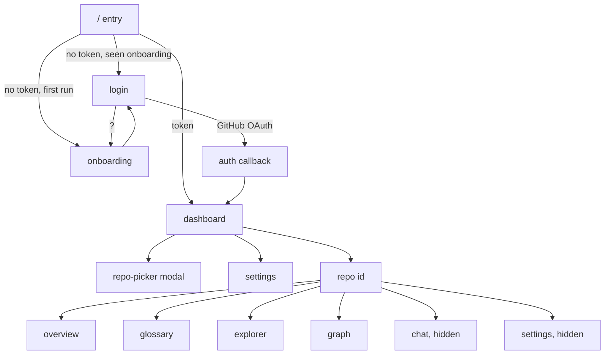
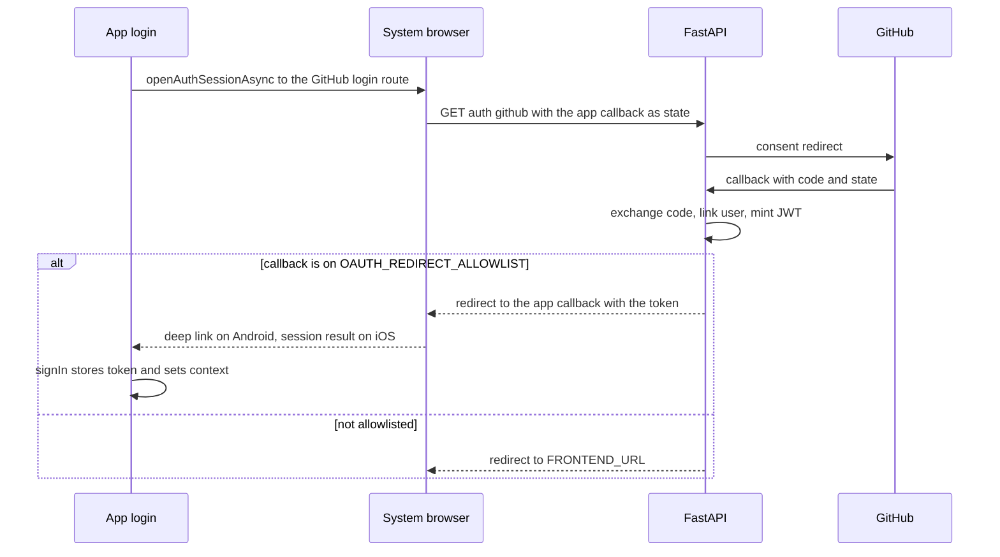

# The mobile app

Illume has a native app in [`mobile/`](../../mobile/), built with Expo SDK 57, React Native 0.86, React 19 and expo-router. It talks to the same FastAPI backend as the web client, authenticated with a bearer token instead of a cookie, and shares no code with the web client. This page covers how it relates to the web client, its toolchain, routing, sign-in and session handling, networking, every screen, push notifications, testing, and how builds are made. The 3D graph has [its own page](graph-renderer.md).

## Terms used on this page

- **Expo**: the toolkit around React Native that builds the app, manages native modules and serves the JavaScript bundle.
- **Metro**: React Native's JavaScript bundler, which a development build loads code from.
- **Development build** (or dev client): an installed app with all of Illume's native modules compiled in, which reloads JavaScript from Metro. **Expo Go**, the generic sandbox app, cannot run Illume.
- **EAS**: Expo Application Services, the cloud that builds installable APKs and store bundles.
- **Native module**: code compiled into the app binary (for example `expo-gl`). Adding one needs a new build, not a reload.

## How it relates to the web client

The web client is canonical: features are designed there and the phone follows. The two share **no code**, no workspace package and no common types module; types and design tokens are copied by hand.

| Concern       | Web ([`client/`](../frontend/overview.md))       | Mobile                                                             |
| ------------- | ------------------------------------------------ | ------------------------------------------------------------------ |
| Rendering     | React DOM, Tailwind 4                            | React Native, NativeWind 5 (`className` compiled to native styles) |
| Routing       | Next.js App Router, server components            | expo-router, client-side only                                      |
| Session       | httponly cookie                                  | `Authorization: Bearer`, token in `expo-secure-store`              |
| Data fetching | server components, server actions, browser fetch | TanStack Query over one `fetch` wrapper                            |
| Chat          | streaming agent with presets                     | **Classic only**: `POST /chat`, no streaming, no presets           |
| 3D graph      | `react-force-graph-3d` (WebGL 2)                 | raw `expo-gl` and three.js r162 (WebGL 1)                          |
| First screen  | marketing landing page                           | a three-screen onboarding carousel                                 |
| Layout        | any viewport                                     | portrait only, dark only                                           |

Decisions behind this, recorded with the port:

- **No shared code**, so a mobile change can never trigger or break a web deploy, and because the web renders server components the phone cannot use. The cost is duplication: `mobile/src/types/` can drift from the server's models, and the palette is maintained twice (with a test keeping the two copies of the palette equal).
- **Android first.** Development happens on Windows, so the Android emulator and a physical device are the test surfaces. iOS builds come from EAS and are not exercised locally.
- **A development build, not Expo Go.** Remote push was removed from Expo Go in SDK 53, and `expo-gl` needs native code Expo Go does not have.

The mobile chat still uses the Classic endpoint. The agentic chat, presets, conversations and the live graph exist only on the web.

## Project layout

```text
mobile/
  app.json             Expo config: scheme "illume", icons, plugins, newArchEnabled, portrait, dark
  eas.json             build profiles and the backend URL each bakes in
  babel.config.js      babel-preset-expo only
  metro.config.js      Expo's Metro config wrapped by NativeWind
  global.css           Tailwind layers and the @theme palette
  jest.config.js       jest-expo preset, @/ mapping
  jest.setup.js        native module mocks, before the React Native environment exists
  jest.after-env.js    testing-library configuration, after it does
  __tests__/           Jest specs
  e2e/                 Maestro flows
  scripts/             check-native-linking.mjs, generate_assets.py
  src/
    app/               expo-router routes: the file tree is the route tree
    components/        feature components: graph renderer, ingest flow, pickers
    ui/                small presentational pieces
    hooks/             data and state hooks
    lib/               pure logic: tree building, layout maths, parsers
    api/               one HTTP client and one module per endpoint group
    types/             copied from the web client; may drift
    theme/tokens.ts    the palette as strings, for places className cannot reach
```

Two rules: `lib/` never imports React, so it is the easiest code to test; and `api/` never imports components, and nothing else calls `fetch`.

## Toolchain

| Package                                                | Role                                                                                          |
| ------------------------------------------------------ | --------------------------------------------------------------------------------------------- |
| `expo`, `expo-router`                                  | build tooling, native module registry, file-based routing                                     |
| `react-native` 0.86                                    | the runtime, New Architecture on                                                              |
| `nativewind` 5 (release candidate), `react-native-css` | `className` to native styles                                                                  |
| `expo-gl`                                              | a WebGL 1 context                                                                             |
| `three` **0.162.0**                                    | the 3D scene; pinned exactly, see [the graph renderer](graph-renderer.md#why-three-is-pinned) |
| `d3-force-3d`                                          | the graph layout                                                                              |
| `@tanstack/react-query`                                | server state                                                                                  |
| `expo-secure-store`                                    | the bearer token                                                                              |
| `@react-native-async-storage/async-storage`            | the onboarding flag                                                                           |
| `expo-web-browser`, `expo-auth-session`                | the OAuth browser session                                                                     |
| `expo-notifications`                                   | push, loaded lazily                                                                           |
| `expo-file-system`, `expo-sharing`                     | the `.illume` export and the share sheet                                                      |
| `react-native-svg`                                     | the git timeline                                                                              |
| `react-native-reanimated`                              | the ingest board, the log drawer, skeleton shimmer                                            |
| `zod`                                                  | form validation mirroring the web's schemas                                                   |

### NativeWind constraints

Styling is `className` on React Native components, compiled from `global.css`. Three constraints have each caused bugs:

1. **`className` reaches only React Native's own components.** A third-party native view such as `SafeAreaView` from `react-native-safe-area-context` ignores it, so `flex-1` on it is dropped and its children collapse to zero height. Use a plain `View` and `useSafeAreaInsets()`.
2. **No `oklch()`.** React Native's colour parser understands hex, `rgb()`, `hsl()` and names. Values handed to native APIs or three.js come from `src/theme/tokens.ts`.
3. **The palette exists twice**, in `global.css` and `tokens.ts`. `__tests__/themeSync.test.ts` parses `@theme` and fails on any value that differs.

### The `typescript` override

`package.json` overrides `typescript` to `~5.4.0`. Without it, an optional peer of `@expo/require-utils` resolves to TypeScript 7, which pulls one native binary per platform, and `npm ci` on the Linux EAS builder fails with `EBADPLATFORM`. Do not remove it.

## Running the app

```bash
cd mobile
npm install
npx expo run:android           # build and install a development build once
npx expo start --dev-client    # then serve JavaScript from Metro
```

### The backend URL

`EXPO_PUBLIC_BACKEND_URL` is inlined into the bundle at build time.

| Situation                         | Value                                                                   |
| --------------------------------- | ----------------------------------------------------------------------- |
| development, physical device      | the machine's LAN address, in `mobile/.env`                             |
| development, Android emulator     | falls back to `http://10.0.2.2:8000`, the emulator's alias for the host |
| `preview` and `production` builds | the production API, set in `eas.json`                                   |

A **release** build without a value throws at start-up with a clear message, rather than sending every request to an emulator alias.

Expo substitutes the value by matching the literal expression `process.env.EXPO_PUBLIC_BACKEND_URL` in the source. Wrapping `process.env` in a cast or destructure stops the match, and the value reads `undefined` only on an installed release build; typechecks, Jest and the bundle build all still pass. `resolveBackendUrl` in [`api/client.ts`](../../mobile/src/api/client.ts) reads it bare, and `__tests__/publicEnvInlining.test.ts` fails if that changes.

`api/ingest.ts` derives the WebSocket URL by swapping `http` for `ws`, so an HTTPS backend gives `wss://`.

## Routing

| Route                 | File                             | Shows                                               |
| --------------------- | -------------------------------- | --------------------------------------------------- |
| `/`                   | `app/index.tsx`                  | the cold-start decision, then a redirect            |
| `/onboarding`         | `app/onboarding.tsx`             | the three-screen carousel                           |
| `/login`              | `app/login.tsx`                  | GitHub sign-in, with "?" to reopen the carousel     |
| `/auth/callback`      | `app/auth/callback.tsx`          | the OAuth deep-link target on Android               |
| `/dashboard`          | `app/(app)/dashboard.tsx`        | repositories, the free-tier banner, an add button   |
| `/repo-picker`        | `app/(app)/repo-picker.tsx`      | modal route: pick a repository, then a version      |
| `/settings`           | `app/(app)/settings.tsx`         | account settings                                    |
| `/settings/ai`        | `app/(app)/settings/ai.tsx`      | the user's own AI key                               |
| `/settings/contact`   | `app/(app)/settings/contact.tsx` | the contact form                                    |
| `/repo/[id]`          | `app/(app)/repo/[id]/index.tsx`  | the overview, or the live ingest board              |
| `/repo/[id]/glossary` | `.../glossary.tsx`               | glossary browse and search                          |
| `/repo/[id]/explorer` | `.../explorer.tsx`               | the file tree with a details sheet                  |
| `/repo/[id]/graph`    | `.../graph.tsx`                  | the 3D graph                                        |
| `/repo/[id]/chat`     | `.../chat.tsx`                   | Classic chat (hidden tab)                           |
| `/repo/[id]/settings` | `.../settings.tsx`               | auto-update, export, re-ingest, delete (hidden tab) |
| anything else         | `app/+not-found.tsx`             | "This screen does not exist"                        |



- **Root layout** (`app/_layout.tsx`) is the only place providers are wired: `SafeAreaProvider`, one `QueryClientProvider`, `AuthProvider`, a `PushRegistration` that renders nothing, the status bar and a headerless `Stack`. It also bridges app foreground to React Query's focus refetch and exports an `ErrorBoundary` with "Try again".
- **Entry decision** (`app/index.tsx`): with a token, go to the dashboard without reading the onboarding flag; without one, onboarding on a first run, otherwise login. It shows a spinner rather than nothing, because some Android builds have already dismissed the splash.
- **Auth gate** (`app/(app)/_layout.tsx`): a splash while loading, a `<Redirect>` to login without a token. Ownership is the backend's job; it returns 404 for another user's repository.
- **Repository shell** (`app/(app)/repo/[id]/_layout.tsx`): a `Tabs` navigator with a custom top tab bar matching the web navbar. Chat and settings are registered with `href: null` and filtered from the bar, but navigable by URL. A repository that is not ready shows only Home. A deep link to a tab of an unready repository navigates (not replaces) back to the overview, because replacing a tab with a tab leaves two routes of the same name.
- **Search params.** Screens nested under `repo/[id]/` must use `useGlobalSearchParams()`. `useLocalSearchParams()` returns only the current route's own params, so it gave `undefined` for `id`, every query stayed disabled, and three tabs loaded forever. Each call site carries a comment so it is not "simplified" back.
- **Two kinds of modal.** `/repo-picker` is a modal route with its own URL; the explorer's file sheet is a modal component, because it is a detail of the current screen.

## Sign-in and the session

The backend issues the same JWT as for the web. The phone stores it in `expo-secure-store` and sends it as a bearer token. A token issued to an allowlisted deep link (or to a request carrying `X-Illume-Client: mobile`) gets the longer `MOBILE_TOKEN_EXPIRE_MINUTES` lifetime, 90 days by default.



- **Two return paths.** Android delivers the redirect as a deep link that mounts `app/auth/callback.tsx`. iOS returns it to the `openAuthSessionAsync` promise and emits no event, so `login.tsx` parses `result.url` itself. Both call the same `signIn`.
- **`signIn` writes the store and the context.** The route guard reads the auth context; an early version wrote only SecureStore and the guard sent the user back to login. `signIn` stores the token, validates it with `GET /auth/me`, sets `{ token, user }`, and returns false only when the backend rejects it.
- **Rejected versus unreachable.** On a cold start `fetchMe` classifies the result: `ok` adopts the token; `rejected` (401 or 403) clears it; `unreachable` (5xx, DNS, timeout) **keeps** it and retries once immediately and again on every foreground, so losing signal never signs a user out. Before clearing, the store is re-read, in case a deep-link sign-in wrote a fresh token meanwhile.
- **Expiry.** Any 401 calls a sign-out handler, debounced for two seconds because one screen can fire several failing queries. A 403 does not sign out.
- **Sign-out** deregisters the push token (errors ignored), clears SecureStore and the context, and clears the whole query cache, because query keys carry no user id.
- The backend's `OAUTH_REDIRECT_ALLOWLIST` must contain `illume://auth/callback` exactly; see [environment variables](../reference/environment.md).

## Networking

Every request goes through `apiRequest` in [`api/client.ts`](../../mobile/src/api/client.ts):

- resolves the base URL and reads the token on every call (cheap after the first read);
- sets `Accept: application/json`, `Content-Type` only with a body, `Authorization` only with a token;
- parses 204 and empty bodies to `undefined` and non-JSON bodies as text;
- throws `ApiError` on any non-2xx, with a `kind` of `unauthorized`, `notFound`, `quota`, `clientError`, `server`, `network` or `unknown`. `quota` (402) is treated specially: the remedy is the user's own key, not a retry.

Every API function takes an options bag with `backendUrl` and `fetchImpl`, so tests inject transport instead of mocking modules.

| Module          | Calls                                                                                   | Keyed by              |
| --------------- | --------------------------------------------------------------------------------------- | --------------------- |
| `repository.ts` | list, get, create (202)                                                                 | `repo_number` for get |
| `graph.ts`      | `GET /graph?level=`                                                                     | UUID                  |
| `explorer.ts`   | the same graph at file level, keeping only the nodes                                    | UUID                  |
| `guide.ts`      | the onboarding guide                                                                    | UUID                  |
| `glossary.ts`   | browse and search                                                                       | UUID                  |
| `ownership.ts`  | ownership (optionally one file) and knowledge silos                                     | UUID                  |
| `chat.ts`       | `POST /chat`, history, delete one, clear                                                | UUID                  |
| `settings.ts`   | AI credentials, auto-update, sync now, re-ingest, delete, the `.illume` export, contact | user or UUID          |
| `push.ts`       | register, deregister and status of the push token                                       | user                  |
| `ingest.ts`     | the ingest WebSocket URL, with `?token=`                                                | UUID                  |
| `github.ts`     | the GitHub proxy: repositories, branches, commits                                       | user                  |

**The identifier split causes most 404s.** List and detail routes use `repo_number`; everything else uses the UUID. A wrong id reads like "no glossary yet", so screens resolve the number to the record first and use `repo.id` after.

### Server state

One `QueryClient` with `retry: 1` and `staleTime: 30_000`. Keys come from one factory, `api/queryKeys.ts`, all starting with a domain (`["repositories", ...]` or `["github", ...]`), so one call can invalidate every repository-scoped entry.

| Mutation                        | Invalidated                    |
| ------------------------------- | ------------------------------ |
| create repository               | the list                       |
| chat send, delete, clear        | that repository's chat history |
| auto-update change, sync queued | the list and the detail        |
| re-ingest                       | every repository key           |
| delete repository               | every repository key, removed  |
| sign-out                        | the whole cache                |

Invalidating only the list after a re-ingest once left a cached detail saying `ready`, sending the user to the stale overview instead of the ingest board.

Two pollers: the dashboard refetches every 5 s while any repository is neither ready nor failed, and `RepoStatusPoller` invalidates the detail every 5 s (`POLL_INTERVAL_MS`) while an ingest or sync is in progress, giving up after 65 minutes (`MAX_POLL_MS`), five minutes past the worker's 60-minute sync lease, because a killed sync cannot clear its own status.

## Screens

- **Dashboard.** Three skeleton cards while loading; an error panel with retry; an empty state; otherwise repository cards with pull-to-refresh, a floating add button, and Settings and Log out in the header. Settings is in the header because the free-tier banner, which used to link there, hides itself for users with their own key.
- **Repository picker.** Step one lists the user's GitHub repositories (100 per page, filtered by name) or accepts a pasted URL; step two is a commit timeline (`GitGraph`, SVG) for choosing a branch or commit. It has an explicit Cancel, because a modal route has no visible dismissal on iOS. Creating a repository refreshes the profile, since the free-tier counter changed.
- **Overview.** `IngestFlow` while ingesting; `RepoDetail` (identity, status, summary, stack, a button into chat) when ready. The guide is fetched only when ready.
- **Glossary.** Server-side search debounced by 400 ms, page size 20, previous data kept while paging so the list does not blank. Three different empty messages: the repository failed to load, nothing matched, or there is no glossary.
- **Explorer.** A tree built client-side from the file-level graph by `lib/fileTree.ts`: build a nested tree (a path that is both a file and a directory keeps the directory), flatten against the expanded set, sort directories first. Rendered by a `FlatList`, so re-renders follow visible rows. Tapping a file opens a sheet with its details and ownership, fetched for that one file.
- **Graph.** See [the graph renderer](graph-renderer.md).
- **Chat.** Optimistic turns with client ids replaced when the answer lands; history copied into local state once so a late refetch cannot reorder turns; 402 shows the server's message; failed turns stay, marked, and are left out of the next request's history. The composer is disabled when the free allowance is spent, and is not drawn until the repository record resolves, which once let a fast tap post to `/api/v1/repository//chat`.
- **Settings.** Account-level only: AI credentials, contact, about, log out. Repository settings live behind the gear in the repository header: auto-update and sync, export, re-ingest and delete.

### The live ingest board

`useIngestStream` owns the WebSocket and normalises frames, like the web hook. `IngestFlow` folds them into stage states with the same rules as the web (see [the WebSocket page](../interfaces/websockets.md#from-frames-to-node-states)): a headline that moves from queued through each stage to "Still working…" after five minutes of silence; a refresh 900 ms after completion or 2500 ms after failure, once each; one reconnect after a 15-second grace when the socket closes early. `IngestFlowCanvas` animates the board and drops its decorative layers when the system's reduce-motion setting is on. After the first successful ingest, and never at launch, the app asks for notification permission.

### Export

`ExportIllumeButton` fetches the [`.illume` export](../interfaces/illume-export.md), writes it to the cache directory as `<name>.illume` (the name from the file's `repo=` line, sanitised to `[a-zA-Z0-9._-]`), and opens the share sheet. The cache file is not deleted, since the share target may still be reading it.

### Push notifications

- The token **re-registers on every launch** from the root layout, because Expo rotates tokens.
- The server's payload carries `event`, `repository_id`, `repository_number` and `repository_name`; `notificationPath` builds `/(app)/repo/{repository_number}` from it.
- `expo-notifications` is required lazily, so a build without push still loads.
- A release build needs `google-services.json` and `android.googleServicesFile` in `app.json`; without them registration silently never happens. The server side is [`api/v1/push.py`](../../server/app/api/v1/push.py) and the `push_tokens` table.

## Visual system

- The palette is sRGB hex or `rgba()`, defined in `global.css` and `tokens.ts` and kept equal by a test.
- The card surface (`#0e0e10`) sits just above the background (`#09090b`); on a small screen the web's raised-card colour made every card a separate pane, so borders do the separating.
- No custom fonts. Touch targets are at least 44 points. Portrait and dark only.
- Screens apply `paddingTop: insets.top` on a plain `View`. The chat pads by the keyboard height from `useKeyboardHeight` plus the bottom inset, because `KeyboardAvoidingView` misjudges the keyboard on Android with edge-to-edge display.

## Testing

```bash
npm test           # Jest through jest-expo
npm run typecheck  # tsc --noEmit
```

| Area       | Examples                                                                                   |
| ---------- | ------------------------------------------------------------------------------------------ |
| pure logic | `graphLayout`, `graphSelection`, `fileTree`, `gitGraphLayout`, `markdownBlocks`            |
| hooks      | `useAuth`, `useChat`, `useIngestStream`, `useRepoForm`, `useRepositories`, `useAutoUpdate` |
| screens    | dashboard, chat, glossary, explorer, graph, the repository shell, settings, onboarding     |
| contracts  | `themeSync`, `routes` (every route module loads), push payload keys, `publicEnvInlining`   |

- `jest.setup.js` mocks native modules and runs **before** the React Native environment exists; anything needing `react-native` goes in `jest.after-env.js`, which also raises the `waitFor` timeout to 5 s for full parallel runs.
- Storage is injected through `__setTokenStoreImplementation` and `__setOnboardingFlagImplementation`, which production code never calls.
- The GL path is not tested in Jest (there is no GL context); the layout and camera maths it depends on are.
- `e2e/` holds Maestro flows for onboarding, the dashboard, the repository shell and chat. They need a device, a reachable backend and an account signed in by hand, because Maestro cannot drive the GitHub OAuth round trip.
- There is no linter configured for `mobile/`.

## Building and releasing

| EAS profile   | Produces                                  | Backend                      |
| ------------- | ----------------------------------------- | ---------------------------- |
| `development` | a development build                       | from `mobile/.env` via Metro |
| `preview`     | an installable APK, internal distribution | production API               |
| `production`  | a store build                             | production API               |

```bash
npx eas login
npx eas build --profile preview --platform android
```

- `eas-cli` is a dev dependency, so `npx eas` runs the right binary; outside `mobile/` an unrelated `eas` package is resolved instead.
- **EAS archives the git repository root**, so `mobile/.easignore` rules are matched at any depth. A rule saved with a CRLF line ending matches nothing and the whole `node_modules` tree is uploaded (about 1.6 GB); `.gitattributes` pins the file to LF.
- Adding a native module needs a new build; the symptom of forgetting is a `ViewManager` error naming the missing component. `node scripts/check-native-linking.mjs` compares declared modules against what Gradle resolves.
- `appVersionSource: "remote"` lets EAS own the Android `versionCode`.
- The web client serves an Android download page at `/mobile`.

## Troubleshooting

| Symptom                                                                             | Cause and fix                                                                            |
| ----------------------------------------------------------------------------------- | ---------------------------------------------------------------------------------------- |
| every request fails with a network error on a device                                | the backend URL is missing or `localhost`; set a reachable host                          |
| release build says `EXPO_PUBLIC_BACKEND_URL is not set` although `eas.json` sets it | the read was wrapped, so Expo did not substitute it; keep it a literal member expression |
| sign-in finishes in the browser but the app stays on login                          | the callback is not on `OAUTH_REDIRECT_ALLOWLIST`, or the context was not updated        |
| a screen shows only its header                                                      | `useLocalSearchParams` under a dynamic segment; use `useGlobalSearchParams`              |
| `Can't find ViewManager ...`                                                        | a native module is missing from the installed build; rebuild                             |
| blank graph, no error                                                               | `gl.endFrameEXP()` not called; see [the graph renderer](graph-renderer.md)               |
| `WebGL 1 is not supported since r163`                                               | `three` was upgraded; restore the exact pin                                              |
| content under the keyboard                                                          | `KeyboardAvoidingView` with edge-to-edge; pad by `useKeyboardHeight()`                   |
| one card a different shade                                                          | `global.css` and `tokens.ts` drifted; `npm test` names the token                         |
| EAS upload takes gigabytes                                                          | `.easignore` has CRLF line endings                                                       |

## Design trade-offs and limits

- **Duplication over coupling.** Two independent apps, at the cost of copied types and a twice-maintained palette.
- **Feature lag.** Mobile chat is Classic only: no agent, presets, conversations or streaming.
- **iOS is unverified locally.**
- **Push needs Firebase configuration** that is not in the repository.
- **The explorer downloads the whole file graph**, links included, to use only the nodes.
- **The backend URL is baked in.** Changing it is a new build.
- **No offline mode.** The only tolerance is keeping a session whose profile could not be read.
- **Token in the WebSocket URL**, as on the web.

## Related documentation

- [The mobile graph renderer](graph-renderer.md): the 3D view in depth.
- [The web client](../frontend/overview.md): the canonical client.
- [API reference](../api.md): every endpoint the app calls.
- [The ingest WebSocket](../interfaces/websockets.md): the frames the ingest board renders.
- [Authentication](../security/auth.md): the JWT, the bearer branch and the OAuth callback.
