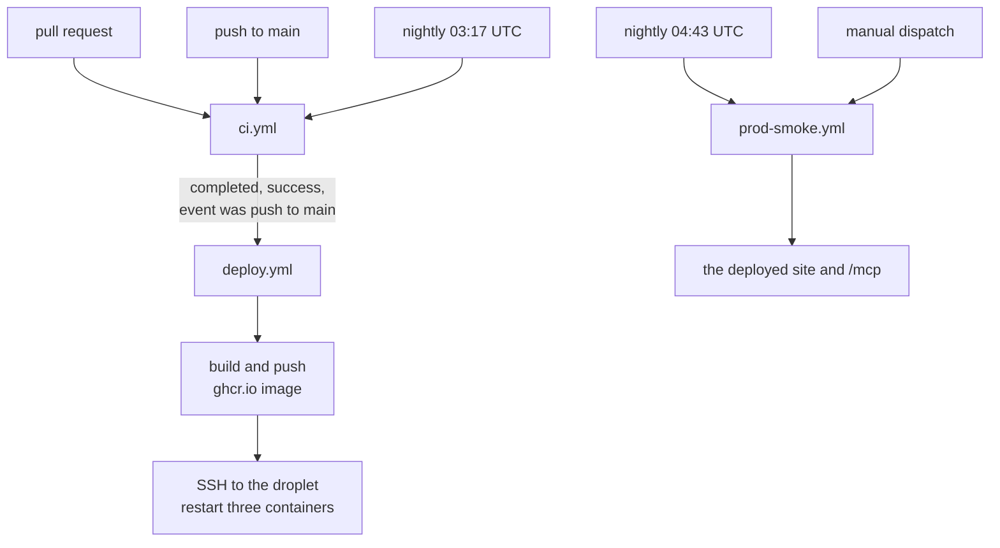
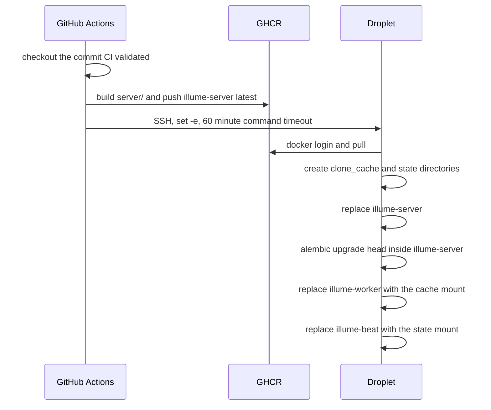

# CI and CD

Three GitHub Actions workflows guard and ship the backend: `ci.yml` lints and tests every pull request and every push to `main`, `deploy.yml` builds the server image and restarts production only after CI succeeds on a push to `main`, and `prod-smoke.yml` checks the live site every night. The web client is not deployed by these workflows. This page describes every job, the deliberate split between blocking and report-only checks, the coverage ratchet, how a commit reaches production, and what each workflow refuses to do.

## Terms used on this page

- **Workflow**: a YAML file under `.github/workflows/`; a **job** is one machine's worth of steps inside it.
- **Service container**: a Docker container GitHub starts beside a job, used here for Postgres and Redis.
- **`workflow_run`**: a trigger that fires when another workflow finishes, used so the deploy waits for CI.
- **Report-only check**: a step with `continue-on-error: true`. Its failures show in the log but do not fail the job.
- **GHCR**: GitHub Container Registry, where the server image is pushed.

## The workflows



| Workflow         | File                                                       | Triggers                                            | Concurrency                                 |
| ---------------- | ---------------------------------------------------------- | --------------------------------------------------- | ------------------------------------------- |
| CI               | [`ci.yml`](../../.github/workflows/ci.yml)                 | `pull_request`, `push` to `main`, cron `17 3 * * *` | `ci-{ref}`, a new push cancels the old run  |
| Deploy Backend   | [`deploy.yml`](../../.github/workflows/deploy.yml)         | `workflow_run` of CI, completed, on `main`          | none                                        |
| Production Smoke | [`prod-smoke.yml`](../../.github/workflows/prod-smoke.yml) | cron `43 4 * * *`, `workflow_dispatch`              | `prod-smoke`, never cancels a run in flight |

## CI

Six jobs. All but `e2e-nightly` run on every pull request and every push to `main`.

| Job              | What it runs                                                                                                                                    | Blocking parts                                                                           | Report-only parts             |
| ---------------- | ----------------------------------------------------------------------------------------------------------------------------------------------- | ---------------------------------------------------------------------------------------- | ----------------------------- |
| `backend-lint`   | `uv sync --dev`, then ruff and mypy                                                                                                             | `ruff check tests/`, `ruff format --check tests/`, `mypy tests/ --follow-imports=silent` | `ruff check app/`, `mypy app` |
| `frontend-lint`  | `npm ci`, `npx next typegen`, `npx tsc --noEmit`, ESLint                                                                                        | typegen, `tsc`, `eslint tests/ e2e/ e2e-prod/ vitest.config.ts`                          | `npm run lint` over `src/`    |
| `backend-tests`  | Postgres and Redis services; `alembic upgrade head`; `pytest --cov=app -n auto`; `pytest ../mcp-local/tests`; the ratchet                       | all                                                                                      |                               |
| `evals`          | same services; `ruff check evals/`, `ruff format --check evals/`; `alembic upgrade head`; `python -m evals selftest`; `pytest tests/evals -n 2` | all                                                                                      |                               |
| `frontend-tests` | `npm run test:coverage`; the ratchet                                                                                                            | all                                                                                      |                               |
| `e2e-nightly`    | Postgres and Redis services; `uv sync --dev`; `npm ci`; `npx playwright install --with-deps chromium`; `npm run test:e2e`                       | all; uploads the report and traces on failure only                                       |                               |

The backend jobs use Python from `uv` with the lockfile cache; the frontend jobs use Node 24 with the npm cache.

### The test environment in CI

`backend-tests`, `evals` and `e2e-nightly` start `pgvector/pgvector:pg16` and `redis:7` as service containers on **5433** and **6380**, the same offset ports as [`docker-compose.test.yml`](../../docker-compose.test.yml), so the credentials in `tests/conftest.py` and `e2e/env.ts` work unchanged.

The two pytest jobs carry an `env:` block with every required `Settings` field (test values mirroring `server/.env.test.example`). pytest does not need it, because `conftest.py` sets its own environment before importing `app`, but `alembic upgrade head` runs first and would fail instantiating `Settings` on a fresh checkout with no `.env`. See [how settings load](../reference/environment.md#how-settings-load).

**Migrations run as their own step** before pytest. Otherwise several xdist workers race to migrate the same empty database, producing a scatter of unrelated errors.

### The lint split

Test code is clean and application code is not, so the checks are split rather than switched off:

- `tests/`, `e2e/`, `e2e-prod/`, `evals/` and `vitest.config.ts` are **blocking**: new test code cannot add a problem.
- `app/` (ruff and mypy) and `src/` (ESLint) are **report-only**: the standing debt stays visible in every log without failing the build.

A change that adds a lint error to `app/` can merge; one that adds an error to `tests/` cannot. The type check, `tsc --noEmit`, covers all of `client/` and is blocking. `next typegen` runs before it because `next-env.d.ts` is gitignored and carries the module types for asset imports; without it every `import x from "./y.png"` is `TS2307`.

`make lint-be` and `make lint-fe` reproduce the blocking half locally, and `make lint-be-app` the report-only half.

### The coverage ratchet

Both test jobs end with the same shape of step:

1. If the floor file (`server/.coverage-floor` or `client/.coverage-floor`) does not exist, skip.
2. Read the measured total: `percent_covered` from `coverage.json` (backend, statements, rounded to two places) or `total.lines.pct` from `coverage/coverage-summary.json` (frontend).
3. Fail with `::error::Coverage dropped to …, below the committed floor of …` when measured is below the floor.

The floors are 80 (backend) and 62 (frontend). A change that raises coverage meaningfully raises the floor file in the same commit, which makes the new floor a reviewed decision. The backend job uploads `coverage.json` as an artifact on every run.

### Why end-to-end is nightly

The job needs a production Next build, a migrated database and a Chromium download, minutes of work for a signal a review rarely turns on. Its condition is:

```yaml
if: github.event_name == 'schedule' || (github.event_name == 'push' && github.ref == 'refs/heads/main')
```

The explicit `event_name` test is there because the job must stay off the pull-request path. It has a 30-minute timeout. On failure it uploads `client/playwright-report` and `client/e2e/test-results` for 14 days; the two paths differ on purpose (see [artifacts](../testing/frontend-and-e2e.md#artifacts)).

Because it runs on a push to `main`, and the deploy waits for the whole CI workflow, **a red end-to-end run blocks that deploy**.

## Deploy

[`deploy.yml`](../../.github/workflows/deploy.yml) triggers on the CI workflow completing on `main`, and its one job runs only when:

```yaml
github.event.workflow_run.conclusion == 'success' &&
github.event.workflow_run.event == 'push'
```

So a failed, cancelled or pull-request CI run never reaches the droplet, and the nightly scheduled CI run does not redeploy either.



Key decisions, each from a comment in the workflow:

- **It checks out `workflow_run.head_sha`**, the commit CI validated, not the branch tip, which may be a newer commit no check has seen.
- **There is no path filter.** `workflow_run` carries no push payload, so the commits a push introduced cannot be recovered reliably; diffing only the tip would miss a server change in an earlier commit of the same push. A documentation-only commit therefore rebuilds and restarts the backend, costing a few seconds of API downtime. A missed backend deploy costs more.
- **`set -e` and `command_timeout: 60m`.** The image pull alone can exceed the 10-minute default on the droplet's link. A timeout used to kill the SSH session mid-pull while the remote shell kept going, and the pull's failure then fell through to the `docker run` lines, relaunching every container from the old image. `set -e` stops the script at the first failure.
- **Migrations run between the API and the worker.** A release that adds a column the new code reads would break every repository read if the worker started first. Each revision is written to be idempotent.
- **Every container gets `--log-opt max-size=20m --log-opt max-file=5`**, because Docker's default `json-file` driver never rotates.

The image is tagged only `latest`, so rolling back means redeploying an older commit (re-running an older successful deploy run, or reverting on `main`). The script is described step by step in [deployment](deployment.md#what-a-deploy-does).

## Production smoke

[`prod-smoke.yml`](../../.github/workflows/prod-smoke.yml) runs nightly at 04:43 UTC (clear of the 03:17 E2E job) and by hand, never on a pull request, with a 20-minute timeout so a hung run cannot hold the non-cancelling concurrency group into the next night.

| Input             | Kind                |
| ----------------- | ------------------- |
| `SMOKE_BASE_URL`  | repository variable |
| `SMOKE_API_URL`   | repository variable |
| `SMOKE_REPO_NAME` | repository variable |
| `SMOKE_EMAIL`     | secret              |
| `SMOKE_PASSWORD`  | secret              |

It has two steps of substance:

1. **`npm run test:e2e:prod`**, the Playwright suite described in [the production smoke suite](../testing/frontend-and-e2e.md#the-production-smoke-suite).
2. **An MCP probe in shell.** It signs in with the same account, deletes any token named `prod-smoke` left by a run that died early (so leftovers cannot fill the account's ten-token allowance), mints a 30-day MCP token, masks it in the log, and then over the stateless Streamable HTTP transport sends `initialize` (checking `serverInfo.name == "illume"`), `tools/list` (more than zero tools) and a `list_repositories` call whose text must contain `SMOKE_REPO_NAME`. Each response is a server-sent event stream, so the JSON-RPC message is read from the `data:` line. A `trap` revokes the token on any exit.

On failure it uploads only `client/e2e-prod/playwright-report`. `test-results/` is never uploaded, and traces and video are off in that config, because a trace records the values typed into fields.

## What these workflows do not do

- **Deploy the web client.** `deploy.yml` builds `server/` only. The Next.js client is hosted separately and is not built or released by any workflow in this repository.
- **Build the mobile app.** EAS builds are run by hand; see [the mobile app](../mobile/overview.md).
- **Run the mobile Jest suite.**
- **Run the eval harness against real models.** The `evals` job is key-free: self-tests and fixture-driven tests only.
- **Gate pull requests on end-to-end tests.**

## Design trade-offs and limits

- **Report-only application lint** keeps the build mergeable but lets the debt grow under a green check; the counts are only visible by reading the log.
- **A single mutable tag.** `latest` is simple to deploy but gives no one-command rollback and no record of which image is running.
- **Restart-everything deploys** guarantee the containers match the image, at the price of brief downtime on every push to `main`.
- **A non-atomic rollout.** A failed migration leaves the new API running beside the old worker until someone intervenes.
- **Nightly E2E** finds browser regressions hours after they merge, though before they deploy only when the push itself runs it.

## Related documentation

- [Deployment](deployment.md): the image, the containers, the host state.
- [The runbook](runbook.md): what to do when something breaks.
- [Testing overview](../testing/overview.md): the suites these jobs run.
- [Commands](../reference/cli.md#makefile): the local equivalents of every job.
