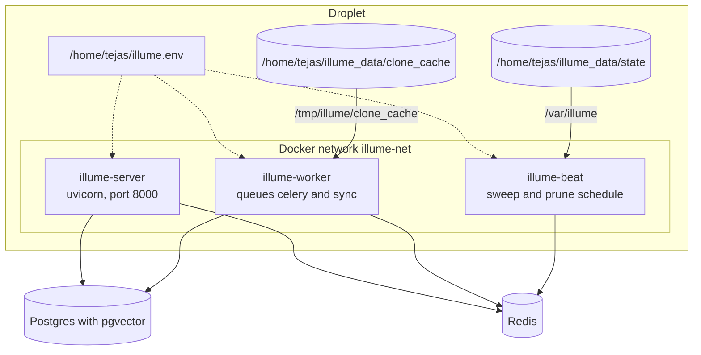
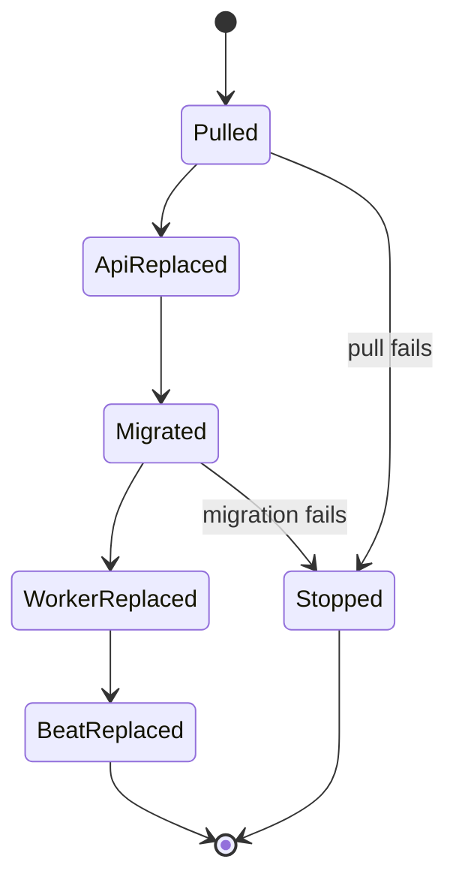

# Deployment

The backend runs as three containers on one DigitalOcean droplet, all from one image built from `server/`: the API, a Celery worker and the Celery beat scheduler. Every deploy stops, removes and re-runs all three, so anything that must outlive a deploy lives on a host bind mount: the clone cache and the beat schedule. This page covers the image, the three processes and why each is configured as it is, the state that must survive, the environment file, and exactly what a deploy does.

## Terms used on this page

- **Droplet**: a DigitalOcean virtual machine.
- **Bind mount**: a host directory mapped into a container, which survives the container's removal.
- **Celery worker**: the process that runs background tasks (ingestion, sync, sweeps).
- **Celery beat**: the scheduler that enqueues periodic tasks; it runs no tasks itself.
- **Prefork pool**: Celery's process-based worker pool, the only one that honours per-child limits.

## The image

[`server/Dockerfile`](../../server/Dockerfile) is a two-stage build on `python:3.14-slim`:

| Stage   | Installs                        | Then                                                                                                     |
| ------- | ------------------------------- | -------------------------------------------------------------------------------------------------------- |
| builder | `libpq-dev`, `gcc`, `git`, `uv` | copies `pyproject.toml` and `uv.lock`, runs `uv sync --frozen --no-dev`                                  |
| runtime | `libpq-dev`, `git`              | copies `/app/.venv` from the builder and the whole `server/` tree, puts the venv on `PATH`, exposes 8000 |

The default command is `uvicorn app.main:app --host 0.0.0.0 --port 8000`; the worker and beat containers override it.

- `--frozen` makes `uv.lock` authoritative, so adding a dependency means regenerating the lockfile.
- `--no-dev` keeps pytest, ruff and the other dev tools out of the image.
- **`git` is in the runtime stage because the product shells out to it.** Cloning, history mining, the sync probe (`git ls-remote`) and the clone cache are real `git` processes. An image without it serves the API perfectly and fails every ingestion.
- There is no `.dockerignore` in `server/`, so the image also contains `tests/`, `evals/` and `scripts/`. CI's checkout has no `.env`, so no local secrets enter an image built there.

## The three containers

| Container       | Command                                                                                                                        | Mounts                                                            |
| --------------- | ------------------------------------------------------------------------------------------------------------------------------ | ----------------------------------------------------------------- |
| `illume-server` | the image default: `uvicorn app.main:app` on 8000, published as `-p 8000:8000`                                                 | none                                                              |
| `illume-worker` | `celery -A app.core.celery worker --loglevel=info --pool=prefork --concurrency=1 -Q celery,sync --max-memory-per-child=614400` | `/home/tejas/illume_data/clone_cache` → `/tmp/illume/clone_cache` |
| `illume-beat`   | `celery -A app.core.celery beat --loglevel=info -s /var/illume/celerybeat-schedule`                                            | `/home/tejas/illume_data/state` → `/var/illume`                   |

All three join the Docker network `illume-net`, use `--restart unless-stopped`, rotate logs at five 20 MB files, and read `--env-file /home/tejas/illume.env`. Where Postgres and Redis run is not described in this repository: the workflow assumes `illume-net` exists and that the URLs in the environment file reach both.

### Why the worker runs one process

**Memory, not CPU, is the binding constraint.** Each ingestion peaks at several hundred megabytes, and the parallelism an ingest needs is already inside the task, as threads ([concurrency and failure](../pipeline/concurrency-and-failure.md)). A second concurrent ingest would not halve anything; it would add a second parse-phase memory floor to the same box.

- `--concurrency=1` is explicit because the prefork pool defaults to the **container's** reported CPU count, not the VM's vCPUs, and silently runs several children.
- `--max-memory-per-child=614400` (kilobytes, about 600 MB) recycles the child once its resident memory passes that, after the current task.
- `worker_max_tasks_per_child=10` in [`app/core/celery.py`](../../server/app/core/celery.py) also recycles it every ten tasks, and `worker_prefetch_multiplier=1` stops it reserving a second ingest while running the first.
- Both per-child limits need `--pool=prefork`; the `solo` pool used on Windows ignores them.

The cost: queued ingests run strictly one after another, and one very large repository delays everyone behind it.

### Why it consumes two queues

`task_routes` sends `app.tasks.sync.sync_repository` to the `sync` queue; everything else uses the default `celery` queue. One process consuming both means syncs serialise against ingests, so two parses never overlap. The split exists so a second worker on `-Q sync` can be added later as a deployment change with no code change.

### Why beat is its own container

Beat enqueues two schedule entries, registered in [`app/tasks/autoupdate.py`](../../server/app/tasks/autoupdate.py):

| Entry                    | Task                                          | Schedule                                    |
| ------------------------ | --------------------------------------------- | ------------------------------------------- |
| `sweep-due-repositories` | `app.tasks.autoupdate.sweep_due_repositories` | every `SWEEP_INTERVAL_MINUTES` (10) minutes |
| `prune-agent-steps`      | `app.tasks.agent_retention.prune_agent_steps` | daily at 03:40 UTC                          |

As a separate container, a worker restart (including a memory recycle) cannot interrupt the cadence. Beat records last-run times in its schedule file; `-s /var/illume/celerybeat-schedule` on the state mount lets the next beat process continue the cadence instead of starting over. What the sweep does is in [auto-update](../pipeline/sync.md#the-sweep).

## State that must survive a deploy

| Host path                             | Container path            | Used by | If it is missing                                                                 |
| ------------------------------------- | ------------------------- | ------- | -------------------------------------------------------------------------------- |
| `/home/tejas/illume_data/clone_cache` | `/tmp/illume/clone_cache` | worker  | every deploy empties the clone cache; the next sync of each repository re-clones |
| `/home/tejas/illume_data/state`       | `/var/illume`             | beat    | the schedule file is lost on every deploy and the cadence restarts               |
| `/home/tejas/illume.env`              | read with `--env-file`    | all     | containers exit at start-up with a `Settings` validation error                   |

**The cache's container path is not arbitrary.** `repo_cache._cache_root` resolves to `tempfile.gettempdir()/illume/clone_cache`, which in a Linux container is `/tmp/illume/clone_cache`. A mount anywhere else leaves the cache writing to the container's ephemeral layer, and because the cache falls back silently on every failure, nothing reports it; syncs are just slower. See [the clone cache](../pipeline/clone-cache.md).

Both host directories are created with `mkdir -p` by every deploy before any container starts.

## The environment file

All three containers read `/home/tejas/illume.env`. Every `Settings` field is required, so a missing variable is a container that refuses to start rather than one running on a wrong default. Every field is listed in [the environment reference](../reference/environment.md#backend-settings-fields). Values whose shape matters:

- **`DOMAIN` is a bare hostname**, passed straight into the session cookie's `Domain` attribute. A scheme or port makes browsers drop the cookie silently, and every protected page then redirects to `/login`. The production smoke suite asserts this.
- **`ENVIRONMENT=production`** turns on the cookie's `Secure` flag.
- **`CONTACT_FROM_EMAIL` is a bare address**, with no quotes or display name. Docker's `--env-file` does no quote processing, so quotes arrive literally and Resend rejects the sender.
- **`CREDENTIAL_ENCRYPTION_KEY`** encrypts stored AI keys and GitHub tokens. Changing it makes every stored credential unreadable; see [BYOK and encryption](../security/byok-and-encryption.md).
- **`AI_API_KEY` empty** turns the operator's free tier off; see [generation](../pipeline/generation.md).

`OPENAI_BASE_URL` must **not** be set in production: the OpenAI SDK reads it, and it exists only so the end-to-end suite can point model calls at a stub.

## What a deploy does

[CI and CD](ci-cd.md#deploy) covers the trigger. On the droplet, under `set -e`:

1. `docker login ghcr.io` with the workflow's `GITHUB_TOKEN`, then `docker pull ghcr.io/<owner>/illume-server:latest`.
2. `mkdir -p` both state directories.
3. Stop and remove `illume-server`; run it again.
4. **`docker exec illume-server alembic upgrade head`**, against the production database. Migrations run here, in the deploy, where a failure stops the script with someone watching, rather than at start-up in three racing processes.
5. Stop and remove `illume-worker`; run it with the cache mount.
6. Stop and remove `illume-beat`; run it with the state mount.

If the migration fails, the new API is already running against the old schema and the old worker and beat are still up. The fix is a corrected migration pushed to `main`, or a manual `docker exec` after diagnosing.

### What a deploy interrupts

- **The API** is down for the seconds between `docker stop` and the new container accepting connections. Open WebSockets and streaming chat responses are cut.
- **A running ingest or sync** is killed with the worker. An ingest's row stays in its last stage (the retry never runs because the process is gone); a sync's lease expires after `SYNC_LEASE_MINUTES` and the next sweep may reclaim it. See [a worker killed mid-ingest](../pipeline/concurrency-and-failure.md#a-worker-killed-mid-ingest) and [the lease](../pipeline/sync.md#the-lease).
- **Agent runs** in flight are interrupted; stale runs are swept up as described in [the chat agent](../retrieval/agent.md#persistence).

## The web client and the mobile app

- **The web client** is deployed separately from this workflow (no workflow here builds it). Its only build-time variable is `NEXT_PUBLIC_BACKEND_URL`, inlined at build, so changing the API's URL needs a client rebuild. Its docs pages are read at build time too.
- **The mobile app** is built with EAS; `EXPO_PUBLIC_BACKEND_URL` is inlined the same way. See [the mobile app](../mobile/overview.md).

## Design trade-offs and limits

- **One machine.** No redundancy: a droplet outage is a full outage, and the worker's memory is shared with the API.
- **Bind mounts, not volumes.** The state is easy to find with `ls`, but the paths are absolute and host-specific, and moving hosts means editing the workflow.
- **A `latest` tag.** No record of which commit is running beyond the deploy log, and no one-step rollback.
- **Restart-everything.** Guarantees containers match the image, at the cost of downtime and killed tasks on every push to `main`, including documentation-only ones.
- **Serial ingestion.** One worker process keeps memory bounded and makes the queue first-come, first-served for all users.

## Related documentation

- [CI and CD](ci-cd.md): the workflows that run this.
- [The runbook](runbook.md): diagnosing a live problem.
- [Environment variables](../reference/environment.md): every value in the environment file.
- [Auto-update](../pipeline/sync.md): what beat and the `sync` queue drive.
- [The clone cache](../pipeline/clone-cache.md): what the cache mount preserves.
