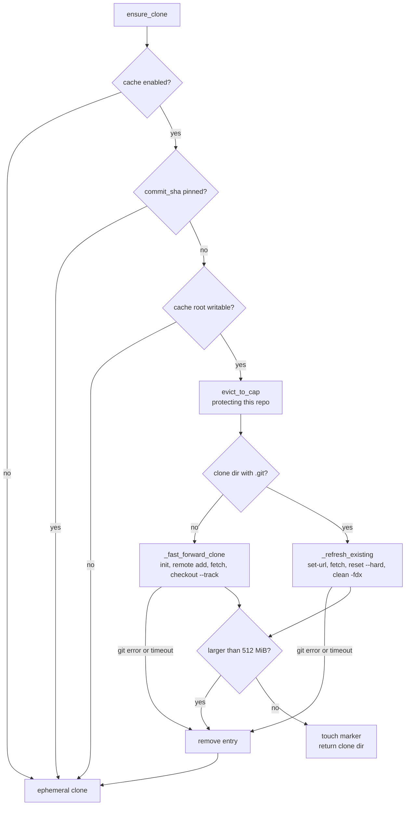

# The clone cache

Every ingest and every sync needs a working tree of the repository on the worker's disk. [`repo_cache.py`](../../server/app/services/repo_cache.py) keeps one persistent, non-bare clone per repository under a cache root so a later run can fetch only what changed instead of cloning from scratch, and [`cloner.py`](../../server/app/services/cloner.py) wraps it for the ingest. The cache is an optimisation and never a correctness dependency: every failure falls back to a throwaway clone in a fresh temporary directory, and deleting the cache at any time is safe. This page covers the layout, the git commands, eviction, token handling, and the ways the cache is used less than its design suggests.

## Layout on disk

```text
<tempdir>/illume/clone_cache/
├── .cache_state/
│   ├── <repo-id>.json          marker: branch, commit_sha, last_used_at, repo_id
│   └── ...
├── <repo-id>/                  non-bare clone, one per repository
│   ├── .git/
│   └── <working tree>
└── ...
```

`_cache_root()` is `Path(tempfile.gettempdir()) / "illume" / "clone_cache"`, created on first use. There is no environment override by design: the same value is baked into the image, a local checkout and every worker. Inside the Linux container that is `/tmp/illume/clone_cache`, and the deploy bind-mounts `/home/tejas/illume_data/clone_cache` there so the cache survives `docker rm` (see [deployment](../operations/deployment.md)). Markers live in `.cache_state`, beside the clones rather than inside them, so a `git clean -fdx` in a working tree cannot remove its own bookkeeping.

## Constants

| Constant                        | Value          | Meaning                                                            |
| ------------------------------- | -------------- | ------------------------------------------------------------------ |
| `CLONE_CACHE_ENABLED`           | True           | kill switch; off means every call makes an ephemeral clone         |
| `CLONE_CACHE_MAX_BYTES`         | 2 GiB          | total size the cache may reach before least-recently-used eviction |
| `CLONE_CACHE_MAX_REPO_BYTES`    | 512 MiB        | a single clone larger than this is not kept                        |
| `GIT_FETCH_TIMEOUT_SECONDS`     | 60             | `git fetch` limit                                                  |
| `GIT_LS_REMOTE_TIMEOUT_SECONDS` | 20             | `git ls-remote` limit (only used by the unused probe)              |
| `GIT_RESET_TIMEOUT_SECONDS`     | 30             | limit for `remote`, `checkout`, `reset`, `clean`, `rev-parse`      |
| `_STATE_SUBDIR`                 | `.cache_state` | marker directory name                                              |

Like the auto-update constants, these are module-level rather than `Settings` fields; changing one is a code change and a deploy.

## `ensure_clone`

`ensure_clone(repo_id, github_url, access_token, branch, commit_sha=None)` returns `(path, branch, commit_sha)`, the same shape `clone_repository` always returned, so callers did not change when the cache was added.



1. **Disabled or pinned.** With the cache off, or a specific commit requested, it goes straight to `_ephemeral_clone_raising`. The cache tracks one branch head per repository and cannot honour a pinned commit.
2. **Write probe.** It writes and deletes `.illume_write_probe` in the root; any `OSError` means an ephemeral clone.
3. **Evict.** `evict_to_cap(protect_repo_id=repo_id)` runs before the fetch, so the cache makes room first and never evicts the entry it is about to use.
4. **Populate or refresh.** A missing directory or one without `.git` is built with `_fast_forward_clone`; an existing one is brought up to date with `_refresh_existing`. A `GitCommandError`, `OSError` or timeout removes the entry and falls back.
5. **Size check.** A clone larger than `CLONE_CACHE_MAX_REPO_BYTES` is removed and replaced with an ephemeral clone, so one large repository cannot take most of the cap. It has already been fetched once by then, so an oversized repository costs two clones per run.
6. **Touch.** `touch` writes the marker with the current branch, head SHA and `last_used_at`, and the clone directory is returned.

### The git commands

`_fast_forward_clone` (first use):

```text
git init <dir>
git remote add origin <url with token>
git fetch origin <branch>
git checkout --track origin/<branch>
```

It deletes any half-written directory first, so a failed earlier attempt cannot poison a retry. The final `checkout --track` puts the tree on a real local branch rather than a detached head, so `active_branch.name` reports the branch name. The fetch is not shallow; it brings the branch's full history, which the git analyzer and the sync's fast-forward check both need.

`_refresh_existing` (later uses):

```text
git remote set-url origin <url with current token>
git fetch origin <branch>
git reset --hard origin/<branch>
git clean -fdx
```

`reset --hard` and `clean -fdx` return the tree to exactly what is committed, removing any untracked files a previous run created, so the next file walk sees only committed content.

Every command runs through `_run_git`, which runs `git` as a subprocess with a hard timeout and raises `git.GitCommandError` on a non-zero exit, with stdout and stderr already passed through `redact_credentials`.

### The git environment

`_git_env` sets, on top of the process environment:

| Variable              | Value        | Purpose                                                                                                      |
| --------------------- | ------------ | ------------------------------------------------------------------------------------------------------------ |
| `GIT_TERMINAL_PROMPT` | `0`          | fail instead of prompting for a password                                                                     |
| `GIT_ASKPASS`         | `echo`       | a no-op credential helper, so a prompt returns immediately                                                   |
| `GIT_CONFIG_GLOBAL`   | `os.devnull` | ignore the developer's or image's global git config                                                          |
| `GIT_CONFIG_SYSTEM`   | `os.devnull` | ignore system config, so a `protocol.*.allow` setting cannot widen what a fetch from an untrusted URL may do |

The ephemeral path uses GitPython's `clone_from`, which does not get this environment.

## The ephemeral fallback

`_ephemeral_clone(github_url, token, branch, commit_sha)` makes `tempfile.mkdtemp(prefix="illume_ephemeral_")` and calls `git.Repo.clone_from`, single-branch unless a commit is pinned (a pinned commit needs full history to check out). It then checks out the commit if one was given and reads the branch (or `detached`) and head SHA. `_ephemeral_clone_raising` wraps it: on a git error, `OSError` or timeout it removes the half-built directory and raises `RuntimeError` ("Git clone/checkout failed: ..." or "Git clone timed out"), with git's output already redacted by `redact_git_error`.

When the cache is disabled, `clone_repository` in [`cloner.py`](../../server/app/services/cloner.py) uses its own equivalent, with a `illume_<repo-id>_` prefix.

## Eviction

`evict_to_cap(protect_repo_id=None)` loops while `cache_size()` is above `CLONE_CACHE_MAX_BYTES`. Each pass lists markers oldest `last_used_at` first (`_list_evictable`; a marker with no parseable timestamp sorts first), skips the protected repository, and removes one entry with `_remove_entry`. It stops when nothing evictable is left, so a cache that cannot get under the cap never loops forever.

`cache_size()` walks the whole root with `os.walk` and sums file sizes, once per pass. With many entries and large `.git` directories, this walk is the expensive part of eviction.

`_remove_entry` deletes the clone directory with an `onerror` handler that clears the read-only bit and retries, because Windows leaves git's object files read-only, and then deletes the marker. A clone directory with no marker is never selected for eviction (eviction iterates markers), so such a directory is counted toward the cap but can only be removed when its repository next runs.

## Tokens and redaction

The access token is embedded in the remote URL as `https://<token>@github.com/...` by `_build_clone_url`, which leaves non-HTTP URLs such as the tests' `file://` repositories unchanged. On every refresh `_set_remote_token` rewrites `origin` with the **current** token first, so a token that expired since the last run cannot leave the clone permanently failing with 401.

The module docstring says a plaintext credential "never lingers in `.git/config` longer than the space of one fetch". Nothing removes it after the fetch, so the token stays in the cached clone's `.git/config` until the next refresh replaces it or the entry is evicted. On the production host that file sits on a bind-mounted directory. Treat the cache directory as containing live GitHub tokens.

`redact_credentials(text)` masks the userinfo of every URL in a string with the regex `_URL_CREDENTIALS`, producing `https://*****@github.com/...`. Git echoes the token-bearing URL when authentication fails (`could not read Password for 'https://<token>@github.com'`), so everything that can reach a log, a stored error or the browser goes through it: `_run_git`'s captured output, `redact_git_error` for GitPython errors (which masks the command line but not stdout, stderr or `args`), the sync's `last_sync_error`, and the ingest's failure frame.

## `refresh_clone` and the unused probe

`refresh_clone` (and its wrapper `refresh_repository` in `cloner.py`) refreshes an existing entry, or delegates to `ensure_clone` when there is none. Nothing in the application calls either; the sync calls `ensure_clone` directly, which refreshes an existing entry anyway.

`_ls_remote_sha(github_url, token, branch)` asks the remote for a branch's head with `git ls-remote` and no local clone. It was written to let an idle sync skip the fetch when the remote head matches both watermarks. **It is never called**, so every sync fetches, resets and cleans. See [sync](sync.md#bringing-the-tree-to-the-head).

## How often the cache actually helps

Three interactions limit the cache's benefit, and they are easy to miss:

1. **The ingest deletes its cache entry.** `ingest_repository` calls `cleanup_clone(tmp_dir)` in its `finally`, and `cleanup_clone` is an unconditional `shutil.rmtree`. With the cache enabled `tmp_dir` is the cache directory, so every ingest removes the clone it just made, while its marker stays behind. The first sync after an ingest therefore re-clones from scratch. The cache only saves work between consecutive syncs.
2. **Incremental syncs on a fallback clone leak it.** The sync removes its working tree only on the full-sync path, and only when `CLONE_CACHE_ENABLED` is false. When the cache is enabled but `ensure_clone` fell back to an ephemeral clone (oversized repository, unwritable root, a git error), the incremental path never deletes that temporary directory. On a repository over 512 MiB with auto-update on, each sync leaves a full clone in the temp directory.
3. **An omitted branch means `main`.** `_branch_for` resolves a missing branch to `default_branch` and then `main`, and `default_branch` is never written by the pipeline. The cache path fetches by branch name, so an ingest requested without a branch on a repository whose default branch is not `main` fails in the cache and then in the ephemeral fallback, which is also given `main`. The client's repository picker always sends a branch, so this affects API callers that omit it.

## Design trade-offs and limits

- **Optimisation, not dependency.** Every failure falls back to an ephemeral clone, which keeps the pipeline correct and makes cache bugs show up as slowness rather than failures.
- **One branch per repository.** The cache cannot serve a pinned commit, so pinned ingests always clone afresh.
- **Size is measured after the fetch.** An oversized repository is fetched, measured and thrown away on every run.
- **Eviction walks the disk.** `cache_size` is a full directory walk per eviction pass.
- **Tokens at rest.** The current token sits in each cached clone's `.git/config`.
- **No locking.** Two processes using the same repository's entry at once would race on `fetch` and `reset`; production avoids this only by running a single worker process.

## Related documentation

- [Auto-update sync](sync.md): the main consumer of the cache.
- [The ingestion pipeline](ingestion.md#clone): the clone stage of an ingest.
- [BYOK and encryption](../security/byok-and-encryption.md): how the GitHub token is stored before it reaches the cache.
- [Deployment](../operations/deployment.md): the bind mount that keeps the cache across deploys.
- [Constants reference](../reference/constants.md): every tunable in one table.
