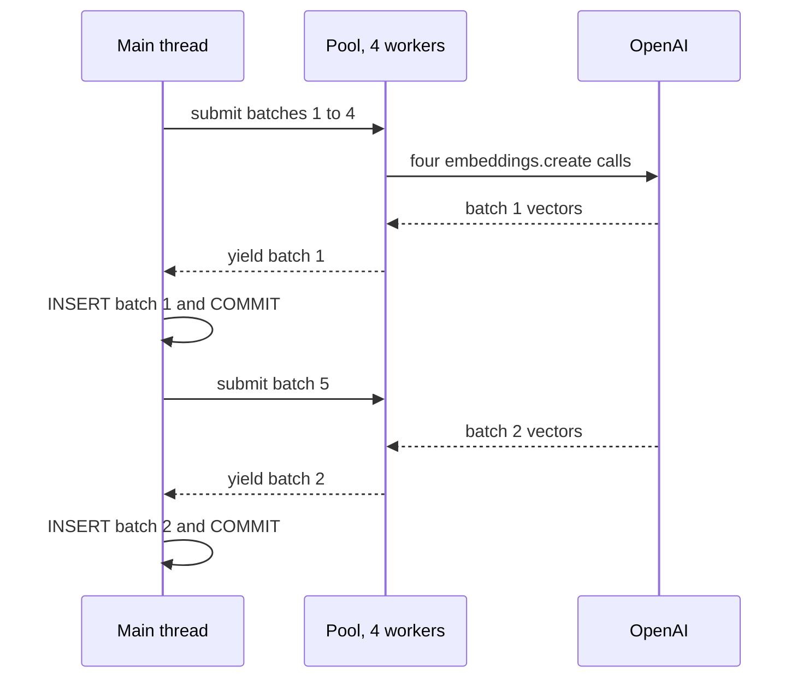
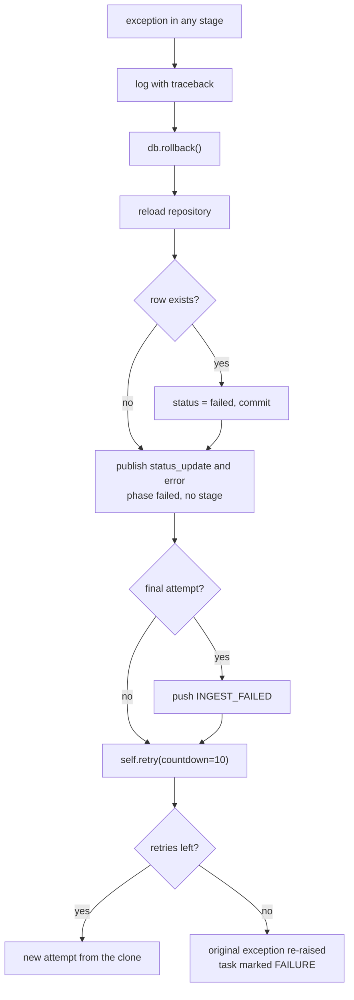

# Ingestion concurrency and failure handling

The ingestion task overlaps its slow, network-bound stages on bounded thread pools, and it has to fail cleanly when any of them breaks. This page is the deep dive on both: which threads exist and when, the one rule that makes sharing a process safe, how database sessions and connections are allocated, how the bounded LLM pools keep memory flat, what the stage timer actually measures, and exactly what happens, line by line, when something raises. It is written for someone about to change [`server/app/tasks/ingest.py`](../../server/app/tasks/ingest.py), [`server/app/services/pipeline.py`](../../server/app/services/pipeline.py), [`server/app/tasks/_parallel.py`](../../server/app/tasks/_parallel.py) or [`server/app/services/_concurrency.py`](../../server/app/services/_concurrency.py), and it records several failure modes the code does not handle.

## Why the pipeline is concurrent at all

An ingest spends most of its wall-clock time waiting: on GitHub for pull requests, on the model provider for glossary definitions, reading-order annotations and the brief, and on OpenAI for embeddings. The production worker runs on a small droplet with two vCPUs and tight memory, running one ingest at a time (`--concurrency=1`, see [deployment](../operations/deployment.md)). That profile has idle CPU while it waits, and not enough memory for more processes. Threads are the cheap way to overlap the waits: they share one interpreter, one set of imported modules and one parsed tree-sitter grammar cache, and the GIL is released during socket reads.

The parse stage is CPU-bound (tree-sitter runs in C, but the Python walk around it holds the GIL), so it is not parallelised. Only I/O is.

## The thread timeline

The diagram shows every thread alive during a normal ingest, in order. Bars that overlap run at the same time.

```mermaid
gantt
  title Threads during one ingest
  dateFormat X
  axisFormat %s
  section Main thread
  clone :a1, 0, 10
  parse to criticality :a2, 10, 60
  wait for glossary and reading order :a3, 60, 85
  generate_embeddings :a4, 85, 130
  wait for PR thread and finish :a5, 130, 132
  section ingest-pr
  pr_fetch :b1, 10, 25
  section pipeline-llm
  glossary :c1, 60, 80
  reading_order :c2, 60, 85
  section pipeline-brief
  brief :d1, 85, 115
```



The numbers are illustrative. The shape is real: the PR thread starts right after the clone and normally finishes long before it is joined; the glossary and reading-order threads start together and are joined together; the brief starts as the embedder starts.

### Every thread, with its pool

| Thread name prefix | Created in                              | Pool size | Runs                                                                               | Own session          | Joined by                                                        |
| ------------------ | --------------------------------------- | --------- | ---------------------------------------------------------------------------------- | -------------------- | ---------------------------------------------------------------- |
| (main)             | Celery prefork child                    | 1         | clone, parse, resolve, fan metrics, stack, git, co-change, criticality, embeddings | the task's `db`      | n/a                                                              |
| `ingest-pr`        | `ingest_repository`                     | 1         | `run_pr_fetch_in_thread` → `fetch_pull_requests`                                   | `SyncSessionLocal()` | `pr_future.result()` after everything else                       |
| `pipeline-llm`     | `run_full_analysis`                     | 2         | `run_glossary_in_thread`, `run_reading_order_in_thread`                            | one each             | `glossary_future.result()`, then `reading_order_future.result()` |
| `pipeline-brief`   | `run_full_analysis`                     | 1         | `run_brief_in_thread` → `generate_brief`                                           | `SyncSessionLocal()` | `brief_future.result()` after the embedder                       |
| `llm-glossary`     | `gather_in_order` in `glossary_builder` | up to 4   | one `responses.create` call each                                                   | none                 | the glossary thread                                              |
| `llm-onboarding`   | `gather_in_order` in `onboarding`       | up to 4   | one annotation batch call each                                                     | none                 | the reading-order thread                                         |
| `llm-embed-<type>` | `iter_gather_in_order` in `embedder`    | up to 4   | one `embeddings.create` call each                                                  | none                 | the main thread, in order                                        |

At the busiest moment (glossary and reading order both fanning out) there are up to twelve threads: main, PR, two pipeline-llm threads and eight network workers. Only four of them hold a database session.

## The scalars-only rule

A SQLAlchemy `Session` is not thread-safe, and neither are the ORM instances in its identity map. A shared session does not fail loudly; it corrupts state intermittently under load. Illume does not guard sessions with locks. Instead it makes sharing impossible by construction:

1. **Every overlapped stage receives only scalars.** The helpers in [`_parallel.py`](../../server/app/tasks/_parallel.py) take `repo_id: UUID`, `github_url: str`, `readme_content: str | None` and `llm_config: LLMConfig | None`. `ingest_repository` reads `repo.id` and `repo.github_url` into `repo_id_value` and `repo_github_url` before it submits anything.
2. **Every overlapped stage opens its own session** with `SyncSessionLocal()` and closes it in a `finally`.
3. **Network worker threads touch no session at all.** In [`_concurrency.py`](../../server/app/services/_concurrency.py) a worker performs one HTTP call and returns the response; the parent thread does every database write.

`LLMConfig` is the one non-primitive that crosses a thread boundary. It is a `@dataclass(frozen=True)` of strings and booleans ([`llm_config.py`](../../server/app/services/llm_config.py)), built from the owner `User` row on the main thread before any submit, so a worker never needs to load the user.

### Why some helpers build a transient Repository and one loads it

`fetch_pull_requests`, `build_glossary` and `build_reading_order` were written to take a `Repository`. The helpers construct a transient one, `Repository(id=repo_id, github_url=github_url)`, which is never added to the session; those functions read only `repo.id` and `repo.github_url`.

`run_brief_in_thread` is the exception: it calls `session.get(Repository, repo_id)`. `generate_brief` assigns `repo.architecture_summary` and calls `db.add(repo)`, and on a transient instance that would mark it pending and attempt an `INSERT`. Loading makes the write an `UPDATE`. If the row is gone the helper raises `ValueError`, which surfaces through `brief_future.result()`.

### Why the overlapped pairs cannot collide

The rule removes shared sessions. Each overlapped pair also has to avoid conflicting writes on the database itself:

| Pair                         | Writes of the first | Writes of the second                                                                             | Why they are independent                                                                                                                                               |
| ---------------------------- | ------------------- | ------------------------------------------------------------------------------------------------ | ---------------------------------------------------------------------------------------------------------------------------------------------------------------------- |
| PR fetch and the main thread | `pull_requests`     | everything else                                                                                  | No other stage writes `pull_requests`; the embedder reads it (see the race below)                                                                                      |
| glossary and reading order   | `glossary_entries`  | `onboarding_guides.reading_order`                                                                | Different tables; neither reads what the other writes                                                                                                                  |
| embeddings and brief         | `embeddings`        | `repositories.architecture_summary`, `onboarding_guides.architecture_brief` and `critical_files` | The brief contains no reference to `Embedding`. `_upsert_guide` writes only the columns it is passed, so it cannot overwrite `reading_order`, which the embedder reads |

## Connections and the sync engine pool

The sync engine in [`server/app/core/database.py`](../../server/app/core/database.py) is `create_engine(SYNC_DATABASE_URL, pool_size=5, max_overflow=10)`. One ingest holds at most four connections at once (main, PR, glossary, reading order). With one worker process and `--concurrency=1` that leaves ample headroom. The async engine used by the API is separate (`pool_size=10, max_overflow=20`) and lives in a different process.

## The bounded LLM pools

[`_concurrency.py`](../../server/app/services/_concurrency.py) provides the inner layer: many small network calls overlapped, results returned in submission order.

| Name              | Value | Meaning                                         |
| ----------------- | ----- | ----------------------------------------------- |
| `LLM_MAX_WORKERS` | 4     | Pool size and in-flight window for every caller |

`gather_in_order(callables, max_workers=4, label="llm")` submits every callable, then calls `future.result()` on each in order. It returns a list aligned with the input. A single callable is run inline, skipping the pool. If any callable raises, the exception surfaces on the parent thread when its turn in the ordered loop comes, after the earlier results were collected; those results are discarded and the caller treats the whole batch as failed. Used by `glossary_builder` and `onboarding`.

`iter_gather_in_order(callables, max_workers=4)` is the streaming variant the embedder uses. It keeps a window of at most four futures, yields each result as soon as it is at the head of the queue, and tops the window up after every yield. The reason is memory: a 1536-dimension embedding is about 48 KB of floats, and `gather_in_order` would hold every response for a repository until the last one landed. The embedder commits each batch as it is yielded, so the peak is four responses rather than the whole repository. On an exception the remaining queued futures are cancelled, the running ones are joined by the pool's shutdown, and the exception propagates.



Neither helper logs or publishes. The caller owns progress reporting, which keeps the helpers easy to reason about.

The OpenAI client is shared across threads. `openai.OpenAI(...)` builds one `httpx.Client` in its constructor and `httpx.Client` is thread-safe. The embedder's client is built with `timeout=_OPENAI_TIMEOUT_S` (60 seconds) and `max_retries=2`; the SDK's default 600-second read timeout would pin the only worker for ten minutes on a stalled call.

## How a join behaves

`run_full_analysis` joins each overlapped pair in a fixed order and publishes each completion immediately after its own `result()` returns:

```python
with stage("glossary_and_reading_order_join", measure_memory=False):
    glossary_future.result()
    publish("glossary_complete", ...)
    reading_order_future.result()
    publish("reading_order_complete", ...)
```

So `glossary_complete` marks the glossary finishing, not the join. If the reading order finishes first, its `complete` frame still waits behind the glossary's. Both executors are created inside `try` blocks whose `finally` calls `shutdown(wait=True)`.

## Reading the stage timer

[`_stage_timer.py`](../../server/app/services/_stage_timer.py) is stdlib-only. `stage(name, measure_memory=True)` is a context manager around `StageTimer`:

- `start()` calls `tracemalloc.start()` if tracing is not on yet (a second start is a no-op), records `time.monotonic()`, and when measuring memory also records `tracemalloc.get_traced_memory()` and the Linux `VmHWM` line from `/proc/self/status`.
- `stop_and_log()` runs in the context manager's `finally`, so a stage that raises is still timed.

The log line has three possible forms:

| Form                                                              | When                                        |
| ----------------------------------------------------------------- | ------------------------------------------- |
| `stage_timer stage=X wall=Ns mem=not_measured`                    | `measure_memory=False`                      |
| `stage_timer stage=X wall=Ns tracemalloc_peak=B`                  | Measuring, on Windows or macOS (no `/proc`) |
| `stage_timer stage=X wall=Ns tracemalloc_peak=B vmhwm_delta_kb=K` | Measuring, on Linux                         |

What the two memory numbers mean, precisely:

- **`tracemalloc_peak`** is `peak_at_stop - peak_at_start` of `tracemalloc`'s process-wide peak. The module never calls `tracemalloc.reset_peak()`, so this is how far the stage pushed the process's all-time traced peak, not how much it allocated. A stage that allocates a lot but stays below an earlier stage's peak reports `0`. Read it as "did this stage set a new high-water mark, and by how much".
- **`vmhwm_delta_kb`** is the change in the kernel's resident-set high-water mark over the stage, in KiB. It has the same "new high only" property, but it also sees memory allocated outside Python (tree-sitter, numpy-free C buffers, the SSL stack) that `tracemalloc` cannot see.
- Both counters are process-global, so a delta across a window in which another thread allocates is unattributable. Every concurrent stage, and both join blocks, pass `measure_memory=False`, and `embed_repository_symbols` forwards `measure_memory=False` to its `generate_embeddings` timer when it runs alongside the brief.

`tracemalloc` is started on first use and never stopped, so every allocation after the first stage pays its tracing overhead for the rest of the process's life. Celery's `worker_max_tasks_per_child=10` recycles the process eventually.

The timer labels and the progress stages share one vocabulary. Each `Stage` member's value is the string passed to `stage(...)`, and a unit test parses every `stage("...")` call under `app/` and asserts the sets agree. `READY` has no timer; the two join labels have timers but no progress node.

## Failure and retry

`ingest_repository` is `@celery.task(bind=True, max_retries=3)`. The `except Exception as exc:` arm runs, in this order:

1. `logger.exception("Ingestion failed for repo %s", repo_id)`.
2. **`db.rollback()`**, first, before any query. A session whose last flush failed is in a pending-rollback state; the next query raises `PendingRollbackError`. Without the rollback the reload in step 3 raises, the inner bare `except` swallows it, and the row keeps whatever status it last had (`parsing`, say) forever.
3. Reload the row and set `status = "failed"`, inside its own `try`/`except: pass`.
4. Publish `status_update` with `status="failed"`, `phase="failed"`, no `stage`, and the error message passed through `redact_credentials` so a token embedded in a git error cannot reach the browser.
5. Publish `error` with message `ERROR` and `phase="failed"`. The WebSocket relay treats a frame whose `message` is `DONE` or `ERROR` as the end of the stream.
6. If this is the final attempt (`self.request.retries >= self.max_retries`) and the row exists, send the `INGEST_FAILED` push.
7. `raise self.retry(exc=exc, countdown=10)`.

The `finally` closes the session.



### Retry semantics

- The countdown is a fixed ten seconds, not a backoff.
- `max_retries=3` means three retries after the original attempt: at most four attempts, about forty seconds of delay in total plus the work itself.
- Each retry is a new run of the whole task from the clone. The row flips from `failed` back to `cloning` when the next attempt starts, so the UI sees `failed` briefly between attempts.
- A retry does not reuse partial work. `process_repository_files` deletes every file first and `generate_embeddings` in full mode deletes every embedding first. Commits and pull requests from an earlier attempt survive (their inserts are `ON CONFLICT DO NOTHING`), which is harmless.
- When retries are exhausted, `self.retry` re-raises the original exception and Celery records the task as failed. The row is already `failed`.

### Why the failure frame has no stage

The catch-all runs outside `run_full_analysis`, so it genuinely does not know which stage raised. Naming the last stage that happened to publish would be a guess the client would render as fact. The client marks whichever node was running as failed when it sees `phase=failed` with no `stage`.

### The clone is always removed

`run_full_analysis` is wrapped in `try`/`finally: cleanup_clone(tmp_dir)`, so a failed attempt does not leak a working tree. `cleanup_clone` is `shutil.rmtree(tmp_dir, ignore_errors=True)`; on Windows a directory git still holds open can survive it.

## Failure modes the code does not handle

These follow from reading the code paths end to end. None of them is guarded today.

### A failure after the analysis is complete

The PR thread is joined only after the embedder and the brief. If `fetch_pull_requests` raised (a 404 for a repository the token cannot see, a 401 for an expired token, three rate-limit refusals), `pr_future.result()` re-raises it at the very end and the task fails and retries, throwing away a finished analysis. The same applies to a Redis error from the task's own `publish` closure, which has no `try`.

### A leaked PR thread

When `run_full_analysis` raises, the second `try` block (the one that joins the PR future and shuts the executor down) is never reached, because the exception propagates out of the first. The `ingest-pr` thread is not cancelled; it keeps running inside the worker process, with its own session, while Celery schedules the retry. Its writes are idempotent so nothing is corrupted, but it can overlap the next attempt's PR thread and doubles GitHub traffic.

### Waiting for a doomed sibling

If the embedder raises, the `finally: brief_executor.shutdown(wait=True)` blocks until the brief thread finishes its LLM call and writes the brief, and only then does the exception reach the task. The same holds for the glossary and reading-order pair. Failure is therefore reported late, and the surviving sibling's writes land in a repository that is about to be marked failed.

### The PR race with the embedder

The embedder reads `pull_requests` when it reaches that source type. Nothing waits for the PR thread first. Normally the PR fetch finishes during the parse, long before embedding starts, but a rate-limit sleep (up to the full reset window from `X-RateLimit-Reset`, which can be most of an hour) or a slow GitHub can push it past. The pull requests are then stored but never embedded until the next full re-embed, and there is no warning.

### A worker killed mid-ingest

Celery acknowledges a task when it is delivered unless `task_acks_late` is set, and [`server/app/core/celery.py`](../../server/app/core/celery.py) does not set it. A `SIGKILL` (the deploy's `docker stop` after its grace period, an out-of-memory kill) loses the task outright. The row is left in `cloning`, `parsing` or `embedding` with no lease and no timeout, so nothing ever moves it. The repository page keeps showing progress forever, and `reingest` refuses it (`400`, the status is neither `ready` nor `failed`). Today the fix is manual: set the row to `failed` and re-ingest. The sync path solved the same problem with a lease; see [auto-update sync](sync.md#the-lease).

### A failure while recording the failure

If Redis is down, the `publish(...)` call in the `except` arm raises, `self.retry` is never reached, and the task fails without retrying. The row is already `failed` by then, so the UI is correct, but the automatic retry is lost.

## What the memory limits do

Two process-level guards bound memory across tasks, both in deployment rather than in the task:

| Guard                           | Where                                              | Effect                                                                                                    |
| ------------------------------- | -------------------------------------------------- | --------------------------------------------------------------------------------------------------------- |
| `worker_max_tasks_per_child=10` | [`celery.py`](../../server/app/core/celery.py)     | The prefork child is replaced after ten tasks, releasing fragmented heap and `tracemalloc` state          |
| `--max-memory-per-child=614400` | [`deploy.yml`](../../.github/workflows/deploy.yml) | After a task finishes, a child whose resident memory exceeds 600 MB is replaced                           |
| `worker_prefetch_multiplier=1`  | `celery.py`                                        | The worker reserves at most one extra task, so a second ingest is never pulled into memory while one runs |

Neither guard interrupts a running task. Both require the prefork pool; `--pool=solo` (used on Windows) ignores them. Inside the task, memory is bounded by batching: `FILE_BATCH_SIZE = 500` in the parser, `DEPENDENCY_BATCH_SIZE = 1000` in the resolver, `EMBED_BUILD_BATCH_SIZE = 500` symbols per embedder page and `BATCH_SIZE = 100` chunks per embedding call.

## Testing this code

The pieces are tested at three levels (see [backend tests](../testing/backend.md)):

- `_concurrency` has unit tests for ordering, single-call inlining, window size and exception propagation.
- `_parallel` helpers are tested to open their own sessions and to propagate `GitHubClientError` through `future.result()` so it surfaces as a retryable task exception.
- The integration suite runs `ingest_repository` end to end against a real Postgres and Redis with GitHub and OpenAI faked, including the failure path that asserts the rollback-first ordering.

The orderings and the overlap cannot be proven by unit tests alone, because those tests inject `git_last_modified` and `has_tests` directly. The ordering rule is enforced by reading `run_full_analysis`.

## Design trade-offs and limits

- **Threads over processes.** Processes would sidestep the GIL and give real isolation, but each would reload the interpreter and the grammars and take its own share of the droplet's memory. Threads cost nothing to start, and the waits they overlap release the GIL anyway.
- **Structural safety over locks.** Scalars-only and session-per-thread make shared state impossible rather than guarded. The price is that each thread reloads what it needs and every credential must be threaded explicitly; a contextvar would not work, because worker threads do not inherit the parent's contextvars.
- **A fixed overlap shape.** Only three pairs overlap. The deterministic stages are a strict chain because each reads what the previous wrote. A smarter scheduler could overlap `detect_stack` with `git_history`, but the gain is seconds.
- **Ordered results.** Both pool helpers return results in submission order, which keeps callers simple (pair result `i` with input `i`) at the cost of head-of-line blocking: a slow first call delays the handling of faster later ones, though the window stays full.
- **Late joins.** Joining the PR thread last gives it the longest possible head start, which is good for wall-clock time and bad for failure reporting and for the embedder race described above.
- **No ingest lease.** The sync path has a lease and a generation token; the ingest path has neither, so a lost ingest task strands its row.

## Related documentation

- [The ingestion pipeline](ingestion.md): what each stage does.
- [Auto-update sync](sync.md): the lease, generations and the non-overlapped variant of the same pipeline.
- [Generation](generation.md): what the glossary, reading-order and brief threads do inside.
- [The index and embeddings](../retrieval/index-and-embeddings.md): the embedder's batching and commit-per-batch behaviour.
- [Deployment](../operations/deployment.md): the worker flags that set concurrency and memory limits.
- [Runbook](../operations/runbook.md): what to do with a stuck repository.
