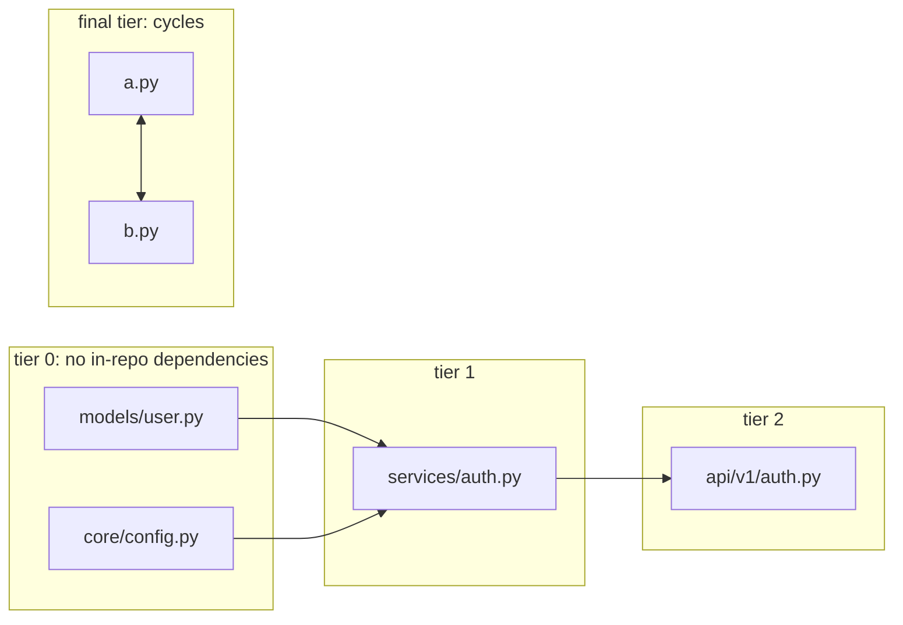
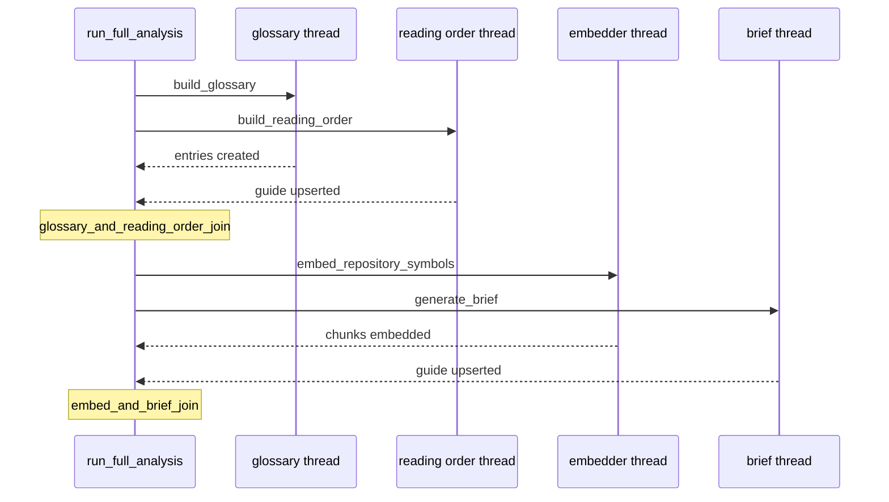

# LLM generation: glossary, reading order and brief

Three stages of the pipeline turn the structural data into prose with a language model: the glossary defines the most-used symbols, the reading order sorts files so dependencies come before the code that uses them and explains why each is worth reading, and the architecture brief writes a short narrative of how the repository fits together. They run after criticality, the first two in parallel and the brief in parallel with the embedder. All three call the OpenAI-compatible **Responses API** (`client.responses.create`) with credentials resolved per user, so the same code runs on the operator's free-tier key or on a user's own key. This page covers [`glossary_builder.py`](../../server/app/services/glossary_builder.py), [`onboarding.py`](../../server/app/services/onboarding.py), [`architecture_brief.py`](../../server/app/services/architecture_brief.py) and [`onboarding_guide.py`](../../server/app/services/onboarding_guide.py).

## Where the credentials come from

Each generation service takes a keyword-only `llm: LLMConfig | None`. The ingest task builds it once from the repository owner with `llm_config_for(owner)` in [`entitlements.py`](../../server/app/services/entitlements.py) and passes the frozen value object down to every stage, including the threaded ones:

1. **The user's own key** (`LLMConfig.from_user`): the provider, key and model saved on the `users` row.
2. **Otherwise the free tier** (`LLMConfig.server_default`): the operator's `AI_API_KEY` against DeepSeek, with `AI_MODEL` and `AI_BASE_URL` overriding the registry defaults when set.
3. **Otherwise `None`.** Each service then falls back to `settings.OPENAI_API_KEY` with `settings.AI_MODEL` and a hard-coded `reasoning.effort`. This legacy path is reachable only when the operator has no `AI_API_KEY` configured.

`LLMConfig.client_kwargs()` builds the `OpenAI(...)` arguments and **omits** `base_url` when it is `None`, rather than passing `base_url=None`. `LLMConfig.response_kwargs(effort)` returns `{"reasoning": {"effort": effort}}`, or `{}` for a provider without reasoning support (Groq), whose models can reject the parameter with a 400. The full credential model, the provider registry and how keys are stored encrypted are on [BYOK and encryption](../security/byok-and-encryption.md).

| Service               | Effort    | `max_output_tokens` | Batch size | Parallel batches |
| --------------------- | --------- | ------------------- | ---------- | ---------------- |
| `build_glossary`      | `minimal` | 8000                | 25 symbols | up to 4          |
| `build_reading_order` | `minimal` | 6000                | 10 files   | up to 4          |
| `generate_brief`      | `low`     | 8000                | one call   | no               |

The output budgets are large because a reasoning model spends part of `max_output_tokens` on reasoning before it writes any visible text; a smaller budget cuts the JSON off mid-string.

Batches run through `gather_in_order` in [`_concurrency.py`](../../server/app/services/_concurrency.py), a `ThreadPoolExecutor` capped at `LLM_MAX_WORKERS = 4` that returns results in submission order and re-raises a worker's exception on the calling thread. See [concurrency](concurrency-and-failure.md#the-bounded-llm-pools).

## The glossary

### Choosing symbols

`_get_top_symbols(db, repository_id, limit, exclude_with_entry=False)` selects symbols of kind `function`, `class`, `method` or `variable` (the parser never writes `variable`), excluding `<anonymous>`, joined to their file and ordered by **the file's** `fan_in` descending. It fetches `limit * CANDIDATE_MULTIPLIER` rows (5×), then keeps the first row per lower-cased name, so the glossary has one entry per term at its most-imported definition site. The over-fetch exists because the de-duplication discards same-named rows, and fetching exactly `limit` would under-fill when the top of the ranking repeats a name.

Ranking by file fan-in means every symbol in a heavily imported file outranks every symbol in a less imported one, and symbols within one file are in no particular order. In a repository where few edges resolve (any language other than Python and JS/TS, see [parsing](parsing-and-dependencies.md)), fan-in is zero everywhere and the choice is effectively arbitrary.

### Prompting

`_build_prompt` renders each symbol as `Name`, `File`, `Lines`, the docstring when there is one, and the first 300 characters of its source, separated by `---`, and asks for a JSON array of `{"name", "definition"}` with one or two plain-English sentences per symbol "that a new engineer would understand on day one". The batch size is `BATCH_SIZE = 25`.

`_parse_response` strips Markdown code fences and parses the JSON. Malformed JSON is logged and yields an empty map for that batch. An API error, however, propagates: `gather_in_order` re-raises it and the glossary stage, and with it the ingest, fails.

### Writing

In `full` mode (the ingest), every existing `GlossaryEntry` of the repository is deleted and committed first, and the budget is `MAX_GLOSSARY_ENTRIES = 200`. Definitions are matched back to symbols by lower-cased name, because models change capitalisation; a symbol the model skipped is logged and left out. Each entry stores `name`, `definition`, `symbol_id`, `file_path` and `line_number`, and the stage commits once at the end.

In `incremental` mode (a sync), nothing is deleted by the builder. The budget is `200 - stored`, and the query excludes symbols that already have an entry by `symbol_id` or by name, so it only fills empty slots. `symbol_id` is a foreign key with `ON DELETE CASCADE`, and a sync replaces every changed file's row and symbols, so the entries of a changed file are deleted by the cascade and their slots are refilled, with fresh definitions, by this same pass. Entries of unchanged files keep their text, and a glossary that is already full does not take in newly important symbols.

### Where it is used

The glossary page and its search endpoints (see [the API](../api.md)), the embedder (a symbol's chunk prefers its glossary definition over its docstring, see [the index](../retrieval/index-and-embeddings.md)), the brief's `glossary_preview`, the `.illume` export and the agent's `get_glossary` tool.

## The reading order

### The tiered sort

`build_reading_order(db, repo, mode="full", llm=None)` loads only `(id, path, fan_in, language)` per file, maps each file's UUID to a dense integer, and streams the file-level edges with `iter_file_edges` into integer adjacency maps with `build_int_adjacency` (both in [`file_graph.py`](../../server/app/services/file_graph.py)). Streaming and integer keys are what fixed an out-of-memory failure on large repositories, where the edge list and two UUID-keyed maps used to coexist with full ORM rows.

`_topological_sort` is Kahn's algorithm, grouped into tiers:

- **Tier 0** is every file that depends on no other file in the repository: utilities, models, constants. These are read first.
- Each later tier holds the files whose dependencies are all in earlier tiers.
- Files on a dependency cycle never reach in-degree zero; they are appended as **one final tier** with a warning, rather than dropped.
- Within a tier the order is `(-fan_in, path)`, so the result is identical across runs and machines. Python's `set` order would otherwise reorder the tour between runs.

Every file of the repository gets an entry, `{path, fan_in, tier, position, annotation}`, with a 1-based `position`.

### Annotations

`_annotate_files` asks the model to annotate the first `MAX_ANNOTATED_FILES = 100` entries in batches of `ANNOTATION_BATCH_SIZE = 10`. Each prompt lists `file_path`, `fan_in`, `tier` and `language` per file and asks for one or two sentences on why a newcomer should read that file at that point, with "no filler phrases". The response is a JSON array of `{"file_path", "annotation"}`.

Unlike the glossary, **a failed batch is skipped, not raised**. `_request` catches any exception, logs the batch range and the exception class, and returns `None`; malformed JSON does the same. The remaining batches still land. So an ingest whose model rejects every call finishes with a reading order and no annotations, and only the worker log shows why. This is also why Groq must not be sent `reasoning.effort`: the resulting 400 would be swallowed into an empty tour rather than failing loudly.

Files after position 100 have an empty annotation.

### Incremental mode

On a sync, the existing guide's annotations are loaded by path. The set to annotate becomes "the first 100 entries that have no reusable annotation", so a new file that lands in the top 100 is annotated and unchanged files are not sent to the model again. Reused annotations are applied first and new ones override them. An annotation is never refreshed when its file changes, and a file that drops out of the top 100 keeps its old annotation.

### Storage and serving

`_upsert_guide(db, repo_id, reading_order=None, *, architecture_brief=None, critical_files=None)` creates or updates the repository's single `OnboardingGuide` row. It writes only the columns it is given, which is what lets the reading order and the brief be written by two different stages, the brief possibly on another thread, without one wiping the other.

`GET /api/v1/repository/{repo_id}/guide` ([`guide.py`](../../server/app/api/v1/guide.py)) returns the reading order through `parse_reading_order` (shared with the MCP server in [`onboarding_guide.py`](../../server/app/services/onboarding_guide.py)), renaming `path` to `file_path` and **dropping `tier`**. The client re-joins the guide onto graph nodes by path at render time to drive the reading-order tour.

## The architecture brief

### Gathering the facts

`generate_brief(db, repo, readme_content=None, *, llm=None)` reads column projections of files, symbols and dependency edges (lightweight `_FileProxy`, `_SymbolProxy` and `_DepProxy` objects rather than ORM rows) and computes:

| Section                      | How it is computed                                                                                                                                                            |
| ---------------------------- | ----------------------------------------------------------------------------------------------------------------------------------------------------------------------------- |
| `key_modules`                | the `TOP_KEY_MODULES = 10` files with the highest fan-in                                                                                                                      |
| `critical_files`             | every `critical` or `caution` file, critical first, then by fan-in, with reasons, change count and test flag                                                                  |
| module structure             | function, class and method symbols grouped by the first path segment (`root` for top-level files)                                                                             |
| `module_edges`               | file edges collapsed to distinct module-to-module pairs                                                                                                                       |
| `data_flow`                  | breadth-first from up to 5 entry points, `DATA_FLOW_HOPS = 2` hops deep, at most 40 edges                                                                                     |
| `external_integrations`      | import symbols whose name starts with one of `EXTERNAL_INTEGRATION_PREFIXES` (Stripe, Twilio, boto3, OpenAI, Anthropic, Sentry, Supabase and others), reported by vendor root |
| `ownership_summary`          | the code-owner rows of the key modules                                                                                                                                        |
| `glossary_preview`           | ten glossary entries                                                                                                                                                          |
| `tech_stack`, `entry_points` | from the repository row, written by `detect_stack` and `detect_entry_points`                                                                                                  |

The external-integration check only sees import names, so it works for Python (`import stripe`) and JS/TS (`from "openai"`) and misses everything else.

### The narrative

`_build_narrative_prompt` assembles a Markdown prompt: the repository name and file count, the first 3,000 characters of the README, the stack, up to 8 entry points, the key modules, up to 8 symbols per module, up to 20 module edges and 20 data-flow steps, and the integrations. It asks for 5–8 sentences covering what the repository does, how modules are structured, the main flow, notable patterns and external services, using real names and not speculating, as plain prose with no title.

`_call_llm_narrative` sends it with a short system prompt ("senior software architect") at `effort="low"`. `_strip_leading_title` removes any leading Markdown heading the model adds anyway, using `_LEADING_HEADING`. **Any exception is caught** and returns an empty string, which `generate_brief` replaces with the placeholder `Architecture summary could not be generated.` The brief therefore never fails an ingest.

### Where it is stored

- `repositories.architecture_summary`: the narrative. The repository list endpoint truncates it to 200 characters for cards; the repository detail endpoint, the `.illume` export and the agent's `get_overview` tool read it in full.
- `onboarding_guides.architecture_brief`: every section above, plus the narrative, `total_files` and `total_symbols`, with `module_edges` capped at 30.
- `onboarding_guides.critical_files`: the critical-files list.

The guide endpoint's `ArchitectureBrief` response model exposes only `entry_points`, `directory_summary`, `external_integrations`, `data_flow`, `module_edges`, `key_modules` and `ownership_summary`. The stored `narrative` is not part of it (clients read the narrative from the repository), `directory_summary` is never written, and the response's `DataFlowStep.step` is always `null` because the stored key is `hop`. `critical_files` is served with `has_tests` and `change_frequency` refreshed from the live file rows by `_with_live_file_facts`, because the stored list is a snapshot from the last analysis.

## Ordering and overlap

The glossary must finish before the embedder (symbol chunks use its definitions) and before the brief (its preview), and the reading order must finish before the embedder (annotated-file chunks use its notes). The glossary and the reading order touch different tables, and the brief writes only the guide's brief columns and the repository's summary, so each overlapped pair is safe. Each threaded stage opens its own session from scalars only; see [the scalars-only rule](concurrency-and-failure.md#the-scalars-only-rule).

On a sync, the same three run sequentially in Step B, in the order brief, glossary, reading order, before the incremental embedder; see [sync](sync.md#step-b-the-llm-delta).

## Constants

| Constant                        | Value       | File                                                                       |
| ------------------------------- | ----------- | -------------------------------------------------------------------------- |
| `BATCH_SIZE`                    | 25          | [`glossary_builder.py`](../../server/app/services/glossary_builder.py)     |
| `CANDIDATE_MULTIPLIER`          | 5           | [`glossary_builder.py`](../../server/app/services/glossary_builder.py)     |
| `MAX_GLOSSARY_ENTRIES`          | 200         | [`glossary_builder.py`](../../server/app/services/glossary_builder.py)     |
| `MAX_ANNOTATED_FILES`           | 100         | [`onboarding.py`](../../server/app/services/onboarding.py)                 |
| `ANNOTATION_BATCH_SIZE`         | 10          | [`onboarding.py`](../../server/app/services/onboarding.py)                 |
| `TOP_KEY_MODULES`               | 10          | [`architecture_brief.py`](../../server/app/services/architecture_brief.py) |
| `DATA_FLOW_HOPS`                | 2           | [`architecture_brief.py`](../../server/app/services/architecture_brief.py) |
| `EXTERNAL_INTEGRATION_PREFIXES` | 24 prefixes | [`architecture_brief.py`](../../server/app/services/architecture_brief.py) |
| `LLM_MAX_WORKERS`               | 4           | [`_concurrency.py`](../../server/app/services/_concurrency.py)             |

## Design trade-offs and limits

- **Three failure policies.** A glossary API error fails the ingest; a reading-order batch failure is swallowed; a brief failure becomes a placeholder. The difference is historical rather than principled, and it means "the ingest succeeded" does not imply "the tour has annotations".
- **File fan-in as symbol importance.** Cheap and available, but coarse: it ranks files, not symbols, and is zero for languages without resolved edges.
- **The model is trusted with names.** Glossary definitions are matched back by name; a renamed or merged name in the reply drops the entry.
- **Incremental output drifts.** A sync redefines the glossary entries of files it replaced, but never re-ranks the glossary as a whole, and never refreshes an existing reading-order annotation, so both drift from the code until the next re-ingest.
- **Annotations cover 100 files.** Larger repositories get an ordered list whose tail is unannotated.
- **The brief is structure, not reading.** It never sends source code to the model, only names, paths, counts and the README, so it describes shape well and behaviour poorly.

## Related documentation

- [The ingestion pipeline](ingestion.md): where these stages sit.
- [Concurrency and failure](concurrency-and-failure.md): the thread pools and joins.
- [BYOK and encryption](../security/byok-and-encryption.md): `LLMConfig`, providers and the free tier.
- [The index and embeddings](../retrieval/index-and-embeddings.md): how glossary definitions and annotations feed chunks.
- [The dependency graph](../graph/dependency-graph.md): the reading-order tour on the graph.
