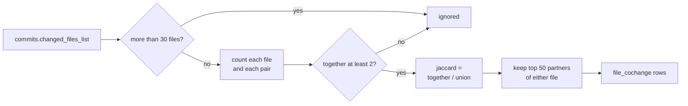

# Git intelligence and criticality

After the parse, Illume reads the repository's history to learn who owns each file, how often it changes, which files change together and which have tests. A separate stage fetches merged pull requests from GitHub. A scoring pass then combines the history with the graph's fan-in to label every file `critical`, `caution` or `safe`. This page covers [`git_analyzer.py`](../../server/app/services/git_analyzer.py), [`test_files.py`](../../server/app/services/test_files.py), [`cochange.py`](../../server/app/services/cochange.py), [`pr_fetcher.py`](../../server/app/services/pr_fetcher.py), [`criticality.py`](../../server/app/services/criticality.py) and [`staleness.py`](../../server/app/services/staleness.py).

## What this produces

| Output                                        | Written by                       | Read by                                                                       |
| --------------------------------------------- | -------------------------------- | ----------------------------------------------------------------------------- |
| `commits` rows (up to 500)                    | `analyze_git_history`            | the embedder (commit chunks), the activity feed, co-change, the agent         |
| `files.change_frequency`, `git_last_modified` | `analyze_git_history`            | criticality, the explorer, the stats endpoint                                 |
| `files.has_tests`                             | `_update_test_flags`             | criticality, the explorer                                                     |
| `code_owners` rows                            | `_bulk_insert_code_owners`       | the ownership endpoints, the stats endpoint, the agent's `get_file_info` tool |
| `file_cochange` rows                          | `build_cochange`                 | the co-change retrieval arm, the agent                                        |
| `pull_requests` rows (up to 200)              | `fetch_pull_requests`            | the embedder (PR chunks), the activity feed                                   |
| `files.criticality`, `criticality_reasons`    | `run_criticality_scoring`        | the graph colours, the reading order, the brief, the agent                    |
| `chat_messages.stale_*`                       | `mark_stale_answers` (sync only) | the chat UI's "this answer may be out of date" notice                         |

## Reading the history

`analyze_git_history(db, redis_client, repo, clone_path)` runs one command:

```text
git -C <clone> log --numstat --format=%H<US>%ae<US>%an<US>%s<US>%ai -n500
```

`<US>` is `FIELD_SEPARATOR = "\x1f"`, the ASCII unit separator, which cannot appear in a commit subject, so the header fields split unambiguously. `GIT_LOG_MAX_COMMITS = 500` caps the walk; on a large repository this is the most recent 500 commits on the checked-out branch, so "ownership" means ownership of recent work. The command has a 120-second timeout and raises `RuntimeError` on failure or timeout, which fails the ingest.

`_parse_git_log` walks the output line by line. A line is a commit header when it contains the separator and its first field is 7–40 lowercase hex characters (`_looks_like_header`). Any other line containing a tab is a numstat row: `added<TAB>deleted<TAB>path`, where `-` (a binary file) counts as zero. Author emails are lower-cased. Dates are parsed with `%Y-%m-%d %H:%M:%S %z` and converted to UTC; an unparseable date falls back to the current time with a warning.

### Renames

`--numstat` writes a rename as `dir/{old => new}/file.py`. `_normalise_rename_path` keeps only the new side, using `_RENAME_RE = ^(.*?)\{(.*?) => (.*?)\}(.*)$`. Both groups inside the braces may be empty, because git writes `dir/{ => sub}/file.py` when a file moves into a new directory; requiring a character on each side once left the braces in the path and silently dropped that file's ownership. Without `-M`/`--follow`, history before a rename is attributed to the old path, which no longer matches a file row, so a renamed file's statistics start at its rename.

### Aggregation

`_aggregate_file_stats` builds, per path:

| Field               | Meaning                                                                               |
| ------------------- | ------------------------------------------------------------------------------------- |
| `change_frequency`  | commits in the window that touched the file                                           |
| `git_last_modified` | the newest commit timestamp touching it                                               |
| `primary_owner_*`   | the author with the most commits to it (ties broken by first seen)                    |
| `contributors`      | every author, sorted by commit count, with `percentage` (1 decimal) and `last_commit` |
| `is_knowledge_silo` | `True` when exactly one author ever touched it in the window                          |

Identity is the lower-cased email. Two emails for one person count as two people; there is no `.mailmap` handling.

### Writes and commits

The analyzer commits four times, so it is not atomic:

1. `_update_test_flags` sets `has_tests` on **every** file of the repository, including files the window never touched, and commits. It runs before the early return, so even an empty history gets test flags.
2. If no commits were parsed, it publishes `git_analysis_complete` and returns.
3. `_bulk_insert_commits` inserts with `ON CONFLICT (repository_id, hash) DO NOTHING` and commits. Each row stores `files_changed` and `changed_files_list`, the JSON list of paths that co-change reads later.
4. `_bulk_update_files` writes `change_frequency` and `git_last_modified` for files that still exist (paths are matched with backslashes normalised) and commits. Paths that no longer exist are skipped.
5. `_bulk_insert_code_owners` upserts one row per file on `file_id` and commits.

**A stale `bus_factor`.** The upsert computes `bus_factor = len(contributors)` for a new row but its `ON CONFLICT DO UPDATE` sets only `primary_owner`, `contributors` and `is_knowledge_silo`. On a full ingest the file rows are new, so every owner row is new and correct. On an [incremental sync](sync.md), which keeps file rows, an existing owner row keeps its old `bus_factor` while its contributor list moves on. The code comment says the opposite of what the statement does.

## Which files have tests

[`test_files.py`](../../server/app/services/test_files.py) decides by name and place, with no coverage data:

- **Name.** `subject_of_test` strips the common markers with three patterns: `test_foo` → `foo`; `foo.test`, `foo_spec`, `foo.specs` → `foo` (case-insensitive); `FooTest`, `FooTests`, `FooSpec`, `FooIT` → `Foo`. A test called `test_agent_planner.py` also counts for `agent/planner.py`, because a source file's candidate subjects are its stem and `<parent>_<stem>`.
- **Place.** The test's folders, after dropping `TEST_DIRS` (`test`, `tests`, `__tests__`, `spec`, `specs`, `testing`, `unit`, `integration`, `functional`, `e2e`), must appear in order within the source file's folders (`_is_subsequence`). That accepts `server/tests/unit/services/test_criticality.py` for `server/app/services/criticality.py`, and `src/test/java/x/FooTest.java` for `src/main/java/x/Foo.java`, and rejects a same-named test in an unrelated package.
- **Language family.** The test must be in the same family (`py`, `js` covering JS/TS/Vue/Svelte, or `jvm` covering Java/Kotlin/Scala/Groovy); otherwise extensions must match exactly.

`is_test_path` is the companion predicate: a file is a test by name, or by sitting under one of the narrower `_TEST_ONLY_DIRS` (`test`, `tests`, `__tests__`, `spec`, `specs`, `e2e`). Test files themselves get `has_tests = False`. `_list_clone_files` walks the clone with `SKIP_DIRS` applied, so the walk never descends into `.git` or `node_modules`; this matters because the [clone cache](clone-cache.md) keeps `.git` growing across syncs.

## Co-change

### What co-change means

Two files that keep changing in the same commits are usually coupled even when neither imports the other: a model and its migration, a component and its test, an API route and its client hook. [`cochange.py`](../../server/app/services/cochange.py) measures that from the stored commits and keeps the strongest pairs in `file_cochange`, which the [co-change retrieval arm](../retrieval/retrieval-arms.md#co-change) and the agent use.

### How it is computed

`build_cochange(db, repo_id)` maps each current file path to its id, streams `changed_files_list` from every stored commit of the repository (`yield_per=1000`), and counts:

1. **Skip bulk commits.** A commit touching more than `MAX_FILES_PER_COMMIT = 30` files is a rename, a formatter run or a vendored import, and says nothing about coupling. It is ignored entirely.
2. **Count.** For each remaining commit, the set of current file ids it touched (paths that no longer exist drop out) increments a per-file count and a count for every pair. Pairs are keyed smaller-UUID-first, which matches how Postgres orders `uuid`, so every row satisfies the table's `file_a_id < file_b_id` check.
3. **Threshold.** A pair needs `together >= MIN_TOGETHER = 2`.
4. **Score.** The Jaccard index: `together / (a_count + b_count - together)`, the share of commits touching either file that touched both.
5. **Cap.** Each file keeps its `MAX_PARTNERS_PER_FILE = 50` strongest partners by Jaccard (ties by partner id). A pair survives if it is in either file's top 50, so a small utility can be a hub's top partner without the hub keeping it.

It then deletes the repository's existing rows and inserts the new ones in batches of `_INSERT_BATCH = 5000`. **It does not commit**; the caller does. In the ingest the pipeline commits right after it, and in a sync it runs inside the deterministic step.



Because it reads the same 500-commit window, co-change describes recent coupling, and a file created in the last two commits cannot have a partner yet.

## Merged pull requests

`fetch_pull_requests(repo, access_token, db, redis_client)` runs on its own thread, overlapped with the parse and git stages (see [concurrency](concurrency-and-failure.md#every-thread-with-its-pool)). It pages through `GET /repos/{owner}/{repo}/pulls?state=closed&sort=updated&direction=desc&per_page=100`, keeps the pull requests with a `merged_at`, and stops at `MAX_PRS = 200` merged results, an empty page, or a short page. Closed-but-unmerged pull requests are skipped without stopping, because a run of them can be followed by merged ones.

Each row stores `number`, `title`, `description` (the body), `author`, `reviewers` (logins from `requested_reviewers`), `files_changed` and `merged_at`, inserted with `ON CONFLICT (repository_id, number) DO NOTHING`.

| Constant          | Value | Meaning                           |
| ----------------- | ----- | --------------------------------- |
| `MAX_PRS`         | 200   | merged pull requests kept         |
| `PER_PAGE`        | 100   | page size                         |
| `REQUEST_TIMEOUT` | 20.0  | seconds per request               |
| `MAX_RETRIES`     | 3     | attempts per page on a 429 or 403 |

Failure handling in `_get_with_retry`:

- **429 or 403**: wait for `retry_after_seconds(response)` (from `Retry-After` or the rate-limit reset header, defaulting to `DEFAULT_RETRY_AFTER_SECONDS = 60` in [`github_http.py`](../../server/app/services/github_http.py)) and retry, up to three attempts. Every 403 is treated as a rate limit, including a genuine permission denial, so a token without access waits through the retries before failing.
- **404**: "Repository not found or token lacks access".
- **401**: the token is invalid or expired.
- Anything else, or a network error: `GitHubClientError`.

Two limits of the data are worth knowing. `requested_reviewers` lists reviewers whose review is still pending, so after a merge it is usually empty, and the stored list is not "who reviewed". And the list endpoint does not include `changed_files` (only the single pull request endpoint does), so `files_changed` is `0` for every row.

A failure here fails the whole ingest, but only when the pipeline joins the pull-request future at the end; see [failure and retry](concurrency-and-failure.md#failure-and-retry).

## Criticality

`run_criticality_scoring(db, repo_id, repo_has_tests=None)` loads every file of the repository, scores each with `_score_file`, writes `criticality` and the human-readable `criticality_reasons` list, and commits once.

| Signal                                         | Points | Reason text                |
| ---------------------------------------------- | ------ | -------------------------- |
| `fan_in >= 10`                                 | +3     | `imported by N files`      |
| `fan_in >= 5` (and below 10)                   | +1     | `imported by N files`      |
| path matches `CRITICAL_PATH_PATTERNS`          | +2     | `core infrastructure file` |
| `git_last_modified` more than 180 days ago     | +1     | `untouched for 6+ months`  |
| no test, the repo has tests, not itself a test | +1     | `no test coverage`         |

| Score | Label      |
| ----- | ---------- |
| 4+    | `critical` |
| 2–3   | `caution`  |
| 0–1   | `safe`     |

`CRITICAL_PATH_PATTERNS` are regular expressions searched anywhere in the path: `config\.`, `database\.`, `middleware/`, `migrations/`, `auth\.`, `security\.`, `celery\.`, `main\.`. So `app/main.py`, `next.config.ts` and `domain.ts` (which contains `main.`) all match.

The "no test coverage" rule only fires when `repo_has_tests` is true; otherwise every file in a repository with no tests would lose a point and the label would stop separating risk. When the argument is `None`, the function derives it from the rows.

**Ordering is load-bearing.** Scoring reads `git_last_modified` and `has_tests`, which only the git analyzer writes, and `fan_in`, which only the fan-metric pass writes. Because the parse stage deletes and re-inserts every file, scoring before the git stage grades every file against `NULL` and `False`. The unit tests inject those values directly, so they cannot catch an ordering regression; see [the ingestion pipeline](ingestion.md#two-orderings-that-are-load-bearing).

The maximum score from fan-in and path alone is 5, so a heavily imported config file is `critical` regardless of tests. A file with fan-in below 5 outside the patterns can reach at most 2 (stale and untested), which is `caution`.

## Stale answers

When a background sync lands changed files, [`mark_stale_answers`](../../server/app/services/staleness.py) flags every chat answer that cited one of them. Each assistant message stores the commit it answered against (`answered_commit_sha`) and the paths it cited (`cited_paths`, JSONB). Two SQL statements do the work:

- `_MARK_CHANGED` uses the JSONB `?|` operator to find answers whose cited paths overlap the changed set, sets `stale_at` (keeping the first time), `stale_commit_sha` and the union of old and newly stale paths.
- `_MARK_ALL` is used when the change set is unknown (a rebuild whose base commit has gone) and treats every cited path as changed.

Both skip answers already given at the new head. Nothing is deleted or rewritten. `compare_url` builds the GitHub compare link the UI offers between the two commits. The sync runs this inside a savepoint so a failure cannot abort its transaction; see [sync](sync.md).

## Where the data is served

| Endpoint                         | File                                                   | What it returns                                                      |
| -------------------------------- | ------------------------------------------------------ | -------------------------------------------------------------------- |
| `GET /{repo_id}/ownership`       | [`ownership.py`](../../server/app/api/v1/ownership.py) | paginated per-file owners, ordered by path                           |
| `GET /{repo_id}/ownership/silos` | [`ownership.py`](../../server/app/api/v1/ownership.py) | files whose `is_knowledge_silo` is true                              |
| `GET /{repo_id}/activity?limit=` | [`activity.py`](../../server/app/api/v1/activity.py)   | recent merged pull requests and non-merge commits, default 6, max 30 |
| `GET /{repo_id}/stats`           | [`stats.py`](../../server/app/api/v1/stats.py)         | totals, the criticality split and the top five owners                |

The full contracts are in the [HTTP API reference](../api.md).

## Design trade-offs and limits

- **A 500-commit window.** It keeps the log bounded on large histories, and makes every ownership, staleness, co-change and silo signal describe recent work only. A file untouched in the window has no owner row.
- **Commit count as ownership.** The primary owner is whoever made the most commits, not who wrote the most lines that survive. A bulk formatter commit counts as much as a feature.
- **Email identity, no mailmap.** One person with two emails splits; a shared bot email merges many people.
- **Renames lose history.** Statistics restart at the rename.
- **Name-and-place test detection.** Fast and coverage-free, and wrong for tests named after behaviours rather than files, or for one test file covering many modules.
- **Criticality is a heuristic.** Five fixed rules with hand-picked weights. Its job is to colour the graph and order the reading list, not to be a risk model.
- **Pull request data is thin.** No changed-file counts and usually no reviewers, as described above.
- **Non-atomic writes.** The analyzer commits four times and criticality once, so a crash between them leaves partial data until the next run rebuilds it.

## Related documentation

- [The ingestion pipeline](ingestion.md): where these stages run and in what order.
- [Parsing and dependency resolution](parsing-and-dependencies.md): where `fan_in` comes from.
- [Auto-update sync](sync.md): how the same stages rerun incrementally and how stale answers are marked.
- [Retrieval arms](../retrieval/retrieval-arms.md): how co-change is used to answer questions.
- [The data model](../reference/data-model.md): the `commits`, `code_owners`, `file_cochange` and `pull_requests` tables.
