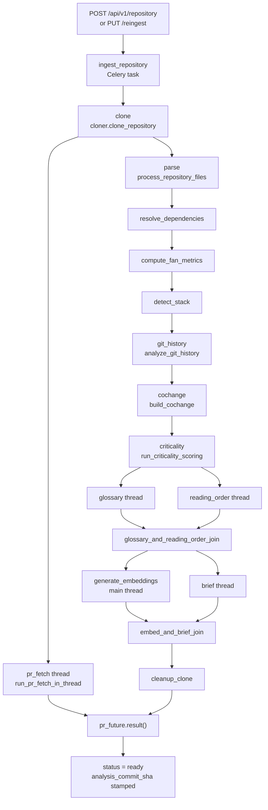
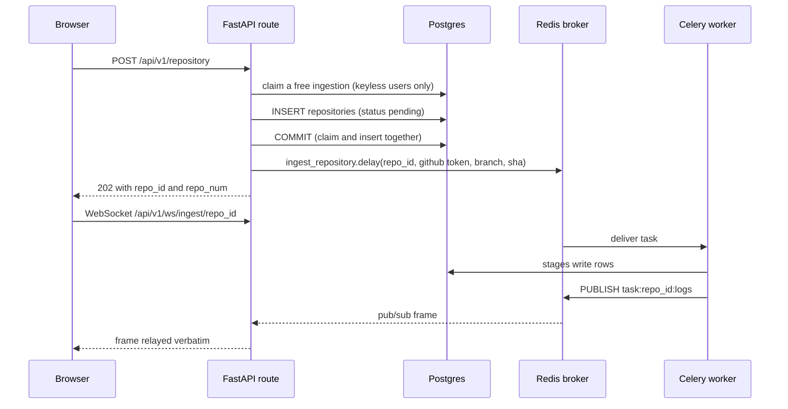
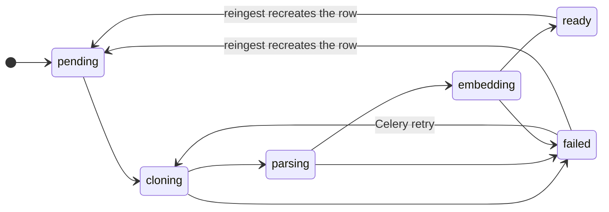

# The ingestion pipeline

Ingestion is the background job that turns a GitHub URL into everything Illume shows: the file and symbol tables, the dependency graph, git ownership, co-change pairs, criticality scores, the glossary, the reading order, the vector index and the architecture brief. It is one Celery task, `ingest_repository` in [`server/app/tasks/ingest.py`](../../server/app/tasks/ingest.py), that clones the repository and then runs the shared stage sequence in [`server/app/services/pipeline.py`](../../server/app/services/pipeline.py). This page walks through every stage in order, says what each one reads and writes, and links to the deep-dive pages for the parts that need one.

## What ingestion produces

A repository row starts life as `status = "pending"` and ends as `"ready"` (or `"failed"`). In between, the pipeline fills these tables, all keyed by the repository's UUID:

| Output                                 | Table(s)                                                                                      | Written by                                                                                     | Read by                                                   |
| -------------------------------------- | --------------------------------------------------------------------------------------------- | ---------------------------------------------------------------------------------------------- | --------------------------------------------------------- |
| Source files with language and size    | `files`                                                                                       | [`scanner.process_repository_files`](../../server/app/services/scanner.py)                     | graph, explorer, stats, every LLM stage                   |
| Functions, classes, methods, imports   | `ast_symbols`                                                                                 | `scanner` via [`parser.parse_file`](../../server/app/services/parser.py)                       | resolver, glossary, embedder, graph, agent tools          |
| Import edges                           | `dependencies`                                                                                | [`dependency_resolver.resolve_dependencies`](../../server/app/services/dependency_resolver.py) | graph, reading order, brief, export, structural retrieval |
| Fan-in and fan-out per file            | `files.fan_in`, `files.fan_out`                                                               | `dependency_resolver.compute_fan_metrics`                                                      | criticality, glossary ranking, graph sizing               |
| Tech stack and entry points            | `repositories.detected_stack`, `entry_points`                                                 | [`stack_detector`](../../server/app/services/stack_detector.py)                                | brief, repository page                                    |
| Merged pull requests (up to 200)       | `pull_requests`                                                                               | [`pr_fetcher.fetch_pull_requests`](../../server/app/services/pr_fetcher.py)                    | embedder, history retrieval                               |
| Commits (newest 500)                   | `commits`                                                                                     | [`git_analyzer.analyze_git_history`](../../server/app/services/git_analyzer.py)                | co-change, embedder, activity feed, history retrieval     |
| Ownership, bus factor, knowledge silos | `code_owners`, `files.change_frequency`, `files.git_last_modified`, `files.has_tests`         | `git_analyzer`                                                                                 | criticality, ownership endpoints, brief                   |
| Files that change together             | `file_cochange`                                                                               | [`cochange.build_cochange`](../../server/app/services/cochange.py)                             | the co-change retrieval channel and agent tool            |
| Criticality level and reasons          | `files.criticality`, `files.criticality_reasons`                                              | [`criticality.run_criticality_scoring`](../../server/app/services/criticality.py)              | graph colour, brief, explorer                             |
| Glossary                               | `glossary_entries`                                                                            | [`glossary_builder.build_glossary`](../../server/app/services/glossary_builder.py)             | glossary page, embedder (symbol descriptions)             |
| Reading order                          | `onboarding_guides.reading_order`                                                             | [`onboarding.build_reading_order`](../../server/app/services/onboarding.py)                    | guide endpoint, graph tour, embedder (file chunks)        |
| Vector index                           | `embeddings`                                                                                  | [`embedder.generate_embeddings`](../../server/app/services/embedder.py)                        | every retrieval arm                                       |
| Architecture brief                     | `onboarding_guides.architecture_brief`, `critical_files`, `repositories.architecture_summary` | [`architecture_brief.generate_brief`](../../server/app/services/architecture_brief.py)         | repository home page, export, MCP resources               |

The deterministic half (files through criticality) needs no model at all. The LLM half (glossary, reading order, brief) runs on whichever credential the repository's owner resolves to, and embeddings always run on the operator's OpenAI key. [Generation](generation.md) and [BYOK and encryption](../security/byok-and-encryption.md) explain that split.

## The pipeline at a glance

The braces in the diagram are real concurrency: those stages run on separate threads at the same time. The arrows are dependencies, so read them as "must finish before", not as a flat list.



Three overlapped groups exist, each documented in depth on [concurrency and failure](concurrency-and-failure.md):

| Group                         | Threads                                                              | Pool                                                       |
| ----------------------------- | -------------------------------------------------------------------- | ---------------------------------------------------------- |
| PR fetch beside everything    | one `ingest-pr` thread                                               | `ThreadPoolExecutor(max_workers=1)` in `ingest_repository` |
| Glossary beside reading order | two `pipeline-llm` threads                                           | `ThreadPoolExecutor(max_workers=2)` in `run_full_analysis` |
| Embeddings beside the brief   | the main thread embeds, one `pipeline-brief` thread writes the brief | `ThreadPoolExecutor(max_workers=1)` in `run_full_analysis` |

Inside the embedder, glossary builder and reading-order builder there is a fourth, finer layer: up to `LLM_MAX_WORKERS = 4` network calls in flight at once through [`_concurrency.py`](../../server/app/services/_concurrency.py).

## Where an ingestion starts

Two routes in [`server/app/api/v1/repository.py`](../../server/app/api/v1/repository.py) queue the task. Both return `202 Accepted` at once; the work happens on the worker.



### Creating a repository

`create_repository` takes a `RepositoryCreate` body: `github_url` (validated by `GitHubRepoUrl` in [`server/app/api/validation.py`](../../server/app/api/validation.py) to be exactly `https://github.com/<owner>/<repo>`), plus an optional `branch` and `commit_sha`. The URL rule matters for security: the clone step embeds the user's GitHub token in the URL it fetches, so any other host would receive that token.

Before inserting, `_require_quota_for_creation` decides who pays:

- A user with a stored AI key (`LLMConfig.from_user` returns a config) is admitted with no counter touched.
- A keyless user must still have free ingestions left. `aclaim_free_ingestion` in [`server/app/services/entitlements.py`](../../server/app/services/entitlements.py) is a conditional `UPDATE users SET free_ingestions_used = free_ingestions_used + 1 WHERE free_ingestions_used < 3`. It does not commit, so the claim and the `Repository` insert land in one transaction. When the cap (`FREE_INGESTIONS = 3`) is spent the route answers `402` with `QUOTA_EXHAUSTED_DETAIL`.

New rows are always created with `auto_update_enabled=False`: a free repository must not keep syncing on the operator's key. The task is dispatched with the owner's decrypted `github_access_token` as a Celery argument.

### Re-ingesting

`PUT /{repo_id}/reingest` requires a stored key (`_require_user_key`, else `402`) and a repository in `ready` or `failed` (else `400`). It **deletes the `repositories` row and inserts a new one with the same `id` and `repo_number`**. Every child row cascades away, so the new ingest starts from an empty slate. The auto-update toggle, interval and `next_sync_at` are copied across so a re-ingest does not silently switch off a schedule the user chose.

Re-ingesting while a background sync holds the row is allowed (the row's `status` is still `ready`). The sync detects it at its next watermark write, because the replacement row has no `sync_generation`. See [auto-update sync](sync.md#generations-and-the-reingest-race).

## The task wrapper

`ingest_repository(self, repo_id, access_token=None, branch=None, commit_sha=None)` is declared `@celery.task(bind=True, max_retries=3)`. It owns four things and delegates the rest:

1. **The database session.** `get_db_context()` wraps `get_sync_db()` so that an exception is thrown back into the generator with `gen.throw(exc)`, which is what makes the generator's `except: rollback` arm reachable. The original wrapper resumed the generator with `next(gen)`, which skipped the rollback.
2. **The clone.** `with stage("clone"): clone_repository(...)` returns `(tmp_dir, actual_branch, actual_sha)`. The branch and SHA are committed onto the row (`ingested_branch`, `ingested_commit_sha`) before any analysis runs.
3. **The PR fetch thread**, started immediately after the clone and joined at the very end.
4. **The outcome.** On success it stamps `analysis_commit_sha = actual_sha`, sets `status = "ready"`, commits, publishes the two terminal frames and sends a push notification. On failure it rolls back, marks the row `failed`, publishes the failure frames and asks Celery to retry.

Before handing anything to a thread, the task captures the scalars the threads need: `repo_id_value`, `repo_github_url`, and the owner's `LLMConfig` from `llm_config_for(owner)`. Threads never receive the ORM `Repository` instance. That rule, and why it is the thing that makes the overlap safe, is on [concurrency and failure](concurrency-and-failure.md#the-scalars-only-rule).

Everything between the clone and the outcome is `run_full_analysis(db, repo, tmp_dir, redis_client, publish, manage_status=True, overlap_llm=True, llm_config=llm_config)`. The sync task calls the same function with `manage_status=False` and `overlap_llm=False`, which is why the stage sequence lives in a service module rather than in the task.

## The stages

Each subsection names the stage's `Stage` enum value (from [`server/app/services/_stages.py`](../../server/app/services/_stages.py)), which is both the timer label in the worker log and the `stage` field on its progress frames.

### clone

[`cloner.clone_repository`](../../server/app/services/cloner.py) first flips the row to `status = "cloning"` (unless `manage_status=False`). Then one of two paths runs:

- **Clone cache enabled** (`CLONE_CACHE_ENABLED = True`, the default): delegates to [`repo_cache.ensure_clone`](../../server/app/services/repo_cache.py), which keeps a persistent working tree per repository under the system temp directory. A pinned `commit_sha` cannot be served from the cache (it tracks one branch), so a pinned ingest falls back to an ephemeral clone.
- **Cache disabled**: `git.Repo.clone_from` into `tempfile.mkdtemp(prefix="illume_<repo_id>_")`, single-branch unless a commit is pinned, then `git checkout <sha>` when one is.

The OAuth token is injected into the HTTPS URL's userinfo (`https://<token>@github.com/...`). Every git error passes through `redact_git_error` before it can reach a log or the browser, because git echoes the URL, token included, when a token is rejected.

The returned branch is `"detached"` when a specific commit was checked out. When no branch is given, `_branch_for` falls back to `repo.default_branch` and then to `"main"` (`default_branch` is never written by the pipeline, so in practice an unspecified branch means `main` on the cache path and the remote's default branch on the ephemeral path).

The [clone cache](clone-cache.md) page covers the cache's eviction, token hygiene and failure fallbacks, and records one quirk that matters here: `ingest_repository` calls `cleanup_clone(tmp_dir)` in a `finally` whether or not the path came from the cache, so an initial ingest deletes its own cache entry when it finishes.

### pr_fetch

Runs on its own thread from the moment the clone finishes. [`pr_fetcher.fetch_pull_requests`](../../server/app/services/pr_fetcher.py) pages through `GET /repos/{owner}/{repo}/pulls?state=closed&sort=updated&direction=desc&per_page=100`, keeps only PRs with a `merged_at`, and stops at `MAX_PRS = 200`, an empty page, or a short page. Rows go in with `ON CONFLICT (repository_id, number) DO NOTHING`.

| Constant          | Value  | Meaning                                       |
| ----------------- | ------ | --------------------------------------------- |
| `MAX_PRS`         | 200    | Merged PRs kept per repository                |
| `PER_PAGE`        | 100    | GitHub page size                              |
| `REQUEST_TIMEOUT` | 20.0 s | Per-request `httpx` timeout                   |
| `MAX_RETRIES`     | 3      | Attempts on a `429` or `403` before giving up |

A `429` or `403` sleeps for `retry_after_seconds(response)` ([`github_http.py`](../../server/app/services/github_http.py)): `Retry-After` if present, else the time until `X-RateLimit-Reset`, else `DEFAULT_RETRY_AFTER_SECONDS = 60`. Every other non-200 raises `GitHubClientError`, which reaches the task through `pr_future.result()` and fails the ingestion.

### parse

[`scanner.process_repository_files`](../../server/app/services/scanner.py) flips `status = "parsing"`, deletes every `File` row for the repository (the cascade removes symbols, edges, ownership rows, co-change pairs and file-scoped embeddings), walks the tree and parses every file `is_scannable` accepts. Rows are built as plain dicts and flushed every `FILE_BATCH_SIZE = 500` files with `INSERT ... ON CONFLICT (repository_id, path) DO NOTHING`, one commit per batch. Progress frames are rate-limited to one every `max(50, total // 20)` files.

The parser, the language table, symbol kinds, complexity and docstrings are on [parsing and dependencies](parsing-and-dependencies.md).

### resolve_dependencies and compute_fan_metrics

`resolve_dependencies` turns each stored `import` symbol into at most one `Dependency` row pointing at a symbol in the imported file, via a five-step matching chain. `compute_fan_metrics` collapses those edges to file pairs and writes `fan_in` and `fan_out`. Both are described on [parsing and dependencies](parsing-and-dependencies.md#resolving-imports-to-files).

### detect_stack

`detect_stack(repo_root)` and `detect_entry_points(repo_root)` in [`stack_detector.py`](../../server/app/services/stack_detector.py) read manifests (`package.json`, `go.mod`, `Cargo.toml`, `Gemfile`, `composer.json`, `pom.xml`, `build.gradle`), CI and infrastructure files, and raw source text, and store a JSON summary of languages, frameworks, databases, CI/CD and infrastructure, plus a list of likely entry-point files. It is best-effort pattern matching; unreadable files are skipped silently.

### git_history

[`git_analyzer.analyze_git_history`](../../server/app/services/git_analyzer.py) runs `git log --numstat -n500`, stores the commits, aggregates per-file ownership and sets `has_tests` on every file. [Git intelligence](git-intelligence.md) has the details.

### cochange

[`cochange.build_cochange`](../../server/app/services/cochange.py) counts, over the stored commits, how often each pair of current files changed in the same commit, and keeps the strongest pairs. It reads the commit rows `git_history` just wrote and the file rows `parse` wrote, so it follows both. See [git intelligence](git-intelligence.md#co-change).

### criticality

[`criticality.run_criticality_scoring`](../../server/app/services/criticality.py) grades every file `critical`, `caution` or `safe` from fan-in, path patterns, staleness and test coverage. It reads `git_last_modified` and `has_tests`, which only `git_history` writes, so it must run after it. This is one of the two load-bearing orderings described below.

### glossary and reading_order

Both run at once on two threads, each with its own session. The glossary builder asks the model to define the most important symbols; the reading-order builder topologically sorts the file graph into tiers and asks the model to annotate the files. [Generation](generation.md) describes both.

### generate_embeddings and brief

The main thread embeds while a second thread writes the architecture brief. The embedder flips `status = "embedding"` and writes every chunk type in the order commits, PRs, README, annotated files, symbols; [the index](../retrieval/index-and-embeddings.md) covers chunking. The brief reads files, symbols, dependencies, owners, the glossary and the reading order, but never the `embeddings` table, which is what makes the overlap safe.

### ready

Not a timed stage. After the PR thread is joined, the task stamps `analysis_commit_sha`, sets `status = "ready"`, commits, and publishes `status_update` and `done` frames with `stage=ready, phase=done`. `_notify` sends the `INGEST_COMPLETED` push to the owner's registered devices; a push failure is logged and swallowed because the analysis is already durable.

## Repository status

`Repository.status` is a Postgres enum, `repo_status`, with seven values. Five are written by the ingest path; `analyzing` exists in the enum and nowhere in the code.



| Status      | Set by                                                                              | What the UI does                                         |
| ----------- | ----------------------------------------------------------------------------------- | -------------------------------------------------------- |
| `pending`   | `server_default` on insert, and the reingest route                                  | Shows the progress view and opens the WebSocket          |
| `cloning`   | `cloner._update_status`                                                             | Progress view                                            |
| `parsing`   | `scanner._update_status`, stays set through criticality, glossary and reading order | Progress view                                            |
| `embedding` | `scanner.embed_repository_symbols`                                                  | Progress view                                            |
| `analyzing` | nothing                                                                             | Unused                                                   |
| `ready`     | `ingest_repository`                                                                 | Every page works; the graph endpoint stops answering 409 |
| `failed`    | the task's `except` arm                                                             | Shows the error and offers re-ingest                     |

A background sync never touches `status`; it has its own `sync_status` column. [Auto-update sync](sync.md#why-a-sync-keeps-status-ready) explains why.

## Two orderings that are load-bearing

Both were wrong at some point, and the unit tests cannot catch either regression because they inject the values directly.

1. **`criticality` must follow `git_history`.** Scoring reads `File.git_last_modified` and `File.has_tests`. The parse stage deletes and re-inserts every file, so those columns are `NULL` and `False` until the git analyzer runs. Scoring first would grade every file as untouched and untested. The same rule applies on the sync path, where `_run_step_a` calls `analyze_git_history` before `run_criticality_scoring`.
2. **The parse insert is idempotent.** `_flush_files` inserts with `ON CONFLICT (repository_id, path) DO NOTHING`, backed by the unique constraint `uq_file_repo_path`. Without it, two workers on the same repository (a retry racing a slow first attempt, or a re-ingest racing a sync) insert duplicate rows instead of failing.

A third ordering is real but less fragile: `cochange` must follow both `parse` (it maps paths to current file ids) and `git_history` (it reads `commits.changed_files_list`). It sits between them and `criticality` in both `run_full_analysis` and `_run_step_a`.

## Idempotency of each write

| Table              | Constraint                                                    | Conflict behaviour                                                                       |
| ------------------ | ------------------------------------------------------------- | ---------------------------------------------------------------------------------------- |
| `files`            | `uq_file_repo_path (repository_id, path)`                     | `ON CONFLICT DO NOTHING` on ingest; `DO UPDATE` on the sync delta                        |
| `ast_symbols`      | none                                                          | Not needed: the parent file is deleted first and the cascade takes the symbols           |
| `dependencies`     | `uq_dependency_edge (source_symbol_id, target_symbol_id)`     | Plain insert; the cascade (ingest) or `delete_repo_edges` (sync) empties the table first |
| `commits`          | `uq_commit_repo_hash (repository_id, hash)`                   | `ON CONFLICT DO NOTHING`                                                                 |
| `pull_requests`    | `uq_pr_repo_number (repository_id, number)`                   | `ON CONFLICT DO NOTHING`                                                                 |
| `code_owners`      | unique `file_id`                                              | `ON CONFLICT DO UPDATE` of owner, contributors and silo flag                             |
| `file_cochange`    | primary key `(file_a_id, file_b_id)`                          | The repository's rows are deleted, then reinserted                                       |
| `glossary_entries` | none                                                          | Full mode deletes the repository's entries first                                         |
| `embeddings`       | `uq_embedding_source (repository_id, source_type, source_id)` | Full mode deletes every row first; incremental mode upserts                              |

## Progress and the live log

Every stage publishes JSON frames to the Redis channel `task:{repo_id}:logs`, and the WebSocket endpoint relays them verbatim to the browser. Each frame carries `event`, `message`, `timestamp`, and (except the failure frame) a `stage` and a `phase` (`started`, `progress`, `done`, `failed`). The client drives its pipeline diagram from `stage` and `phase` alone. The complete frame catalogue is on [WebSockets](../interfaces/websockets.md).

Two publishers exist and they do not behave the same:

- `publish_log` in [`server/app/services/_publish.py`](../../server/app/services/_publish.py), used by every service, swallows Redis errors and logs a warning, and also writes an `INFO` line with the stage and phase so a worker-log grep lines up with what the browser saw.
- The `publish` closure inside `ingest_repository`, used for the `*_started`/`*_complete` frames of the LLM stages and the terminal frames, calls `redis_client.publish` directly with no `try`. A Redis outage at that moment raises, which fails the task and triggers a retry.

## Per-stage timing

[`server/app/services/_stage_timer.py`](../../server/app/services/_stage_timer.py) logs one line per stage:

```text
stage_timer stage=parse wall=41.27s tracemalloc_peak=184736512 vmhwm_delta_kb=212044
stage_timer stage=glossary wall=18.02s mem=not_measured
stage_timer stage=glossary_and_reading_order_join wall=19.40s mem=not_measured
```

Concurrent stages pass `measure_memory=False` and log `mem=not_measured`, because both memory counters are process-global. Compare each concurrent stage's wall time with its `*_join` line: the join should land near the maximum of its members, not their sum. Grep a production worker with:

```bash
docker logs illume-worker 2>&1 | grep stage_timer
```

What `tracemalloc_peak` does and does not mean is explained on [concurrency and failure](concurrency-and-failure.md#reading-the-stage-timer).

## Failure, briefly

On any exception the task rolls back first, marks the row `failed`, publishes a failure frame with no `stage`, and raises `self.retry(exc=exc, countdown=10)`. With `max_retries=3` a repository is attempted at most four times, ten seconds apart. Each retry starts the pipeline from the clone. The push notification for a failure is sent only on the final attempt (`_is_final_attempt`). [Concurrency and failure](concurrency-and-failure.md#failure-and-retry) covers the failure path line by line, including the cases where a late failure throws away a completed analysis.

## Design trade-offs and limits

- **One task, not a Celery chain.** A chain would let stages retry independently, but each link would need to reload state and the overlap would need a chord. One task keeps the session, the clone and the scalars in one place. The cost is that a failure anywhere restarts everything from the clone.
- **Full rebuild on every ingest.** The parse stage deletes every file first. There is nothing to diff against on a first ingest, and reconciling an arbitrary old state is far more complex than rebuilding. The [sync path](sync.md) exists for the incremental case.
- **Only imports become edges.** `dep_type` allows `calls`, `inherits` and `instantiates`, but the resolver only ever writes `imports`, so the call graph is never captured and the `Called by:` and `Calls:` lines in symbol chunks are always empty.
- **No size cap on what is ingested.** There is no limit on file count or repository size beyond the clone cache's per-repository ceiling (which only decides cache versus ephemeral). A very large repository is bounded only by the worker's memory, which is why the worker runs one task at a time.
- **PR fetch can fail a finished analysis.** The PR thread is joined after the embedder and the brief. A `GitHubClientError` raised there marks the row failed and retries the whole pipeline, even though every other stage succeeded.
- **The PR join is late, so embeddings may miss PRs.** PR rows are written by the PR thread, but the embedder reads `pull_requests` whenever it reaches that source type. If the PR fetch is still sleeping on a rate limit when embedding starts, those PRs exist in the table but have no vectors until the next full re-embed.
- **`analyzing` is a dead enum value**, and `parsing` stays set through several stages that are not parsing.

## Related documentation

- [Concurrency and failure](concurrency-and-failure.md): the thread pools, the scalars-only rule, the stage timer and the failure path in full.
- [Parsing and dependencies](parsing-and-dependencies.md): tree-sitter, symbol kinds, import resolution and fan metrics.
- [Git intelligence](git-intelligence.md): history mining, ownership, co-change, test detection and criticality.
- [Generation](generation.md): the glossary, the reading order and the brief.
- [The index and embeddings](../retrieval/index-and-embeddings.md): what the embedder writes.
- [Auto-update sync](sync.md): the incremental path that reuses these stages.
- [WebSockets](../interfaces/websockets.md): every progress frame.
