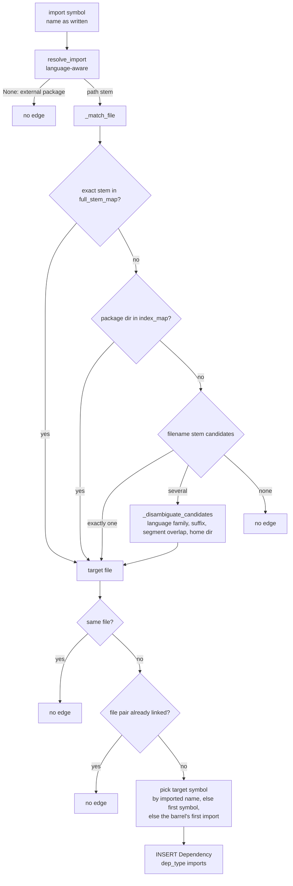

# Parsing and dependency resolution

The parse stage reads every source file in a cloned repository with tree-sitter and stores its functions, classes, methods and imports as rows in `ast_symbols`. The resolver then turns each import into an edge pointing at a symbol in the imported file, and the fan-metric pass counts those edges per file. Together they produce the structural data everything else is built on: the dependency graph, fan-in and fan-out, the reading order's topological sort, the glossary's ranking, structural retrieval and the agent's graph tools. This page covers [`parser.py`](../../server/app/services/parser.py), [`docstrings.py`](../../server/app/services/docstrings.py), [`scanner.py`](../../server/app/services/scanner.py), [`import_resolver.py`](../../server/app/services/import_resolver.py), [`dependency_resolver.py`](../../server/app/services/dependency_resolver.py) and [`stack_detector.py`](../../server/app/services/stack_detector.py), and states plainly which languages get real edges and which do not.

## Terms

- **Symbol**: one declaration the parser recognised, stored as an `AstSymbol` row with a `kind` (`function`, `class`, `method` or `import`), a `name`, a line range, its raw `source_code`, a `cyclomatic_complexity` and an optional `docstring`. The `symbol_kind` enum also allows `variable` and `module`; nothing writes them.
- **Import symbol**: a symbol of kind `import` whose `name` is the module specifier as written (`./utils`, `@/lib/api`, `app.models`).
- **Edge**: a `Dependency` row from an import symbol to a symbol in another file, with `dep_type = "imports"`.
- **Stem**: a repository-relative path with its extension removed (`server/app/models/user`). The resolver matches on stems because an import never names the extension the file has on disk.
- **Barrel**: a file with no function or class symbols, typically an `index.ts` or `__init__.py` that only re-exports. Barrels matter to the graph; see [the dependency graph](../graph/dependency-graph.md#barrel-resolution).

## Which files are parsed

Two lists in [`stack_detector.py`](../../server/app/services/stack_detector.py) decide, and `is_scannable(relative_path)` is the single predicate both the full walk (`walk_source_files`) and the sync delta (`apply_file_delta`) consult, so the two file sets cannot drift apart.

`SOURCE_EXTENSIONS`: `.py`, `.ipynb`, `.ts`, `.tsx`, `.js`, `.jsx`, `.go`, `.rs`, `.java`, `.c`, `.cpp`, `.h`, `.hpp`, `.rb`, `.cs`, `.php`, `.swift`, `.kt`.

`SKIP_DIRS`: any path segment equal to `.git`, `node_modules`, `__pycache__`, `.venv`, `venv`, `dist`, `build`, `.next`, `coverage`, `.pytest_cache`, `alembic`, `target`, `bin` or `obj` excludes the file. The match is on whole segment names anywhere in the path, so `alembic` excludes every directory of that name, including a project's real source package if it happened to be called that.

`walk_source_files` walks with `os.walk` and prunes skipped directories in place so it never descends into them. A file `parse_file` cannot parse (unknown extension, unreadable, tree-sitter error, malformed notebook JSON) is skipped: it gets no `files` row at all, not an empty one.

## The parser

`parse_file(path)` routes notebooks to `parse_notebook` and everything else to `_parse_source` with the language from `EXTENSION_TO_LANGUAGE`. `get_parser(language)` comes from `tree_sitter_language_pack`, which supplies prebuilt grammars.

| Extension(s)    | tree-sitter language | Node map used                 |
| --------------- | -------------------- | ----------------------------- |
| `.py`, `.ipynb` | `python`             | `SYMBOL_NODE_TYPES["python"]` |
| `.js`           | `javascript`         | explicit                      |
| `.jsx`          | `jsx`                | explicit                      |
| `.ts`           | `typescript`         | explicit                      |
| `.tsx`          | `tsx`                | explicit                      |
| `.go`           | `go`                 | explicit                      |
| `.rs`           | `rust`               | explicit                      |
| `.java`         | `java`               | explicit                      |
| `.c`, `.h`      | `c`                  | explicit                      |
| `.cpp`, `.hpp`  | `cpp`                | explicit                      |
| `.rb`           | `ruby`               | `DEFAULT_SYMBOL_TYPES`        |
| `.cs`           | `c_sharp`            | `DEFAULT_SYMBOL_TYPES`        |
| `.php`          | `php`                | `DEFAULT_SYMBOL_TYPES`        |
| `.swift`        | `swift`              | `DEFAULT_SYMBOL_TYPES`        |
| `.kt`           | `kotlin`             | `DEFAULT_SYMBOL_TYPES`        |

### The walk

`_parse_source` does not visit the whole tree. It starts from the root node's children and pops nodes off a stack. A node whose type is in the language's map becomes a symbol. A class is the only thing descended into: `_class_body` finds the child of type `block`, `class_body`, `declaration_list` or `field_declaration_list` and its children are queued. Function bodies are never descended, so a nested function inside a function or method is not a symbol of its own; it is part of its parent's `source_code`.

`loc` is the byte count of newlines plus one. A notebook's code cells are concatenated (with a newline forced between cells) and parsed as one Python file; markdown cells are dropped.

### Symbol kinds per language

`SYMBOL_NODE_TYPES` maps tree-sitter node types to kinds. The rows that matter:

| Language        | function                                                                                     | class                                                                  | method                                                            | import                                      |
| --------------- | -------------------------------------------------------------------------------------------- | ---------------------------------------------------------------------- | ----------------------------------------------------------------- | ------------------------------------------- |
| Python          | `function_definition`, `decorated_definition`                                                | `class_definition`                                                     | (none: a method is a `function_definition`, stored as `function`) | `import_statement`, `import_from_statement` |
| JavaScript, JSX | `function_declaration`, `function_expression`, `arrow_function`; JSX adds `export_statement` | `class_declaration`                                                    | `method_definition`                                               | `import_statement`                          |
| TypeScript, TSX | as JavaScript, plus `export_statement`                                                       | `class_declaration`, `interface_declaration`, `type_alias_declaration` | `method_definition`                                               | `import_statement`                          |
| Go              | `function_declaration`                                                                       | `type_declaration`                                                     | `method_declaration`                                              | `import_declaration`                        |
| Rust            | `function_item`                                                                              | `impl_item`, `struct_item`                                             |                                                                   | `use_declaration`                           |
| Java            | (none)                                                                                       | `class_declaration`                                                    | `method_declaration`                                              | `import_declaration`                        |
| C               | `function_definition`                                                                        |                                                                        |                                                                   | `preproc_include`                           |
| C++             | `function_definition`                                                                        | `class_specifier`                                                      |                                                                   | `preproc_include`                           |
| default         | `function_definition`, `function_declaration`                                                | `class_definition`, `class_declaration`                                |                                                                   | `import_statement`                          |

TypeScript interfaces and type aliases are stored as `class`, which is why they appear as nodes in the symbol-level graph.

### Export statements

A JS-family `export_statement` is a wrapper. `_parse_source` looks inside it for one of `EXPORTABLE_DECLARATIONS` (`function_declaration`, `class_declaration`, `interface_declaration`, `type_alias_declaration`, `enum_declaration`, `lexical_declaration`) and records that instead. For `export const handler = () => {}` it unwraps one level further, from the `lexical_declaration` to the arrow function, and names it from the declarator. An `export ... from "./x"` with no declaration inside is a re-export and is stored as an `import` named `./x`, which is how barrels get their outgoing edges.

### Names

`_extract_name` tries, in order: the variable an anonymous function is assigned to; the declarator of a `lexical_declaration`; the inner definition of a Python `decorated_definition`; for imports, the `source` field, then a `string` or `from_clause` child, then a `dotted_name`, `aliased_import` or `identifier` child; then the node's `name` field; then the first `identifier` or `name` child. When all fail the name is `<anonymous>`.

For Python this means `from app.models import User` is an import named `app.models` (the module, not the imported name) and `from . import x` is an import named `x`.

### Cyclomatic complexity

`_count_complexity` starts at 1 and adds 1 for every node in the subtree whose type is in a fixed set: `if_statement`, `else_clause`, `elif_clause`, `for_statement`, `for_in_statement`, `for_each_statement`, `enhanced_for_statement`, `while_statement`, `do_statement`, `try_statement`, `catch_clause`, `except_clause`, `switch_case`, `case_clause`, `ternary_expression`, `logical_and`, `logical_or`, `boolean_operator`, `optional_chain`. It is computed for functions and methods only; classes and imports store `0`. The set is a union across grammars, so the same logic scores slightly differently per language: in TypeScript `a && b` is a `binary_expression`, not a `logical_and`, and does not count. Treat it as a relative signal within one language.

### Docstrings

[`docstrings.extract_docstring`](../../server/app/services/docstrings.py) is a second pass over each declaration:

- **Python**: the first statement of the body when it is a string literal, including the one-line form where the body itself is the string, and decorated definitions (whose wrapper has no body of its own).
- **Everything else**: the run of `comment` nodes immediately preceding the declaration (or its `export_statement` wrapper), with `//`, `/*`, `*/` and leading `*` markers stripped.

A comment run containing `@license`, `copyright` or `//!` is treated as a file header and dropped. Text is capped at `MAX_DOCSTRING_CHARS = 4000`. Imports never get one. An empty string (as opposed to `None`) means an adjacent comment run was present but stripped to nothing. The embedder uses the docstring only when no glossary definition exists and the docstring is not already inside the symbol's source.

### What the parser gets right and wrong, per language

These results were checked by parsing small sample files with `parse_file`:

| Language            | Functions and classes                                                                                                                | Imports usable for edges                             |
| ------------------- | ------------------------------------------------------------------------------------------------------------------------------------ | ---------------------------------------------------- |
| Python              | Named correctly; methods are found by class descent but stored with kind `function`                                                  | Yes: named by module path                            |
| TypeScript, TSX, JS | Named correctly for declarations and exported arrows                                                                                 | Yes: named by the string specifier                   |
| Go                  | Functions and methods named; `type` declarations are `<anonymous>`                                                                   | No: imports are `<anonymous>`                        |
| Rust                | Functions and structs named; `impl` blocks are `<anonymous>`                                                                         | No: `use` declarations are `<anonymous>`             |
| Java                | Classes and methods named                                                                                                            | No: imports are `<anonymous>`                        |
| C, C++              | Functions are `<anonymous>`                                                                                                          | No: includes are `<anonymous>`                       |
| PHP, Swift          | Top-level functions and classes named; PHP methods missed                                                                            | No: the default map has no import node type for them |
| Kotlin              | Every symbol is `<anonymous>`                                                                                                        | No                                                   |
| Ruby                | No symbols at all (the grammar uses `method` and `class` node types the default map does not list)                                   | No                                                   |
| C#                  | The `c_sharp` grammar is not available in the installed language pack, so `parse_file` returns `None` and `.cs` files are not stored | No                                                   |

Two JS-family gaps follow from the walk: a top-level `const f = () => {}` that is not exported is not captured (a bare `lexical_declaration` is not in the map and is not descended), and `export const LIMIT = 5` or `export { a, b }` become a `function` named `<anonymous>`, because the `export_statement` itself falls back to the map's `function` entry.

The practical consequence: **the dependency graph, fan-in, fan-out and everything derived from them exist only for Python and the JavaScript/TypeScript family.** Other languages are indexed for search (their files, symbols and source are embedded) but are edge-free islands in the graph.

## Persisting the parse

`process_repository_files` builds plain dicts rather than ORM instances, so the session's identity map stays empty no matter how many rows a batch holds. File ids are assigned client-side with `uuid.uuid4()` so the symbol rows of the same batch can reference their parent without a round trip. Every `FILE_BATCH_SIZE = 500` files it flushes files first (the foreign key needs the parent row), then symbols, then commits. `file_id_for_path` is reset after each flush so it never grows beyond one batch.

The file insert is `ON CONFLICT (repository_id, path) DO NOTHING`. The symbol insert has no conflict clause, because the stage deletes every file of the repository before it starts, and the cascade takes the symbols.

## Resolving imports to files

`resolve_dependencies(db, repo_id, repo_root)` reads three column projections (never full ORM rows): every file's `(id, path, language)`, every import symbol's `(id, file_id, name)`, and every function, class and method's `(id, file_id, name)`. It loads the tsconfig aliases and workspace packages from the clone once, then resolves each import in two steps.

### Step 1: specifier to stem

`resolve_import(language, import_name, importing_file, repo_root, ts_paths, workspace_map)` dispatches on the importing file's language and returns a repository-relative stem, or `None` when the import points outside the repository.

| Language                                 | Function                  | Rules                                                                                                                                                                                                                                                                                                                                                                                                                                                                                  |
| ---------------------------------------- | ------------------------- | -------------------------------------------------------------------------------------------------------------------------------------------------------------------------------------------------------------------------------------------------------------------------------------------------------------------------------------------------------------------------------------------------------------------------------------------------------------------------------------- |
| `python`                                 | `_resolve_python_import`  | Drop an `as` alias. Leading dots are relative to the importing file's directory (one dot = same directory, each extra dot = one level up). Otherwise dots become slashes: `app.models` becomes `app/models`.                                                                                                                                                                                                                                                                           |
| `javascript`, `typescript`, `tsx`, `jsx` | `_resolve_js_import`      | 1. Longest-prefix match against the workspace map. 2. The tsconfig aliases that govern the file. 3. A scoped `@pkg` or bare specifier is external (`None`). 4. A relative `./` or `../` path is normalised against the importing directory. The result then has any JS code extension stripped (`_strip_code_extension`: `.ts`, `.tsx`, `.mts`, `.cts`, `.js`, `.jsx`, `.mjs`, `.cjs`), so `./service.js` under `NodeNext` matches `service.ts`. Other extensions such as `.css` stay. |
| `java`                                   | `_resolve_java_import`    | Dotted name to a `.java` path, dropping a trailing member segment (`*`, an all-caps constant, a lowercase field). Unused in practice: Java imports parse as `<anonymous>` and are skipped before resolution.                                                                                                                                                                                                                                                                           |
| anything else                            | `_resolve_generic_import` | Dot-or-slash heuristics. Equally unused for the same reason.                                                                                                                                                                                                                                                                                                                                                                                                                           |

**tsconfig aliases.** `load_ts_paths(repo_root)` finds every `tsconfig.json` and `jsconfig.json` outside `SKIP_DIRS` and keeps each config's `compilerOptions.paths` separately, keyed by the config's directory. `_resolve_ts_alias` applies only the configs whose directory contains the importing file, nearest first (as TypeScript itself resolves them), and within one config the longest matching alias prefix wins, so `@/lib/` beats `@/`. Keeping configs separate matters in a monorepo where every app maps `@/*` to its own `src/`.

**Workspace packages.** `load_workspace_map(repo_root)` reads every `package.json` outside `SKIP_DIRS` and maps the package `name` (and subpath patterns) to the source directory: from `exports` (preferring the `import`, then `types`, then `default` condition), falling back to `main` with `dist/` rewritten to `src/`, then to the package directory. That is how `import { x } from "@acme/ui"` in one package resolves to `packages/ui/src/index` in another.

### Step 2: stem to file

`_build_stem_indexes` builds three maps once per run:

- `full_stem_map`: each file's stem, plus a variant with the top-level directory removed (so an import written relative to an unknown source root such as `src/` still matches).
- `short_stem_map`: bare filename stem to every file id with that name.
- `index_map`: each package directory to its `index.*` or `__init__.*` file (with the same top-level-stripped variant), so `import pkg` finds `pkg/__init__.py`.

`_match_file` tries the full stem, then the index map, then the short stem. A short stem with one candidate wins outright. Several candidates go to `_disambiguate_candidates`, which narrows to the importer's language family (Python, or the JS family), prefers an exact suffix match on the specifier, then the candidate sharing the most trailing path segments, and breaks a tie in favour of a candidate under the importer's own top-level directory, so in a monorepo an app's import stays inside that app. A candidate scoring zero is never chosen.

### Step 3: file to target symbol

An edge links two symbols, not two files, so the resolver picks a target symbol in the matched file:

1. If the matched file has definitions, the imported name is taken from the specifier's last segment (`imp_name.split("/")[-1].split(".")[-1].strip("_")`) and looked up among that file's definitions. For `./utils/format` that is `format`; for Python's `app.models` it is `models`. When no definition has that name the first definition in the file is used.
2. If the matched file has no definitions but has imports, it is a barrel, and the edge targets its first import symbol so the chain can be followed later.
3. If it has neither, the edge is dropped.

### Deduplication

The `seen` set is keyed by `(importing_file_id, matched_file_id)`, not by symbol. **Each pair of files gets at most one edge**, however many import statements link them. Self-imports are dropped. Edges are buffered as dicts and flushed every `DEPENDENCY_BATCH_SIZE = 1000`, each flush followed by a commit. The table's unique constraint `uq_dependency_edge (source_symbol_id, target_symbol_id)` is a safety net: inserts are plain, so a duplicate would raise rather than silently double-count.

Because of the file-pair dedup, the file-level graph's `weight` (the number of underlying edges per file pair) is always 1 and its `type` is always `imports`. See [the dependency graph](../graph/dependency-graph.md#file-level).

## Fan-in and fan-out

`compute_fan_metrics(db, repo_id)` joins `dependencies` to `ast_symbols` on both ends, keeps edges whose source and target files are both in the repository, drops self-edges, and counts `fan_out[src_file]` and `fan_in[tgt_file]`. It writes both columns with one bulk `UPDATE` for files with inbound edges and a second for files that only fan out, then commits. Files with no edges at all keep the column default of `0`.

With one edge per file pair, `fan_in` is the number of distinct files that import a file, and `fan_out` is the number of distinct files it imports.

`delete_repo_edges(db, repo_id)` deletes every edge whose source symbol belongs to the repository. Only the [sync path](sync.md) calls it: on a full ingest the file delete cascades through `ast_symbols` to both ends of every edge, so the table is already empty.

## Stack and entry points

`detect_stack(repo_root)` returns a dict of languages (from a count of `SOURCE_EXTENSIONS`), frameworks, databases, CI/CD and infrastructure, detected from manifests (`package.json` dependencies, `go.mod`, `Cargo.toml`, `Gemfile`, `composer.json`, `pom.xml`, `build.gradle`), from CI and infrastructure files (GitHub Actions, Dockerfiles, compose files and similar) and from patterns in source text. `detect_entry_points(repo_root)` returns repository-relative paths of likely entry files (`main.py`, `index.ts`, `server.js`, `manage.py` and the like). Both are stored on the `repositories` row and fed to the architecture brief. They are pattern matching, not analysis, and a missed framework is common.

## Constants

| Constant                | Value              | File                                                                         |
| ----------------------- | ------------------ | ---------------------------------------------------------------------------- |
| `FILE_BATCH_SIZE`       | 500                | [`scanner.py`](../../server/app/services/scanner.py)                         |
| `DEPENDENCY_BATCH_SIZE` | 1000               | [`dependency_resolver.py`](../../server/app/services/dependency_resolver.py) |
| `MAX_DOCSTRING_CHARS`   | 4000               | [`docstrings.py`](../../server/app/services/docstrings.py)                   |
| `SOURCE_EXTENSIONS`     | 18 extensions      | [`stack_detector.py`](../../server/app/services/stack_detector.py)           |
| `SKIP_DIRS`             | 14 directory names | [`stack_detector.py`](../../server/app/services/stack_detector.py)           |
| `EXTENSION_TO_LANGUAGE` | 18 entries         | [`parser.py`](../../server/app/services/parser.py)                           |

## Design trade-offs and limits

- **Top-level walk.** Visiting only top-level declarations and class bodies keeps the symbol table small and the graph readable, at the cost of missing nested functions and non-exported arrow functions in JS.
- **Name-based import matching.** The resolver never runs a type checker or a module system. Stems, aliases and workspace maps resolve the common cases; dynamic imports, `importlib`, re-exported names and path tricks are missed.
- **One edge per file pair.** File-pair dedup keeps the table small and makes fan-in mean "how many files import this", but it loses multiplicity, so the graph cannot show that one file leans on another heavily.
- **Target symbol is a guess.** Picking a definition by the specifier's last segment fits `import { format } from "./format"`, and falls back to the first symbol for everything else. Symbol-level edges are therefore approximate; file-level edges are exact.
- **Language coverage is uneven.** Real edges exist for Python and JS/TS only; Go, Rust, Java and C/C++ imports parse as `<anonymous>`, Ruby yields no symbols, Kotlin names nothing, and C# fails to parse at all. Adding a language means adding an explicit node map and, for edges, an import naming rule.
- **`alembic` in `SKIP_DIRS`.** Migration directories are excluded to keep generated schema code out of the graph, which also excludes any directory that happens to share the name.

## Related documentation

- [The ingestion pipeline](ingestion.md): where these stages run.
- [The dependency graph](../graph/dependency-graph.md): how edges become file and symbol graphs, and barrel resolution.
- [Git intelligence](git-intelligence.md): the stages that run next.
- [The index and embeddings](../retrieval/index-and-embeddings.md): how symbols become chunks.
- [Add a pipeline stage](../guides/add-a-pipeline-stage.md): adding a stage that consumes these tables.
