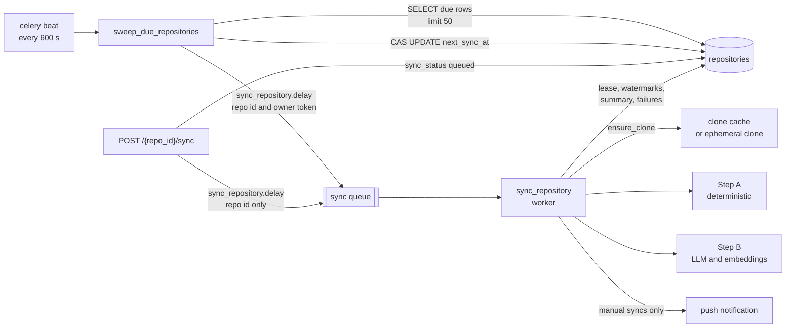
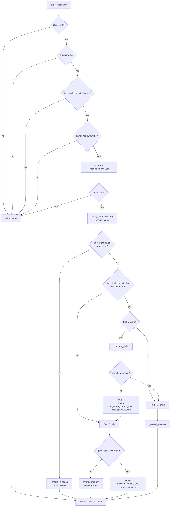
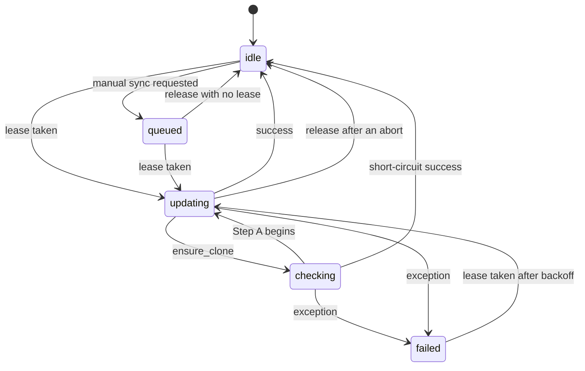

# Auto-update sync

Auto-update keeps an ingested repository current without a manual re-ingest. A beat-scheduled sweep finds repositories that are due, claims each one with a conditional update, and dispatches a `sync_repository` task. The task takes a lease on the row, brings a working tree to the remote head, and then either does nothing (already current), applies only the changed files (an incremental sync) or rebuilds everything (a full sync), all while the repository stays usable. This page documents [`app/tasks/autoupdate.py`](../../server/app/tasks/autoupdate.py) and [`app/tasks/sync.py`](../../server/app/tasks/sync.py) down to the function level, including the places where the code's own comments claim more than it does.

## Terms

- **Sweep**: `sweep_due_repositories`, a Celery task the beat process runs every `SWEEP_INTERVAL_MINUTES` (10). It reads the database and dispatches syncs; it does no git or analysis work itself.
- **Claim**: the sweep's conditional `UPDATE` that moves a due row's `next_sync_at` forward. Only a sweep whose update changed the row dispatches a sync for it.
- **Lease**: `sync_status = 'updating'` plus `sync_lease_expires_at = now + SYNC_LEASE_MINUTES` (60), taken by the sync task with its own conditional update. While a lease is live, no other sync may start on the row.
- **Generation**: a random UUID the lease writes to `sync_generation`. It identifies one sync attempt, so the attempt can tell whether the row it is writing to is still the one it leased.
- **Watermark**: a commit SHA recording what some of the data reflects. There are two: `ingested_commit_sha` (deterministic data) and `analysis_commit_sha` (LLM output and embeddings).
- **Step A**: the deterministic half of a sync: file rows, symbols, history, co-change, edges, fan metrics, criticality and stack.
- **Step B**: the LLM half: the architecture brief, new glossary entries, reading-order annotations and embeddings.
- **Escalation**: abandoning the incremental path for a full rebuild, because the change is not a fast-forward or is too large.

## The moving parts



Both entry points enqueue on the `sync` queue (`task_routes` in [`celery.py`](../../server/app/core/celery.py)). In production one worker consumes both `celery` and `sync` with `--concurrency=1`, so a sync never runs at the same time as an ingest on the same box; see [deployment](../operations/deployment.md).

## Turning it on

Auto-update is per repository: `auto_update_enabled` (default off) and `auto_update_interval_hours` (default 6). `PATCH /api/v1/repository/{repo_id}/auto-update` sets them. The interval must be one of `ALLOWED_AUTO_UPDATE_INTERVALS = (1, 3, 6, 12, 24)` in [`repository.py`](../../server/app/api/v1/repository.py), and the route requires the owner to have saved their own AI key (`_require_user_key`), because a keyless free-tier account cannot pay for background LLM calls. Enabling sets `next_sync_at = now()` so the next sweep picks the repository up; disabling resets `consecutive_sync_failures` and `last_sync_error`.

A repository created through the free tier is inserted with `auto_update_enabled = False`. A re-ingest carries the previous toggle and interval over to the recreated row.

## The sweep

`sweep_due_repositories()` is registered in `celery.conf.beat_schedule` at the bottom of `autoupdate.py` as `sweep-due-repositories`, running every `SWEEP_INTERVAL_MINUTES * 60.0` seconds. The same schedule holds `prune-agent-steps`, which deletes old agent step rows at 03:40 daily (see [the agent](../retrieval/agent.md)). Registering the entry in this module rather than in `celery.py` avoids a circular import; the module is loaded because `celery.py` lists it in `include`.

Each tick:

1. **Kill switch.** If `AUTO_UPDATE_ENABLED` is `False`, return 0.
2. **One clock.** `now` is read once and reused, which also makes the tests deterministic under `freezegun`.
3. **Select candidates.** Rows matching `_claim_predicate(now)`, oldest `next_sync_at` first with `NULL` first, limited to `SWEEP_BATCH_LIMIT = 50`.
4. **Claim each.** For every candidate, an `UPDATE ... WHERE id = :id AND <the same predicate>` sets `next_sync_at = now + interval + jitter`. The jitter is `random.uniform(0, SWEEP_OFFSET_JITTER_SECONDS)` (60 s) from `_next_offset_seconds`, so repositories on the same interval drift apart instead of all syncing on one boundary. Only rows whose update reports `rowcount == 1` are kept; a row another sweep claimed first fails the predicate and is skipped.
5. **Look up tokens.** `_lookup_owner_tokens` reads every claimed row's owner `github_access_token` in one query. The column is an `EncryptedString`, so this yields the decrypted token.
6. **Dispatch.** `sync_repository.delay(str(repo.id), token)` per claimed row, then commit.

`_claim_predicate(now)` is the single definition of "due":

| Condition                                     | Why                                                            |
| --------------------------------------------- | -------------------------------------------------------------- |
| `status == 'ready'`                           | never touch a row that is mid-ingest                           |
| `auto_update_enabled IS TRUE`                 | the user's toggle, or the automatic pause after three failures |
| `next_sync_at IS NULL OR next_sync_at <= now` | due, or never scheduled                                        |
| `sync_lease_expires_at IS NULL OR < now`      | no live lease; an expired lease is reclaimable                 |

The sweep does not look at `sync_status` and does not check whether the owner has an AI key. Both are checked by the task, which simply returns when the owner has no key; the row was already pushed forward by one interval, so a keyless repository is reconsidered every interval and skipped every time.

Two details to know:

- **The commit happens after dispatch.** The claims are committed after every `delay()` call. A worker can therefore pick up a task before the claim is visible to it; this is harmless because the task re-reads the row and takes its own lease.
- **The token travels through Redis.** The decrypted GitHub token is a positional task argument, so it sits in the broker message and in any worker log that prints task arguments. Encryption at rest does not cover it in transit. The manual route avoids this by dispatching without a token; the sweep could do the same, since the task already falls back to the stored token (`_resolve_token`). Repository creation and re-ingest pass the token to `ingest_repository` the same way. See [BYOK and encryption](../security/byok-and-encryption.md#threat-model).

## Manual sync

`POST /api/v1/repository/{repo_id}/sync` answers `202` with `{repo_id, sync_status, next_sync_at}` after these checks:

| Check                                                         | Response                       |
| ------------------------------------------------------------- | ------------------------------ |
| repository not owned by the caller                            | 404                            |
| owner has no saved AI key                                     | 402 (from `_require_user_key`) |
| `AUTO_UPDATE_ENABLED` is off                                  | 409                            |
| an unexpired `sync_lease_expires_at`                          | 409                            |
| no `ingested_commit_sha` (ingested before watermarks existed) | 409                            |

It then sets `sync_status = 'queued'` and pushes `next_sync_at` forward by one interval so a sweep ticking meanwhile cannot dispatch a duplicate, commits, and calls `sync_repository.delay(str(repo_id))` with **no token**. If the broker refuses the task, it resets `sync_status = 'idle'` and `next_sync_at = NULL` and answers `503`, so the settings panel is not left polling a sync that will never run. A manual sync works with the toggle off, because it is dispatched directly rather than left for the sweep.

## The task, step by step

`sync_repository(self, repo_id, access_token=None)` is bound, with `max_retries=0`: a failed sync is never retried by Celery. Retrying is the sweep's job, after the backoff the failure recorded.



### Guards

Before anything is written, the task returns `None` when the row is missing, when `status != 'ready'`, when there is no `ingested_commit_sha`, or when `LLMConfig.from_user(owner)` is `None` (the owner has no key of their own). The last guard is the free-tier backstop for swept syncs: there is no route to check the key, and without it a free repository would quietly run on the operator's key. The ingest task has no such gate, because its route already claimed a free ingestion and refusing would strand it.

### Manual or scheduled

`_requested_by_user(args, kwargs, sync_status)` reads the row's `sync_status` **before** the lease overwrites it. A sync is manual when the row was `queued` (only the route sets that) or when the task was dispatched with fewer than two positional arguments and no keyword arguments (the route sends only the id; the sweep sends the id and a token). Only manual syncs send a push notification on completion or failure (`_notify` with `sync_event(manual=..., failed=...)` from [`push.py`](../../server/app/services/push.py)); a scheduled sync is silent either way, since the repository keeps its previous, still-valid analysis.

### The lease

`_take_lease(db, repo, now)` generates a `uuid4` generation and runs:

```text
UPDATE repositories
SET sync_status = 'updating',
    sync_lease_expires_at = now + 60 min,
    sync_generation = :generation,
    last_sync_error = NULL
WHERE id = :id
  AND status = 'ready'
  AND (sync_lease_expires_at IS NULL OR sync_lease_expires_at < now)
```

A `rowcount` of 0 means another attempt holds a live lease; the task rolls back and returns `None`. The lease clause must match the sweep's exactly. An earlier version required `sync_lease_expires_at IS NULL` here, which wedged repositories after a crash: the sweep kept claiming the row (its lease had expired) and the task kept refusing it (the lease was not `NULL`), and nothing ever cleared it.

**Why a lease expires.** The deploy workflow runs `docker stop`, `docker rm` and `docker run`. A worker killed mid-sync never reaches its `finally`, so without an expiry `sync_status` would stay `updating` forever. `SYNC_LEASE_MINUTES = 60` is set well above the slowest realistic sync, so a live sync is never stolen, and short enough that a killed one is reclaimed within the hour. The expiry is a wall-clock bound, not a heartbeat: a sync that genuinely runs longer than 60 minutes can be overlapped by a second one.

**Status values.** `sync_status` is one of `idle`, `queued`, `checking`, `updating` and `failed`. The settings panel polls it every few seconds while it is non-idle.



`ACTIVE_SYNC_STATUSES = ("queued", "checking", "updating")` are the in-flight values; `idle` and `failed` are settled.

### Releasing the lease

`_release_lease(db, repo_id, generation)` runs in the task's `finally` on every exit, including the guard returns and the generation aborts, none of which settle the row themselves. Before it existed, those exits left `sync_status` non-idle and the settings panel polled forever. It sets `sync_status = 'idle'` and clears the expiry only when both guards hold:

- **Never overwrite a settled result.** The row must still be in an active status. `_record_success` and `_record_failure` have usually already written `idle` or `failed`.
- **Only release what you own.** With a generation, the row's `sync_generation` must match it (or be `NULL`). Without one (this attempt never took the lease), only a row that is `queued` with no lease is touched; `checking` and `updating` belong to whoever does hold the lease. Without this guard, an attempt that lost the race would clear the winner's live lease and let a third sync start.

A failure inside the release is logged and swallowed so it cannot mask the exception already propagating.

### Bringing the tree to the head

`_do_sync` resolves the GitHub token (`_resolve_token`: the argument, else the owner's stored token) and the owner's `LLMConfig` once via `llm_config_for(owner)`, sets `sync_status = 'checking'`, picks the branch (`ingested_branch`, else `default_branch`, else `main`; a stored `detached` becomes `main`) and calls `ensure_clone(repo_id, github_url, token, branch)` from the [clone cache](clone-cache.md). That returns `(repo_root, actual_branch, new_sha)`.

The module docstring and a comment here describe a cheap `git ls-remote` probe that lets an idle sync skip the clone. **That probe is not wired in.** `_ls_remote_sha` exists in [`repo_cache.py`](../../server/app/services/repo_cache.py) and nothing calls it, so every sync, including one that finds nothing to do, runs `git fetch`, `git reset --hard` and `git clean -fdx` on a cached clone, or a full clone when the cache has no entry.

### The short-circuit

If `ingested_commit_sha == new_sha` and `analysis_commit_sha == new_sha`, nothing has changed: `_record_success` writes a zero-change summary and the task returns. No row other than the repository's is touched and no LLM is called.

### Two watermarks

| Watermark             | Written                                                | Means                                                                        |
| --------------------- | ------------------------------------------------------ | ---------------------------------------------------------------------------- |
| `ingested_commit_sha` | at the end of Step A, or after a full sync's analysis  | files, symbols, edges, fan metrics, criticality, history reflect this commit |
| `analysis_commit_sha` | after Step B succeeds and the generation still matches | brief, glossary, reading order and embeddings reflect this commit            |

A sync that finishes Step A and then fails in Step B leaves the deterministic watermark at the head and the analysis watermark behind. The next sync sees `ingested_commit_sha == new_sha`, skips Step A, and runs only Step B. That is the reason for having two.

The ingest task writes both: `ingested_commit_sha` when the clone lands and `analysis_commit_sha` once the pipeline finishes.

### Choosing incremental or full

When `ingested_commit_sha` lags the head:

1. **Fast-forward check.** `is_fast_forward(old_sha, new_sha, repo_root)` in [`scanner.py`](../../server/app/services/scanner.py) first verifies both SHAs exist with `git cat-file -e <sha>^{commit}` (with `check=True`), then runs `git merge-base --is-ancestor old new`. Exit code 0 means a fast-forward. Anything else (force push, rebase, branch switch) escalates to a full sync, with `changed_paths` from `_changed_paths(repo_root, old_sha, new_sha)`, a `git diff --name-only --no-renames` that returns `None` when git cannot answer.
2. **Delta.** `compute_delta(repo_root, old, new)` runs `git diff --name-status -M old new` (60 s timeout) and returns `[(status, path)]`. A rename `R100 old new` produces two entries, `("D", old)` and `("R", new)`, so the vacated row is deleted rather than lingering as a file that exists twice. A copy `C` is a single upsert.
3. **Size check.** `should_escalate(diff, total_files, max_files=500, max_ratio=0.5)` escalates when more than `SYNC_FULL_MAX_FILES = 500` paths changed, or when changed paths exceed `SYNC_FULL_MAX_RATIO = 0.5` of the working tree's source files (`len(walk_source_files(repo_root))`). The numerator counts every diff entry, including non-source files and both halves of a rename.

**A missing old commit fails instead of escalating.** If `old_sha` is not in the working tree's object store, which happens after a force push when the clone is fresh (an ephemeral clone, or a cache entry that was evicted or deleted by the last ingest), `git cat-file -e` exits non-zero and `check=True` raises `CalledProcessError`. That is recorded as a sync failure, not as a non-fast-forward, and three of them in a row pause auto-update. The fix in that case is a manual re-ingest.

### Step A: the deterministic delta

`_run_step_a(db, repo, repo_root, diff)` runs, in this fixed order:

| Order | Call                                         | Effect                                                                                                               |
| ----- | -------------------------------------------- | -------------------------------------------------------------------------------------------------------------------- |
| 1     | `apply_file_delta(db, repo.id, root, paths)` | per path: delete the row; if the file exists, is scannable and parses, insert a fresh row (new UUID) and its symbols |
| 2     | `analyze_git_history(db, None, repo, root)`  | new commits, change frequency, ownership, `has_tests` for every file                                                 |
| 3     | `build_cochange(db, repo.id)`                | rebuild the whole co-change table from stored commits                                                                |
| 4     | `delete_repo_edges(db, repo.id)`             | delete every dependency edge of the repository                                                                       |
| 5     | `resolve_dependencies(db, repo.id, root)`    | rebuild every edge from the current import symbols                                                                   |
| 6     | `compute_fan_metrics(db, repo.id)`           | recount fan-in and fan-out                                                                                           |
| 7     | `run_criticality_scoring(db, repo.id)`       | rescore every file                                                                                                   |
| 8     | `detect_stack`, `detect_entry_points`        | update the stack and entry points on the row                                                                         |

`apply_file_delta` treats a path that no longer exists, is not scannable (a `.png`, or anything under `SKIP_DIRS`), or fails to parse as a deletion, so a file that became unparseable does not linger as a symbol-less row. An upsert deletes the old row first, which cascades its symbols, its code-owner row, its outgoing and incoming edges, its co-change pairs and its file-scoped embeddings, and then inserts a new row with a new id. That is why steps 2 to 7 recompute repository-wide rather than per file: the replaced files' derived data is gone and must be rebuilt, and unchanged files that imported them have lost their edges.

The order matters for the same reason as in the ingest: criticality needs the history columns and fan-in written first; co-change needs the new file rows and commit rows; the resolver's insert-only contract needs the delete before it. The last line of `_run_step_a`, `repo.ingested_commit_sha = repo.ingested_commit_sha or repo.ingested_commit_sha`, assigns the column to itself and does nothing; the caller writes the watermark.

After Step A, `_do_sync` sets `ingested_commit_sha = new_sha`, commits, and calls `_mark_stale_answers` with the changed paths, inside a savepoint, so a marking failure rolls back only the marking (see [stale answers](git-intelligence.md#stale-answers)).

**Step A is not one transaction.** The function's docstring, the module docstring and earlier documentation all say it is, so that "a reader sees either the old graph or the new one, never a torn one". The services it calls commit on their own: `analyze_git_history` commits four times (the first of which also commits the file delta), `resolve_dependencies` commits after every 1,000 edges, and `compute_fan_metrics` and `run_criticality_scoring` each commit. Concretely, between the resolver's first flush and its last, the live graph endpoint serves a repository whose edges are partly rebuilt, and fan-in and criticality still reflect the previous commit until their own steps finish. The window is short on a small change and grows with repository size. A failure part-way leaves the committed parts in place, behind a watermark that still points at the old commit, so the next sync redoes the work.

### Step B: the LLM delta

Step B runs outside any long transaction so a slow model does not hold locks across network calls. It runs with the owner's `LLMConfig`:

1. `_ingest_artifact_frame` regenerates the architecture brief with `generate_brief` (reading `README.md`, `readme.md` or `Readme.md` from the tree).
2. `build_glossary(db, repo, mode="incremental", llm=...)` defines only symbols that have no glossary entry yet (including those whose entries cascaded away with a replaced file), ranked by current fan-in, and returns how many it added.
3. `build_reading_order(db, repo, mode="incremental", llm=...)` recomputes the order and annotates only files that lack an annotation.
4. `embed_repository_symbols(..., embedding_mode="incremental", changed_file_ids=...)` drops chunks for the changed files and reconciles the rest by content hash, so unchanged chunks are not re-embedded.

The details of each are in [LLM generation](generation.md) and [the index and embeddings](../retrieval/index-and-embeddings.md). Step B runs without overlapping its stages on threads (unlike the ingest), and the embedding stage passes `measure_memory=False`.

Then the task re-reads the generation with `_fresh_generation` (a scalar query, because the status writers update the table with Core statements that leave the ORM instance stale, and the session has `expire_on_commit=False`). If the row is gone or the generation changed, it rolls back and returns the summary without stamping `analysis_commit_sha`. Otherwise it stamps the watermark, commits, and calls `_record_success`.

### The full sync

`_run_full_sync` handles escalations:

1. Delete every `File` row of the repository and **commit**. The cascade clears symbols, edges, owners, co-change pairs and file-scoped embeddings.
2. Call `run_full_analysis(db, repo, repo_root, None, _publish, manage_status=False, overlap_llm=False, llm_config=...)`, the same function the ingest uses, with no Redis client and a `_publish` that only logs.
3. Stamp `ingested_commit_sha`, commit, and mark stale answers.
4. Check the generation and stamp `analysis_commit_sha`, as in Step B.
5. In `finally`, call `cleanup_clone(repo_root)` only when `CLONE_CACHE_ENABLED` is false.
6. `_record_success` with a summary of zero upserts and zero deletes.

Because step 1 commits and the re-parse commits every 500 files, **a full sync empties the repository's graph, glossary ranking inputs and embeddings and refills them over several minutes, while `status` stays `ready`**. During that window the graph endpoint serves an empty or partial graph and chat retrieves from a partial index. This is the price of keeping the product usable; it is not the "old graph or new graph" guarantee the comments describe. The summary's zero counts also mean the settings panel cannot tell a full rebuild from a no-op.

### Generations and the reingest race

A re-ingest deletes the `Repository` row and recreates it **with the same `id` and `repo_number`** (see [ingestion](ingestion.md#re-ingesting)). The re-ingest route only requires `status` to be `ready` or `failed`, and a sync keeps the row `ready`, so a re-ingest can start while a sync is running. The sync's later writes then land on the recreated row, because they are keyed by the same id.

The generation is the only defence, and it guards exactly one write: the `analysis_commit_sha` stamp. The recreated row has `sync_generation = NULL`, so the check fails and the sync aborts before stamping. What it does not prevent:

- An in-flight Step A or full sync writing file, edge and history rows into the repository while the new ingest's parse stage is deleting and inserting the same rows. The ingest's `ON CONFLICT DO NOTHING` file insert keeps duplicates out; the result can still mix the two runs until the next full analysis.
- `_record_failure` writing a failure, a backoff and possibly `auto_update_enabled = False` onto the new row if the sync then fails.
- `_release_lease` setting the new row's `sync_status` to `idle`, which its `sync_generation IS NULL` branch permits. That one is harmless.

On the production deployment the single worker process serialises tasks, so a re-ingest task queued while a sync is running only starts after the sync finishes; the race needs two worker processes.

### Why a sync keeps status ready

Every status write in the sync path goes through `_set_sync_status`, which updates only `sync_status`. The ingest's stage functions all take `manage_status`, and the sync passes `False`, which makes `_update_status` in [`cloner.py`](../../server/app/services/cloner.py) and the scanner skip both the `status` write and the `status_update` frame. The graph endpoint answers `409` unless `status == 'ready'`, the navbar and the repository page key off it, and the client mounts its live progress view on `status_update` frames, so flipping `status` mid-sync would take the repository offline for the length of the sync.

**A sync publishes nothing to the live log.** It passes `redis_client=None` to every service. `publish_log` in [`_publish.py`](../../server/app/services/_publish.py) then fails on `None.publish` and swallows the error, so the frames exist only in the worker log. The full-sync path also passes a logger-only `_publish`. That is why a background update shows no live progress in the UI; wiring the sync to the channel is the prerequisite for showing it.

## Recording the outcome

`_record_success(db, repo, summary, now)` sets `sync_status = 'idle'`, clears the lease and generation, resets `consecutive_sync_failures` and `last_sync_error`, sets `last_synced_at`, sets `next_sync_at = now + interval` (6 hours when unset) and stores the summary in `last_sync_summary`:

```json
{
  "files_upserted": 3,
  "files_deleted": 1,
  "files_changed": 4,
  "new_commit_sha": "<sha>",
  "glossary_added": 2,
  "embeddings_added": 17,
  "status": "ok"
}
```

`summarise` in [`scanner.py`](../../server/app/services/scanner.py) builds it.

On an exception inside `_do_sync`, the task rolls back first, builds `"<ExceptionType>: <message>"` with credentials masked by `redact_credentials`, and calls `_record_failure`:

| Field                       | Value                                                                    |
| --------------------------- | ------------------------------------------------------------------------ |
| `sync_status`               | `failed`                                                                 |
| `sync_lease_expires_at`     | `NULL`                                                                   |
| `consecutive_sync_failures` | previous + 1                                                             |
| `last_sync_error`           | the redacted message                                                     |
| `next_sync_at`              | `now + SYNC_BACKOFF_BASE_MINUTES * 2^(n-1)` minutes: 5, then 10, then 20 |
| `auto_update_enabled`       | `False` once `n >= SYNC_MAX_CONSECUTIVE_FAILURES` (3)                    |

The failure is then re-raised so the worker logs it; with `max_retries=0` nothing retries it. The docstring says the backoff is "capped by the lease window"; there is no cap in the code, though in practice the third failure pauses auto-update before the backoff grows. After a pause the user re-enables the toggle, which resets the counter.

If recording the failure itself raises, that exception is raised from the original one.

## Constants

All in [`autoupdate.py`](../../server/app/tasks/autoupdate.py). They are module-level rather than `Settings` fields because every `Settings` field is required and `.env` is not committed, so a new field is another way for a fresh checkout to fail; a code change plus a deploy is the intended way to tune them. `sync.py` imports them lazily through `_sync_tunables` to avoid a circular import (`autoupdate.py` imports `sync_repository`).

| Constant                        | Value | Meaning                                                        |
| ------------------------------- | ----- | -------------------------------------------------------------- |
| `AUTO_UPDATE_ENABLED`           | True  | deployment-wide kill switch for the sweep and the manual route |
| `SWEEP_INTERVAL_MINUTES`        | 10    | beat cadence                                                   |
| `SYNC_LEASE_MINUTES`            | 60    | lease length                                                   |
| `SWEEP_BATCH_LIMIT`             | 50    | most rows claimed per tick                                     |
| `SWEEP_OFFSET_JITTER_SECONDS`   | 60.0  | random spread added to each `next_sync_at`                     |
| `SYNC_FULL_MAX_FILES`           | 500   | changed paths above which a sync escalates                     |
| `SYNC_FULL_MAX_RATIO`           | 0.5   | changed share of the tree above which a sync escalates         |
| `SYNC_MAX_CONSECUTIVE_FAILURES` | 3     | failures before auto-update pauses itself                      |
| `SYNC_BACKOFF_BASE_MINUTES`     | 5     | first backoff, doubling per failure                            |

## Observing a sync

- **Worker log.** `sync_repository: ...` lines for every guard and abort, `sync(full): <event> -- <message>` for each pipeline frame on a full sync, `Sweep dispatched N sync task(s)` from the sweep, and `stage_timer` lines from the stages that time themselves.
- **The row.** `sync_status`, `last_synced_at`, `next_sync_at`, `last_sync_error`, `consecutive_sync_failures`, `last_sync_summary`, `ingested_commit_sha` and `analysis_commit_sha`.
- **The UI.** The repository settings panel ([`AutoUpdateSection.tsx`](../../client/src/components/AutoUpdateSection.tsx)) shows the toggle, the interval, the last result and the paused state.

The [runbook](../operations/runbook.md) has the recovery steps for a stuck lease, a paused repository and a repository whose watermarks disagree.

## Testing

The sync path is covered by the backend suite against real Postgres: lease contention, the release guards, the short-circuit, escalation, the two-watermark recovery and the sweep predicate. The tests drive a local `file://` repository so no network is needed (`_build_clone_url` returns `file://` URLs unchanged). See [backend tests](../testing/backend.md).

## Design trade-offs and limits

- **Status stays `ready`.** Users keep the product during an update, at the cost of seeing a partly rebuilt graph during Step A and an emptied one during a full sync.
- **Repository-wide recompute.** Steps 2 to 7 of Step A rebuild every edge, fan count and score, not just the changed files'. It is simple and correct, and it means a one-line change on a large repository costs a full resolve.
- **A wall-clock lease.** No heartbeat, so a sync longer than 60 minutes can be overlapped, and a killed sync blocks its repository for up to an hour.
- **No idle short-cut before the clone.** The `ls-remote` probe exists but is unused, so idle syncs still fetch.
- **Force pushes on a fresh clone fail.** The fast-forward check raises when the old commit is missing locally, which counts toward the auto-pause rather than escalating.
- **Tokens in the broker.** The sweep passes the decrypted GitHub token as a task argument.
- **One generation check.** It protects the analysis watermark from a concurrent re-ingest, not the data written before it.
- **Incremental LLM output drifts.** The glossary entries of replaced files are redefined, but the glossary is never re-ranked and existing reading-order annotations are kept even when their file changed. A re-ingest regenerates both.

## Related documentation

- [The ingestion pipeline](ingestion.md): the full pipeline the full sync reuses.
- [The clone cache](clone-cache.md): `ensure_clone`, eviction and token handling.
- [Concurrency and failure](concurrency-and-failure.md): the failure model of the ingest for comparison.
- [Git intelligence](git-intelligence.md#stale-answers): how stale answers are marked.
- [LLM generation](generation.md): incremental glossary and reading order.
- [The index and embeddings](../retrieval/index-and-embeddings.md): incremental embedding by content hash.
- [The runbook](../operations/runbook.md): recovering a stuck or paused repository.
