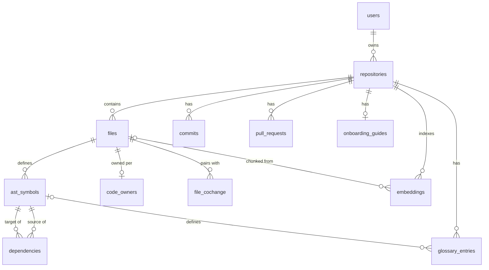
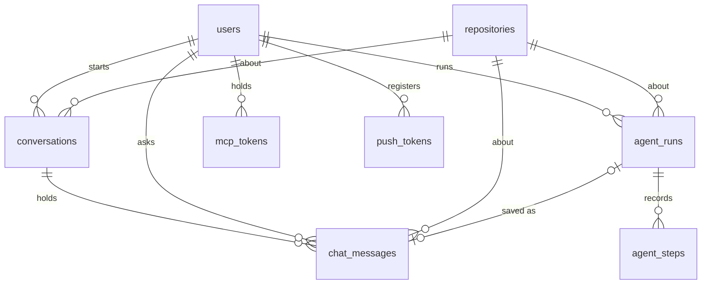

# Data model

Illume stores everything in one Postgres database with the `pgvector` and `pg_trgm` extensions: 17 tables, defined as SQLAlchemy models in [`server/app/models/`](../../server/app/models/) and created by 36 Alembic revisions in [`server/alembic/versions/`](../../server/alembic/versions/). This page lists every table with its columns, keys, indexes and cascades, explains the few columns whose meaning is not obvious, and lists every migration in order. It is a reference: the pages linked from each table explain how the data is produced and read.

## Terms used on this page

- **Model**: a SQLAlchemy class mapped to one table.
- **Cascade**: `ON DELETE CASCADE` on a foreign key, so deleting the parent deletes the child rows in the database itself, without the ORM loading them.
- **JSONB**: Postgres's binary JSON column type.
- **Revision**: one Alembic migration file. The revisions form a single linear chain; the head is `d9e0f1a2b3c4`.

## The tables at a glance

| Table               | Model                                                            | One row is                                            | Parent                  | Explained in                                                                      |
| ------------------- | ---------------------------------------------------------------- | ----------------------------------------------------- | ----------------------- | --------------------------------------------------------------------------------- |
| `users`             | [`User`](../../server/app/models/user.py)                        | an account                                            |                         | [Authentication](../security/auth.md), [BYOK](../security/byok-and-encryption.md) |
| `repositories`      | [`Repository`](../../server/app/models/repository.py)            | one ingested repository of one user                   | `users`                 | [Ingestion](../pipeline/ingestion.md), [sync](../pipeline/sync.md)                |
| `files`             | [`File`](../../server/app/models/file.py)                        | a source file                                         | `repositories`          | [Parsing](../pipeline/parsing-and-dependencies.md)                                |
| `ast_symbols`       | [`AstSymbol`](../../server/app/models/ast_symbol.py)             | a function, class, method, import, variable or module | `files`                 | [Parsing](../pipeline/parsing-and-dependencies.md)                                |
| `dependencies`      | [`Dependency`](../../server/app/models/dependency.py)            | an import edge between two symbols                    | `ast_symbols`           | [The dependency graph](../graph/dependency-graph.md)                              |
| `commits`           | [`Commit`](../../server/app/models/commit.py)                    | a commit from the analysed history                    | `repositories`          | [Git intelligence](../pipeline/git-intelligence.md)                               |
| `pull_requests`     | [`PullRequest`](../../server/app/models/pull_request.py)         | a merged pull request                                 | `repositories`          | [Git intelligence](../pipeline/git-intelligence.md)                               |
| `code_owners`       | [`CodeOwner`](../../server/app/models/code_owner.py)             | ownership of one file                                 | `files`                 | [Git intelligence](../pipeline/git-intelligence.md)                               |
| `file_cochange`     | [`FileCochange`](../../server/app/models/file_cochange.py)       | a pair of files that change together                  | `files`                 | [Git intelligence](../pipeline/git-intelligence.md#co-change)                     |
| `glossary_entries`  | [`GlossaryEntry`](../../server/app/models/glossary_entry.py)     | a glossary term                                       | `repositories`          | [Generation](../pipeline/generation.md)                                           |
| `onboarding_guides` | [`OnboardingGuide`](../../server/app/models/onboarding_guide.py) | the reading order and brief of one repository         | `repositories`          | [Generation](../pipeline/generation.md)                                           |
| `embeddings`        | [`Embedding`](../../server/app/models/embedding.py)              | one retrievable chunk and its vector                  | `repositories`          | [Index and embeddings](../retrieval/index-and-embeddings.md)                      |
| `conversations`     | [`Conversation`](../../server/app/models/conversation.py)        | a chat thread                                         | `users`, `repositories` | [Chat](../retrieval/chat.md)                                                      |
| `chat_messages`     | [`ChatMessage`](../../server/app/models/chat_message.py)         | one question and its answer                           | `conversations`         | [Chat](../retrieval/chat.md)                                                      |
| `agent_runs`        | [`AgentRun`](../../server/app/models/agent_run.py)               | one answer run of any preset                          | `users`, `repositories` | [The agent](../retrieval/agent.md#persistence)                                    |
| `agent_steps`       | [`AgentStep`](../../server/app/models/agent_step.py)             | one step of a run                                     | `agent_runs`            | [The agent](../retrieval/agent.md#persistence)                                    |
| `mcp_tokens`        | [`McpToken`](../../server/app/models/mcp_token.py)               | a personal access token for MCP clients               | `users`                 | [Authentication](../security/auth.md#mcp-tokens)                                  |
| `push_tokens`       | [`PushToken`](../../server/app/models/push_token.py)             | one mobile device's push token                        | `users`                 | [Mobile](../mobile/overview.md)                                                   |

[`encrypted.py`](../../server/app/models/encrypted.py) is not a table: it defines `EncryptedString`, the column type that encrypts `users.github_access_token` and `users.ai_api_key` at rest.

## Relationships

### Repository data

### Accounts, chat and runs

Every foreign key cascades except two `SET NULL` links between a run and its chat turn. Deleting a user deletes everything they own; deleting a repository deletes every row derived from it. That is what makes [re-ingest](../pipeline/ingestion.md) (delete the repository row, recreate it with the same id) a clean slate.

## Table reference

Columns are listed as the model declares them. "PK" is the primary key; UUID primary keys default to `gen_random_uuid()` or a Python `uuid4`.

### `users`

| Column                    | Type              | Notes                                                         |
| ------------------------- | ----------------- | ------------------------------------------------------------- |
| `id`                      | UUID PK           |                                                               |
| `name`                    | string            | required                                                      |
| `email`                   | string            | unique, indexed                                               |
| `password`                | string, null      | bcrypt over a SHA-256 pre-hash; null for GitHub-only accounts |
| `avatar_url`              | string, null      |                                                               |
| `github_id`               | string, null      | unique                                                        |
| `github_access_token`     | encrypted, null   | used to clone private repositories and call the GitHub API    |
| `created_at`              | timestamptz       | `now()`                                                       |
| `ai_provider`             | string, null      | the user's own key's provider                                 |
| `ai_api_key`              | encrypted, null   | the user's own key                                            |
| `ai_model`                | string, null      |                                                               |
| `ai_key_validated_at`     | timestamptz, null | when the save-time probe last succeeded                       |
| `ai_supports_tools`       | bool, null        | **null means "not measured"**, distinct from `false`          |
| `ai_tools_checked_at`     | timestamptz, null |                                                               |
| `ai_context_window`       | int, null         | null means "use the default window"                           |
| `free_ingestions_used`    | int               | default 0                                                     |
| `free_chat_messages_used` | int               | default 0                                                     |

`EncryptedString` encrypts with a fresh IV on every write, so equality comparisons against an encrypted column never match; only `IS NULL` and `IS NOT NULL` work. A value without the envelope prefix is a row from before encryption and is returned as is. See [BYOK and encryption](../security/byok-and-encryption.md).

### `repositories`

| Column                               | Type               | Notes                                                                     |
| ------------------------------------ | ------------------ | ------------------------------------------------------------------------- |
| `id`                                 | UUID PK            | kept across re-ingest                                                     |
| `repo_number`                        | int                | `Identity()`, unique across the table; most list and get routes key on it |
| `user_id`                            | UUID FK users      | cascade                                                                   |
| `github_url`, `name`                 | string             | required                                                                  |
| `default_branch`, `primary_language` | string, null       |                                                                           |
| `status`                             | enum `repo_status` | default `pending`; see below                                              |
| `detected_stack`                     | JSONB, null        | languages, frameworks, databases, infrastructure, CI                      |
| `entry_points`                       | JSONB, null        |                                                                           |
| `architecture_summary`               | text, null         | the brief's narrative                                                     |
| `ingested_branch`                    | string, null       | with the SHA below, the "snapshot"                                        |
| `ingested_commit_sha`                | string, null       | the commit the deterministic data reflects                                |
| `analysis_commit_sha`                | varchar(40), null  | the commit the LLM artefacts reflect                                      |
| `created_at`, `updated_at`           | timestamptz        |                                                                           |
| `auto_update_enabled`                | bool               | default false                                                             |
| `auto_update_interval_hours`         | int                | default 6                                                                 |
| `next_sync_at`, `last_synced_at`     | timestamptz, null  |                                                                           |
| `sync_status`                        | varchar(32)        | default `idle`; `idle`, `queued`, `checking`, `updating`, `failed`        |
| `sync_lease_expires_at`              | timestamptz, null  | the lease that stops a killed sync locking the row forever                |
| `sync_generation`                    | UUID, null         | the claim token a sweep writes                                            |
| `last_sync_error`                    | text, null         |                                                                           |
| `consecutive_sync_failures`          | int                | default 0; drives back-off                                                |
| `last_sync_summary`                  | JSONB, null        |                                                                           |

Index: `ix_repositories_next_sync_due` on `next_sync_at`, partial `WHERE auto_update_enabled`, which is what the sweep scans.

**The status enum drifts.** The model declares `pending, cloning, parsing, embedding, analyzing, ready, failed`; the database type was created with `scoring` where the model has `analyzing`. Nothing writes either value, so the drift is unreachable, but assigning `analyzing` would fail against the real column. The pipeline writes only `pending`, `cloning`, `parsing`, `embedding`, `ready` and `failed`.

**`repo_number` is unique across all users**, not per user, despite often being described as user-scoped; every route that takes it also filters by `user_id`.

### `files`

| Column                | Type              | Notes                                       |
| --------------------- | ----------------- | ------------------------------------------- |
| `id`                  | UUID PK           |                                             |
| `repository_id`       | UUID FK           | cascade                                     |
| `path`                | string            | repository-relative                         |
| `language`, `loc`     | string, int, null |                                             |
| `fan_in`, `fan_out`   | int               | default 0, written by `compute_fan_metrics` |
| `criticality`         | string, null      | `critical`, `caution` or `safe`             |
| `criticality_reasons` | JSONB, null       | the reasons behind the label                |
| `change_frequency`    | float, null       |                                             |
| `has_tests`           | bool              | written by the git analyzer                 |
| `git_last_modified`   | timestamptz, null | written by the git analyzer                 |
| `created_at`          | timestamptz       |                                             |

Constraint `uq_file_repo_path (repository_id, path)` backs the parse stage's `ON CONFLICT DO NOTHING`. Indexes `ix_files_repository_id`, `ix_files_path`.

### `ast_symbols`

| Column                   | Type               | Notes                                                         |
| ------------------------ | ------------------ | ------------------------------------------------------------- |
| `id`                     | UUID PK            |                                                               |
| `file_id`                | UUID FK files      | cascade                                                       |
| `kind`                   | enum `symbol_kind` | `function`, `class`, `method`, `import`, `variable`, `module` |
| `name`                   | string             |                                                               |
| `start_line`, `end_line` | int, null          |                                                               |
| `source_code`            | text, null         | the symbol's full text                                        |
| `cyclomatic_complexity`  | int, null          |                                                               |
| `docstring`              | text, null         |                                                               |
| `created_at`             | timestamptz        |                                                               |

Indexes:

- `ix_ast_symbols_file_id` and `ix_ast_symbols_file_id_kind`;
- `ix_ast_symbols_name_trgm` and `ix_ast_symbols_source_trgm`, GIN trigram indexes on `name` and `source_code`, **partial** on `kind IN ('function', 'class', 'method')`. They serve fuzzy symbol lookup and grep; a query uses them only if it repeats the same `kind` predicate.

### `dependencies`

| Column             | Type                | Notes                                                                     |
| ------------------ | ------------------- | ------------------------------------------------------------------------- |
| `id`               | UUID PK             |                                                                           |
| `source_symbol_id` | UUID FK ast_symbols | cascade                                                                   |
| `target_symbol_id` | UUID FK ast_symbols | cascade                                                                   |
| `dep_type`         | enum `dep_type`     | `imports`, `calls`, `inherits`, `instantiates`; only `imports` is written |

`uq_dependency_edge (source_symbol_id, target_symbol_id)`, plus an index on each end.

### `commits`

`id`, `repository_id` (cascade), `hash`, `author_name`, `author_email`, `message`, `files_changed` (int, default 0), `changed_files_list` (JSONB list of paths), `authored_at`. Constraint `uq_commit_repo_hash (repository_id, hash)`. An earlier global unique constraint on `hash` alone was dropped, because two users ingesting the same repository share commit hashes.

### `pull_requests`

`id`, `repository_id` (cascade), `number`, `title`, `description` (null), `author`, `reviewers` (JSONB), `files_changed`, `merged_at`. Constraint `uq_pr_repo_number (repository_id, number)`.

### `code_owners`

`id`, `file_id` (cascade, **unique**: one row per file), `primary_owner`, `contributors` (JSONB), `bus_factor` (default 0), `is_knowledge_silo` (default false).

### `file_cochange`

| Column               | Type        | Notes                                       |
| -------------------- | ----------- | ------------------------------------------- |
| `file_a_id`          | UUID PK, FK | cascade                                     |
| `file_b_id`          | UUID PK, FK | cascade                                     |
| `repository_id`      | UUID FK     | cascade                                     |
| `together`           | int         | commits touching both                       |
| `a_count`, `b_count` | int         | commits touching each                       |
| `jaccard`            | float       | `together / (a_count + b_count - together)` |

`ck_file_cochange_ordered_pair` enforces `file_a_id < file_b_id`, so each unordered pair is stored once. Indexes on `repository_id` and `file_b_id` (the primary key already covers lookups by `file_a_id`).

### `glossary_entries`

`id`, `repository_id` (cascade), `symbol_id` (null, cascade), `name`, `definition`, `file_path` (null), `line_number` (null).

### `onboarding_guides`

`id`, `repository_id` (cascade, **unique**: one guide per repository), `reading_order` (JSONB list of entries with position, tier, path, annotation and fan-in), `critical_files` (JSONB), `architecture_brief` (JSONB), `pdf_path` (text, unused), `created_at`, `updated_at`.

### `embeddings`

| Column          | Type              | Notes                                                                                                |
| --------------- | ----------------- | ---------------------------------------------------------------------------------------------------- |
| `id`            | UUID PK           |                                                                                                      |
| `source_id`     | UUID              | the symbol, commit, PR or file id; not a foreign key                                                 |
| `file_id`       | UUID FK, null     | cascade                                                                                              |
| `repository_id` | UUID FK           | cascade                                                                                              |
| `chunk_text`    | text              | the rendered chunk                                                                                   |
| `embedding`     | `vector(1536)`    | `text-embedding-3-small`; changing the model is a migration                                          |
| `source_type`   | string enum       | `symbol`, `commit`, `pull_request`, `document`, `file` (`native_enum=False`, so a check, not a type) |
| `chunk_hash`    | varchar(64), null | hash of `chunk_text`, used by incremental embedding                                                  |
| `search_tsv`    | tsvector          | generated and stored from `chunk_text`; deferred, so never loaded by the ORM                         |

Indexes: `ix_embeddings_repository_id`, `ix_embeddings_embedding_hnsw` (HNSW with `vector_cosine_ops`), `ix_embeddings_search_tsv` (GIN). Constraint `uq_embedding_source (repository_id, source_type, source_id)`. The HNSW index is **declared on the model** so that autogenerate does not drop it again, which is what happened to the first one. Full detail: [index and embeddings](../retrieval/index-and-embeddings.md).

### `conversations`

`id`, `user_id` (cascade), `repository_id` (cascade), `title` (text), `created_at`, `updated_at`. Index `ix_conversations_user_repo_updated (user_id, repository_id, updated_at DESC)`, the order the sidebar lists them in.

### `chat_messages`

| Column                                        | Type          | Notes                                                |
| --------------------------------------------- | ------------- | ---------------------------------------------------- |
| `id`                                          | UUID PK       |                                                      |
| `repository_id`, `user_id`                    | UUID FK       | cascade                                              |
| `conversation_id`                             | UUID FK       | cascade, indexed, not null                           |
| `question`, `answer`                          | text          |                                                      |
| `sources`                                     | JSONB, null   | the citation list, so history reloads with citations |
| `agent_run_id`                                | UUID FK, null | `SET NULL` when the run is deleted                   |
| `created_at`                                  | timestamptz   |                                                      |
| `answered_commit_sha`                         | string, null  | the snapshot the answer was given against            |
| `cited_paths`                                 | JSONB, null   | files the answer cited                               |
| `stale_at`, `stale_paths`, `stale_commit_sha` | null          | written by a sync when cited files change            |

See [stale answers](../pipeline/git-intelligence.md#stale-answers).

### `agent_runs`

| Column                                                      | Type             | Notes                                                                                          |
| ----------------------------------------------------------- | ---------------- | ---------------------------------------------------------------------------------------------- |
| `id`                                                        | UUID PK          |                                                                                                |
| `user_id`, `repository_id`                                  | UUID FK          | cascade                                                                                        |
| `chat_message_id`                                           | UUID FK, null    | `SET NULL`; set when the turn is saved, `use_alter` because the two tables point at each other |
| `question`                                                  | text             |                                                                                                |
| `standalone_question`                                       | text, null       | the question rewritten without its history                                                     |
| `preset`                                                    | text             | the resolved preset, never `auto`                                                              |
| `config`                                                    | JSONB            | the full resolved configuration                                                                |
| `config_hash`                                               | char(64)         |                                                                                                |
| `prompt_version`, `model`, `decider`, `ingested_commit_sha` | text, null       |                                                                                                |
| `status`                                                    | text             | default `running`                                                                              |
| `stop_reason`, `answer`, `error`                            | text, null       |                                                                                                |
| `citations`                                                 | JSONB list, null |                                                                                                |
| `usage`                                                     | JSONB, null      | token counts                                                                                   |
| `tool_calls`, `iterations`, `latency_ms`                    | int, null        |                                                                                                |
| `created_at`, `finished_at`                                 | timestamptz      |                                                                                                |

Index `ix_agent_runs_user_repo_created (user_id, repository_id, created_at)`.

### `agent_steps`

`id`, `run_id` (cascade), `seq` (int), `worker_id` (null; set for planner workers), `kind` (text), `name` (text), `payload` (JSONB), `tokens_in`, `tokens_out` (null), `latency_ms` (default 0), `created_at`. Constraint `uq_agent_steps_run_seq (run_id, seq)`; index `ix_agent_steps_created_at`, used by retention pruning.

### `mcp_tokens`

`id`, `user_id` (cascade, indexed), `name` (varchar 60), `token_prefix` (varchar 16, shown in the UI), `token_hash` (varchar 64, unique and indexed: the SHA-256 digest and the lookup path), `created_at`, `last_used_at`, `expires_at`, `revoked_at`. The token itself is never stored.

### `push_tokens`

`id`, `user_id` (cascade, indexed), `token` (unique across the table, so a device can move between accounts), `platform` (varchar 16, `ck_push_tokens_platform` allows `android` and `ios`), `created_at`, `updated_at`.

## Migrations

`alembic/env.py` imports all 17 model modules explicitly. A new model module must be added there, or autogenerate will not see it.

Several later revisions are hand-written and idempotent (`IF NOT EXISTS`, checks against `pg_constraint`), because the test database is migrated once per pytest-xdist worker and several workers can reach an unmigrated database at the same moment. See [backend testing](../testing/backend.md).

| #   | Revision       | Date       | What it does                                                                                                                                                                                                                                                                                        |
| --- | -------------- | ---------- | --------------------------------------------------------------------------------------------------------------------------------------------------------------------------------------------------------------------------------------------------------------------------------------------------- |
| 1   | `ec40440330d3` | 2026-04-08 | creates `users`, `repositories`, `files`, `ast_symbols`, `dependencies`, `embeddings` and `health_metrics`, and the `vector` extension                                                                                                                                                              |
| 2   | `8cffbb1cf735` | 2026-04-09 | recreates foreign keys with `ON DELETE CASCADE`                                                                                                                                                                                                                                                     |
| 3   | `2ffeeb4ce948` | 2026-04-09 | more cascading foreign keys                                                                                                                                                                                                                                                                         |
| 4   | `3d6ee06b4ec6` | 2026-04-10 | auth: adds `users.email`, `name`, `password`; drops `username` and `github_id`                                                                                                                                                                                                                      |
| 5   | `aff92caa271e` | 2026-04-15 | creates `commits`, `pull_requests`, `code_owners`, `glossary_entries`, `onboarding_guides`; adds fan metrics, criticality and `has_tests` to `files`, stack, entry points, summary and `repo_number` to `repositories`, `docstring` to `ast_symbols`, `source_id` and `source_type` to `embeddings` |
| 6   | `e5f221c31fc2` | 2026-04-15 | adds `uq_commit_repo_hash` and `uq_pr_repo_number`                                                                                                                                                                                                                                                  |
| 7   | `570a9dabb547` | 2026-04-15 | unique `code_owners.file_id` and a global unique `commits.hash`                                                                                                                                                                                                                                     |
| 8   | `e8dffd71f0da` | 2026-04-15 | adds `files.git_last_modified`                                                                                                                                                                                                                                                                      |
| 9   | `b90f023a9981` | 2026-04-15 | reshapes `embeddings.source_id`, drops `source_type`                                                                                                                                                                                                                                                |
| 10  | `1c993ad52c53` | 2026-04-15 | re-adds `embeddings.source_type`                                                                                                                                                                                                                                                                    |
| 11  | `650508da1616` | 2026-04-16 | changes `onboarding_guides.architecture_brief` to JSONB                                                                                                                                                                                                                                             |
| 12  | `8d8c3934e9f4` | 2026-04-17 | drops `health_metrics` and `repositories.summary`                                                                                                                                                                                                                                                   |
| 13  | `6a7706111825` | 2026-04-18 | more cascading foreign keys                                                                                                                                                                                                                                                                         |
| 14  | `c64d0bfafa27` | 2026-05-14 | re-adds `users.github_id` (unique) and makes `password` nullable, for GitHub-only accounts                                                                                                                                                                                                          |
| 15  | `005c608e801e` | 2026-05-28 | creates `chat_messages`                                                                                                                                                                                                                                                                             |
| 16  | `4a3abf082a58` | 2026-05-31 | adds `commits.changed_files_list`                                                                                                                                                                                                                                                                   |
| 17  | `b4e7be529e5b` | 2026-06-23 | adds `repositories.ingested_branch` and `ingested_commit_sha`                                                                                                                                                                                                                                       |
| 18  | `e934fbe8247e` | 2026-09-12 | drops the global unique constraint on `commits.hash`                                                                                                                                                                                                                                                |
| 19  | `a1b2c3d4e5f6` | 2026-09-20 | adds `uq_file_repo_path`, removing existing duplicates first                                                                                                                                                                                                                                        |
| 20  | `4b8d6e2a97f1` | 2026-09-20 | creates the foreign-key indexes on `files`, `ast_symbols`, `dependencies` and `embeddings`, one per autocommit block (`CREATE INDEX CONCURRENTLY`)                                                                                                                                                  |
| 21  | `4c5d6e7f8a01` | 2026-09-21 | adds `embeddings.chunk_hash`                                                                                                                                                                                                                                                                        |
| 22  | `5d6e7f8a01b2` | 2026-09-22 | auto-update columns and `analysis_commit_sha` on `repositories`; `uq_dependency_edge` and `uq_embedding_source`                                                                                                                                                                                     |
| 23  | `c3d4e5f6a7b8` | 2026-09-26 | user-key columns and free-tier counters on `users`                                                                                                                                                                                                                                                  |
| 24  | `d4e5f6a7b8c9` | 2026-10-02 | gives `repo_number` an identity generator, unless it already has a default                                                                                                                                                                                                                          |
| 25  | `e5f6a7b8c9d0` | 2026-10-04 | replaces the boolean free-ingestion flag with `free_ingestions_used`                                                                                                                                                                                                                                |
| 26  | `f6a7b8c9d0e1` | 2026-10-21 | creates `push_tokens`                                                                                                                                                                                                                                                                               |
| 27  | `a7b8c9d0e1f2` | 2026-11-02 | restores the HNSW index on `embeddings.embedding`                                                                                                                                                                                                                                                   |
| 28  | `b8c9d0e1f2a3` | 2026-11-02 | adds `ai_supports_tools` and `ai_tools_checked_at`                                                                                                                                                                                                                                                  |
| 29  | `c9d0e1f2a3b4` | 2026-11-02 | `pg_trgm`, `embeddings.search_tsv` with its GIN index, the trigram indexes on `ast_symbols`, and `file_cochange`                                                                                                                                                                                    |
| 30  | `d0e1f2a3b4c5` | 2026-11-06 | adds `users.ai_context_window`                                                                                                                                                                                                                                                                      |
| 31  | `e1f2a3b4c5d6` | 2026-11-07 | creates `agent_runs` and `agent_steps`; adds `chat_messages.agent_run_id` (`NOT VALID`, then validated)                                                                                                                                                                                             |
| 32  | `f2a3b4c5d6e7` | 2026-11-11 | drops `agent_runs.verification`, which nothing read                                                                                                                                                                                                                                                 |
| 33  | `a3b4c5d6e7f8` | 2026-11-11 | adds the staleness columns to `chat_messages`                                                                                                                                                                                                                                                       |
| 34  | `b7c8d9e0f1a2` | 2026-11-14 | creates `mcp_tokens`                                                                                                                                                                                                                                                                                |
| 35  | `c8d9e0f1a2b3` | 2026-11-16 | creates `conversations` and attaches every existing message to one per user and repository, titled from its first question                                                                                                                                                                          |
| 36  | `d9e0f1a2b3c4` | 2026-11-25 | encrypts every stored GitHub token and AI key with `CREDENTIAL_ENCRYPTION_KEY`; already-encrypted values are skipped                                                                                                                                                                                |

Revisions 1 to 18 are autogenerated and have no upgrade docstrings; the summaries above are from their operations. Revisions 19 onward are documented in their own docstrings.

### Notable migration hazards

- **`repo_number` without a generator.** Revision 5 added `repo_number` as a plain `integer NOT NULL`; the `autoincrement=True` it passed does nothing on a non-primary-key `ADD COLUMN`, so a database built from migrations alone could not create a repository until revision 24. Production had been fixed by hand with a sequence default, which revision 24 detects and leaves alone.
- **The dropped HNSW index.** An autogenerated revision removed the vector index because the model did not declare it. Revision 27 restored it and the model now declares it.
- **A table rewrite.** Revision 29 adds a stored generated column, which rewrites `embeddings` under an exclusive lock; on a large table that blocks reads and writes for the duration.
- **Running migrations points at production.** `alembic/env.py` reads `SYNC_DATABASE_URL` from `server/.env`, which in a development checkout is the production database. See [changing the schema](../guides/change-the-schema.md).

## Design trade-offs and limits

- **Cascades everywhere.** Deletion is simple and complete, but one mistaken repository delete removes every derived row with no soft-delete or undo.
- **Polymorphic `source_id`.** `embeddings.source_id` points at different tables depending on `source_type` and has no foreign key, so orphaned rows are possible if a source is deleted without its embedding. Most sources cascade through `file_id` or `repository_id` anyway.
- **Unused columns and values.** `onboarding_guides.pdf_path`, the `calls`, `inherits` and `instantiates` edge types, and the `analyzing` status are declared and never written.
- **Model and database drift.** The `repo_status` enum differs between the model and the database.
- **JSONB for structure.** Reading orders, briefs, citations and stacks are JSONB, which keeps writes simple but leaves their shape to the code, not the schema.

## Related documentation

- [Changing the schema](../guides/change-the-schema.md): how to add a migration safely.
- [Environment variables](environment.md): `DATABASE_URL`, `SYNC_DATABASE_URL` and the encryption key.
- [Architecture](../architecture.md): where each table is written and read.
- [Index and embeddings](../retrieval/index-and-embeddings.md): the `embeddings` table in depth.
