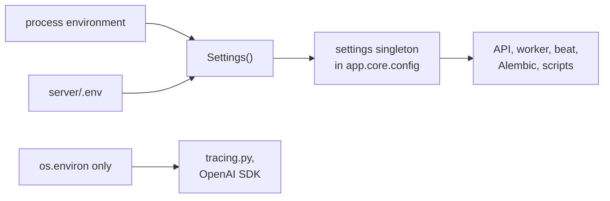

# Environment variables

Illume's backend is configured by one Pydantic `Settings` class in [`app/core/config.py`](../../server/app/core/config.py), read from the process environment and `server/.env`. A handful of variables bypass `Settings` and are read straight from `os.environ`, the web and mobile clients each read one public variable, and the test, end-to-end, eval and production-smoke harnesses have their own. This page lists every one of them, what reads it, its default, and what happens when it is empty. It contains no values.

## Terms used on this page

- **Required**: the field has no default, so `Settings()` raises a pydantic `ValidationError` at import time when it is missing. An empty string still counts as present.
- **Operator**: whoever runs the Illume deployment and pays for its server-side keys.
- **Free tier**: requests from users without their own AI key, which run on the operator's `AI_API_KEY`. See [BYOK and encryption](../security/byok-and-encryption.md).

## How settings load



- `model_config = SettingsConfigDict(env_file=".env", extra="ignore")`. The environment wins over `.env`; unknown variables are ignored.
- `settings = Settings()` runs when `app.core.config` is first imported. Always import that object (`from app.core.config import settings`); never construct `Settings()` yourself.
- **Every process that imports anything under `app` needs the full set of required fields.** A fresh checkout, a CI job or a standalone script fails at import otherwise. When a process does not need configuration, move its import rather than adding an environment block; `server/scripts/openai_stub_server.py` stays configuration-free by importing its one constant from `tests/fixtures/openai_stub`.
- `.env` is gitignored. [`server/.env.example`](../../server/.env.example) lists every variable with comments.
- **In a development checkout, `server/.env` points at production.** Alembic reads `SYNC_DATABASE_URL` from it, so `alembic upgrade head` from a laptop migrates the production database. See [changing the schema](../guides/change-the-schema.md).

## Backend `Settings` fields

| Variable                             | Type | Default            | Read by                                                                 | When empty or wrong                                                                                                                    |
| ------------------------------------ | ---- | ------------------ | ----------------------------------------------------------------------- | -------------------------------------------------------------------------------------------------------------------------------------- |
| `DATABASE_URL`                       | str  | required           | async engine (`postgresql+asyncpg://`) in `core/database.py`            | the API cannot start                                                                                                                   |
| `SYNC_DATABASE_URL`                  | str  | required           | sync engine (`postgresql://`, psycopg2): Celery tasks, Alembic, scripts | the worker and migrations cannot connect                                                                                               |
| `REDIS_URL`                          | str  | required           | Celery broker and results, ingest log channel, run slots, rate limits   | no ingests, no live progress                                                                                                           |
| `OPENAI_API_KEY`                     | str  | required           | embeddings (`text-embedding-3-small`) in `embedder.py` and retrieval    | ingest fails at embedding; chat cannot embed the question                                                                              |
| `AI_MODEL`                           | str  | required           | `LLMConfig.server_default()` only                                       | empty means the DeepSeek registry default                                                                                              |
| `AI_API_KEY`                         | str  | `""`               | `LLMConfig.server_default()`, the free tier                             | the free tier is off: a keyless user gets 402                                                                                          |
| `AI_BASE_URL`                        | str  | `""`               | `LLMConfig.server_default()`                                            | empty means `https://api.deepseek.com`, without `/v1`                                                                                  |
| `OPENROUTER_API_KEY`                 | str  | `""`               | the Jev decider and reranker, the Cohere reranker, the auto router      | Jev and Cohere are unavailable; reranks answer from the fused order, decisions fall back to the user's model, `auto` runs `structural` |
| `ACCESS_TOKEN_EXPIRE_MINUTES`        | int  | required           | `core/security.py`, web JWT lifetime                                    |                                                                                                                                        |
| `MOBILE_TOKEN_EXPIRE_MINUTES`        | int  | `129600` (90 days) | JWTs for requests with `X-Illume-Client: mobile`                        |                                                                                                                                        |
| `SECRET_KEY`                         | str  | required           | JWT signing (HS256)                                                     | rotating it signs everyone out                                                                                                         |
| `CREDENTIAL_ENCRYPTION_KEY`          | str  | required           | `core/crypto.py`, encrypting AI keys and GitHub tokens                  | at least 32 characters; **losing it makes every stored credential unreadable**                                                         |
| `CREDENTIAL_ENCRYPTION_KEY_PREVIOUS` | str  | `""`               | `core/crypto.py`, decryption fallbacks                                  | comma-separated earlier keys, for rotation without re-encryption                                                                       |
| `FRONTEND_URL`                       | str  | required           | CORS allowed origin, OAuth redirects                                    | the browser's requests are refused by CORS                                                                                             |
| `ENVIRONMENT`                        | str  | `"development"`    | the session cookie is `Secure` only when this is `production`           |                                                                                                                                        |
| `DOMAIN`                             | str  | required           | the session cookie's `Domain` attribute                                 | a bare hostname: a scheme or port makes the cookie invalid, so logins silently do not stick                                            |
| `GITHUB_CLIENT_ID`                   | str  | required           | GitHub OAuth                                                            |                                                                                                                                        |
| `GITHUB_CLIENT_SECRET`               | str  | required           | GitHub OAuth                                                            |                                                                                                                                        |
| `GITHUB_REDIRECT_URL`                | str  | required           | GitHub OAuth callback                                                   |                                                                                                                                        |
| `OAUTH_REDIRECT_ALLOWLIST`           | list | `[]`               | the OAuth callback's `redirect_uri` for native clients                  | exact matches only; empty disables the parameter                                                                                       |
| `RESEND_API_KEY`                     | str  | required           | the contact form                                                        | empty: the contact endpoint answers 503                                                                                                |
| `CONTACT_TO_EMAIL`                   | str  | required           | the contact form's recipient                                            | empty: 503                                                                                                                             |
| `CONTACT_FROM_EMAIL`                 | str  | required           | the contact form's `From`                                               | a bare address on a Resend-verified domain, no quotes or display name                                                                  |

Notes:

- The contact variables are **required but may be empty**: the field must exist, but an empty value disables the endpoint rather than failing start-up.
- `OAUTH_REDIRECT_ALLOWLIST` is a list; pydantic-settings parses it from JSON (`["illume://auth/callback"]`). Typical entries are the production app scheme and the Expo development client's.
- `CONTACT_FROM_EMAIL` is passed through Docker's `--env-file`, which does no quote processing, so quotes would become part of the value.
- Tunable constants for auto-update, the clone cache, retrieval and the agent are deliberately **not** settings; they are module-level constants changed by a code change and a deploy. See [constants](constants.md).

## Variables read outside `Settings`

| Variable                 | Read by                                                       | Effect                                                                                                                                                     |
| ------------------------ | ------------------------------------------------------------- | ---------------------------------------------------------------------------------------------------------------------------------------------------------- |
| `OPENAI_BASE_URL`        | the OpenAI SDK itself, for the embedding client               | redirects every embedding call. The end-to-end suite points it at a stub. Never pass `base_url` to the embedding client in code; this variable is the seam |
| `LANGSMITH_TRACING`      | [`services/tracing.py`](../../server/app/services/tracing.py) | tracing of the chat path is on only when this is `true`                                                                                                    |
| `LANGSMITH_API_KEY`      | `tracing.py`, the LangSmith client                            | must also be non-empty for tracing                                                                                                                         |
| `LANGSMITH_PROJECT`      | the LangSmith client                                          | the project runs are filed under                                                                                                                           |
| `LANGSMITH_HIDE_INPUTS`  | the LangSmith client                                          | set in production, so questions and context are not uploaded                                                                                               |
| `LANGSMITH_HIDE_OUTPUTS` | the LangSmith client                                          | set in production, so answers are not uploaded                                                                                                             |

Both tracing checks are read from `os.environ` on every call, so an environment without them behaves as if tracing did not exist. Only the chat and agent path is wrapped; ingestion and sync model calls are never traced.

Git subprocesses run with `GIT_ASKPASS=echo`, `GIT_TERMINAL_PROMPT=0`, and `GIT_CONFIG_GLOBAL` and `GIT_CONFIG_SYSTEM` set to the null device (`repo_cache._git_env`), so a credential prompt fails fast and a developer's git configuration cannot change how an untrusted remote is fetched. These are set by the code, not by the operator.

## Clients

| Variable                  | App                                     | Meaning                                                                                                                                                      |
| ------------------------- | --------------------------------------- | ------------------------------------------------------------------------------------------------------------------------------------------------------------ |
| `NEXT_PUBLIC_BACKEND_URL` | web client ([`client/`](../../client/)) | the API's absolute origin. Used by server components, server actions, client fetches and the WebSocket (with `http` swapped for `ws`). Inlined at build time |
| `EXPO_PUBLIC_BACKEND_URL` | mobile app ([`mobile/`](../../mobile/)) | the same, for the Expo app                                                                                                                                   |
| `CI`                      | the end-to-end Playwright configuration | forbids `.only`, switches reporters, and never reuses running servers                                                                                        |

There is no `rewrites` in `next.config.ts`: the browser talks to the backend origin directly, so `FRONTEND_URL` and `NEXT_PUBLIC_BACKEND_URL` must agree with each other for CORS and cookies to work.

## Test and harness variables

### Backend tests

[`server/tests/conftest.py`](../../server/tests/conftest.py) sets every required field with `os.environ.update` **before** `app.core.config` is imported, pointing at the test stack (Postgres on 5433, Redis on 6380), and asserts the database port is a test-stack port. Fields it does not set, notably `AI_API_KEY` and `OPENROUTER_API_KEY`, fall through to `server/.env` on a developer machine, which CI does not have. To reproduce CI locally:

```bash
AI_API_KEY= OPENROUTER_API_KEY= uv run pytest
```

`PYTEST_XDIST_WORKER` is read by the sample-repository fixture to keep workers' clones apart. See [backend testing](../testing/backend.md).

### End-to-end tests

[`client/e2e/env.ts`](../../client/e2e/env.ts) defines the environment for every server process Playwright starts, in one place, so the configuration and the seed script cannot drift apart.

| Variable                                | Default                 | Purpose                                                                        |
| --------------------------------------- | ----------------------- | ------------------------------------------------------------------------------ |
| `E2E_CLIENT_PORT`                       | 3000                    | Next.js port                                                                   |
| `E2E_API_PORT`                          | 8000                    | API port                                                                       |
| `E2E_STUB_PORT`                         | 8099                    | the OpenAI-compatible stub server                                              |
| `E2E_BASE_URL`                          | `http://localhost:8000` | [`scripts/seed_e2e.py`](../../server/scripts/seed_e2e.py): API to seed against |
| `E2E_EMAIL`, `E2E_PASSWORD`, `E2E_NAME` | test values             | the seeded account                                                             |
| `E2E_SEED_OUTPUT`                       | `e2e-seed.json`         | where the seed writes what it created                                          |

The suite's server environment sets `OPENAI_BASE_URL` and `AI_BASE_URL` to the stub and `DOMAIN=localhost`. `localhost`, not `127.0.0.1`, matters: the cookie domain must match the host the browser uses. See [frontend and end-to-end tests](../testing/frontend-and-e2e.md).

### Evals

The eval harness never reads `server/.env`. Importing [`evals/settings.py`](../../server/evals/settings.py) rewrites `os.environ` with every `Settings` field pinned to the isolated eval stack (Postgres on 5434, Redis on 6381), refuses to run if `app.core.config` was already imported against another stack, and asserts every URL is local. Keys come from `server/evals/.env.eval`:

| Key                                                                 | Purpose                                                                 |
| ------------------------------------------------------------------- | ----------------------------------------------------------------------- |
| `OPENAI_API_KEY`                                                    | embeddings                                                              |
| `AI_API_KEY`, `AI_BASE_URL`                                         | the generator                                                           |
| `OPENROUTER_API_KEY`                                                | Jev and Cohere                                                          |
| `GITHUB_TOKEN`                                                      | mining questions from GitHub; never exported under a name the app reads |
| `JUDGE_MODEL`, `JUDGE_BASE_URL`, `JUDGE_API_KEY`, `JUDGE_API_STYLE` | the judge endpoint; harness only                                        |

`evals/run/deepeval_env.py` forces DeepEval offline (telemetry off, no dotenv loading). A test compares the pinned field list against `Settings.model_fields`, so adding a `Settings` field without pinning it for evals fails the build. See [the eval harness](../evals/harness.md).

### Production smoke test

[`.github/workflows/prod-smoke.yml`](../../.github/workflows/prod-smoke.yml) drives the deployed site nightly with `SMOKE_BASE_URL`, `SMOKE_API_URL` and `SMOKE_REPO_NAME` (repository variables) and `SMOKE_EMAIL` and `SMOKE_PASSWORD` (secrets). Locally the same names go in `client/.env.smoke` (from [`.env.smoke.example`](../../client/.env.smoke.example)). Three optional variables move the suite's guard rails to another pair of origins: `SMOKE_ALLOWED_HOSTS` (the web hosts the browser may visit), `SMOKE_ALLOWED_API_HOSTS` (the API hosts it may call) and `SMOKE_COOKIE_DOMAIN` (the registrable domain the session cookie must be scoped to); their defaults are the production hosts.

### Scripts

[`scripts/probe_ai_provider.py`](../../server/scripts/probe_ai_provider.py) reads `PROBE_PROVIDER`, `PROBE_MODEL`, `PROBE_BASE_URL` and `PROBE_API_KEY` (falling back to `AI_API_KEY`). `tests/tools/agent_smoke.py` reads `AGENT_SMOKE_API_KEY`, `AGENT_SMOKE_PROVIDER` and `AGENT_SMOKE_MODEL`.

## Production

The droplet's containers all start with `--env-file /home/tejas/illume.env`, which holds the `Settings` fields and the LangSmith variables. CI's deploy workflow uses `DO_HOST`, `DO_SSH_KEY` and the built-in `GITHUB_TOKEN` secrets. See [deployment](../operations/deployment.md).

## Design trade-offs and limits

- **Everything required.** Most fields have no default, so configuration mistakes fail loudly at start-up, at the cost of making every import of `app` need a full environment.
- **Constants are not settings.** Tuning auto-update or retrieval needs a deploy, by design.
- **One `.env` for two jobs.** A developer's `.env` holds production credentials, which is why migrations and test runs need explicit overrides.
- **`AI_MODEL` is required but optional in meaning.** It must be present and may be empty.

## Related documentation

- [Local setup](../getting-started/local-setup.md): a working `.env` for development.
- [Constants](constants.md): the tunables that are deliberately not here.
- [BYOK and encryption](../security/byok-and-encryption.md): the keys and the encryption key.
- [Deployment](../operations/deployment.md): where production's environment lives.
