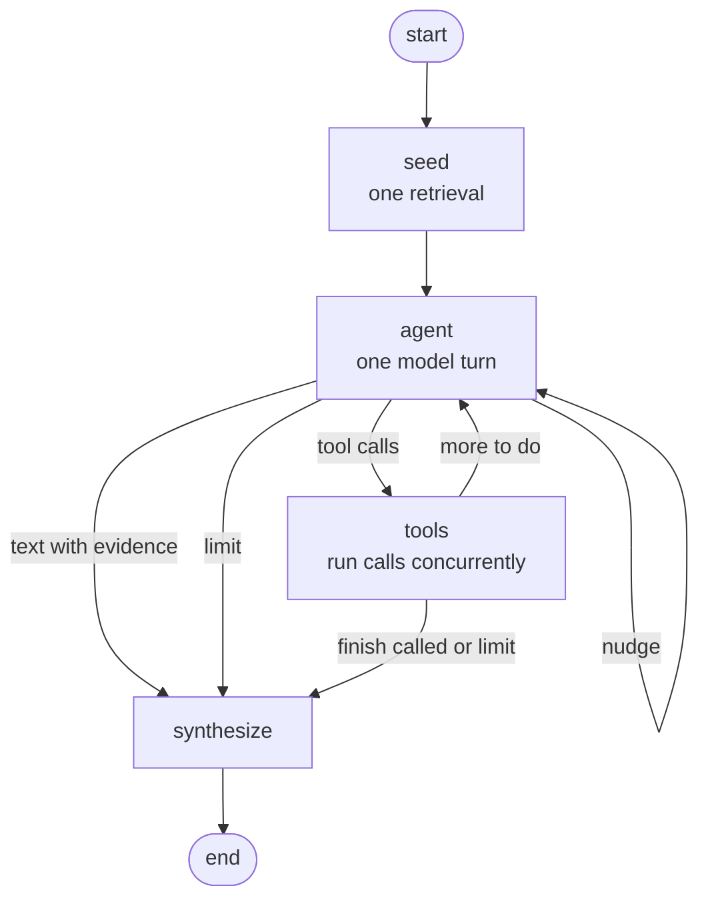
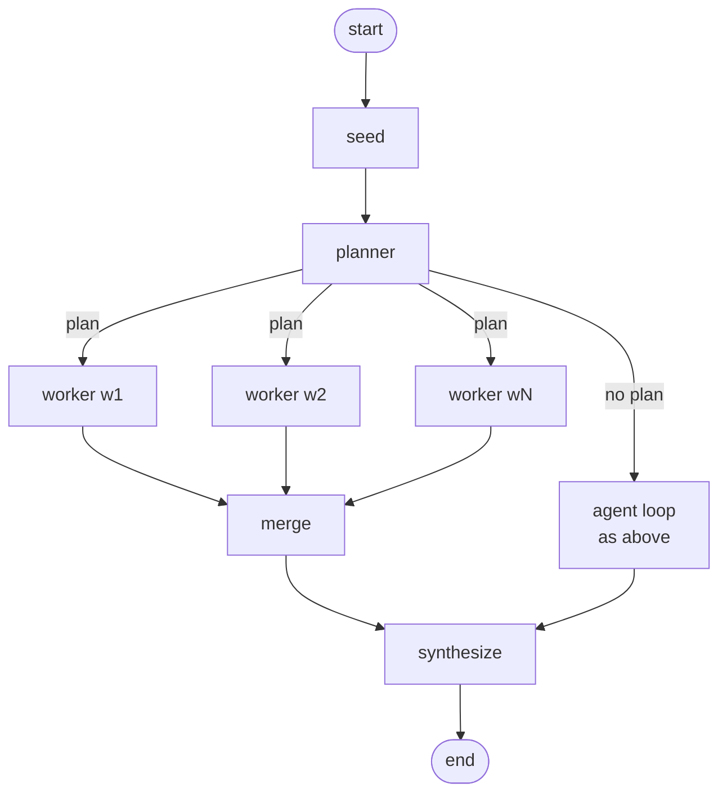

# The agent

The two agent presets, `deep_agent` and `deep_agent_workers`, answer a question by letting a model explore the repository with tools instead of retrieving once. The model reads the question and a first retrieval, decides what to look at, calls tools such as `search_code`, `get_importers` and `read_file`, reads the results, and repeats until it can answer with evidence. The loop is a [LangGraph](https://langchain-ai.github.io/langgraph/) state graph in [`services/agent`](../../server/app/services/agent/__init__.py), bounded by budgets on turns, tool calls, tokens and wall-clock time. This page covers the graph, every tool, the budgets and context management, planner mode with parallel workers, events, persistence, and how failures are handled.

## Terms used on this page

- **Turn** (or iteration): one model call. The model either requests tool calls or replies with text.
- **Tool call**: a request by the model to run one named tool with JSON arguments. Several can be requested in one turn and run concurrently.
- **Evidence**: every citable piece of repository text the run has seen, keyed by its [citation key](chat.md#citations). The answer may cite only evidence.
- **Seed**: one ordinary retrieval run before the first turn, so the model starts from what a single-shot answer would have seen.
- **Synthesis**: the final model call that writes the answer from the evidence when the loop ended without a finished answer.
- **Compaction**: replacing older tool outputs in the conversation with short stubs so the next call fits in the model's context window.
- **Planner mode**: `deep_agent_workers`, which can split a question into sub-questions and investigate them in parallel workers.
- **Stop reason**: why the loop ended, one of the values of `StopReason`.

## Who can run it

Agent presets need tool calling and cost many model calls, so:

- they run only on the user's own key; on the free tier the request is refused with 402 before anything starts;
- the user's model must support tool calling, which is probed once per key and cached (`ensure_tool_support`; see [BYOK](../security/byok-and-encryption.md#tool-support-and-its-cache)); a model without it gets a 400;
- they are reached through `POST /chat/stream` (see [chat](chat.md#the-streaming-endpoint)) and the MCP `ask` tool, and from `auto` when the [router](router.md) picks `deep_agent`.

## The graph

[`build_graph`](../../server/app/services/agent/graph.py) compiles a `StateGraph(AgentState)` per run.



In planner mode the seed goes to a planner first:



Every node is wrapped by `_instrumented`, which emits a `node` event with `phase: started` and `phase: done` around it. Routing reads one field of the state, `turn_end`:

| Node  | `turn_end` it sets | Next node   |
| ----- | ------------------ | ----------- |
| agent | `tools`            | tools       |
| agent | `text`             | synthesize  |
| agent | `nudge`            | agent again |
| agent | `limit`            | synthesize  |
| tools | `tools`            | agent       |
| tools | `finish`           | synthesize  |
| tools | `limit`            | synthesize  |

The graph runs under `recursion_limit = STEPS_PER_ITERATION * max_iterations + STEPS_OUTSIDE_LOOP`, that is `2 * 20 + 16 = 56` by default. Each turn is two graph steps (agent, tools), and the constant covers seed, planner, workers, merge and synthesis. Hitting it raises `GraphRecursionError`, which the runner turns into stop reason `recursion` and a synthesized answer; it is a backstop that the iteration budget should always reach first.

### The state

`AgentState` ([`state.py`](../../server/app/services/agent/state.py)) is a `TypedDict`:

| Field                                                  | Meaning                                                                                                                                                                                          |
| ------------------------------------------------------ | ------------------------------------------------------------------------------------------------------------------------------------------------------------------------------------------------ |
| `question`, `standalone_question`                      | the question as asked, and as condensed by the seed retrieval                                                                                                                                    |
| `history`                                              | prior turns as `ChatTurn`s                                                                                                                                                                       |
| `items`                                                | the Responses API conversation: system prompt, replayed history, question, model output items and tool outputs. Reducer `merge_items` appends, unless an update is a `ReplaceItems` (compaction) |
| `evidence`                                             | `{key: Evidence}`, reducer `merge_evidence` (union by key)                                                                                                                                       |
| `iteration`                                            | model turns so far                                                                                                                                                                               |
| `pending_calls`                                        | tool calls requested by the last turn                                                                                                                                                            |
| `consecutive_errors`                                   | turns in a row that produced nothing useful                                                                                                                                                      |
| `draft`, `confidence_note`                             | the answer passed to `finish`, if any                                                                                                                                                            |
| `plan`, `worker_results`                               | planner mode only; `worker_results` is appended by each worker (`operator.add`)                                                                                                                  |
| `last_input_tokens`, `last_input_chars`, `compactions` | context accounting                                                                                                                                                                               |
| `turn_end`, `stop_reason`, `answer`                    | routing and the outcome                                                                                                                                                                          |

### Dependencies

Each node is built by a `make_*_node(deps)` factory over one `AgentDeps` ([`deps.py`](../../server/app/services/agent/deps.py)), which holds the configuration, the effective `AgentConfig`, the `LLMConfig`, the wrapped generation client, the `ToolContext`, the tool registry, the repository brief, the shared budget, the event emitter and the step recorder. `allows(name)` restricts the offered tools to `AgentConfig.tools` when that is set (`None` offers all of them).

## Running a question

[`run_agent`](../../server/app/services/agent/runner.py) is the entry point. In order, it:

1. Wraps the caller's emitter in a `sink` that tracks answer text for the hard-timeout fallback (below).
2. Computes the effective agent limits (`_effective_agent` applies the user's context window).
3. Builds a `RunBudget`, loads the repository brief (`load_repo_brief`: name, detected stack, entry points and other facts for the system prompt), and builds the decider when planning or Jev reranking needs one.
4. Builds the `ToolContext` with only scalars and factories: a `RepoSnapshot` copied out of the ORM row, a session factory (each tool call opens its own session), the `LLMConfig`, the pipeline configuration, the GitHub token for `read_file`, the budget and the emitter.
5. Builds the opening conversation: the system prompt, the last `query.history_messages` prior turns (10 for the agent presets), and the question.
6. Emits `run_started` with the model, `PROMPT_VERSION` (`agent-4`), the configuration hash and every limit.
7. Streams the graph under `asyncio.timeout(hard_cancel_seconds)`.
8. Turns the outcome into a `RunResult`, emits `answer` and `run_finished`, and records the outcome in the step log.

### The seed

The seed node ([`nodes/seed.py`](../../server/app/services/agent/nodes/seed.py)) runs the preset's full retrieval pipeline once on the question and history (condensing, the seven channels, fusion, Cohere rerank, diversity to 20). Every candidate becomes evidence, and `seed_message` adds one user message listing them as fenced `<source>` blocks, each cut to `_SEED_BLOCK_CHARS = 1500`. It emits a `seed` event, which the client shows as the first retrieval.

The seed is a head start, never a requirement: if retrieval raises, a `degraded` event with `stage: "seed"` is emitted and the agent starts with nothing. `AgentConfig.seed = False` skips it.

### The agent turn

[`nodes/agent.py`](../../server/app/services/agent/nodes/agent.py) runs one model call:

1. **Limits.** `limit_reached` checks the iteration count against `max_iterations`, then the shared budget (input tokens, tool calls, seconds). A reached limit ends the turn with `turn_end = "limit"` and the matching stop reason.
2. **Compaction by threshold.** If the estimated input is at or above `compact_at * context_window` (80% by default), older tool outputs are compacted (below).
3. **Context full.** If the estimate is still above the window, `_context_full` stops with stop reason `context_window`.
4. **Call.** One streamed Responses API call with every allowed tool, `max_output_tokens = AGENT_MAX_OUTPUT_TOKENS = 16000` and the configured reasoning effort (`low` by default). Text deltas become `thinking` events (the model's narration before each round of tool calls, which the system prompt asks for) and reasoning summaries become `thinking` events with `kind: "reasoning"`.
5. **Provider overflow.** If the provider refuses because the input is too long (`is_context_overflow` matches messages such as "maximum context length" or "prompt is too long"), it compacts harder, keeping only `OVERFLOW_KEEP_RECENT_TURNS = 1` recent turn, and retries once. A second overflow, or nothing left to compact, stops with `context_window`.
6. **Usage.** The reported input and output tokens are added to the budget, and a `model_call` event and step are recorded.
7. **Route.** Tool calls present: `turn_end = "tools"`. Text and at least some evidence: `turn_end = "text"`, and the text goes to synthesis. Otherwise the model replied without working: a nudge message is appended (`NO_TOOL_CALL_NUDGE` when it wrote text, `EMPTY_REPLY_NUDGE` when it wrote nothing), `consecutive_errors` goes up, and after `MAX_CONSECUTIVE_TOOL_ERRORS = 3` the run stops with `tool_errors`.

### The tools turn

[`nodes/tools.py`](../../server/app/services/agent/nodes/tools.py) runs the pending calls:

1. **Reserve.** `reserve_tool_calls(n)` grants up to the remaining tool-call allowance for the calls other than `finish`. Calls beyond the grant are not run; each gets `SKIPPED_CALL_OUTPUT` ("the tool call allowance for this investigation is used up") so the conversation stays well-formed, since every function call must have an output.
2. **Run.** The granted calls run concurrently with `asyncio.gather`. Each goes through `ToolRegistry.call`, which validates the arguments against the tool's Pydantic model and never raises: an unknown tool, invalid arguments, a refusal or an exception all come back as a `ToolResult` with a status and a readable message the model can act on.
3. **Collect.** Each result's text becomes a `function_call_output` item. `extract_evidence` parses every `<source key=... type=... provenance=...>` block in a successful result into evidence; keys starting with `tool:` are context, not citable.
4. **Events.** `tool_call` before each call (arguments cut to 2000 characters), `tool_result` after (status, latency, whether it was truncated, error type, and the first `SHOWN_OUTPUT_CHARS = 4000` characters of output), `nodes` when a tool reports files for the client to highlight in the live graph, and `evidence` listing keys not seen before.
5. **Route.** A successful `finish` call stores its `answer` as the draft and its `confidence_note`, and sets `turn_end = "finish"`. Any successful call resets `consecutive_errors`; a turn where every call failed increments it, and three in a row stop the run with `tool_errors`.

### Synthesis

[`nodes/synthesize.py`](../../server/app/services/agent/nodes/synthesize.py) decides the answer:

- **Finished with a draft.** If the model called `finish`, its draft is the answer as written. No extra call.
- **Anything else.** `write_answer` makes one more streamed call with `build_synthesis_prompt`: the repository brief, a sentence saying why the investigation stopped (from `_STOP_REASONS`, for example "You ran out of tool calls."), every piece of evidence rendered as fenced blocks up to `SYNTHESIS_CONTEXT_CHARS = 60000`, and rules to answer only from the evidence and say what is missing. It replays the recent history and uses `SYNTHESIS_MAX_OUTPUT_TOKENS = 8000` at `SYNTHESIS_EFFORT = "low"`. The text streams as `answer_delta` events. An empty reply becomes `NOTHING_WRITTEN`.

Either way, `with_coverage_note` appends a note when planner workers left sub-questions unanswered.

So every run that does not fail ends with an answer, even one that hit a limit; the stop reason says how it got there.

## The tools

Sixteen tools are registered in the shared `REGISTRY` ([`tools/registry.py`](../../server/app/services/agent/tools/registry.py)). Each has a Pydantic input model, a description the model reads, and a handler that receives the `ToolContext` and opens its own database session.

| Tool             | Module                                                               | What it does                                                                                                                                                                       |
| ---------------- | -------------------------------------------------------------------- | ---------------------------------------------------------------------------------------------------------------------------------------------------------------------------------- |
| `search_code`    | [`search.py`](../../server/app/services/agent/tools/search.py)       | the preset's full retrieval pipeline on a query the model writes, optionally filtered by source type; returns ranked hits with excerpts of up to 1500 characters                   |
| `search_symbols` | `search.py`                                                          | functions, classes and methods by name: exact names first, then similar spellings and names containing the text; path, line range, kind and the first docstring line               |
| `grep_code`      | `search.py`                                                          | a regular expression over function, class and method bodies only, returning `path:line: text`, through the same engine as the grep channel                                         |
| `search_history` | `search.py`                                                          | commits and pull requests by meaning and keyword, optionally between `since` and `until` dates; excerpts of up to 800 characters                                                   |
| `list_files`     | [`navigate.py`](../../server/app/services/agent/tools/navigate.py)   | the repository's files in path order with language, size, fan-in and criticality, filtered by `path_prefix` and language                                                           |
| `list_symbols`   | `navigate.py`                                                        | an outline of one file: its functions, classes and methods with line ranges                                                                                                        |
| `read_symbol`    | `navigate.py`                                                        | the full, line-numbered body of a symbol by name or id, including bodies too long to be indexed                                                                                    |
| `read_file`      | [`read_file.py`](../../server/app/services/agent/tools/read_file.py) | a file's line-numbered text at the ingested commit, fetched from GitHub: imports, constants, module-level code, configuration and documentation                                    |
| `get_importers`  | [`graph.py`](../../server/app/services/agent/tools/graph.py)         | files that import a file, looking through re-export files                                                                                                                          |
| `get_importees`  | `graph.py`                                                           | files a file imports, looking through re-export files                                                                                                                              |
| `find_path`      | `graph.py`                                                           | the shortest import path between two files, up to `max_depth`                                                                                                                      |
| `get_cochanged`  | `graph.py`                                                           | files that most often change in the same commits as a file, with counts and Jaccard scores                                                                                         |
| `get_file_info`  | [`info.py`](../../server/app/services/agent/tools/info.py)           | one file's criticality and why, fan-in and fan-out, owners and whether one person owns it, whether it has tests, how often and recently it changes, and its reading-order position |
| `get_glossary`   | `info.py`                                                            | glossary definitions whose names contain a term                                                                                                                                    |
| `get_overview`   | `info.py`                                                            | the architecture summary, detected stack, entry points and the most critical files                                                                                                 |
| `finish`         | [`finish.py`](../../server/app/services/agent/tools/finish.py)       | ends the investigation with the complete markdown answer and an optional confidence note                                                                                           |

`finish` does not count against the tool-call budget.

### What the tools can see

The system prompt states these limits explicitly so the model does not promise what the tools cannot deliver:

- The graph is file level. There is no call graph, so no tool can list callers or callees of a function.
- `grep_code` sees function, class and method bodies only, not module-level code, comments between definitions or configuration files.
- `read_file` is the only tool that can see text outside those bodies. It calls `github_files.fetch_file` at `ingested_commit_sha` with the user's GitHub token, refuses binary files and files over 2 MB, and returns at most `MAX_LINES_PER_CALL = 400` lines per call. A repository whose token has expired loses this tool.
- Commit and pull request history covers the most recent changes only: the git analyzer caps history at 500 commits and the PR fetcher at 200 merged pull requests, and a sync does not embed new history (see [the index](index-and-embeddings.md#what-incremental-mode-does-not-do)).

### Output and schemas

Every tool's output goes through [`tools/output.py`](../../server/app/services/agent/tools/output.py), which renders citable text as fenced `<source>` blocks (with the same escaping as the citing prompt) and truncates the whole result at `MAX_RESULT_CHARS = 12000`, marking it truncated. The shown output in the event stream is shorter still (4000 characters).

`ToolRegistry.function_tools` turns each input model into a Responses API function definition. `strict_schema` rewrites the Pydantic JSON schema into the shape OpenAI's strict mode accepts: every property is listed as required, optional ones become nullable (`_nullable`), `default` and `title` keywords are dropped, and `additionalProperties` is false. `_null_means_omitted` maps a `null` the model sends for an optional field back to "omitted" before validation, so the field's default applies.

## Token budgets

A run is bounded in five ways. All live on `AgentConfig` in [`config.py`](../../server/app/services/retrieval/config.py) and are counted by `RunBudget` ([`budgets.py`](../../server/app/services/agent/budgets.py)) or the agent node.

| Limit                 | Default   | Range                             | Counted                                                | When reached                                          |
| --------------------- | --------- | --------------------------------- | ------------------------------------------------------ | ----------------------------------------------------- |
| `max_iterations`      | 20        | 1 to 50                           | model turns, in the state                              | stop reason `max_iterations`, then synthesis          |
| `max_tool_calls`      | 100       | 1 to 300                          | granted tool calls, excluding `finish`                 | remaining calls skipped; stop reason `max_tool_calls` |
| `max_input_tokens`    | 1,500,000 | 1,000 to 10,000,000               | provider-reported input tokens, summed over every call | stop reason `max_input_tokens`                        |
| `max_seconds`         | 240       | 10 to 600                         | wall clock since the budget was created                | stop reason `max_seconds`, checked before each turn   |
| `hard_cancel_seconds` | 300       | 10 to 900, at least `max_seconds` | the `asyncio.timeout` around the graph                 | the graph is cancelled; stop reason `hard_timeout`    |

Each limit is announced once with a `degraded` event carrying `stage: "budget"`, the limit name, the amount used and the amount allowed.

`max_input_tokens` is a **cumulative** spend cap, not a per-call size. Every turn resends the whole conversation, so input tokens grow roughly quadratically with the number of turns; 1.5 million is about 20 turns at 75,000 tokens each. The per-call size is governed separately by the context window.

### The context window

`context_window` (default `DEFAULT_CONTEXT_WINDOW = 250000`, range `MIN_CONTEXT_WINDOW = 32000` to `MAX_CONTEXT_WINDOW = 1000000`) is the most input one call may carry. It comes from, in order of precedence: a per-request override, the user's `ai_context_window` setting, and the default. Users with small-context models set it lower in their account so compaction starts in time.

Before each call the conversation's size is estimated with [`window.py`](../../server/app/services/agent/window.py): `conversation_chars` measures the serialised items and `estimate_tokens` divides by `CHARS_PER_TOKEN = 3.5`. That ratio deliberately over-estimates for code, so compaction starts a little early rather than a call failing.

### Compaction

`compact(items, keep_recent_turns=...)` finds each run of tool outputs (one per turn), keeps the most recent `keep_recent_turns` runs (2 by default) intact, and replaces every older tool output of at least `MIN_COMPACTED_CHARS = 600` characters with a stub from `compacted_output`:

```text
[Compacted to save context. This was the result of search_code({"query": "..."}). It held these sources, which you can still cite: F:server/app/main.py:12-40, C:1a2b3c4d. Call the tool again if you need to read the text.]
```

The stub keeps the tool name, the arguments (cut to 200 characters) and up to 20 of the citation keys the output contained. The evidence itself is not lost: it stays in `state["evidence"]`, which synthesis reads, so a compacted source can still be cited and still reaches the answer. Short outputs and outputs already compacted are left alone. A compaction emits a `compacted` internal event, published as `degraded` with `stage: "context"`, and records a step with the before and after estimates and its trigger (`threshold` or `provider_refused`).

### The hard timeout and its grace period

`max_seconds` is a soft limit: it is checked before each turn, so a turn already in progress finishes. `hard_cancel_seconds` is a hard limit: when it expires the graph task is cancelled wherever it is.

If the hard limit is about to cut off the final answer, the run would lose everything. So when the `synthesize` or `merge` node starts, the sink reschedules the timeout to at least `FINAL_ANSWER_GRACE_SECONDS = 120` seconds from then. If the timeout fires anyway, the answer is, in order of preference, the finished answer, the `finish` draft, whatever answer text had already streamed, or `TIMED_OUT_ANSWER` followed by the list of evidence keys gathered.

The run slot's TTL (`SLOT_TTL_SECONDS = 960`) is well above the longest run a request can produce: overrides cannot raise `hard_cancel_seconds` above the most generous preset's 300, so a run lasts at most 300 seconds plus the 120-second grace period. A slot is therefore not reclaimed while its run is alive.

## Planner mode

`deep_agent_workers` adds three nodes. Its `PlannerConfig` defaults are `max_workers = 4` (range 2 to 6), `worker_iterations = 12`, `min_subquestions = 2` and `plan_threshold = 0.5`.

1. **Should it plan?** The planner node asks the decider with `decide_plan`, a `noul` question: the probability that the question needs several independent investigations. Below `plan_threshold`, a `plan` event with `skipped: true, reason: "pre_check"` is emitted and the run continues as a single agent. If the decider fails, a `degraded` event is emitted and the planner goes on to try planning anyway.
2. **Plan.** One JSON call (`planner_system`, `plan_user`) asks the model to split the question into between `min_subquestions` and `max_workers` sub-questions, each with a `focus` of `code`, `graph` or `history` (`FOCUSES`; anything else becomes `code`), plus an optional `synthesis_hint`. `parse_plan` drops malformed entries and caps the count. Fewer than the minimum, or a model failure, skips planning with reason `too_few_subquestions` or `model_failure`.
3. **Fan out.** `_after_planner` returns one LangGraph `Send("worker", WorkerInput(...))` per sub-question, so the workers run concurrently. Each worker gets an id `w1`, `w2` and so on, the parent conversation so far plus a message naming its sub-question and focus, and a copy of the evidence gathered so far.
4. **Work.** `build_worker_graph` is the agent and tools loop without a seed or synthesis node, run with `max_iterations = worker_iterations`. All workers **share the run's one budget**, so four workers together can use at most 100 tool calls and 1.5 million input tokens. Every event a worker emits is tagged with its `worker_id`, which becomes a field of the public event envelope.
5. **Worker outcome.** A worker that finished or replied with text is `completed`; one stopped by a limit or the recursion limit is `partial`; a timeout is `timed_out`; an exception is `failed`, with a `worker_failed` event (published as `degraded` with `stage: "worker"`). A worker that wrote nothing gets a placeholder answer listing up to 20 evidence keys it gathered. Workers never fail the run.
6. **Merge.** When every worker has returned, the merge node orders the results by sub-question and makes one streamed call with `build_merge_prompt`: the brief, the original question, each worker's findings (each cut to `_FINDING_CHARS = 8000`), the combined evidence and the synthesis hint. Its text, with the coverage note, becomes the draft, and synthesis passes it through.

The evidence maps of all workers are merged by the state reducer, so the final citations can come from any worker.

## Evidence and citations

Evidence is gathered from the seed and from every successful tool result. `Evidence` records the key, the text, the source label, provenance, the step it was first seen at, and which tools found it; seeing the same key twice merges the records.

When the run ends, `resolve_citations(answer, evidence)` finds every bracketed key in the answer with `find_keys` and matches it with `match_evidence`:

- an exact key match;
- for `F:` keys, any evidence in the same file whose line range overlaps the cited range, or any evidence in the file when either side has no range (`_covers`);
- for `C:` keys, a hash prefix match either way.

Matched keys become `cited`; the rest are `unresolved`. The session turns each cited key into a `CitationData` with `citation_from_evidence`, cutting the stored text to `MAX_CITATION_CHARS = 4000`, which is what the `done` event carries and what the chat history stores. The evaluation scores unresolved keys as invented citations.

## Events

A run produces internal events (`Event`, in [`events.py`](../../server/app/services/agent/events.py)), which `EventTranslator` turns into the public event types the client and the MCP server see. Internal events with no public form (`model_call`, `answer`, `run_finished`, and `node` events other than workers') are recorded but not streamed.

| Public type      | Comes from                               | Carries                                                                                                 |
| ---------------- | ---------------------------------------- | ------------------------------------------------------------------------------------------------------- |
| `run_started`    | the session                              | preset, configuration hash, model label, execution kind, conversation id                                |
| `route`          | the session, for `auto`                  | the requested and resolved preset, the decision and its probability                                     |
| `plan`           | `plan`                                   | sub-questions and hint, or `skipped` with the reason                                                    |
| `worker_started` | `node` for a worker, phase started       | worker id, sub-question                                                                                 |
| `worker_done`    | `node` for a worker, phase done          | worker id, status, stop reason                                                                          |
| `retrieval`      | `seed`, or a single-shot `retrieval`     | source (`seed` or `pipeline`), standalone question, channel counts, keys, reranker, queries, date range |
| `thinking`       | `thinking`                               | interim text, or reasoning when `kind` is `reasoning`                                                   |
| `tool_call`      | `tool_call`                              | call id, tool, arguments, step                                                                          |
| `tool_result`    | `tool_result`                            | call id, tool, status, latency, truncated, error type, shown output                                     |
| `nodes`          | `nodes`                                  | file paths to highlight and the action: `touched`, `neighbours` or `path`                               |
| `evidence`       | `evidence`                               | newly gathered keys                                                                                     |
| `answer_delta`   | `answer_delta`                           | a piece of answer text                                                                                  |
| `degraded`       | `degraded`, `compacted`, `worker_failed` | stage, limit, used, allowed, reason, and other detail                                                   |
| `error`          | `error`                                  | message, kind, HTTP-like status                                                                         |
| `done`           | the session                              | run id, answer, citations, unresolved keys, stop reason, usage, chat message id                         |

`done` and `error` are terminal (`TERMINAL_TYPES`). Each event travels in a `StreamEvent` envelope with `seq` (a per-run sequence number), `ts`, `run_id`, `worker_id` (for worker events) and `type`. On the server-sent event stream, the SSE `event` field is the type and the `id` field is `seq`. `event_schema()` returns the JSON schema of the envelope and of every type's data, which the client's types follow.

A translation that fails validation is logged and dropped rather than failing the run.

## Persistence

[`persistence.py`](../../server/app/services/agent/persistence.py) records each run in two tables:

| Table         | Model                                                | Holds                                                                                                                                                                                                |
| ------------- | ---------------------------------------------------- | ---------------------------------------------------------------------------------------------------------------------------------------------------------------------------------------------------- |
| `agent_runs`  | [`AgentRun`](../../server/app/models/agent_run.py)   | one row per run: question, preset, configuration JSON and hash, prompt version, model, ingested commit, status, stop reason, answer, citations, usage, error, timestamps, the resulting chat message |
| `agent_steps` | [`AgentStep`](../../server/app/models/agent_step.py) | the ordered step log: seed, plan, each model call, each tool call, synthesis, merge, decisions, errors, and every public event (kind `event`) so a run can be replayed                               |

`create_run` inserts the run as `running` and commits before the stream starts. `RunRecorder` receives every internal event, publishes its public form to the stream queue, and enqueues step rows that a background task writes in batches, so the stream never waits on the database. `close` waits for the queue to drain.

Bounds keep a run from flooding the database:

| Constant              | Value  | Meaning                                                                                                   |
| --------------------- | ------ | --------------------------------------------------------------------------------------------------------- |
| `MAX_PAYLOAD_BYTES`   | 64 KiB | a step payload larger than this is replaced by a preview; NUL characters are stripped so JSONB accepts it |
| `MAX_STEPS`           | 400    | detail steps stored per run; later ones are counted as dropped                                            |
| `MAX_EVENTS`          | 1500   | public events stored per run                                                                              |
| `DELTA_FLUSH_CHARS`   | 160    | answer and thinking text is coalesced until this many characters                                          |
| `DELTA_FLUSH_SECONDS` | 0.1    | or this long has passed, so a token stream is not a row per token                                         |
| `STALE_RUN_SECONDS`   | 300    | a `running` run with no step for this long reads as `interrupted`                                         |
| `RETENTION_DAYS`      | 30     | steps older than this are pruned                                                                          |

`public_status` makes a run killed by a deploy or crash, whose row still says `running`, read as `interrupted` once it has been quiet for five minutes. `GET /agent-runs` uses it. Steps are pruned by the `prune-agent-steps` command, which the production host runs from cron at 03:40 daily; see [the runbook](../operations/runbook.md).

When a run ends with an answer, `save_turn` writes the `ChatMessage` (question, answer, citations as sources, `agent_run_id`, `answered_commit_sha`, `cited_paths`), creating the conversation if needed, and links the run to it.

## Run slots

[`slots.py`](../../server/app/services/agent/slots.py) caps each user at `MAX_CONCURRENT_RUNS = 2` runs in flight, single-shot or agent, through a Redis sorted set per user (`slot_key`). A Lua script makes acquiring atomic: it reads the Redis server's clock, removes members whose expiry score has passed, refuses when the set already has two members, and otherwise adds a member scored `now + SLOT_TTL_SECONDS` (960) and refreshes the key's expiry. Releasing pops the member with the lowest score.

Two properties follow:

- **Fail open.** If Redis is unreachable, `acquire` logs a warning and allows the run; a Redis outage does not take chat down. `release` failures are left to the TTL.
- **Self-healing.** A process killed mid-run never releases its slot, but the slot expires after 16 minutes, so a user is never locked out permanently.

Releasing pops the earliest-expiring member rather than the run's own member, which is harmless because members are interchangeable counters.

## Cancellation and errors

`RunSession` ([`session.py`](../../server/app/services/agent/session.py)) runs the work in a background task and streams from a queue. When the client disconnects, the frame generator's `finally` calls `cleanup`, which cancels the task, waits up to `CLEANUP_TIMEOUT_SECONDS = 15` for it to stop, releases the slot, and marks the run `cancelled` if it is still running. Cleanup runs inside a shielded cancel scope so it completes even though the request itself is being cancelled.

A cancelled agent run records its partial usage. An exception anywhere in the run is mapped by `describe_error` ([`errors.py`](../../server/app/services/agent/errors.py)) to a `RunError` with a kind (`auth` for a rejected key, `unreachable` for a connection failure or timeout, `provider` for any other provider error, `internal` for a failure in Illume), a user-readable message and an HTTP-like status, published as an `error` event, and recorded as an `error` step. Internal errors are logged with their traceback; provider errors are not, since they are the provider's.

## Design trade-offs and limits

- **Bounded, not optimal.** The budgets guarantee a run ends and costs at most a known amount; they do not guarantee the model used its turns well. Synthesis after a limit makes every run end in an answer, which can hide that the investigation was cut short; the stop reason and `limits_reached` record it.
- **Cumulative input cost.** Every turn resends the conversation, so long investigations are expensive even with compaction.
- **Evidence survives compaction, text does not.** The model loses the text of compacted results unless it calls the tool again, but synthesis still sees it.
- **Shared worker budget.** Parallel workers finish sooner but compete for the same allowance, so a plan with many sub-questions gives each fewer calls.
- **Narration is prompted.** The progress sentences the client shows depend on the model following the prompt.
- **`read_file` depends on GitHub.** It needs a valid token and network access at answer time, unlike every other tool, which reads the database.
- **Prompt-injection defence is advisory.** Fencing and the untrusted-content rule reduce the risk that repository text steers the agent; they do not remove it. The tools are read-only, which limits what a steered agent could do.
- **Fail-open slots.** A Redis outage lifts the concurrency cap.

## Related documentation

- [Chat and citations](chat.md): the streaming endpoint, admission and citation matching.
- [Retrieval arms](retrieval-arms.md): the pipeline behind the seed and `search_code`, and the decision model.
- [The auto router](router.md): when `auto` sends a question here.
- [The MCP server](../mcp/server.md): the same runs through MCP.
- [BYOK and encryption](../security/byok-and-encryption.md): whose key an agent run uses.
- [Evaluation harness](../evals/harness.md): how the agent presets are measured.
