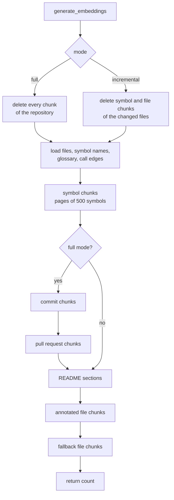

# The index and embeddings

Every answer Illume gives about a repository starts from its search index: one table, `embeddings`, that holds a labelled text chunk, a 1536-dimension vector and a full-text vector for every function, class, method, annotated file, commit, pull request and README section. [`embedder.py`](../../server/app/services/embedder.py) builds that table at the end of an ingest and reconciles it after a sync. This page explains what a chunk contains, how chunks are built, batched and stored, the two indexes that search them, and the content that never reaches the index.

## Terms used on this page

- **Chunk**: the text that represents one source in the index. It is never raw source alone; it is a small labelled document, described in [what a chunk contains](#what-a-chunk-contains).
- **Embedding**: a list of 1536 floats produced by OpenAI's `text-embedding-3-small` model. Texts with similar meaning have vectors that point in similar directions, so the cosine distance between two vectors measures how unrelated the texts are.
- **Source type**: which kind of thing a chunk describes: `symbol`, `file`, `commit`, `pull_request` or `document`.
- **HNSW**: Hierarchical Navigable Small World, the approximate nearest-neighbour index pgvector uses to find the closest vectors without comparing against every row.
- **tsvector**: Postgres's parsed full-text representation of a document, which the lexical search matches against.

## The `embeddings` table

[`Embedding`](../../server/app/models/embedding.py) has one row per indexed source:

| Column          | Type                 | Meaning                                                                                                 |
| --------------- | -------------------- | ------------------------------------------------------------------------------------------------------- |
| `id`            | UUID                 | primary key, `gen_random_uuid()`                                                                        |
| `repository_id` | UUID                 | owning repository, `ON DELETE CASCADE`                                                                  |
| `source_type`   | string enum          | `symbol`, `commit`, `pull_request`, `document` or `file` (a non-native enum, stored as a string)        |
| `source_id`     | UUID                 | the id of the symbol, commit, pull request or file; for README sections a derived UUID (see below)      |
| `file_id`       | UUID, nullable       | the file the chunk belongs to, `ON DELETE CASCADE`; null for commits, pull requests and README sections |
| `chunk_text`    | text                 | the rendered chunk                                                                                      |
| `chunk_hash`    | string(64), nullable | SHA-256 of `chunk_text`, used by incremental reconciliation                                             |
| `embedding`     | `vector(1536)`       | the chunk's embedding                                                                                   |
| `search_tsv`    | tsvector, generated  | full-text vector computed by Postgres from `chunk_text`, deferred so it is never loaded into Python     |

Constraints and indexes:

| Name                           | Kind                                                | Purpose                                                 |
| ------------------------------ | --------------------------------------------------- | ------------------------------------------------------- |
| `uq_embedding_source`          | unique on `(repository_id, source_type, source_id)` | one chunk per source; the target of incremental upserts |
| `ix_embeddings_repository_id`  | b-tree                                              | every query filters by repository                       |
| `ix_embeddings_embedding_hnsw` | HNSW, `vector_cosine_ops`                           | dense (vector) search                                   |
| `ix_embeddings_search_tsv`     | GIN                                                 | lexical (full-text) search                              |

The HNSW index is declared on the model, not only in its migration, because an earlier version existed only in the database and `alembic revision --autogenerate` classified it as stray schema and dropped it. The comment in the model records that.

`source_id` has no foreign key. That is what lets one table point at five different parent tables, and it means a deleted commit or pull request leaves its chunk behind until the repository is deleted or fully re-embedded. Symbol and file chunks are cleaned up through `file_id`'s cascade instead.

The relevant migrations, in order, are `b90f023a9981` and `1c993ad52c53` (the early embedding model changes), `a7b8c9d0e1f2` (the HNSW index), `4c5d6e7f8a01` (`chunk_hash`) and `c9d0e1f2a3b4` (the `search_tsv` column, its GIN index and the trigram indexes on symbols). The [data model reference](../reference/data-model.md) lists every revision.

## What a chunk contains

A chunk is designed so that both a vector model and a human reader can tell what it is about without context. Every chunk starts with a `#` header naming its source.

### Symbol chunks

Built by `_build_chunk_text` for every symbol whose kind is in `EMBEDDABLE_KINDS = {"function", "class", "method"}`:

```text
# server/app/services/repo_cache.py
## function: ensure_clone
Description: Returns a working tree for a repository, reusing a cached clone when possible.
Called by: ...
Calls: ...
def ensure_clone(repo_id, github_url, access_token, branch, commit_sha=None):
    ...
```

1. The file path.
2. `kind: name`.
3. One description line: the symbol's [glossary](../pipeline/generation.md) definition if it has one, otherwise `Docstring: ...` if it has a docstring. The docstring line is dropped when `_source_already_contains_docstring` finds the docstring inside the source after collapsing whitespace, which is the normal case for Python, where the docstring is part of the function body. That avoids spending the same tokens twice.
4. `Called by:` and `Calls:`, up to five names each.
5. The symbol's full source.

**The caller and callee lines are always empty.** They are read from `Dependency` rows with `dep_type == "calls"`, and the [dependency resolver](../pipeline/parsing-and-dependencies.md) only ever writes `imports`. The call graph is never captured anywhere in the pipeline, so these lines exist in the code and never in a stored chunk.

Note that the parser stores Python methods with kind `function`, so `method` is in the set for the languages that do emit it.

### File chunks

Only files that received an annotation in the [reading order](../pipeline/generation.md) get one, which caps them at `onboarding.MAX_ANNOTATED_FILES = 100` per repository:

```text
# File: server/app/services/repo_cache.py
Note: <the reading-order annotation>
Contains: function ensure_clone, function evict_to_cap, ...
```

`Contains` lists up to 15 of the file's functions, classes and methods as `kind name`. The function `_build_file_chunk` exists for this layout, but the live code builds the text inline with `kind name` pairs rather than calling it (the helper lists bare names); only the tests call the helper.

### Fallback file chunks

A file none of whose symbols produced a symbol chunk (a configuration module of constants, a file whose only functions were all oversized, a barrel) would be invisible to search. For those files, the embedder concatenates the source of every symbol in the file under a `# <path>` header and stores it as one chunk. It is stored with `source_type = "symbol"` but `source_id = file_id`, so when it is retrieved `resolve_sources` finds no symbol with that id and the citation falls back to the whole file (`F:path`, with no line range).

### Commit chunks

```text
# Commit 1a2b3c4d by Jane Developer
Message: fix: Accept only GitHub repository URLs
Files changed: server/app/api/v1/repository.py, server/app/services/cloner.py
```

The short hash is the first 8 characters, the author is the commit's author name, and `Files changed` lists the first 20 paths from `changed_files_list`.

### Pull request chunks

```text
# PR #42: Encrypt stored AI keys
<the PR description>
```

### README chunks

`_build_readme_chunks` splits the README on every line that begins with `## ` (a lookahead split, so each heading stays with its section) and prefixes each section with `# README`. The text before the first `##` heading becomes its own chunk. Each section's `source_id` is `uuid5(_README_SECTION_NS, f"{repository_id}:{section_index}")`, a deterministic UUID, so the same section position gets the same id on every run and incremental reconciliation can compare hashes position by position.

Only `README.md`, `readme.md` and `Readme.md` at the repository root are read (`_README_CANDIDATES` in [`pipeline.py`](../../server/app/services/pipeline.py)). Other documentation in the repository is not embedded as documentation; markdown files are not parsed, so they produce no symbols either.

## Size limits

`_token_estimate(text)` is `len(text) // 4`, a rough four-characters-per-token rule rather than a tokenizer. Any chunk whose estimate exceeds `MAX_CHUNK_TOKENS = 2048` (about 8 KB of text) is **skipped, not truncated**:

| Source              | What happens to an oversized chunk                                                                 |
| ------------------- | -------------------------------------------------------------------------------------------------- |
| symbol              | skipped and counted; the file may still get a fallback chunk, which will usually also be too large |
| file (annotated)    | skipped                                                                                            |
| fallback file chunk | skipped, so the file is absent from the index                                                      |
| commit              | skipped (only very long messages)                                                                  |
| pull request        | skipped (long PR descriptions)                                                                     |
| README section      | skipped                                                                                            |

A long function is therefore silently absent from dense and lexical search. It is still reachable through the symbol channel, grep channel and agent tools, which read the `ast_symbols` table directly; see [retrieval arms](retrieval-arms.md). The progress log reports the skip count (`Built N symbol chunks (S skipped, U up to date)`), which is the only place the loss is visible.

## Building the index

`generate_embeddings(repository_id, db, publish_log=None, readme_content=None, mode="full", changed_file_ids=None)` runs on the sync engine inside the worker. It is called through `embed_repository_symbols` in [`scanner.py`](../../server/app/services/scanner.py), which wraps it in the `generate_embeddings` stage timer and publishes `embedding_started`, `embedding_progress` and `embedding_complete` frames (see [WebSockets](../interfaces/websockets.md)).



The order is symbols, then commits, then pull requests, then README sections, then annotated files, then fallbacks. (Older documentation gave a different order; the code is as shown.)

### Preloading

Before building anything, the function loads, for the whole repository:

- every file's id, path and language;
- the name of every embeddable symbol (`symbol_id_to_name`);
- the glossary definition for each of those symbols;
- `calls` edges in both directions (always empty, see above).

If the repository has no files it logs a warning and returns 0.

### Symbol chunks in pages

`_iter_query_batches` pages through the repository's embeddable symbols with keyset pagination (`AstSymbol.id > after_id`, ordered by id, `EMBED_BUILD_BATCH_SIZE = 500` rows a page), so the symbols' source code is never all in memory at once. Each page is rendered, filtered for size, and handed to `_embed_and_store` before the next page is read.

### Batching and the in-flight window

`_embed_and_store` splits a list of `(source_id, chunk_text)` pairs into batches of `BATCH_SIZE = 100` and sends them through `_embed_batches`, which uses `iter_gather_in_order` from [`_concurrency.py`](../../server/app/services/_concurrency.py):

- at most `LLM_MAX_WORKERS = 4` embedding requests are in flight at once;
- results come back in submission order;
- each response is yielded as soon as it resolves, so the caller inserts and commits that batch and drops the response before the next one is consumed.

The last point matters for memory. One 1536-dimension vector is about 48 KB as Python floats, so holding every response for a large repository would cost hundreds of megabytes. The docstring of `iter_gather_in_order` records that holding every response at once (what `gather_in_order` does) is the dominant term in the embedding stage's peak memory. See [concurrency and failure](../pipeline/concurrency-and-failure.md#the-bounded-llm-pools).

Each batch is written with one `INSERT` and committed immediately. A failure halfway through therefore keeps every batch already committed; the exception is logged and re-raised, and the ingest's retry starts over (a full-mode retry deletes everything first).

The README is the exception: its sections go out in a single unbatched `embeddings.create` call, since a README rarely has more than a few dozen sections.

### The embedding client

The client is `OpenAI(api_key=settings.OPENAI_API_KEY, timeout=60.0, max_retries=2)`, built from the operator's key. Embeddings are **never** made with a user's own key, even for a BYOK user, because:

- the vector space has to be the same for the stored chunks and the query embeddings, and the query side always uses the server key too ([`retrieval/embedding.py`](../../server/app/services/retrieval/embedding.py));
- the model is fixed at `text-embedding-3-small`, and changing it would change the dimension baked into `Vector(1536)`, which is a migration and a full re-embed.

Neither embedding path passes `base_url`. The OpenAI SDK reads `OPENAI_BASE_URL` from the environment on its own, which is the seam the end-to-end tests use to point both paths at a local stub server (see [frontend and end-to-end testing](../testing/frontend-and-e2e.md)). Adding an explicit `base_url` here would bypass that seam.

## Incremental reconciliation

A sync calls `generate_embeddings` with `mode="incremental"` and the ids of the files it re-parsed. See [sync](../pipeline/sync.md#step-b-the-llm-delta) for where that happens.

1. **Targeted delete.** It deletes the `symbol` and `file` chunks whose `file_id` is in `changed_file_ids`. In practice the sync has already deleted and re-inserted those files, and the cascade on `file_id` removed their chunks; this delete is a second guarantee.
2. **Load stored hashes.** `_load_stored_hashes` returns `{source_id: chunk_hash}` for the repository's symbol and file chunks.
3. **Rebuild everything.** Every desired chunk is rendered again in pure CPU, for the whole repository, not just the changed files. A glossary definition that changed, or a reading-order annotation that moved, changes chunks in unchanged files too, and only a full rebuild sees that.
4. **Filter by hash.** `_filter_chunks_by_hash` keeps only chunks whose stored hash is missing or differs from `sha256(chunk_text)`.
5. **Upsert.** Those go through `_embed_and_store` with `upsert=True`, which uses `ON CONFLICT (repository_id, source_type, source_id) DO UPDATE` and rewrites `file_id`, `chunk_text`, `chunk_hash` and `embedding`.

Only changed text costs an OpenAI call. An idle sync where nothing in the chunks moved embeds nothing.

### What incremental mode does not do

- **Commits and pull requests are skipped.** Both blocks only run in full mode. A sync does insert new `Commit` rows (the git analyzer's insert is `ON CONFLICT DO NOTHING`, so the new commits are added and old ones keep their ids), but those new commits are never embedded. Pull requests are not re-fetched by a sync at all. **The history channel, and `search_history`, therefore see only the commits and PRs that existed at the last full ingest.**
- **The README is not re-embedded.** The sync passes `readme_content=None`, so README edits after the ingest never reach the index, even though the sync re-reads the README for the architecture brief.
- **Stale chunks are not removed.** Reconciliation only inserts and updates. A symbol chunk that becomes oversized, a file that loses its reading-order annotation, or a README that loses sections leaves its old chunk in place. A symbol that disappears from a changed file is cleaned up by the cascade, but nothing else is.

A [re-ingest](../pipeline/ingestion.md) runs full mode and fixes all three.

## The two search indexes

### Dense: HNSW with cosine distance

The dense channel orders by `embedding.cosine_distance(query_vector)` within one repository. Before searching, [`prepare_filtered_vector_search`](../../server/app/services/retrieval/vector.py) runs on the search's own session:

```sql
SET LOCAL hnsw.ef_search = 200;
SET LOCAL hnsw.iterative_scan = strict_order;  -- pgvector 0.8 or later only
```

The problem it solves: an HNSW index is global across every repository on the instance. Below pgvector 0.8, a query filtered by `repository_id` walks the index, takes the `ef_search` nearest rows globally (40 by default), and only then applies the filter. On a shared instance, a small repository's chunks may not be in that global top 40 at all, and the search returns too few hits or none. Raising `ef_search` to 200 widens the walk; `iterative_scan = strict_order` makes pgvector keep scanning until the filter has produced enough rows. `strict_order` rather than `relaxed_order` because the diversity step takes hits in the order they arrive, and the relaxed mode can return them slightly out of distance order.

The extension version is read once per process from `pg_extension` and cached. On pgvector older than 0.8 the iterative setting is skipped and the under-fill problem remains. `SET LOCAL` applies only to the current transaction, which is why it is issued on the session doing the search rather than once on the pool.

### Lexical: a generated tsvector

`search_tsv` is a generated, stored column computed by Postgres on every insert or update from `SEARCH_TSV_EXPRESSION`:

```sql
to_tsvector('simple',
  regexp_replace(
    regexp_replace(
      regexp_replace(chunk_text, '([A-Z]+)([A-Z][a-z])', '\1 \2', 'g'),
      '([a-z0-9])([A-Z])', '\1 \2', 'g'),
    '[_./:-]+', ' ', 'g')
  || ' ' || chunk_text)
```

It splits acronym boundaries (`HTTPServer` to `HTTP Server`), camelCase boundaries (`ensureClone` to `ensure Clone`) and separators (`_ . / : -`), then appends the original text, so `ensure_clone` matches both as one token and as the words `ensure` and `clone`. It uses the `simple` configuration rather than `english`, because English stemming and stop words damage identifiers: `get`, `is`, `set` and `all` are stop words, and stemming turns `parser` and `parsing` into the same stem.

The Python twin is `lexical_text` in [`identifiers.py`](../../server/app/services/retrieval/identifiers.py), which applies the same splits to the query so that the query and the index are tokenised the same way. The two must change together; [`test_lexical_index.py`](../../server/tests/integration/services/test_lexical_index.py) compares Postgres's column against `lexical_text` on real chunks, so a drift fails the backend suite.

## From a row to a citation

Retrieval works with `Candidate` objects ([`candidate.py`](../../server/app/services/retrieval/candidate.py)) rather than ORM rows. `resolve_sources` turns a list of `Embedding` rows into `SourceReference` objects with four batched queries, one each for symbols, commits, pull requests and files, so resolving 50 hits costs four round trips, not 50.

`key_for` then gives each reference the stable key the answer cites:

| Source type   | Key                                                    | Example                      |
| ------------- | ------------------------------------------------------ | ---------------------------- |
| symbol        | `F:path:start-end`, or `F:path` when lines are missing | `F:server/app/main.py:12-40` |
| file          | `F:path`                                               | `F:server/app/main.py`       |
| commit        | `C:` plus the first 8 characters of the hash           | `C:1a2b3c4d`                 |
| pull_request  | `PR:n`                                                 | `PR:42`                      |
| document      | `D:README#heading-slug`                                | `D:README#getting-started`   |
| anything else | `X:<type>:<16 hex of the chunk hash>`                  | (never produced today)       |

`readme_heading` reads the first `##` line after the `# README` header to build the document key. The key is what de-duplicates the same source across channels and query variants during fusion, and it is the bracketed citation format the model is asked to write; see [chat](chat.md#citations).

`provenance_for` marks commits and pull requests as `history` and everything else as `repo`, which the context renderer prints on each source so the model can tell code from history.

## Design trade-offs and limits

- **Labelled chunks, not raw code.** Putting the path, kind, name and a one-line description in front of the source makes both vector and keyword search work for questions phrased in English. The cost is that the stored text is not the file's text, so line numbers come from the symbol row, not from the chunk.
- **One embedding model, server key only.** Simple and consistent, but the operator pays for every user's embeddings and the model cannot change without a migration and re-embed.
- **Skip, do not truncate.** A truncated chunk would be a misleading half-function; a skipped one is honest but silent. The largest functions are often the most important, and they are exactly what is missing.
- **No call graph.** The `Called by` and `Calls` lines are always empty.
- **Incremental mode is code-only.** Commits, pull requests and the README freeze at the last full ingest.
- **Reconciliation never deletes.** Stale chunks for annotations, README sections and oversized symbols accumulate until a re-ingest.
- **The token estimate is crude.** Four characters per token under-counts dense code and over-counts prose, so the 2048-token cap is approximate in both directions.
- **A shared global HNSW index.** Correct filtering on small repositories depends on pgvector 0.8's iterative scan.

## Related documentation

- [Chat and citations](chat.md): how retrieved chunks become an answer.
- [Retrieval arms](retrieval-arms.md): every channel that searches this table, and the ones that bypass it.
- [LLM generation](../pipeline/generation.md): the glossary and reading order that feed symbol and file chunks.
- [Auto-update sync](../pipeline/sync.md): when incremental reconciliation runs.
- [Concurrency and failure](../pipeline/concurrency-and-failure.md): the bounded pools and per-batch commits.
- [Data model](../reference/data-model.md): the `embeddings` table among the rest of the schema.
