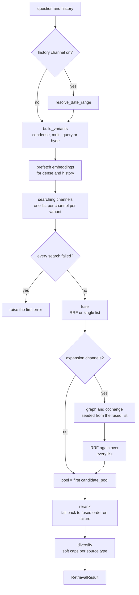

# Retrieval arms

Retrieval is the step that picks which pieces of a repository a model sees before it answers. Illume does not have one retrieval method but a configurable pipeline of them: query rewriting, seven independent search channels, rank fusion, three optional rerankers and a diversity step, all driven by one frozen configuration object. Each named configuration is called a preset (or an "arm", in the evaluation). This page explains every stage down to its constants, the six presets built from them, and the decision model that some of them consult.

## Terms used on this page

- **Candidate**: one retrievable item (a symbol, file, commit, pull request or README section) with its citation key, text and the record of which channels found it. Defined in [`candidate.py`](../../server/app/services/retrieval/candidate.py).
- **Channel**: one independent way of finding candidates, such as vector similarity or keyword search. A **searching** channel starts from the question; an **expansion** channel starts from the files an earlier pass ranked highest.
- **Variant**: one phrasing of the question. The original (or condensed) question is variant 0; query transforms add more.
- **Fusion**: merging several ranked lists into one. Illume uses reciprocal rank fusion (RRF), which scores an item by its rank in each list rather than by the lists' raw scores, so lists with incomparable scores can be combined.
- **Reranking**: reordering a fused pool with a model that reads each passage against the question.
- **Pool**: the top of the fused list handed to the reranker, `candidate_pool` items long.
- **Degraded**: a stage that failed and was skipped or replaced by a simpler behaviour. A degraded stage emits a `degraded` event and the run continues.

## The pipeline at a glance

[`retrieve(config, question, ctx=..., history=..., llm=...)`](../../server/app/services/retrieval/pipeline.py) runs every stage in order:



1. **Date range.** When the history channel is on and the caller has not set one, `resolve_date_range(question, now)` looks for a date phrase in the question (below).
2. **Variants.** `build_variants` returns the standalone question and the list of variants.
3. **Prefetch.** Every variant text that the dense or history channel will search is embedded in one batched call, so the channels do not each embed it. A prefetch failure is logged and each channel embeds on demand instead.
4. **Search.** Every searching channel runs once per variant, sequentially, each inside its own savepoint (`_guarded` opens `db.begin_nested()`), so a channel whose SQL fails rolls back to the savepoint without aborting the session the other channels share. A failure is recorded in the trace, emits `degraded`, and contributes no list. A `hyde` variant is searched by the dense channel only.
5. **Total failure.** If no channel produced a list and at least one raised, the first error is raised. Empty results without errors are not a failure.
6. **Fuse.** `fuse` either passes a single list through (`fusion="none"`) or runs RRF.
7. **Expand.** Graph and co-change expansion read the fused list as their seeds. Their lists are fused with all the searching lists in a second RRF pass.
8. **Pool and rerank.** The first `rerank.candidate_pool` candidates (60 by default) are reranked to `rerank.top_n` (20). With no reranker the pool passes through untruncated. A reranker failure emits `degraded` and keeps the first `top_n` of the fused order.
9. **Diversify.** `diversify` cuts the result to `diversify.total` with soft per-type caps.

The result carries the standalone question, the variants, the final candidates, the pool, and a `RetrievalTrace`: one `ChannelTrace` per channel run (channel, variant, stage, candidate count, milliseconds, error), the reranker kind and whether it degraded, every `degraded` payload, the configuration hash, the reranker's provider calls and the resolved date range. The evaluation harness stores this trace for every question.

## Presets

Every preset is a `PipelineConfig` in [`config.py`](../../server/app/services/retrieval/config.py), collected in `PRESETS`:

| Preset               | Query                             | Channels                                                            | Fusion | Rerank | Total | Execution                                      |
| -------------------- | --------------------------------- | ------------------------------------------------------------------- | ------ | ------ | ----- | ---------------------------------------------- |
| `classic`            | identity, no condense, 5 messages | dense (`k=50`, `max_distance=0.7`)                                  | none   | none   | 10    | single-shot                                    |
| `hybrid`             | condense                          | dense, lexical, symbol                                              | RRF    | none   | 20    | single-shot                                    |
| `hybrid_rerank`      | condense                          | dense, lexical, symbol                                              | RRF    | Cohere | 20    | single-shot                                    |
| `structural`         | condense                          | dense, lexical, symbol, grep (weight 0.7), graph, cochange, history | RRF    | Cohere | 20    | single-shot                                    |
| `deep_agent`         | condense, 10 messages             | as `structural`                                                     | RRF    | Cohere | 20    | agent, `AgentConfig()`                         |
| `deep_agent_workers` | condense, 10 messages             | as `structural`                                                     | RRF    | Cohere | 20    | planner, `AgentConfig()` and `PlannerConfig()` |

Read it as a ladder: `classic` is the original dense-only chat; `hybrid` adds keyword and identifier search; `hybrid_rerank` adds a cross-encoder; `structural` adds literal grep, the import graph, co-change and commit history; the two agent presets let a model decide what to search next with tools, starting from the `structural` retrieval as a seed. Which rung helps which kind of question is what the [evaluation](../evals/results-full-v1.md) measures.

For the agent presets the channel list is used twice: once to seed the agent's first turn, and again inside the `search_code` tool. See [the agent](agent.md).

### The configuration object

`PipelineConfig` and its parts are frozen Pydantic models with `extra="forbid"`, so a typo in a field name is an error rather than a silently ignored setting.

| Part        | Fields and defaults                                                                                                                                            |
| ----------- | -------------------------------------------------------------------------------------------------------------------------------------------------------------- |
| `name`      | 1 to 64 characters; not part of the hash                                                                                                                       |
| `query`     | `transform` (`identity`, `multi_query`, `hyde`; default `identity`), `condense` (False), `n_variants` (3, range 3 to 5), `history_messages` (5, range 0 to 20) |
| `channels`  | at least one channel spec; sorted by kind on construction                                                                                                      |
| `fusion`    | `rrf` (default) or `none`                                                                                                                                      |
| `rrf_k`     | 60, range 1 to 1000                                                                                                                                            |
| `rerank`    | `kind` (`none`, `cohere`, `llm`, `jev`; default `none`), `candidate_pool` (60, 1 to 200), `top_n` (20, 1 to 100, not above the pool)                           |
| `diversify` | `total` 10 (1 to 100); caps `symbol` 5, `commit` 2, `pull_request` 1, `document` 1, `file` 2, `other` 2                                                        |
| `execution` | `single_shot` (default), `agent`, `planner`                                                                                                                    |
| `agent`     | an `AgentConfig`, required for `agent` and `planner`, forbidden for `single_shot`                                                                              |
| `planner`   | a `PlannerConfig`, required for `planner` only                                                                                                                 |
| `decider`   | `jev` (default) or `llm`: which decider answers routing, planning and Jev reranking questions                                                                  |

Every channel spec has `weight` (1.0, above 0 and at most 10) and `k` (50, 1 to 200), plus:

| Channel    | Extra fields                                          |
| ---------- | ----------------------------------------------------- |
| `dense`    | `max_distance` 0.7 (above 0, at most 2)               |
| `lexical`  | none                                                  |
| `symbol`   | `min_similarity` 0.3 (0 to 1)                         |
| `grep`     | none                                                  |
| `graph`    | `seeds` 5 (1 to 20), `decay` 0.5 (above 0, at most 1) |
| `cochange` | `seeds` 5 (1 to 20)                                   |
| `history`  | `max_distance` 0.7                                    |

The model-level validator `_slots_agree` rejects configurations that cannot run:

- a channel kind repeated;
- only expansion channels (graph and co-change expand what others find);
- `fusion="none"` with more than one channel, or with a transform that produces several variants;
- `hyde` without the dense channel, which is the only channel that searches a `hyde` variant;
- agent or planner settings on a single-shot configuration, or missing on an agent one;
- planner settings on plain `agent` execution.

### The configuration hash

`config_hash()` is the SHA-256 of the configuration's canonical JSON (`sort_keys=True`, compact separators) excluding `name`. Two configurations that behave the same hash the same whatever they are called, and because channels are sorted on construction, listing them in a different order does not change the hash. The hash is stored on every `AgentRun` and every evaluation result, and `is_classic_shaped(config)` compares against `CLASSIC.config_hash()` to decide whether a run must keep the Classic prompt.

### Overrides

The streaming endpoint accepts `overrides`, a partial configuration sent by the client's advanced drawer. [`overrides.py`](../../server/app/services/agent/overrides.py) accepts only a fixed set of fields; anything else is a 422, because the models reject unknown fields. What may change depends on who pays:

- **Free tier** (the operator pays): a request may only make a run cheaper. Budgets may not exceed the preset's own, the seed may be switched off but not on, channels may only be removed, the replayed history and the number of surviving results may not exceed the preset's, and the reranker and query rewriting may only be turned off.
- **Own key**: the seed may be switched on, channels added, and the reranker and query rewriting chosen. Budgets may be raised only as far as the most generous preset allows, not to the bounds the models accept.

The context window stays inside the range a user may set in their account (32,000 to 1,000,000 tokens). The merged configuration is validated again, so an override cannot produce a configuration the validators would reject.

## Query transforms

[`query.py`](../../server/app/services/retrieval/query.py) runs up to two model calls before any search, each through `call_json`, which asks for a JSON object with a fixed schema:

| Transform     | When                                                          | Prompt in short                                                                                                     | Output                                 |
| ------------- | ------------------------------------------------------------- | ------------------------------------------------------------------------------------------------------------------- | -------------------------------------- |
| condense      | `condense` is on, `history_messages > 0` and there is history | rewrite the final message into one standalone question, resolving "it" and "that file", keeping identifiers exactly | variant 0 replaced, kind `condensed`   |
| `multi_query` | `transform="multi_query"`                                     | write exactly `n` alternative queries: one in code identifiers, one in plain English, one describing behaviour      | `n` extra variants, kind `multi_query` |
| `hyde`        | `transform="hyde"`                                            | write a hypothetical code snippet of at most 15 lines that would answer the question                                | one extra variant, kind `hyde`         |

Condensing uses the last `history_messages` messages rendered as `role: content` lines. The rewrites start from the condensed question.

Every output is trimmed and must be under `MAX_VARIANT_CHARS = 2000` characters ("a rewrite longer than this is a model rambling, not a search query"). `multi_query` drops rewrites that repeat the question or each other (case-insensitively) and fails if none is left.

Every failure degrades rather than failing the question: the transform is lost, a `degraded` event with `stage: "query"` and the reason is emitted, and retrieval continues with what it has. With no model credential at all, each requested transform degrades immediately. No preset ships with `multi_query` or `hyde` on; they exist for the evaluation and for overrides.

## Searching channels

The channel registry in [`channels/__init__.py`](../../server/app/services/retrieval/channels/__init__.py) maps each kind to one stateless object. A searching channel implements `search(ctx, variant, spec)` and returns up to `spec.k` candidates, best first. `RetrievalContext` ([`base.py`](../../server/app/services/retrieval/channels/base.py)) carries the repository id, the async session, the embedder with its per-run cache, the event emitter and the date range.

| Channel | Searches                         | Finds                       | Ranks by                                          | Ignores `hyde`    |
| ------- | -------------------------------- | --------------------------- | ------------------------------------------------- | ----------------- |
| dense   | `embeddings.embedding`           | any chunk                   | cosine distance                                   | no                |
| lexical | `embeddings.search_tsv`          | any chunk                   | `ts_rank_cd`                                      | yes               |
| symbol  | `ast_symbols.name`               | functions, classes, methods | exact first, then trigram similarity, then fan-in | yes               |
| grep    | `ast_symbols.source_code`        | functions, classes, methods | matched lines, then fan-in                        | yes               |
| history | `embeddings` for commits and PRs | commits and pull requests   | internal RRF of dense and lexical                 | lexical half only |

The symbol and grep channels read the `ast_symbols` table, not the index, so they can find a symbol that was too large to embed. `symbol_candidates` in [`_symbols.py`](../../server/app/services/retrieval/channels/_symbols.py) uses the symbol's indexed chunk when it has one and otherwise renders the symbol itself, capped at `MAX_RENDERED_CHARACTERS = 8192`.

### Dense

[`dense.py`](../../server/app/services/retrieval/channels/dense.py): `dense_rows` tunes pgvector with `prepare_filtered_vector_search` (see [the index](index-and-embeddings.md#dense-hnsw-with-cosine-distance)), then selects the repository's chunks with `cosine_distance < max_distance`, nearest first, `LIMIT k`. Cosine distance runs from 0 (same direction) to 2 (opposite), so the default 0.7 means a cosine similarity above 0.3. The raw distance is kept on the candidate's channel hit. The function also accepts a source-type filter and extra conditions, which is how the history channel reuses it.

### Lexical

[`lexical.py`](../../server/app/services/retrieval/channels/lexical.py):

1. `query_tokens` runs the query through `lexical_text` (the same identifier splitting the index column uses), extracts `[A-Za-z0-9]+` words, lower-cases them, removes the 31 `STOP_WORDS` (question words such as `how`, `what`, `where` and function words such as `the`, `is`, `of`) and keeps the first `MAX_QUERY_TOKENS = 64` distinct terms.
2. `or_query` joins them with `|`, so a chunk matches if it shares **any** term.
3. The query is `search_tsv @@ to_tsquery('simple', ...)` ordered by `ts_rank_cd(search_tsv, query, 32)` descending, then id. Normalisation flag 32 divides the rank by itself plus one, scaling it into 0 to 1.

OR semantics give the channel recall on long natural-language questions, where an AND query would match nothing. `ts_rank_cd` (cover density) rewards chunks where the matched terms appear close together, which keeps precision reasonable.

### Symbol

[`symbol.py`](../../server/app/services/retrieval/channels/symbol.py) looks for identifiers the question names.

`identifier_tokens` in [`identifiers.py`](../../server/app/services/retrieval/identifiers.py) pulls identifier-shaped tokens from the question in order: anything in backticks, and any bare word that contains `_`, a dot between parts, a lower-case letter followed later by an upper-case one (camelCase) or two capitals followed by a lower-case letter (`HTTPServer`). For a dotted name it also keeps the last segment when it is at least `_MIN_SEGMENT_LENGTH = 3` characters and not a file extension in `_FILE_EXTENSIONS`, so `repo_cache.ensure_clone` yields `ensure_clone` too. Plain English words are not identifiers, so "how does caching work" produces no tokens and the channel returns nothing.

For each token, `_MATCH_NAMES` finds the repository's functions, classes and methods whose name equals the token or is trigram-similar to it (Postgres `pg_trgm`, using the GIN trigram index on `ast_symbols.name`). The similarity threshold is set per transaction with `set_config('pg_trgm.similarity_threshold', min_similarity, true)` and restored afterwards. A symbol matched by several tokens keeps its best match. The ranking is: exact matches first, then by similarity, then by file fan-in (more widely imported files first), then by id.

### Grep

[`grep.py`](../../server/app/services/retrieval/channels/grep.py) is both a retrieval channel and the engine behind the agent's `grep_code` tool.

`grep_terms` collects identifier tokens and quoted strings (`"..."` or `'...'` in the question, via `quoted_strings`). Each term is searched **literally**: `escape_like` escapes `\`, `%` and `_`, and the SQL is `source_code LIKE '%term%'` over the repository's function, class and method bodies. For each matching symbol it counts the matching lines. Symbols are merged across terms and ranked by total matched lines, then by fan-in.

Limits (shared with the agent tool):

| Constant              | Value | Meaning                                                                                               |
| --------------------- | ----- | ----------------------------------------------------------------------------------------------------- |
| `MAX_PATTERN_LENGTH`  | 200   | longer patterns are refused                                                                           |
| `DEFAULT_MAX_RESULTS` | 200   | most matches returned                                                                                 |
| `DEFAULT_TIMEOUT_MS`  | 2000  | `statement_timeout` set for the search with `set_config(..., true)` inside a savepoint, then restored |

A search that hits the timeout (Postgres error `57014`) or, for the agent's regex mode, an invalid regular expression (`2201B`) returns a `GrepRefusal` with a readable reason instead of raising. The channel skips a refused term and keeps the others. The `structural` presets give grep a fusion weight of 0.7, because a literal match on a common identifier is weaker evidence than a semantic one.

### History

[`history.py`](../../server/app/services/retrieval/channels/history.py) searches only commits and pull requests. For each variant it runs a dense search and a lexical search (the lexical half skipped for `hyde`), both restricted to `HISTORY_SOURCE_TYPES` and to the date range when there is one, then fuses the two internally with RRF at `INTERNAL_RRF_K = 60` and returns the top `k`.

`date_conditions` turns a date range into SQL: a commit's `authored_at` and a pull request's `merged_at` must fall inside it. Because the history channel's results enter the main fusion as one more list, a question that names a time period gets commits from that period alongside code.

#### Date phrases

[`dates.py`](../../server/app/services/retrieval/dates.py) resolves a date phrase with regular expressions, without a model. `resolve_date_range` tries, in order:

| Pattern                        | Example                          | Range                                                                                          |
| ------------------------------ | -------------------------------- | ---------------------------------------------------------------------------------------------- |
| `since YYYY-MM-DD`             | "since 2026-10-01"               | from that day                                                                                  |
| `since <month> [year]`         | "since March"                    | from the start of that month                                                                   |
| `before` or `after YYYY-MM-DD` | "after 2026-09-15"               | open-ended on one side                                                                         |
| `in <month> [year]`            | "in Oct 2026"                    | that calendar month                                                                            |
| `last` or `past <n> <unit>s`   | "past two weeks", "last 30 days" | the `n` units before now; `n` may be a word up to the teens or digits up to `MAX_COUNT = 1000` |
| `last` or `past <unit>`        | "last month"                     | the previous calendar week, month or year                                                      |
| `this <unit>`                  | "this week"                      | the current calendar week (from Monday), month or year                                         |
| `yesterday`, `today`           |                                  | that day                                                                                       |

A month without a year means the most recent such month that is not in the future. Every range is in UTC. The resolved range appears in the trace and in the `retrieval` event as a description such as `from 2026-10-28 to 2026-11-11`.

## Fusion

[`fusion.py`](../../server/app/services/retrieval/fusion.py) implements reciprocal rank fusion:

```text
score(candidate) = sum over every list containing it of  weight / (rrf_k + rank)
```

`rank` starts at 1, `weight` is the channel's weight and `rrf_k` defaults to 60. With `rrf_k = 60`, first place in one list is worth `1/61`, about 0.0164, and tenth place `1/70`, about 0.0143, so the formula flattens differences in rank and strongly rewards an item that several lists agree on.

Details that matter:

- Lists are processed in a fixed order, sorted by channel and variant, so fusion is deterministic.
- Within one list, a repeated key counts once, at its best rank.
- Across lists, candidates are merged by key. The merged candidate keeps the text and reference from its best-ranked appearance, and the union of every channel hit, so a citation can show which channels found it.
- The result is sorted by fused score descending, then by key.

Each query variant is a separate list, so a candidate that every variant finds accumulates score from each. With `fusion="none"`, `single_list` requires exactly one list and returns it unchanged, which is how `classic` keeps its plain distance order.

## Expansion channels

Expansion channels implement `expand(ctx, seeds, spec)`. They receive the fused list from the searching channels and grow it with neighbouring **files**.

`seed_files(seeds, limit)` in [`_files.py`](../../server/app/services/retrieval/channels/_files.py) takes the first `limit` distinct files (`spec.seeds`, default 5) among the seed candidates in rank order, skipping commits and anything else without a file. Each seed file's strength is the best `fused_score` among its candidates, or `1 / (60 + position)` when there is no fused score. Expanded files that are themselves seeds are skipped.

`file_candidates` turns scored file ids into ranked `file` candidates. A file with an indexed file chunk uses that chunk; any other file gets a header from `render_file_header`: the path, its language, `Imported by N files`, and up to `MAX_HEADER_SYMBOLS = 15` symbol names in source order.

Both expansions only order their own list; the numbers below decide the order, and RRF then uses rank, not score, when it merges the list with the others.

### Graph

[`graph.py`](../../server/app/services/retrieval/channels/graph.py) looks one import away. `query_neighbours_async` (from [`file_graph.py`](../../server/app/services/file_graph.py)) returns every importer and importee of the seed files, with the edge weight (how many symbol-level import edges the file-level edge collapses; see [the dependency graph](../graph/dependency-graph.md#file-level)). Each neighbour scores:

```text
neighbour_score = seed_score * decay * (1 + WEIGHT_GAIN * log1p(weight))
```

with `decay = 0.5` and `WEIGHT_GAIN = 0.1`. A file reached from several seeds keeps its best score. Only direct neighbours are added; the channel does not walk further.

### Co-change

[`cochange.py`](../../server/app/services/retrieval/channels/cochange.py) adds files that tend to change in the same commits as the seeds, read from the `file_cochange` table that [git intelligence](../pipeline/git-intelligence.md#co-change) builds. `_PARTNERS` reads each pair from both sides (a pair is stored once, smaller id first). Each partner scores `seed_score * jaccard`, keeping its best.

Co-change finds coupling the import graph cannot: a migration and its model, a component and its test, a server route and the client hook that calls it. It depends on the history's quality: a repository with few commits, or one whose commits are mostly bulk changes over 30 files (which the builder ignores), has few or no pairs.

`cochanged_files(db, repository_id, file_id, limit)` in the same module serves the agent's `get_cochanged` tool and the file-detail endpoint.

## Rerankers

A reranker implements `rerank(question, candidates, top_n)` and returns at most `top_n` candidates, best first, with `rerank_score` set. `get_reranker(kind, llm=...)` in [`rerank/base.py`](../../server/app/services/retrieval/rerank/base.py) builds one, or raises `RerankerUnavailable` when the kind has no credential. The reranker reads the standalone (condensed) question.

| Kind     | Class            | Model                  | Credential                      | Score                                                   |
| -------- | ---------------- | ---------------------- | ------------------------------- | ------------------------------------------------------- |
| `none`   | `NoneReranker`   | none                   | none                            | unchanged; keeps the first `top_n` when called directly |
| `cohere` | `CohereReranker` | `cohere/rerank-5-fast` | operator's `OPENROUTER_API_KEY` | Cohere's relevance score                                |
| `jev`    | `JevReranker`    | `typesafe/jev-1.14`    | operator's `OPENROUTER_API_KEY` | probability-weighted rubric position, 0 to 3            |
| `llm`    | `LLMReranker`    | the caller's own model | the caller's `LLMConfig`        | `1 - position / N`                                      |

### Cohere

[`cohere.py`](../../server/app/services/retrieval/rerank/cohere.py) posts the question and every passage, each cut to `MAX_DOCUMENT_CHARS = 4000`, to `COHERE_RERANK_URL = https://openrouter.ai/api/v1/rerank` with a `REQUEST_TIMEOUT_SECONDS = 30` timeout, and sorts by the returned relevance scores. A cross-encoder reads the question and passage together, so it judges relevance more accurately than comparing two independently computed vectors. It runs on the operator's OpenRouter key whoever is asking, which is why the BYOK page counts it as a server-side cost.

### Jev

[`rerank/jev.py`](../../server/app/services/retrieval/rerank/jev.py) asks the decision model (below) one `score` question per passage on the rubric `RELEVANCE_LEVELS`: `unrelated`, `mentions the topic`, `partially answers`, `directly answers`. The answer is the probability-weighted position on that rubric, so 3.0 means the model is certain the passage answers the question directly. Passages are cut to `MAX_PASSAGE_CHARS = 1500` and packed into requests that each stay under `MAX_REQUEST_BYTES = 32000`, because Jev switches to a slower, less accurate long-context mode above that size; up to `MAX_PARALLEL_REQUESTS = 4` requests run at once. Because scores are absolute rubric positions, scores from different requests are comparable. `total_cost` sums the reported cost of the last call's requests, which the evaluation records.

### LLM (listwise)

[`rerank/llm.py`](../../server/app/services/retrieval/rerank/llm.py) asks the caller's own model to order numbered passages, each inside `<passage number="N">` tags with fence escaping (passages are untrusted data). It returns a JSON array of passage numbers.

For a pool of `N` candidates:

1. `N <= WINDOW_SIZE` (20): one call ranks everything.
2. Otherwise the pool is cut into consecutive windows of 20, each ranked by its own call, up to `MAX_PARALLEL_CALLS = 4` at once.
3. The top `ceil(MERGE_POOL / windows)` of each window are the winners (`MERGE_POOL = 20`). They are put back in fused order, so the window they came from gives no hint, and one merge call ranks them. That ranking is the head of the result.
4. Non-winners follow, ordered by their position within their own window, then by window.

Parsing is lenient: invalid and repeated numbers are ignored, and unmentioned passages follow the ranked ones in their given order. A reply with no usable number at all raises, which degrades the rerank. Passages are cut to `PASSAGE_CHARS = 1500`.

### When a reranker fails

Any exception, including `RerankerUnavailable` from a missing key, is caught in `_rerank`: a `degraded` event with `stage: "rerank"` is emitted, `reranker_degraded` is set in the trace, and the first `top_n` candidates of the fused order are used. A missing `OPENROUTER_API_KEY` therefore silently turns `hybrid_rerank` into `hybrid` with a different total, which matters when comparing arms; the evaluation harness checks for degraded runs.

## Diversity

[`diversify.py`](../../server/app/services/retrieval/diversify.py) cuts the reranked list to `total` in two passes:

1. Walk the list in order and take each candidate whose source type is still under its cap (`symbol` 5, `commit` 2, `pull_request` 1, `document` 1, `file` 2, anything else `other` = 2).
2. If fewer than `total` were taken, walk again and append the skipped candidates in order until `total` is reached.

The caps are **soft**: they decide what comes first, not what is allowed. With `total = 20` and the default caps (which sum to 11 for the five known types), the second pass always runs when the list is long enough, so a symbol-heavy result can contain far more than five symbols. Pass 1 makes sure history and documentation get a place near the top when they rank at all.

## Decisions

Some steps need a small judgement rather than generated text: is this passage relevant, which preset suits this question, should this question be split. [`services/decisions`](../../server/app/services/decisions/__init__.py) gives them one interface with two implementations.

A **decider** ([`base.py`](../../server/app/services/decisions/base.py)) answers narrow questions with probabilities, never prose:

| Primitive | Answers                                   | Returns                                                                      |
| --------- | ----------------------------------------- | ---------------------------------------------------------------------------- |
| `choice`  | which of a set of options                 | the chosen option, a probability per option, a confidence                    |
| `score`   | where something sits on an ordered rubric | the probability-weighted position on the rubric                              |
| `noul`    | whether a statement is true               | the probability that it is (`NOUL_TRUE`, `NOUL_FALSE` are the rubric labels) |

`batch` sends several questions in one request. Every result carries the model, latency, reported cost and raw response, because the evaluation computes calibration and cost from exactly those fields. `record_decision` turns a result into a step-log record that stores a hash of the state rather than the repository text.

| Decider           | File                                                     | How                                                                                                                                                                                                                                                               |
| ----------------- | -------------------------------------------------------- | ----------------------------------------------------------------------------------------------------------------------------------------------------------------------------------------------------------------------------------------------------------------- |
| `JevDecider`      | [`jev.py`](../../server/app/services/decisions/jev.py)   | OpenRouter's Decisions API (`DECISIONS_URL = https://openrouter.ai/api/alpha/decisions`), model `JEV_MODEL = typesafe/jev-1.14`, requests under 32,000 bytes, 30-second timeout, up to 4 in parallel; probabilities clamped to 0 to 1 and positions to the rubric |
| `LlmDecider`      | [`llm.py`](../../server/app/services/decisions/llm.py)   | asks the caller's own model for a JSON probability; state cut to `MAX_STATE_CHARS = 40000`, up to `MAX_PARALLEL_CALLS = 4`                                                                                                                                        |
| `FallbackDecider` | [`base.py`](../../server/app/services/decisions/base.py) | prefers Jev, answers with the LLM decider when Jev is missing, unreachable, out of credit or malformed, and emits **one** `degraded` event per run rather than one per decision                                                                                   |

A decision model is a model trained to return calibrated probabilities over typed answers instead of text, so it is called through its own low-level client in [`openrouter.py`](../../server/app/services/decisions/openrouter.py) rather than a chat SDK. The endpoint is an alpha path, and every failure surfaces as a `DecisionError` with a readable message; the caller decides whether to degrade. `_RUN_ENDING_REASONS` (unauthorized, out of credit, timeout, server, transport) are the failures after which the fallback stops trying Jev for the rest of the run.

The decision points themselves live in [`points.py`](../../server/app/services/decisions/points.py):

| Point     | Used by                                                      | Primitive | Page                               |
| --------- | ------------------------------------------------------------ | --------- | ---------------------------------- |
| route     | `auto`, choosing a preset                                    | `choice`  | [the auto router](router.md)       |
| plan      | `deep_agent_workers`, deciding whether to split the question | `noul`    | [the agent](agent.md#planner-mode) |
| relevance | the Jev reranker                                             | `score`   | this page                          |

Shared bounds there: `MAX_QUESTION_CHARS = 4000`, `MAX_HISTORY_MESSAGE_CHARS = 500`, `MAX_STATE_CHARS = 12000`, `MAX_PASSAGE_CHARS = 1500`, `MAX_RELEVANCE_QUESTION_CHARS = 1000`.

## Design trade-offs and limits

- **Many channels, sequentially.** Channels run one after another on a shared session (each in a savepoint) rather than concurrently, because an `AsyncSession` cannot run two statements at once. Latency is the sum of the channels, not the slowest.
- **Rank fusion discards scores.** RRF is robust across incomparable scores but cannot tell a near-perfect top hit from a weak one.
- **Soft caps.** Diversity prefers a mix but does not enforce it.
- **Server-side reranking cost.** Cohere and Jev run on the operator's OpenRouter key for every user, including BYOK users.
- **Silent degradation.** A missing key or provider outage changes what a preset does without failing the question; only the `degraded` events and trace show it.
- **Identifier heuristics.** The symbol and grep channels depend on the question containing identifier-shaped words. Plain-English questions get nothing from them.
- **History freezes at the last full ingest.** New commits from a sync are not embedded, so the history channel cannot see them; see [the index](index-and-embeddings.md#what-incremental-mode-does-not-do).
- **One hop.** Graph expansion adds direct neighbours only; multi-hop exploration is left to the agent's `find_path` and `get_importers` tools.

## Related documentation

- [The index and embeddings](index-and-embeddings.md): what the dense, lexical and history channels search.
- [Chat and citations](chat.md): how the final candidates become an answer.
- [The agent](agent.md): the tool-using presets built on this pipeline.
- [The auto router](router.md): picking a preset per question.
- [The dependency graph](../graph/dependency-graph.md): the edges graph expansion follows.
- [Evaluation results](../evals/results-full-v1.md): how the presets compare.
- [Constants reference](../reference/constants.md): every number on this page in one table.
