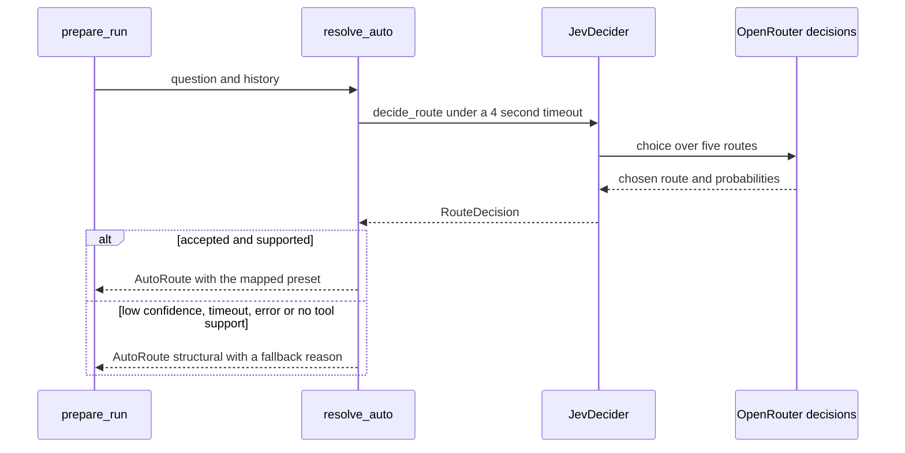

# The auto router

`auto` is a preset choice that is not a preset: it asks a decision model what kind of question was asked and runs the preset suited to that kind. A question about one function goes to `hybrid_rerank`, one about how files connect or why something changed goes to `structural`, one about the whole repository goes to the `deep_agent`, and one that is not about the code at all goes to `classic`. The router lives in [`agent/auto.py`](../../server/app/services/agent/auto.py) and the decision itself in [`decisions/points.py`](../../server/app/services/decisions/points.py). This page explains the routes, the decision, every fallback, and what the client sees.

## Terms used on this page

- **Route**: the kind of question, one of five values of `Route`.
- **Decision model**: a model that answers a multiple-choice question with a probability per option instead of text. Illume uses Jev (`typesafe/jev-1.14`) through OpenRouter; see [retrieval arms](retrieval-arms.md#decisions).
- **Confidence floor**: the probability the chosen route must reach to be trusted, `ROUTE_CONFIDENCE = 0.6`.
- **Fallback preset**: what runs when the route cannot be trusted, `FALLBACK_PRESET = "structural"`.

## Routes and presets

| Route          | What the decider is told it means                                              | Preset          | Why that preset                                                                                                    |
| -------------- | ------------------------------------------------------------------------------ | --------------- | ------------------------------------------------------------------------------------------------------------------ |
| `local`        | one place in the code: a single function, class, file or module                | `hybrid_rerank` | the answer is in one place, so keyword, identifier and dense search with a reranker find it cheaply                |
| `relational`   | how files or modules connect: imports, dependents, or a path between two files | `structural`    | needs graph and co-change expansion                                                                                |
| `history`      | why or when something changed, or who changed it                               | `structural`    | needs the history channel and its date ranges                                                                      |
| `global`       | the architecture, the stack, the entry points, or the repository as a whole    | `deep_agent`    | needs many lookups, starting from `get_overview`                                                                   |
| `out_of_scope` | not a question about this repository's code, or not answerable from it         | `classic`       | the cheapest preset; when nothing relevant is retrieved it returns the no-context answer without calling the model |

`ROUTE_PRESETS` in `auto.py` holds this mapping. The instructions sent with the options (`_ROUTE_INSTRUCTIONS`) restate the same definitions as a classification task: "Classify the question by what answering it needs."

## The decision



`resolve_auto(question, history, decider=None, supports_tools=..., timeout=None, confidence_floor=0.6)`:

1. **Build the decider.** With no decider passed in (the production path), it constructs a `JevDecider`. If that raises `DeciderUnavailable` (no `OPENROUTER_API_KEY`), it returns the fallback with reason `unavailable` without calling anything.
2. **Build the state.** `_route_state` sends the question (cut to `MAX_QUESTION_CHARS = 4000`) and, when there is one, the user's previous message (cut to `MAX_HISTORY_MESSAGE_CHARS = 500`) under "Previous question in this conversation", so a follow-up such as "and who wrote it?" can be classified. The whole state is bounded at `MAX_STATE_CHARS = 12000`.
3. **Decide.** `decide_route` makes one `choice` call over `ROUTE_OPTIONS`, under `asyncio.wait_for` with `ROUTE_TIMEOUT_SECONDS = 4.0`. The decision is recorded as a `DecisionRecord` for the step log.
4. **Judge.** `RouteDecision.accepted` is true when the chosen route's probability is at least the floor. The confidence is the chosen route's probability, or the decider's own reported confidence when it gave no probabilities. An answer that does not name a valid route is recorded as `relational` with `defaulted=True`, and a defaulted decision is never accepted.
5. **Check tool support.** If the route maps to `deep_agent`, it asks `supports_tools()`. `prepare_run` passes the result of the tool-support probe it has already made for the user's key, so no second probe is sent. A model without tool calling falls back with reason `no_tool_support`.
6. **Return** an `AutoRoute`: the resolved preset, the route, the confidence, the probability of every route, the fallback reason if any, the model, and the raw decision record.

### Fallback reasons

| `fallback_reason` | Cause                                                                    | Runs              |
| ----------------- | ------------------------------------------------------------------------ | ----------------- |
| none              | the route was trusted                                                    | the mapped preset |
| `unavailable`     | no `OPENROUTER_API_KEY`, so Jev cannot be built                          | `structural`      |
| `timeout`         | the decision took longer than 4 seconds                                  | `structural`      |
| `error`           | the decision raised (a provider error or malformed output)               | `structural`      |
| `low_confidence`  | the chosen route's probability was under 0.6, or the answer was unusable | `structural`      |
| `no_tool_support` | the route was `global` but the user's model cannot call tools            | `structural`      |

`structural` is the fallback because it is the most capable single-shot preset: it has every channel, so it does reasonably on every route, and it needs neither tool calling nor more than one generation call.

Unlike the decisions made inside a run, routing does **not** fall back to the user's own model when Jev fails. It goes straight to `structural`. The `FallbackDecider` described on the [retrieval arms](retrieval-arms.md#decisions) page is used for planning and Jev reranking, not for routing.

## Where it runs

`auto` is accepted by the streaming endpoint and the MCP `ask` tool, and only with the user's own key; a free-tier request for `auto` is refused with 402 in [`prepare_run`](../../server/app/services/agent/run_request.py) before routing. The routing call itself is made on the operator's OpenRouter key.

Routing happens inside `prepare_run` after the run slot is taken and before the `AgentRun` row is created. The resolved preset is what the run row stores as its `preset`, and overrides from the request are applied to the resolved preset, not to `auto`. The run's history bound and every later check use the resolved configuration.

Once the run starts, `RunSession` publishes a `route` event right after `run_started`:

```json
{
  "route": "relational",
  "confidence": 0.82,
  "probabilities": {
    "local": 0.09,
    "relational": 0.82,
    "global": 0.04,
    "history": 0.04,
    "out_of_scope": 0.01
  },
  "resolved_preset": "structural",
  "fallback_reason": null
}
```

It also records a `decision` step at index `-1` with the requested preset, the route data and the decision record, including its latency, so the evaluation can measure routing accuracy and cost from the step log. The web client's `PresetPicker` offers `auto`, and the agent reducer ([`lib/agent/reducer.ts`](../../client/src/lib/agent/reducer.ts)) keeps the route so the activity block can show which preset answered.

## Design trade-offs and limits

- **One cheap call.** A single bounded decision request adds little latency, and the 4-second timeout caps the worst case.
- **Fail toward capability.** Every failure runs `structural`, which is never the cheapest choice but rarely a bad one.
- **A coarse taxonomy.** Five routes cannot express a question that is both local and historical; such questions get whichever route scores highest.
- **No LLM fallback for routing.** A Jev outage sends every `auto` question to `structural` until it recovers.
- **Out of scope still answers.** `classic` is run rather than refusing, so an off-topic question still costs one generation call when anything is retrieved.
- **Operator-paid.** Routing runs on the operator's OpenRouter key even for users with their own key.

## Related documentation

- [Retrieval arms](retrieval-arms.md): the presets the router picks between, and the decision model.
- [The agent](agent.md): what runs for `global` questions.
- [Chat and citations](chat.md): the streaming endpoint that accepts `auto`.
- [Evaluation results](../evals/results-full-v1.md): how the presets compare by question type.
