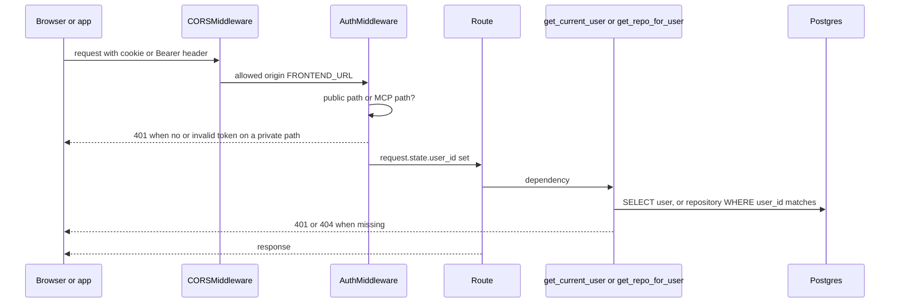

# Authentication and authorization

Illume authenticates people with a signed JSON Web Token (JWT) carried in an httponly cookie named `access_token`, or, for the mobile app, in an `Authorization: Bearer` header. Accounts are created with an email and password or through GitHub OAuth, which also stores the GitHub token used to clone private repositories. AI tools that connect to the MCP server use a separate kind of credential, a personal MCP token. Authorization is ownership: every query that reads a user's data filters by that user's id. This page documents [`security.py`](../../server/app/core/security.py), [`middleware/auth.py`](../../server/app/middleware/auth.py), [`api/deps.py`](../../server/app/api/deps.py), the auth routes in [`api/v1/auth.py`](../../server/app/api/v1/auth.py) and [`mcp_tokens.py`](../../server/app/services/mcp_tokens.py), and lists the known weaknesses plainly.

## Terms

- **JWT**: a signed token. Illume's carries `sub` (the user id) and `exp` (expiry), signed with HMAC-SHA256 (`HS256`) using `SECRET_KEY`, via `python-jose`.
- **httponly cookie**: a cookie JavaScript cannot read, so a script injected into the page cannot steal it.
- **Bearer token**: the same JWT sent in a header by a client that has no cookie jar (the Expo app).
- **MCP token**: a long random string starting `ilm_`, stored only as a SHA-256 hash, used by AI tools to call the MCP server. It is not a JWT.
- **Public path**: a URL prefix the middleware lets through without a token.

## The request path

[`main.py`](../../server/app/main.py) adds `AuthMiddleware` and then `CORSMiddleware`; Starlette runs the last-added middleware first, so CORS answers preflight requests before authentication runs. CORS allows exactly one origin, `settings.FRONTEND_URL`, with credentials, all methods and all headers.

### `AuthMiddleware`

`dispatch` reads the token through `_resolve_token`: the `access_token` cookie if present, otherwise an `Authorization: Bearer <token>` header. The cookie wins because it cannot be read by page scripts.

- **Public paths.** A path starting with any of `/healthz`, `/api/v1/auth/login`, `/api/v1/auth/register`, `/api/v1/auth/logout`, `/api/v1/auth/github`, `/api/v1/auth/github/callback`, `/api/v1/contact`, `/api/v1/ws` or `/openapi.json` passes through. If a valid token happens to be present, `request.state.user_id` is still set, so the contact form can attribute a signed-in submission; an invalid token on a public path is ignored.
- **The MCP path.** `MCP_PATH` and paths beneath it pass through, matched exactly rather than by prefix, because MCP callers authenticate with their own token (see [the MCP server](../mcp/server.md)).
- **Everything else.** No token is `401 {"detail": "Not authenticated"}`; a token that fails to decode or has expired is `401 {"detail": "Invalid or expired token"}`. Otherwise the user id goes on `request.state.user_id`.

The middleware does not check that the user still exists; the dependencies below do.

### Dependencies

[`deps.py`](../../server/app/api/deps.py) provides two:

- `get_current_user(request, db)`: `401 Not authenticated` without a user id on the request, `401 User not found` when the row is gone (a deleted account with a still-valid token).
- `get_repo_for_user(repo_id, user_id, db)`: `SELECT ... FROM repositories WHERE id = :repo_id AND user_id = :user_id`, `404 Repository not found` otherwise. A repository that exists but belongs to someone else is indistinguishable from one that does not exist.

There is no row-level security in Postgres and no ORM-level scoping. Every route that touches user data must call one of these, or filter by `user_id` itself. Routes keyed by the per-user `repo_number` (the repository page, for example) filter by `user_id` and `repo_number` together.

## Passwords and tokens

[`security.py`](../../server/app/core/security.py):

- `hash_password(password)` computes SHA-256 of the password, base64-encodes the digest (44 characters), and bcrypts that with a fresh salt. bcrypt only reads the first 72 bytes of its input; pre-hashing means a long passphrase is not silently truncated.
- `verify_password(plain, hashed)` repeats the pre-hash and calls `bcrypt.checkpw`.
- `create_access_token(subject, expires_delta=None)` signs `{"sub": subject, "exp": now + expiry}`. The default expiry is `ACCESS_TOKEN_EXPIRE_MINUTES`; mobile logins use `MOBILE_TOKEN_EXPIRE_MINUTES` (default 129,600 minutes, 90 days).
- `decode_access_token(token)` returns `sub`, or `None` on any `JWTError` including expiry.

There is no refresh token and no server-side session list. Logging out clears the cookie; a copied token stays valid until it expires. Rotating `SECRET_KEY` invalidates every token at once.

## Email and password accounts

| Route                        | Behaviour                                                                                                                                                                                        |
| ---------------------------- | ------------------------------------------------------------------------------------------------------------------------------------------------------------------------------------------------ |
| `POST /api/v1/auth/register` | `RegisterRequest`: `email` (validated), `name` 3–100 characters, `password` at least 8. `400 Email already registered` on a duplicate. Sets the cookie. `201`.                                   |
| `POST /api/v1/auth/login`    | `LoginRequest`: `email`, `password`. `401 Invalid credentials` on a mismatch. Sets the cookie with `max_age` of the access-token lifetime.                                                       |
| `POST /api/v1/auth/logout`   | Deletes the cookie.                                                                                                                                                                              |
| `GET /api/v1/auth/me`        | The profile, the provider and model of the saved AI key (never the key), `has_ai_key`, cached tool support, the agent context window, free-tier counters and limits, and whether MCP is enabled. |
| `DELETE /api/v1/auth/me`     | Requires `confirm_email` equal to the account's email (case-insensitive), deletes the user with a Core `DELETE` so Postgres cascades every owned row, and clears the cookie. `204`.              |

Every cookie is set with `httponly=True`, `samesite="lax"`, `secure` when `ENVIRONMENT == "production"`, and `domain=settings.DOMAIN`. `SameSite=Lax` keeps the cookie off cross-site `POST`, `PUT` and `DELETE` requests, which is the main defence against cross-site request forgery here; there is no separate CSRF token.

## GitHub OAuth

`GET /api/v1/auth/github?state=...` redirects to GitHub's authorize page with `scope=user:email repo`. The `repo` scope is what lets Illume clone private repositories and read their pull requests; it also grants write access to every repository the user can reach, which is far more than reading needs. `state` is passed through if the caller supplied one.

`GET /api/v1/auth/github/callback?code=...&state=...`:

1. `_exchange_github_code` posts the code to GitHub's token endpoint with `GITHUB_CLIENT_ID`, `GITHUB_CLIENT_SECRET` and `GITHUB_REDIRECT_URL`, then reads `/user` and `/user/emails`. No access token in the reply is `400 GitHub auth failed`.
2. It picks the email that is both `primary` and `verified`; none is `400 No verified email on GitHub account`.
3. It looks the user up by `github_id`, then by that email, so an existing password account with the same email is **linked** rather than duplicated. A new user is created otherwise, with no password.
4. It stores `github_id`, the avatar and the GitHub token (encrypted, see [BYOK and encryption](byok-and-encryption.md)).
5. It returns one of three shapes:

| Caller                                                          | Response                                                                                       |
| --------------------------------------------------------------- | ---------------------------------------------------------------------------------------------- |
| web (no header, `state` not allowlisted)                        | `302` to `_select_redirect_target(state)` (always `FRONTEND_URL` here) with the cookie set     |
| `X-Illume-Client: mobile` header, no allowlisted `state`        | JSON `{access_token, token_type: "Bearer", expires_in, redirect_uri}`                          |
| `state` exactly equal to an entry of `OAUTH_REDIRECT_ALLOWLIST` | `302` to that deep link with `access_token`, `token_type` and `expires_in` in the query string |

`_select_redirect_target` trusts only exact entries of `OAUTH_REDIRECT_ALLOWLIST` and falls back to `FRONTEND_URL`, so the callback is not an open redirect. Mobile and deep-link callers get the 90-day expiry. See [the mobile app](../mobile/overview.md) for the deep-link flow.

## MCP tokens

[`mcp_tokens.py`](../../server/app/services/mcp_tokens.py) mints and checks the credentials AI tools use:

- **Format.** `TOKEN_PREFIX = "ilm_"` followed by `secrets.token_urlsafe(32)` (43 characters). `_TOKEN_PATTERN` rejects anything else before touching the database.
- **Storage.** Only `hash_token(plaintext)`, a SHA-256 hex digest, is stored (`token_hash`), plus the first `DISPLAY_PREFIX_LENGTH = 8` characters after the prefix for display. A fast hash is appropriate because the token is 256 bits of randomness, not a guessable password.
- **Limits.** `MAX_TOKENS_PER_USER = 10` active tokens; creating an eleventh is `409`.
- **Lifetime.** `expires_in_days` of 30 or 90 (default 90), or `null` for a token that never expires.
- **Use.** `resolve_token` hashes the presented token, looks it up, compares with `hmac.compare_digest`, rejects revoked or expired tokens, and updates `last_used_at` at most once per `LAST_USED_THROTTLE` (one minute). Malformed, unknown, revoked and expired all look the same to the caller.

| Route                                    | Behaviour                                                                |
| ---------------------------------------- | ------------------------------------------------------------------------ |
| `GET /api/v1/auth/me/mcp-tokens`         | active tokens, newest first, metadata only                               |
| `POST /api/v1/auth/me/mcp-tokens`        | `{name, expires_in_days}`; the plaintext is in this response only. `201` |
| `DELETE /api/v1/auth/me/mcp-tokens/{id}` | revoke; revoking twice succeeds; `404` for another user's token. `204`   |

## The WebSocket

`/api/v1/ws/ingest/{repo_id}` is under the public `/api/v1/ws` prefix, so the middleware does not check it. [`ws.py`](../../server/app/api/v1/ws.py) checks for itself: the `access_token` cookie or a `?token=` query parameter, decoded with `decode_access_token`, then repository ownership. Any failure closes the socket with code `1008` (policy violation). See [WebSockets](../interfaces/websockets.md).

## Other credentials in the system

| Credential                | Where it lives                         | Page                                                 |
| ------------------------- | -------------------------------------- | ---------------------------------------------------- |
| user AI keys              | `users.ai_api_key`, encrypted          | [BYOK and encryption](byok-and-encryption.md)        |
| GitHub tokens             | `users.github_access_token`, encrypted | [BYOK and encryption](byok-and-encryption.md)        |
| push tokens               | `push_tokens`, plain Expo push tokens  | [the mobile app](../mobile/overview.md)              |
| operator keys and secrets | the server environment                 | [environment variables](../reference/environment.md) |

## Known security issues

These are present in the code today. They are listed so they are not extended, and so they can be fixed opportunistically.

1. **Prefix matching of public paths.** `any(path.startswith(public) ...)` means any path that _begins with_ a public path is public. `/api/v1/auth/github` makes `/api/v1/auth/githubX` public, and `/api/v1/ws` makes every future route under `/api/v1/ws...` public. No current route is exposed this way, but a new route added under one of those prefixes would silently skip authentication.
2. **Token in a query string.** The WebSocket accepts `?token=`, and the mobile deep-link callback puts the JWT in the redirect URL. Query strings end up in proxy and server access logs and in browser history.
3. **No rate limiting.** Login, register, the OAuth callback and the contact form have no rate limit or lockout, so passwords can be guessed online at whatever rate the server sustains.
4. **No OAuth `state` nonce.** `state` carries the deep-link target, not a random value bound to the browser session, so the callback cannot detect a login started elsewhere (login CSRF: an attacker can complete their own GitHub login in a victim's browser and sign the victim into the attacker's account).
5. **Linking by email.** A GitHub login whose verified primary email matches an existing password account takes over that account and replaces its GitHub token. This is safe only as far as GitHub's email verification is.
6. **A broad GitHub scope.** `repo` grants write access to every repository the user can reach.
7. **Login with a GitHub-only account errors.** Such accounts have `password = NULL`, and `verify_password` calls `.encode()` on it, so a password login attempt for their email raises `AttributeError` and returns 500 instead of 401. It also distinguishes those accounts from unknown emails.
8. **User enumeration by timing.** An unknown email returns without running bcrypt; a known one runs it, which is measurably slower.
9. **No session revocation.** JWTs are valid until `exp`; there is no server-side list to revoke one, and mobile tokens last 90 days.
10. **The register cookie has no `max_age`.** It is a browser-session cookie while the JWT inside it has an expiry; the two lifetimes disagree.
11. **Tokens in transit to workers.** Repository creation, re-ingest and the auto-update sweep pass decrypted GitHub tokens as Celery task arguments, so they sit in Redis messages (see [sync](../pipeline/sync.md#the-sweep) and [BYOK and encryption](byok-and-encryption.md#threat-model)).

## Design trade-offs and limits

- **Stateless JWTs.** No session table to query on each request, at the cost of no revocation.
- **Ownership by convention.** A `WHERE user_id = ...` in every query is easy to read and easy to forget; nothing enforces it centrally.
- **One origin.** CORS allows only `FRONTEND_URL`; a second web origin needs a code change.
- **SameSite as the CSRF defence.** Simple and adequate for same-site deployments; it relies on browsers honouring `Lax`.

## Related documentation

- [BYOK and encryption at rest](byok-and-encryption.md): stored AI keys, GitHub tokens and the free tier.
- [The MCP server](../mcp/server.md): how MCP tokens are used.
- [The HTTP API](../api.md): every route and its auth requirement.
- [WebSockets](../interfaces/websockets.md): the ingest log socket.
- [Environment variables](../reference/environment.md): `SECRET_KEY`, the token lifetimes and the OAuth settings.
