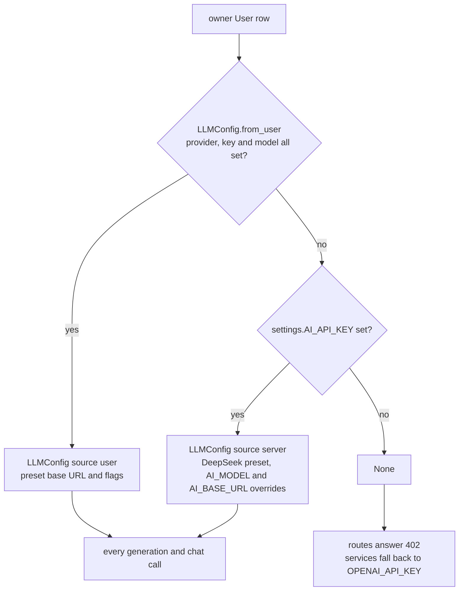
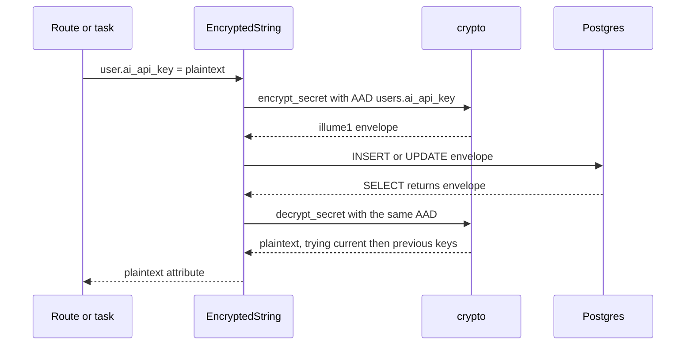

# Bring your own key, the free tier and encryption at rest

Illume's generation and chat run on a language model, and someone has to pay for every call. A user can save their own provider key (bring your own key, BYOK); without one, a small free tier runs on the operator's key. The decision of whose key pays is made once per request or task and carried as an immutable `LLMConfig` value through every service and thread. The two credentials Illume stores for users, AI keys and GitHub tokens, are encrypted in the database with AES-256-GCM. This page documents [`llm_config.py`](../../server/app/services/llm_config.py), [`llm_providers.py`](../../server/app/services/llm_providers.py), [`entitlements.py`](../../server/app/services/entitlements.py), [`tool_support.py`](../../server/app/services/tool_support.py), [`crypto.py`](../../server/app/core/crypto.py) and [`encrypted.py`](../../server/app/models/encrypted.py).

## Terms

- **BYOK**: the user pastes an API key for a supported provider in account settings; Illume calls that provider with it on their behalf.
- **Provider preset**: one of four fixed OpenAI-compatible providers, each with a base URL, a default model and capability flags. There is no custom-URL option.
- **Free tier**: a per-user allowance of 3 ingestions and 10 chat questions paid by the operator's `AI_API_KEY`.
- **`LLMConfig`**: a frozen dataclass of strings and booleans holding one resolved credential: key, model, base URL, whether reasoning effort is supported, whether strict tool schemas are supported, and whether it is the user's or the server's.
- **Envelope**: the stored form of an encrypted credential, `illume1.<keyId>.<iv>.<tag>.<ciphertext>`.
- **AAD** (additional authenticated data): bytes that are authenticated with a ciphertext but not encrypted. Illume uses it to bind each ciphertext to the column it lives in.

## Provider presets

[`llm_providers.py`](../../server/app/services/llm_providers.py) holds `PROVIDERS`, a dict of `AIProvider` records. It imports no settings, so standalone scripts can read it without a full environment.

| Key          | Label      | Base URL                         | Default model             | `supports_reasoning` | `supports_strict_tools` | `key_prefixes` |
| ------------ | ---------- | -------------------------------- | ------------------------- | -------------------- | ----------------------- | -------------- |
| `openai`     | OpenAI     | `https://api.openai.com/v1`      | `gpt-4o-mini`             | yes                  | yes                     | none           |
| `groq`       | Groq       | `https://api.groq.com/openai/v1` | `llama-3.3-70b-versatile` | no                   | no                      | `gsk_`         |
| `openrouter` | OpenRouter | `https://openrouter.ai/api/v1`   | `openai/gpt-4o-mini`      | yes                  | no                      | `sk-or-`       |
| `deepseek`   | DeepSeek   | `https://api.deepseek.com`       | `deepseek-flash`          | yes                  | no                      | none           |

- **Every preset speaks the Responses API**, which is what all generation and chat code calls (`client.responses.create`).
- **DeepSeek has no `/v1`.** Its Responses endpoint is `https://api.deepseek.com/responses`; a trailing `/v1` returns 404 at request time, not at import.
- **Groq has no reasoning parameter.** Its models can reject `reasoning.effort` with a 400, and the reading-order stage swallows per-batch errors, so sending it would silently produce an empty tour. `response_kwargs` sends nothing for Groq.
- **Strict tools only for OpenAI.** `strict: true` function schemas (every property required, no extras) are enforced reliably only by OpenAI; Groq enforces it on some models, OpenRouter depends on the backend, and DeepSeek only on a beta endpoint. The agent sends plain schemas to the others.
- **No custom base URL.** A user-supplied URL would need server-side request forgery protection, since the server would send the user's key to whatever host was named.

`get_provider(key)` raises `KeyError` for an unknown key; callers map that to 422. `suggest_provider(provider_key, model=..., api_key=...)` powers the "did you mean" hint when a key is rejected: it checks whether the model equals another preset's default model, then whether the key starts with another preset's prefix. It compares the key against those literals only and never sends it to another provider. OpenAI and DeepSeek both issue `sk-` keys, which is why neither lists a prefix.

## Resolving a credential



- `LLMConfig.from_user(user)` returns `None` unless `ai_provider`, `ai_api_key` and `ai_model` are all set, and re-raises `KeyError` for a provider that no longer exists so a stale row is not silently replaced by the server key.
- `LLMConfig.server_default()` returns `None` when `AI_API_KEY` is empty, so a deployment without a free-tier key reports "free tier disabled" instead of a 401 at request time. Otherwise it uses the DeepSeek preset, with `AI_MODEL` and `AI_BASE_URL` each overriding one half; if only one is set, the other still comes from the preset, so the two cannot drift into a mismatched pair.
- `llm_config_for(user)` in [`entitlements.py`](../../server/app/services/entitlements.py) is the policy: user key, else server default, else `None`.

### Two contracts the call sites depend on

1. **`client_kwargs()` omits `base_url` when it is `None`.** Passing `base_url=None` behaves the same today, but omission is the guard against someone later "fixing" it to a real URL. The embedding client is separate and never takes a `base_url` at all: the OpenAI SDK reads `OPENAI_BASE_URL` from the environment, which is how the end-to-end suite points embeddings at its stub (see [frontend and end-to-end tests](../testing/frontend-and-e2e.md)).
2. **`response_kwargs(effort)` is `{}` without reasoning support**, otherwise `{"reasoning": {"effort": effort}}`. The glossary, the reading order and classic chat ask for `minimal`; the brief asks for `low`.

### Why a value object, and why never a context variable

`LLMConfig` is built from the `User` row on the main thread and passed explicitly to every function that calls a model. The ingest's overlapped stages run on real threads, which do not inherit `contextvars` from their parent; a context variable would silently fall back to the server key for every BYOK user in those stages. Because `LLMConfig` contains only strings and booleans, it also satisfies the [scalars-only rule](../pipeline/concurrency-and-failure.md#the-scalars-only-rule) for thread helpers.

### Embeddings always use the operator's key

Embedding calls in [`embedder.py`](../../server/app/services/embedder.py) and the retrieval code authenticate with `settings.OPENAI_API_KEY` and model `text-embedding-3-small`, whoever owns the repository. A BYOK user's provider may not offer that embedding model, and the 1536-dimension column fixes the model for the whole database. So BYOK covers generation and chat, and the operator always pays for indexing.

## Saving a key

`PUT /api/v1/auth/me/ai-credentials` takes `{provider, api_key, model}` (`api_key` 8–512 characters). It never writes before it has proved the key works:

1. An unknown `provider` is `422`.
2. `_probe_credentials` builds an `AsyncOpenAI` client with a 15-second timeout and no retries, and sends `input="ping"` with `max_output_tokens=16` and the preset's reasoning extras.
   - `AuthenticationError` → `400 Incorrect API key for <Provider>.` plus the mismatch hint.
   - another `APIStatusError` → `400 That model isn't available on <Provider>.` plus the hint.
   - connection error or timeout → `400 Could not reach <Provider>.`
3. `check_tool_support` (in [`tool_support.py`](../../server/app/services/tool_support.py)) sends `"Call the ping tool."` with one `PING_TOOL` function and `tool_choice="auto"`, `max_output_tokens=512`. It returns `True` when the reply contains a `function_call` item, `False` when the provider answered without one or rejected the request, and `None` when no answer came (timeout, connection error, rate limit, server error). It never raises, and a `False` never turns a successful save into a failure: a key that only generates text is still a valid key.
4. Only then are `ai_provider`, `ai_api_key`, `ai_model`, `ai_key_validated_at`, `ai_supports_tools` and `ai_tools_checked_at` written.

`GET /api/v1/auth/me/ai-credentials` returns provider, model, `has_key`, `validated_at`, `supports_tools` and `tools_checked_at`, never the key. `DELETE` clears all six columns; artefacts already generated stay, and the free-tier counters are not reset.

### Tool support and its cache

Agent presets need a model that can call functions (see [the agent](../retrieval/agent.md)). `cached_tool_support(user)` trusts a stored `True` forever, but treats a stored `False` as unknown when it has no timestamp, predates `PROBE_REVISED_AT` (7 November 2026, when the probe changed), or is older than `NEGATIVE_VERDICT_TTL` (one day). `ensure_tool_support(db, user)` re-probes in that case on the first agent request and stores a definite answer; a `None` answer is not stored, so the next request tries again.

### Agent settings

`GET` and `PUT /api/v1/auth/me/agent-settings` read and write `ai_context_window`, the most input tokens one model call of an agent run may carry, bounded by `MIN_CONTEXT_WINDOW` and `MAX_CONTEXT_WINDOW` and defaulting to `DEFAULT_CONTEXT_WINDOW` (all from the agent's budget module; see [the agent](../retrieval/agent.md#token-budgets)). It is stored separately from the key so removing a key does not reset it.

## The free tier

[`entitlements.py`](../../server/app/services/entitlements.py) defines the allowance as module constants, served to the client on `/auth/me` so the banner and the composer never carry their own copy:

| Constant             | Value |
| -------------------- | ----- |
| `FREE_INGESTIONS`    | 3     |
| `FREE_CHAT_MESSAGES` | 10    |

Each claim is a conditional update, so two concurrent requests cannot both spend the last unit:

```text
UPDATE users SET free_ingestions_used = free_ingestions_used + 1
WHERE id = :user_id AND free_ingestions_used < 3
```

| Helper                      | Session | Commits | Used by                                                                                                          |
| --------------------------- | ------- | ------- | ---------------------------------------------------------------------------------------------------------------- |
| `claim_free_ingestion`      | sync    | no      | tests and scripts                                                                                                |
| `aclaim_free_ingestion`     | async   | no      | `POST /repository`, in the same transaction as the insert, so a failed insert returns the unit                   |
| `claim_free_chat_message`   | sync    | yes     | tests and scripts                                                                                                |
| `aclaim_free_chat_message`  | async   | yes     | classic chat and the agent, in its own short transaction so the user row is not locked during the model call     |
| `arefund_free_chat_message` | async   | yes     | the agent, when a claimed answer is never delivered (failed, cancelled before output, or nothing to answer from) |

Where each gate sits:

| Action                          | With own key                                          | Without own key                                                              |
| ------------------------------- | ----------------------------------------------------- | ---------------------------------------------------------------------------- |
| create a repository             | allowed                                               | claims a free ingestion; `402` with `QUOTA_EXHAUSTED_DETAIL` when spent      |
| re-ingest                       | allowed                                               | `402` (`_require_user_key`)                                                  |
| enable auto-update, manual sync | allowed                                               | `402`; `sync_available` is `false` on the repository so the UI disables them |
| a swept sync                    | runs                                                  | the task skips it                                                            |
| classic chat                    | allowed                                               | pre-checked, then claimed; `402` when spent                                  |
| single-shot presets (no tools)  | allowed                                               | runs on the server key and claims a free message; `402` when spent           |
| tool-using agent presets        | allowed if the model can call tools (`400` otherwise) | `402`                                                                        |
| `auto` mode                     | allowed                                               | `402`                                                                        |

A repository created on the free tier is inserted with `auto_update_enabled = False`, so the operator's key stops paying the moment the free ingestion ends. The full agent gating, including the 429 for concurrent runs, is on [the agent](../retrieval/agent.md).

## Encryption at rest

### What is encrypted

| Column                      | AAD                                       |
| --------------------------- | ----------------------------------------- |
| `users.ai_api_key`          | `credential:v1:users.ai_api_key`          |
| `users.github_access_token` | `credential:v1:users.github_access_token` |

MCP tokens are stored as SHA-256 hashes rather than encrypted (see [auth](auth.md#mcp-tokens)); push tokens and everything else are plaintext.

### The scheme

[`crypto.py`](../../server/app/core/crypto.py):

- **Key derivation.** `_derive_key(passphrase)` runs HKDF-SHA256 over `CREDENTIAL_ENCRYPTION_KEY` with salt `illume/credential-encryption/v1` and info `credential:v1`, producing a 32-byte AES-256 key. The setting must be at least `MIN_KEY_LENGTH = 32` characters; `openssl rand -base64 32` produces 44. There is no default: it is a required setting, and a short one raises `RuntimeError` on first use.
- **Encryption.** `encrypt_secret(plaintext, aad)` draws a fresh 96-bit IV from `os.urandom`, encrypts with AES-GCM, splits off the 16-byte tag and returns `illume1.<keyId>.<base64 iv>.<base64 tag>.<base64 ciphertext>`. `keyId` is the first 8 hex characters of SHA-256 of the derived key: a non-secret hint of which key wrote the value.
- **Decryption.** `decrypt_secret(envelope, aad)` validates the shape (prefix, four non-empty parts, strict base64, 12-byte IV, 16-byte tag) and tries the current key, then each key in `CREDENTIAL_ENCRYPTION_KEY_PREVIOUS` (comma-separated, entries shorter than 32 characters ignored). A wrong key and a tampered value both fail GCM's tag check, so it tries the next key. If none opens it, `CredentialDecryptionError`. Neither the plaintext, the envelope nor the key ever appears in a log or an exception message.
- **Column binding.** The AAD names the table and column, so an envelope copied from `ai_api_key` into `github_access_token` fails to decrypt.



### The column type

[`EncryptedString(table, column)`](../../server/app/models/encrypted.py) is a SQLAlchemy `TypeDecorator` over `String`. `process_bind_param` encrypts any value that is not already an envelope; `process_result_value` decrypts envelopes and returns a non-envelope value unchanged with a warning (a row written before encryption, which the migration converts). Every reader and writer, async routes, Celery tasks, scripts and tests, sees plaintext in Python and ciphertext in the database without doing anything.

Two consequences of encrypting in the column type:

- **Equality queries do not work.** Each write uses a fresh IV, so `WHERE ai_api_key = :x` never matches. `IS NULL` and `IS NOT NULL` do work, and that is all the code uses (for example `_user_has_ai_key`).
- **Every load decrypts.** Selecting a `User` row decrypts both columns even when the caller never reads them, so a missing or wrong key breaks any query that loads users, not only the ones that need the credential.

### The migration

Revision [`d9e0f1a2b3c4_encrypt_stored_credentials`](../../server/alembic/versions/d9e0f1a2b3c4_encrypt_stored_credentials.py) reads every non-null `github_access_token` and `ai_api_key` with raw SQL and rewrites each plaintext value as an envelope. It skips values that are already envelopes, so it is idempotent, which matters when several test workers migrate one database at once. `downgrade` decrypts back to plaintext. The migration needs `CREDENTIAL_ENCRYPTION_KEY` in the environment it runs in.

### Rotating the key

1. Generate a new key and set it as `CREDENTIAL_ENCRYPTION_KEY`; move the old one into `CREDENTIAL_ENCRYPTION_KEY_PREVIOUS`.
2. Deploy. New writes use the new key; reads fall back to the old one.
3. Remove the old key only after every stored value has been rewritten with the new one.

There is no re-encryption job. An existing envelope is rewritten only when its plaintext changes (a user saves a new key, or a GitHub login stores a new token); reading and saving the same value does not re-encrypt it, because SQLAlchemy does not flag an unchanged attribute as dirty and `process_bind_param` passes envelopes through. In practice the old key must stay in `CREDENTIAL_ENCRYPTION_KEY_PREVIOUS` until each affected user replaces their credential, or until someone writes a script that decrypts and re-encrypts every row. The `keyId` in each envelope tells you which key wrote it.

### Threat model

The [`crypto.py`](../../server/app/core/crypto.py) docstring is explicit: the scheme protects against a leaked backup or database dump, a read-only SQL injection, or a `SELECT *` in a support tool. It does not protect against anyone who can read the running process's environment, which holds the key. It is not a vault.

Places a decrypted credential leaves the database, by design or not:

- the AI key is sent to the chosen provider on every call;
- the GitHub token is embedded in the clone URL and remains in each cached clone's `.git/config` (see [the clone cache](../pipeline/clone-cache.md#tokens-and-redaction));
- the GitHub token is passed as a Celery task argument, and therefore through Redis, by `POST /repository` and re-ingest (to `ingest_repository`) and by the auto-update sweep (to `sync_repository`); the manual sync route does not.

## Design trade-offs and limits

- **Four presets, no custom URL.** A fixed list keeps the request surface small and avoids sending keys to arbitrary hosts; a fifth provider needs a code change.
- **The operator pays for embeddings.** Indexing never uses the user's key, because the embedding model is fixed by the schema.
- **Encryption in the column type.** Transparent to every caller, at the cost of decrypting on every load and losing equality queries.
- **Rotation without re-encryption.** Cheap to start, but the previous key cannot be retired until every row has been rewritten.
- **Tokens in the broker.** Encryption at rest does not cover task arguments.
- **A probe at save time only.** A key revoked later fails at the next ingest or chat, not at save.

## Related documentation

- [Authentication and authorization](auth.md): sessions, GitHub OAuth and MCP tokens.
- [LLM generation](../pipeline/generation.md): how the four generation services use `LLMConfig`.
- [The agent](../retrieval/agent.md): presets, tool support and the free-tier rules for agent runs.
- [Environment variables](../reference/environment.md): `CREDENTIAL_ENCRYPTION_KEY`, `AI_API_KEY` and the rest.
- [The data model](../reference/data-model.md): the `users` columns.
