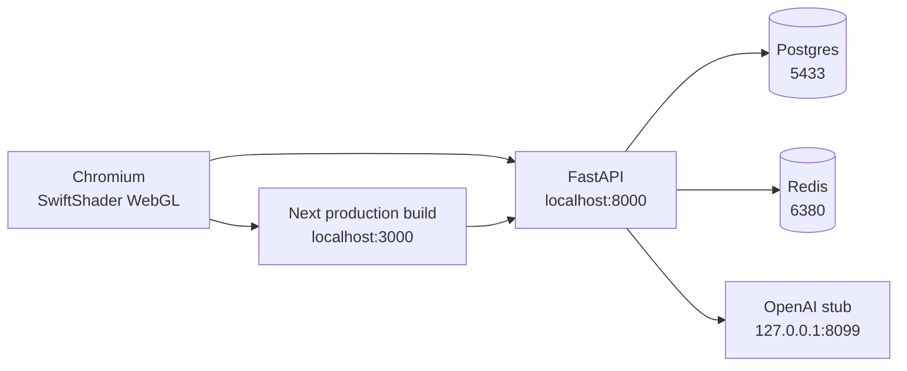
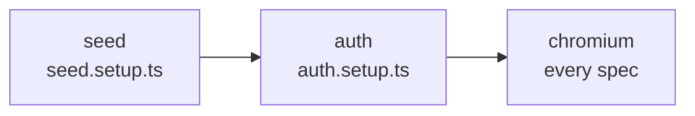

# Frontend and end-to-end tests

The web client has three browser-side suites: Vitest for units, hooks and components; a Playwright suite that boots a real API, an OpenAI stub and a production Next build against the test database; and a second Playwright suite that drives the deployed site as a real account. The mobile app has its own Jest suite. This page explains how each is configured, why the configuration looks the way it does, how to run and debug each one, and how to add a test.

## Terms used on this page

- **Vitest project**: a named slice of the Vitest run with its own environment and include list.
- **happy-dom**: a fast, incomplete browser DOM implementation for Node, used for component tests.
- **MSW (Mock Service Worker)**: a library that intercepts `fetch` at the network layer, so code under test makes ordinary requests.
- **Playwright project**: a named group of tests with its own settings; projects can depend on each other.
- **Storage state**: cookies and local storage saved by one Playwright project and loaded by another, so specs start signed in.
- **SwiftShader**: Chromium's software WebGL rasteriser, used where there is no GPU.

## Running the frontend suite

```bash
cd client
npm test                                        # watch mode
npm run test:run                                # one pass, what make test-fe runs
npm run test:coverage                           # one pass with coverage, what CI runs
npm run test:ui                                 # the Vitest browser UI
npx vitest run tests/unit/hooks/useChat.test.ts # one file
npx vitest run -t "clears history"              # one test by name
npx vitest run --project dom                    # one project
```

`npm test` never exits, so scripts use `test:run`.

## Vitest configuration

[`vitest.config.ts`](../../client/vitest.config.ts) defines two projects, split by environment rather than by directory:

| Project | Environment | Includes                                                                                                             |
| ------- | ----------- | -------------------------------------------------------------------------------------------------------------------- |
| `node`  | `node`      | `tests/unit/api/**`, `tests/unit/utils/**`, `tests/unit/types/**`, `tests/unit/*.test.ts` (the `proxy.ts` auth gate) |
| `dom`   | `happy-dom` | `tests/unit/hooks/**`, `tests/unit/lib/**`, `src/**/__tests__/**`                                                    |

The DOM environment is slower and most pure logic does not need it. The split has one sharp edge: importing a component under `node` fails with `document is not defined`, not a clear message. A component test colocated in `src/**/__tests__/` lands in `dom` automatically.

Coverage uses the V8 provider with `text` and `json-summary` reporters over `src/**/*.{ts,tsx}`, excluding `*.d.ts`, `__tests__/`, and the route `loading.tsx` and `error.tsx` files. CI reads `coverage/coverage-summary.json` for the ratchet (floor 62, lines).

### What the setup file does

[`tests/setup.ts`](../../client/tests/setup.ts) runs before every test in both projects:

1. **Raises the async-utility timeout to 3,000 ms** (`configure({ asyncUtilTimeout: 3000 })`). Under a full parallel run, tests waiting on an `IntersectionObserver` callback and then an MSW round trip missed the 1 s default by about 85 ms while passing alone. It stays under Vitest's 5 s test timeout, so a failing wait still names its assertion.
2. **Patches `Animation.prototype.cancel`.** `cancel()` rejects the animation's `finished` promise, and framer-motion cancels during unmount without a handler, leaving an unhandled rejection for every animated component. Suppressing it once keeps real unhandled rejections visible.
3. **Replaces `ResizeObserver`.** happy-dom's never reports anything, so components that size themselves (the pixel graph canvases, diagram fitting) would never lay out. The shim reports the element's size once on `observe`.
4. **Sets `NEXT_PUBLIC_BACKEND_URL`** to `http://localhost:8000` when unset. Vitest exposes only `VITE_` names from `.env`, so without this every client builds `undefined/api/v1/...`.
5. **Mocks `next/image`**, which calls `getImgProps` and throws outside a Next build.
6. **Starts the MSW server with `onUnhandledRequest: "error"`** and runs `cleanup()` after every test, unconditionally.

### Network mocking

Handlers live in [`tests/msw/handlers.ts`](../../client/tests/msw/handlers.ts) and the server in [`tests/msw/server.ts`](../../client/tests/msw/server.ts). Because unhandled requests are errors, a test that forgets a handler fails with a message naming the request, not a connection error to `localhost:8000`. The cost is intended: adding an API call to a component breaks its tests until a handler is registered.

Other test doubles in [`tests/mocks/`](../../client/tests/mocks/): `fakeWebSocket.ts` for [`useIngestStream`](../interfaces/websockets.md#the-client), and `next-image.tsx`.

### What is covered

| Area                 | Where                                    | Notes                                                                                                                                                  |
| -------------------- | ---------------------------------------- | ------------------------------------------------------------------------------------------------------------------------------------------------------ |
| Server API clients   | `tests/unit/api/`                        | URL, method, cookie forwarding, typed mapping, 401/404/500 and empty 204                                                                               |
| Hooks                | `tests/unit/hooks/`                      | `useIngestStream`, `useConversationList`, `useGitGraph`, `useGlossarySearch`, the form hooks, `useLogout`                                              |
| Library code         | `tests/unit/lib/`                        | `docs.test.ts` over the real `docs/` folder, `pixelGraph`, `mermaidZoom`, and the agent client (`agent/` reducer, SSE parser, answer assembly, limits) |
| Validators and utils | `tests/unit/types/`, `tests/unit/utils/` | form schemas, `ingestFlow`, `timeAgo`, `stripLeadingTitle`                                                                                             |
| The auth gate        | `tests/unit/proxy.test.ts`               | redirects for protected and public paths                                                                                                               |
| Pages                | `src/app/__tests__/`                     | home, login, contact, not-found, repository home, settings                                                                                             |
| Components           | `src/components/__tests__/`              | settings panels, ingest flow, repo picker, status poller, navbars, and a mount test for the 3D graph                                                   |
| Chat                 | `src/components/chat/__tests__/`         | the chat page, answer view, activity block, sidebar, preset picker, stale notice                                                                       |
| UI primitives        | `src/components/ui/__tests__/`           | citation card, file tree, file detail, glossary letters, repo thumbnail, select, switch                                                                |

`graph-client-mount.test.tsx` mocks `react-force-graph-3d`, because happy-dom has no WebGL; it proves the component initialises, not that it draws. The drawing is checked in the end-to-end suite.

[The docs test](../frontend/docs-site.md#checks) is in this suite, so a broken link or a missing sidebar entry in these pages fails `frontend-tests` in CI.

### Optimistic UI

Send, delete, rename and clear update local state before their request. Tests assert the optimistic state and the after-failure state separately, because "the UI changed" and "the server accepted it" are different claims.

## The end-to-end suite

`client/e2e/`, run by Playwright, is the only layer that uses a real browser against the real stack. It exists to catch what the other suites cannot: a server component that throws, a route that 404s, a cookie lost across a redirect, WebGL that fails without a GPU.

```bash
make test-infra                                    # the suite needs the test stack
cd client
npm run test:e2e                                   # the whole suite
npm run test:e2e:report                            # open the HTML report
npx playwright test --config=e2e/playwright.config.ts e2e/specs/chat.spec.ts
npx playwright test --config=e2e/playwright.config.ts --headed
npx playwright test --config=e2e/playwright.config.ts --ui
```

### The three web servers

[`e2e/playwright.config.ts`](../../client/e2e/playwright.config.ts) starts three servers in order and polls each until it answers. Their `cwd` is resolved from the config file's directory, not the shell's.



| Order | Command                                                                    | Polled at            | Timeout |
| ----- | -------------------------------------------------------------------------- | -------------------- | ------- |
| 1     | `uv run python scripts/openai_stub_server.py`                              | `{STUB_URL}/healthz` | 120 s   |
| 2     | `uv run python -m uvicorn app.main:app --port {API_PORT}` with `serverEnv` | `{API_URL}/healthz`  | 120 s   |
| 3     | `npm run build && npm run start` with `NEXT_PUBLIC_BACKEND_URL` and `PORT` | `CLIENT_URL`         | 300 s   |

Outside CI, `reuseExistingServer` lets an already-running server on the same port be reused. The API's health check returns 503 when Redis is down, so a run without `make test-infra` times out waiting for the API.

The client is built inside the command because `NEXT_PUBLIC_BACKEND_URL` is inlined at build time: passing it to `next start` would do nothing, and a stale build fails in the browser as a CORS or connection error.

**There is no Celery worker.** No spec waits for an ingestion; the seed inserts ready repositories directly, and the pipeline is covered by the backend's eager task tests.

### The model seam

[`e2e/env.ts`](../../client/e2e/env.ts) builds `serverEnv`, the API's whole environment. It sets `OPENAI_BASE_URL` and `AI_BASE_URL` to the stub, with placeholder keys, so every model call the API makes (embeddings, Classic answers, the free-tier path) lands on [`server/scripts/openai_stub_server.py`](../../server/scripts/openai_stub_server.py). An end-to-end run never makes a billed call. The variables are listed in [the environment reference](../reference/environment.md#end-to-end-tests).

The stub serves `POST /v1/responses` (plain or streamed as server-sent events; when the request carries `tools` it plays a short script of one `grep_code` call and then a fixed sentence) and `POST /v1/embeddings`. Every embedding is the same constant, `RETRIEVABLE_VECTOR`, which the seed also stores on its chunks. Two unrelated 1,536-dimension vectors sit near distance 1.0, beyond retrieval's 0.7 cut, so a realistic fake would make Classic retrieval find nothing and return its canned answer without calling the model; one shared vector gives distance 0.

### Projects and the seed



- **`seed`** runs [`server/scripts/seed_e2e.py`](../../server/scripts/seed_e2e.py) once the API is listening (a dependency project, not `globalSetup`, because only projects are guaranteed to run after the web servers are healthy). The script migrates the test database, waits for the API, deletes the previous E2E user and their repositories, registers the user, inserts two ready repositories and writes `.auth/seed.json`.
- **`auth`** signs in once and saves the cookie to the storage-state file.
- **`chromium`** runs every spec as Desktop Chrome with that storage state and the SwiftShader flags `--use-gl=angle --use-angle=swiftshader --enable-unsafe-swiftshader --disable-gpu-sandbox`.

| Seeded repository | Contract                                                    |
| ----------------- | ----------------------------------------------------------- |
| `seed-repo`       | every browsing spec reads it; nothing may mutate it         |
| `reingest-me`     | the one repository the re-ingest spec is allowed to destroy |

Specs read identifiers through `readSeed()` and `repoNamed()` **inside `test.beforeEach`**, never at module scope. Playwright loads every spec to build the test list before any project runs, so a module-scope read of `.auth/seed.json` fails on a clean checkout, and appears to work locally only because an old file survives.

### Settings

| Setting                        | Value                                                             | Why                                                                                                                 |
| ------------------------------ | ----------------------------------------------------------------- | ------------------------------------------------------------------------------------------------------------------- |
| `workers`, `fullyParallel`     | `1`, `false`                                                      | the seeded database is shared and one spec mutates a repository                                                     |
| `retries`                      | `2`, always                                                       | a test that passes on retry is reported as flaky, which is worth seeing                                             |
| `forbidOnly`                   | in CI                                                             | a stray `test.only` fails the run                                                                                   |
| `timeout`, `expect.timeout`    | 60 s, 10 s                                                        |                                                                                                                     |
| `trace`, `video`, `screenshot` | `retain-on-failure`, `retain-on-failure`, `only-on-failure`       | a green run stores nothing                                                                                          |
| Ports                          | `E2E_CLIENT_PORT` 3000, `E2E_API_PORT` 8000, `E2E_STUB_PORT` 8099 | so a run can sit beside a dev stack                                                                                 |
| `API_URL`                      | `http://localhost:…`, not `127.0.0.1`                             | the cookie's `Domain=localhost` must match the browser's host; a mismatch is a login that silently does not persist |

### Specs

| Spec                     | Tests | Covers                                                                                                                                                                               |
| ------------------------ | ----- | ------------------------------------------------------------------------------------------------------------------------------------------------------------------------------------ |
| `smoke.spec.ts`          | 4     | a heading renders, not the framework error screen, `/healthz` answers, the 404 page                                                                                                  |
| `auth.spec.ts`           | 9     | sign-in, sign-out, the proxy redirects, protected routes                                                                                                                             |
| `seeded-browse.spec.ts`  | 18    | dashboard, repository overview, explorer, glossary, and the 3D graph: the canvas paints, level switch, reading-order tour, search                                                    |
| `chat.spec.ts`           | 11    | navigation, history (load, rename, delete), a Classic turn against the real backend, the free tier disabling agent presets, a Deep agent run on a scripted stream, a mobile viewport |
| `reingest.spec.ts`       | 3     | re-ingesting `reingest-me` and the UI reflecting it                                                                                                                                  |
| `free-tier-chat.spec.ts` | 3     | the keyless free tier, and that an unowned repository is a 404, not a 402                                                                                                            |
| `mcp-settings.spec.ts`   | 1     | a token made in Settings works against `/mcp` until it is revoked                                                                                                                    |

### Artifacts

| Artifact                    | Location                    | Resolved against              |
| --------------------------- | --------------------------- | ----------------------------- |
| HTML report                 | `client/playwright-report/` | the shell's working directory |
| Traces, screenshots, videos | `client/e2e/test-results/`  | the config file               |

Neither path is a typo: `outputDir: "test-results"` resolves against `e2e/playwright.config.ts`, while the HTML reporter's default folder resolves against where Playwright was started (`client/`, because npm runs there). Open the report from `client/`; run from the repository root, `npx` looks for a second Playwright and then says no report exists.

```bash
cd client
npx playwright show-report playwright-report
npx playwright show-trace e2e/test-results/<test-name>/trace.zip
npx playwright test --config=e2e/playwright.config.ts e2e/specs/chat.spec.ts --trace=on
```

A trace is usually more useful than a video: it shows which element each locator resolved to, the DOM at that moment and the network response. A file filter still runs `seed` and `auth`, so one spec runs against a seeded database.

## The production smoke suite

`client/e2e-prod/` drives the **deployed** site as a dedicated smoke account. It boots nothing and needs no Docker; it reads `client/.env.smoke` locally (shape in `client/.env.smoke.example`) or the `SMOKE_*` variables in CI.

```bash
make test-e2e-prod            # or: cd client && npm run test:e2e:prod
```

### Guard rails

It writes to production, so the safety checks are the feature:

- **No `webServer` and no `globalSetup`**, so it cannot start a local stack or reach the local seed, which deletes data. Its `.auth/`, `test-results/` and `playwright-report/` live under `e2e-prod/`.
- **[`guard.ts`](../../client/e2e-prod/guard.ts) refuses to start** unless both origins are `https:` and their hostnames are exactly on an allow-list (set membership, never a substring test, so `illume.tejasnasa.me.attacker.tld` is refused). Localhost and bare IPs are refused, and the two hosts must share a registrable domain because the session cookie is `SameSite=Lax`.
- Missing variables are reported together.
- **Traces and video are off**: a trace records typed values, including the password, and CI artifacts are readable by anyone with repository access.
- **No retries on writes**: a retry would re-issue a billed model call.
- The workflow has no `pull_request` trigger and never cancels a run in flight.

### Projects

| Project         | Signed in | Retries | Does                                                                                                                         |
| --------------- | --------- | ------- | ---------------------------------------------------------------------------------------------------------------------------- |
| `setup`         | creates   | n/a     | `POST /api/v1/auth/login`, asserts the cookie's `Domain` in both `Set-Cookie` and the stored state, clears chat history      |
| `public`        | no        | 1       | homepage, 404, contact form rendered (never submitted), the proxy redirect, a cross-origin `fetch` from the page, `/healthz` |
| `authenticated` | yes       | 0       | dashboard, repository overview, explorer, glossary, graph and settings, read-only                                            |
| `journey`       | yes       | 0       | one real chat turn, deleted again in a teardown that runs on failure too                                                     |

There is no password form in the UI, so sign-in calls the login endpoint and injects the cookie. That makes **the cookie `Domain` assertion the most valuable check in the suite**: scoped wrongly, the Next proxy never sees the cookie on the web origin and every protected page redirects to `/login`. The setup fails with a message naming `DOMAIN` on the server rather than a navigation timeout.

`public` has no dependency on `setup`, so it still reports whether the site is up when sign-in is what broke. The chat turn is the only proof that the provider still accepts the operator's key; the other probes prove configuration, not that a key works.

Deliberately not covered: the GitHub OAuth round trip, real ingestion (the smoke repository was ingested once by hand), the ingest WebSocket, Celery and beat, email delivery, and anything that depends on model-generated content.

The workflow adds a shell probe of `/mcp` after Playwright; see [production smoke in CI](../operations/ci-cd.md#production-smoke).

### Why `/healthz` has no database probe

`GET /healthz` returns `{"status": "ok", "checks": {"redis": "ok"}}`, or 503 with `"status": "degraded"` when a check fails ([`app/main.py`](../../server/app/main.py), [`app/core/health.py`](../../server/app/core/health.py)). The Redis probe runs under a deadline because the client has no connection timeout. There is deliberately no Postgres probe: opening a fresh connection measured connection setup, which on the deployed instance exceeded any sensible health budget and reported a healthy database as down, and reusing the app's pool from another event loop raises. Database health is covered functionally, by specs that read pages and write and re-read a chat turn.

## The mobile suite

`mobile/` has 62 Jest test files (`cd mobile && npm test`, `jest --watchAll=false`). They cover the pure parts: the layout, camera and selection maths behind the graph, the API client, query invalidation and screen logic. Jest has no GL context, so the renderer is verified on a device. The suite is not in CI. See [the mobile app](../mobile/overview.md#testing).

## Writing a test

### A frontend test

1. Pure logic goes under `tests/unit/` in a folder the right project includes; a component or hook test goes in `src/**/__tests__/` (the `dom` project).
2. Register an MSW handler for every request.
3. Use `findBy*` or `waitFor` for anything asynchronous.
4. Prefer role-based queries (`getByRole("button", { name: "Send" })`).

### An end-to-end spec

1. Add `e2e/specs/<name>.spec.ts`.
2. Read the seed inside `test.beforeEach`.
3. Read-only specs use `seed-repo`; a spec that mutates needs `reingest-me` or a new seeded repository in `seed_e2e.py`.
4. Prefer role-based locators. They fail when an accessible name changes, which is usually a real regression; a CSS selector fails when a class changes, which usually is not.
5. Run `npx eslint e2e/`; CI blocks on it.

## Troubleshooting

| Symptom                                                    | Cause and fix                                                                                                    |
| ---------------------------------------------------------- | ---------------------------------------------------------------------------------------------------------------- |
| `document is not defined`                                  | a component test in the `node` project; move it under `src/**/__tests__/`                                        |
| a test passes alone and fails in the full run              | usually a timeout under load or a handler reset by another test; prefer removing the wait to raising the timeout |
| a request error mentioning `undefined/api/v1`              | `NEXT_PUBLIC_BACKEND_URL` was unset before the module under test read it                                         |
| E2E times out starting the API                             | the test stack is down; `make test-infra`                                                                        |
| a spec fails at collection on a clean checkout             | the seed is read at module scope; move it into `test.beforeEach`                                                 |
| "no report exists"                                         | run `show-report` from `client/`                                                                                 |
| a green run left no traces                                 | expected; pass `--trace=on`                                                                                      |
| WebGL errors in headless Chromium                          | the SwiftShader flags were changed; restore them                                                                 |
| every protected page in the smoke suite redirects to login | the cookie `Domain` is wrong; check `DOMAIN` in the production environment file                                  |

## Design trade-offs and limits

- **A production build per E2E run.** Faithful, but a run takes about seven minutes, which is why it is not on the pull-request path.
- **A fixed-sentence model stub.** The E2E suite proves wiring, not answer quality.
- **One worker.** Serial specs are slow but readable; parallel specs would need a seeded repository each.
- **The smoke suite trusts one account.** It proves the configured path, not that new accounts or OAuth work.
- **happy-dom is incomplete.** Layout, WebGL and real resize behaviour are only checked in the browser suites.

## Related documentation

- [Testing overview](overview.md): every suite and when to use it.
- [Backend tests](backend.md): the server side.
- [CI and CD](../operations/ci-cd.md): where these suites run.
- [The web client](../frontend/overview.md): what the specs drive.
- [The docs site](../frontend/docs-site.md#checks): the docs test.
