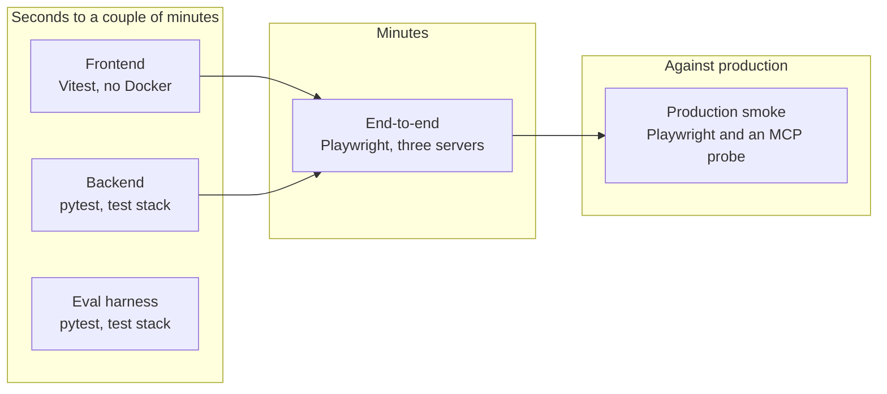

# Testing overview

Illume has four automated suites in two languages: a backend suite (pytest), a frontend suite (Vitest), an end-to-end suite (Playwright against a stack it boots itself), and a production smoke suite (Playwright against the deployed site). Beside them sit the key-free eval harness tests, the local MCP launcher tests and the mobile app's Jest tests. This page says what each suite is for, which one a change belongs in, how to run them, and the rules every suite follows; the backend and browser suites each have a page of their own.

## Terms used on this page

- **Test stack**: the Postgres and Redis pair the backend and end-to-end suites run against, on ports 5433 and 6380 so they never collide with a development stack on 5432 and 6379.
- **Unit test**: one function or class, with everything it depends on faked.
- **Integration test**: the real FastAPI app over a real database and Redis, with only outside services faked.
- **End-to-end test**: a real browser driving the real client and API.
- **Stub**: a fake that answers like the real service. Illume fakes OpenAI-compatible model APIs and GitHub, never its own database.
- **Coverage floor**: a committed minimum coverage percentage that CI refuses to drop below.

## The suites at a glance

| Suite            | Where                                       | Runner     | Needs Docker | Size, this working tree                 |
| ---------------- | ------------------------------------------- | ---------- | ------------ | --------------------------------------- |
| Backend          | `server/tests/` except `tests/evals/`       | pytest     | yes          | about 3,450 tests collected             |
| Eval harness     | `server/tests/evals/`                       | pytest     | yes          | about 830 tests collected               |
| MCP launcher     | `mcp-local/tests/`                          | pytest     | yes          | 14 tests                                |
| Frontend         | `client/tests/`, `client/src/**/__tests__/` | Vitest     | no           | about 840 tests                         |
| End-to-end       | `client/e2e/`                               | Playwright | yes          | 49 tests in 7 specs, plus 2 setup steps |
| Production smoke | `client/e2e-prod/`                          | Playwright | no           | 21 tests in 3 specs, plus setup         |
| Mobile           | `mobile/src/**/*.test.ts(x)`                | Jest       | no           | 62 test files                           |

The backend count comes from `uv run pytest --collect-only -q` (4,284 in total, of which 834 are under `tests/evals/`), the frontend count from `npx vitest list`, and the browser counts from the `test(` calls in each spec. They describe the working tree at the time of writing, which includes uncommitted work; a clean `main` has fewer.



## Which suite a change belongs in

| The change                                                        | Write a                                                          |
| ----------------------------------------------------------------- | ---------------------------------------------------------------- |
| A pure function: a parser, a scorer, a formatter, a validator     | backend or frontend **unit** test                                |
| A route's status codes, response shape, query or per-user scoping | backend **integration** test                                     |
| A Celery task or a pipeline stage                                 | backend integration test under `tasks/`                          |
| An access-control rule, a token, a cookie, hostile input          | backend **security** test                                        |
| A migration                                                       | backend **migration** test                                       |
| A retrieval channel or a preset's recall                          | backend integration test under `services/`, and the recall check |
| How a component renders or reacts to a click                      | frontend **component** test                                      |
| A hook's state machine                                            | frontend hook test under `tests/unit/hooks/`                     |
| Routing, sign-in, cookies across redirects, WebGL                 | **end-to-end** spec                                              |
| Whether production is configured correctly                        | **production smoke** spec                                        |
| An eval metric, the gold-set builder or a run adapter             | eval harness test under `tests/evals/`                           |

Covering one change at more than one layer is normal: a new route usually has an integration test for its behaviour, an entry in the IDOR table, and sometimes a spec for the page that calls it.

## Quick start

```bash
make test-infra        # Postgres on 5433 and Redis on 6380
make test              # backend (not slow) and frontend
make test-e2e          # Playwright, about seven minutes
make eval-ci           # key-free eval harness tests
make lint              # lint and types for both projects
```

[The command reference](../reference/cli.md#makefile) lists every target. The [backend](backend.md#running-the-suite) and [browser](frontend-and-e2e.md#running-the-frontend-suite) pages give the per-file and per-test forms.

### Running the backend suite the way CI does

`server/.env` is loaded by `Settings` in any process that imports `app`. On a developer machine it supplies real values for `AI_API_KEY` and `OPENROUTER_API_KEY`, which CI does not have, and a few tests take a different branch when a server key exists. Blank them to get CI's behaviour:

```bash
cd server
AI_API_KEY= OPENROUTER_API_KEY= uv run pytest -n auto
```

The database and Redis URLs need no such care: `tests/conftest.py` overwrites them before anything under `app` is imported, and refuses to start if they point anywhere but the test ports. See [the environment bootstrap](backend.md#the-environment-bootstrap).

## Rules every suite follows

1. **The database is never mocked.** A mock cannot report a wrong query, a constraint violation, or a model and migration that disagree, and those are the defects this project has actually shipped. Every backend test that touches data runs against real Postgres with `pgvector`.
2. **Model APIs and GitHub are always faked.** No test, in any suite, makes a billed call or reaches GitHub, with one deliberate exception: the production smoke suite's single chat turn.
3. **Fakes read their input.** The OpenAI stub answers a glossary prompt with definitions for the symbols in that prompt, and the embedding fake derives each vector from its text. A fake that returned a fixed answer would let a wiring bug pass.
4. **Order does not matter.** `pytest-randomly` shuffles backend test order on every run and the rollback session hides each test's rows from the next, so a test that depends on another's leftovers fails quickly.
5. **Test code is clean.** The `tests/` trees, `e2e/`, `e2e-prod/`, `evals/` and `vitest.config.ts` pass ruff, mypy and ESLint, and CI blocks on that. Application code does not yet, and CI reports it without blocking. See [the lint split](../operations/ci-cd.md#the-lint-split).
6. **A test names its claim.** `test_cannot_delete_another_users_repository`, not `test_delete_2`, so a red CI line is readable without opening the file.
7. **A negative test cannot pass vacuously.** A test asserting two files land in the same tier also asserts that they have resolved imports at all, so it cannot go green because nothing was parsed.
8. **A flaky test is a bug.** A retry or a sleep hides the cause. The causes found so far have been a race with a component's own teardown and a value another test happened to leave behind.

## Coverage

| Suite    | Floor file               | Floor | What is measured                                                                                                       |
| -------- | ------------------------ | ----- | ---------------------------------------------------------------------------------------------------------------------- |
| Backend  | `server/.coverage-floor` | 80    | statement coverage of `app/`, excluding `alembic/`                                                                     |
| Frontend | `client/.coverage-floor` | 62    | line coverage of `src/**/*.{ts,tsx}`, excluding type declarations, `__tests__/`, and route `loading.tsx` / `error.tsx` |

Both CI test jobs compare the measured number with the floor and fail below it ([the coverage ratchet](../operations/ci-cd.md#the-coverage-ratchet)). The floor only moves up, in the same commit as the tests that earned it. Coverage measures which lines ran, not whether anything was checked, so raising it with tests that assert little is not worth doing.

```bash
make cov                 # both suites with coverage
cd server && uv run pytest --cov=app --cov-report=term-missing -n auto
cd client && npm run test:coverage
```

## Expected failures

A known defect is recorded as a test that asserts the **desired** behaviour, marked `pytest.xfail(strict=True)`. Strict mode turns an unexpected pass into a failure (`XPASS(strict)`), so fixing the bug forces the marker's removal in the same change. **No test carries one today.** Eleven were retired as their defects were fixed, the last being `repo_number`, which the model declared as an identity column but no migration provisioned, so `POST /api/v1/repository` returned 500 on any database built from migrations. Revision `d4e5f6a7b8c9` fixed it.

To record the next one: mark it strict, put a shared marker with the cause in `tests/helpers.py` if several tests share it, and delete the marker with the fix.

## Where the suites run in CI

| Suite            | Workflow and job                        | When                                        | Blocks the deploy        |
| ---------------- | --------------------------------------- | ------------------------------------------- | ------------------------ |
| Backend          | `ci.yml`, `backend-tests`               | every pull request and every push to `main` | yes                      |
| MCP launcher     | `ci.yml`, `backend-tests`, after pytest | same                                        | yes                      |
| Eval harness     | `ci.yml`, `evals`                       | same                                        | yes                      |
| Frontend         | `ci.yml`, `frontend-tests`              | same                                        | yes                      |
| End-to-end       | `ci.yml`, `e2e-nightly`                 | nightly at 03:17 UTC and on push to `main`  | yes, on a push to `main` |
| Production smoke | `prod-smoke.yml`                        | nightly at 04:43 UTC and by hand            | no                       |
| Mobile           | none                                    | by hand, `cd mobile && npm test`            | no                       |

Because the deploy waits for the whole CI workflow to succeed, a red end-to-end run on a push to `main` blocks that deploy too. See [CI and CD](../operations/ci-cd.md).

## Design trade-offs and limits

- **Real Postgres everywhere.** Catches the defects mocks hide, at the cost of Docker for every backend run and a slower suite.
- **Fakes, not recordings.** The OpenAI stub is hand-written and prompt-aware. It never drifts from a recording, but it can drift from the real provider's behaviour, and nothing except the production smoke turn checks the real one.
- **End-to-end is not on the pull-request path.** It runs nightly and on `main`, so a browser-only regression can merge and be caught hours later.
- **Mobile is not in CI.** Its Jest suite runs by hand, and its renderer is verified only on a device.
- **Retrieval quality is not tested here.** The recall check guards the lexical, symbol, graph, co-change and grep channels on a fixture; dense retrieval quality is measured by [the eval harness](../evals/harness.md), not asserted.
- **Counts go stale.** The numbers above are a snapshot; `--collect-only` and `vitest list` are the source of truth.

## Related documentation

- [Backend tests](backend.md): fixtures, factories, the rollback session, fakes and traps.
- [Frontend and end-to-end tests](frontend-and-e2e.md): Vitest projects, MSW, Playwright and the production smoke suite.
- [CI and CD](../operations/ci-cd.md): the workflows that run these suites.
- [The eval harness](../evals/harness.md): what measures answer and retrieval quality.
- [Commands](../reference/cli.md): every make target and script.
